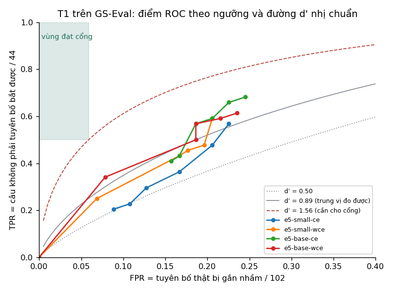
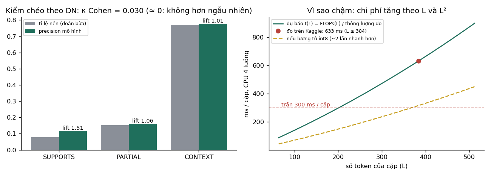

# Vì sao các mô hình không qua cổng: giải thích bằng toán (13/11/2026)

Tệp sinh tự động bởi `tools/bao_cao_mo_hinh/giai_thich_truot.py` từ `metrics.json` của các lượt Kaggle (khối `offline_training_v1` trong `configs/measurement_decisions.yaml`). Nhãn đều là nhãn bạc.

## 1. T1 lọc tuyên bố: trượt cổng S1

**Cổng.** Có một ngưỡng t mà TPR = bắt / 44 ≥ 0,5 và FPR = gắn nhầm / 102 ≤ 6/102 = 0,059.

**Mô hình nhị chuẩn.** Giả sử điểm P(NOT_CLAIM) của tuyên bố thật ~ N(0, 1) và của câu không phải tuyên bố ~ N(d′, 1). Khi đó TPR = Φ(d′ + Φ⁻¹(FPR)). Đặt TPR = 0,5 và FPR = 6/102:

  d′ ≥ Φ⁻¹(0,5) − Φ⁻¹(0,059) = 0 + 1,565 = **1.565**, tương đương AUC = Φ(d′/√2) ≥ **0.866**.

**Đo được.** Trên 22 điểm (4 cấu hình × 6 ngưỡng), d′ trung vị là **0.892** (AUC ≈ 0.736), d′ lớn nhất 1.16 (e5-base-ce, t = 0.6). Với d′ = 0.892, khi đã giữ FPR = 6/102 thì TPR chỉ còn Φ(0.892 − 1,565) = **0.25**, khoảng 11/44, xa mức 22/44 cổng cần. Điểm có d′ lớn nhất bắt 29/44 nhưng gắn nhầm 23/102 (Wilson 95% cho FPR: (0.155, 0.316)).

**Vì sao d′ thấp dù kiểm chéo nội bộ T1 đạt macro-F1 0,72–0,74.** Mô hình tách tốt các lớp *theo định nghĩa T1*, nhưng 102 câu GS-Eval được tính là tuyên bố có nhiều câu mà sổ tay T1 gọi là không phải tuyên bố (dòng bảng, câu cơ chế chung, câu của tổ chức khác). Đây là nhiễu nhãn giữa hai định nghĩa: phần chồng lấn của hai phân phối điểm nằm ở chính định nghĩa, nên không mô hình nào học được chỉ từ T1. Q13 v1.2 mới chuyển 31 câu nên d′ chỉ tăng ít (gắn nhầm ở ngưỡng 0,5 giảm từ 26 xuống 21–25).

**Muốn qua:** cần d′ ≥ 1,57. Muốn vậy phải thống nhất định nghĩa nhãn T1 với GS-Eval. Cách làm: đọc các câu bị gắn nhầm (notebook `gs-off-t1-q13-v2` xuất xác suất từng câu), sửa sổ tay, gán lại, rồi huấn luyện lại. Chọn ngưỡng khác không đủ, vì đường ROC đã nằm dưới vùng đạt.

## 2. mDeBERTa chấm quan hệ: không hơn luật và quá chậm

**Học được gì trên 821 cặp (kiểm chéo theo DN, n = 815).** Với κ Cohen = (p_o − p_e)/(1 − p_e) tính từ ma trận nhầm lẫn, đo được **κ = 0.03**, gần như bằng 0: mô hình không khớp nhãn hơn đoán theo tỉ lệ. Với lift = precision / tỉ lệ nền: SUPPORTS 0.1167 / 0.0773 = **1.51**; PARTIAL 0.1609 / 0.1521 = **1.06**; CONTEXT 0.7784 / 0.7706 = **1.01**. PARTIAL có lift ≈ 1, tức không hơn đoán bừa.

**Vì sao.** (1) Đầu phân loại NLI (entailment / neutral / contradiction) bị khởi tạo lại thành 4 lớp (`ignore_mismatched_sizes`). Như vậy đã bỏ đúng phần tri thức "hỗ trợ" mà bản chưa tinh chỉnh có sẵn: NLI chưa tinh chỉnh đạt 0.3558, cao hơn bản tinh chỉnh 0.3497. (2) Lớp thiểu số rất ít: SUPPORTS 63 cặp, mỗi fold huấn luyện còn khoảng 4/5 số đó, lại trải trên 11 doanh nghiệp. Phần lớn SUPPORTS là đoạn lặp lại tuyên bố (cờ `lap_lai`), nên mô hình học "giống chữ" thay vì "xác nhận". (3) Ranh giới PARTIAL / CONTEXT phụ thuộc kỳ, phạm vi, mục tiêu (R3, R7), tức là so năm và số. Đó là việc của code, không phải của một bộ mã hoá 280 triệu tham số học từ vài trăm ví dụ.

**S5 (391 cặp ngoài).** Mô hình đạt macro-F1(S,O) = 0.5363 [0.4991, 0.5658]; luật tính cùng cách gộp (PARTIAL tính là S) đạt 0.5578 [0.4299, 0.6127]. Cổng đăng ký so với 0,397, là số của luật tính theo cách gộp cũ ở llm_stages_v1. Theo chữ thì CI dưới vượt 0,397, nhưng so cùng cách gộp thì mô hình **không hơn luật**. Ghi nhận: không dùng.

**Tốc độ.** FLOPs(L) ≈ 12 · [2(4d² + 2d·d_ff)·L + 3·4·L²·d], với d = 768, d_ff = 3072. Ở L = 384 ra 81.5 GFLOP mỗi cặp. Đo được 632.6 ms, tức thông lượng hiệu dụng khoảng 128.9 GFLOP/s. Muốn ≤ 300 ms ở cùng thông lượng thì L ≤ **192** token; nếu lượng tử int8 (nhanh khoảng 2 lần) thì L ≤ 352. Laptop i7-1355U (AVX2, 2 nhân P) có thể chậm hơn CPU Kaggle.

**Muốn qua:** giữ đầu NLI và ánh xạ entailment → SUPPORTS/PARTIAL, neutral → CONTEXT, contradiction → CONTRADICTS. Cắt cặp còn khoảng 256 token, lượng tử int8, rồi chấm lại; khi đó nhãn vàng mới đủ để xét cổng.

