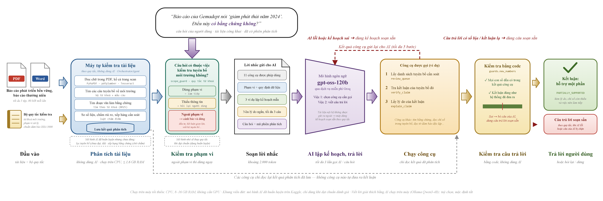

# GreenScan MCP trên máy tối thiểu (8–16 GB RAM, không GPU) và bản đồ hệ thống (13/11/2026)

Quyết định: D-2026-11-13-01 (bộ định tuyến và chốt phạm vi), D-2026-11-13-02 (MCP cho máy tối thiểu), D-2026-11-13-03 (bác bỏ thuê GPU: chỉ còn máy tối thiểu + API miễn phí), xem `docs/00-project/DECISIONS_LOG.md`.

## 1. Bản đồ hệ thống (vẽ lại 13/11: ghi tên mô hình và tên công cụ ở từng công đoạn)



Ảnh sinh từ mã: `C:/Python314/python.exe -X utf8 tools/bao_cao_mo_hinh/ban_do_he_thong.py`, ra SVG rồi PNG; sửa nội dung trong script rồi chạy lại.

**Đọc ảnh:**
- Luồng chạy từ trái sang phải. Tài liệu đi qua **quy trình ra kết luận** (OrchestratorAgent, toàn luật và code) và vào kho phiên `result.json`. Câu hỏi của người dùng đi từ trên xuống **chốt phạm vi** (scope_guard, luật).
- **Màu khối:**
  - **xanh dương:** quy trình ra kết luận;
  - **xanh lá đậm:** chốt phạm vi;
  - **giấy trắng:** prompt;
  - **tím (hình thang):** LLM `gpt-oss-120b` qua Groq, chỉ khi `public = true`;
  - **cam:** công cụ MCP;
  - **vàng:** bộ kiểm `guards.new_numbers`;
  - **xanh lá nhạt / đỏ:** kết quả, hoặc mẫu của luật.
- **Nét đứt:**
  - **đỏ sẫm:** vòng hồi tiếp (kết quả công cụ trả về LLM; lỗi thì lùi về luật);
  - **xám:** công cụ đọc kho phiên;
  - **khung nét đứt dưới khối:** mô hình huấn luyện trên Kaggle, chỉ dùng khi qua cổng.


### Mô hình nằm ở đâu

| Công đoạn | Công cụ MCP / mã | Mô hình hoặc engine | Trên máy tối thiểu |
|---|---|---|---|
| Chọn công cụ | ứng dụng MCP (Claude Desktop…) | LLM của client | ngoài hệ thống |
| ① Chốt phạm vi | `check_scope` · `scope_guard.rules_route` | luật (không mô hình) | **đang dùng** |
| ① (thay luật) | bộ định tuyến | e5-small + Qwen3-0.6B LoRA GGUF | chờ cổng `prompt_router_v1` (đang huấn luyện) |
| ③ Lập kế hoạch | `ask_greenscan` · `agent_harness.llm_plan` | **Groq `openai/gpt-oss-120b`** (API miễn phí) | chỉ khi `public=true`; lỗi → luật |
| ④ Đọc tài liệu | `analyze_documents` | PyMuPDF, pdfplumber, Tesseract OCR | đang dùng |
| ④ Trích tuyên bố | `analyze_documents`, `claim_attributes` | luật taxonomy + regex | đang dùng |
| ④ (lọc tuyên bố) | `claim_model.py` | T1 multilingual-e5-small | **tắt** (trượt cổng S1) |
| ④ Truy xuất | `analyze_documents`, `find_evidence` | BM25 + bộ chấm lite | đang dùng |
| ④ (xếp lại) | — | bge-reranker-v2-m3 tinh chỉnh | chờ cổng (Kaggle đang chạy) |
| ④ Đối chiếu số và lập trường | `analyze_documents` | code so số + bộ từ khoá | đang dùng |
| ④ (lập trường bằng mô hình) | `verification` | LLM stance; mDeBERTa-xnli; Qwen3-4B LoRA | **tắt**; mDeBERTa trượt cổng; Qwen3-4B đang chạy |
| ④ Rủi ro, hàng soát, pháp lý | `analyze_documents`, `review_queue` | luật (scoring_v1, priority_v1) | đang dùng |
| ④ Lời giải thích S6 | `analyze_documents` (cờ) | Ollama Qwen3-4B Q4; học trò 4B/1.7B LoRA GGUF | tuỳ chọn, mặc định tắt; học trò chờ cổng |
| ⑤ Viết câu trả lời | `agent_harness.audited_answer` | **Groq `openai/gpt-oss-120b`** | chỉ khi `public=true` |
| ⑥ Kiểm câu trả lời | `guards.new_numbers` | code | đang dùng |

**Tóm lại:**
- Trên máy tối thiểu, **toàn bộ quy trình ra kết luận chạy bằng luật và code**, không có mô hình nơ-ron. Chỉ OCR Tesseract có mô hình LSTM bên trong.
- **LLM chỉ ở hai chỗ:** (a) lập kế hoạch và viết câu trả lời qua Groq API miễn phí, chỉ cho tài liệu công khai; (b) lời giải thích bằng Ollama Qwen3-4B, tuỳ chọn.
- Các mô hình nhỏ huấn luyện trên Kaggle chỉ được cắm vào chỗ viền đứt khi qua cổng đã đăng ký.

## 2. Cài và chạy

```powershell
cd "D:\Sinh viên CNhan\AI quantum\docs\greenscan-ai\GreenScan-AI"
.venv\Scripts\python.exe -m pip install -e ".[mcp]"          # chỉ thêm gói mcp; không cần torch
.venv\Scripts\python.exe -X utf8 tools\mcp_smoke.py          # tự khởi máy chủ, liệt kê 11 công cụ, gọi thử 3 công cụ
```

- **Claude Desktop:** chép `deploy/mcp/claude_desktop_config.json` vào `%APPDATA%\Claude\claude_desktop_config.json`, sửa đường dẫn nếu khác, rồi khởi động lại.
- **API miễn phí:** `GROQ_API_KEY` trong `.env` (đã có). Mô hình harness đặt bằng `QUANTUM_HARNESS_MODEL`, mặc định `openai/gpt-oss-120b`.
- Gọi `ask_greenscan` với `public=true` thì harness mới dùng API. Mặc định `false`: chạy hoàn toàn bằng luật.

## 3. Giới hạn tài nguyên

| | 8 GB RAM | 16 GB RAM |
|---|---|---|
| Hồ sơ | `offline`: luật, so số, truy xuất từ vựng; không torch, không mô hình cục bộ | như 8 GB; có thể thêm Ollama Qwen3-1.7B / 4B Q4 (khoảng 1,5–2,6 GB) cho lời giải thích ngoại tuyến |
| Bộ nhớ đã đo | phân tích HPG BCPTBV 2025 + BCTN 2024: đỉnh 1,3 GB, 116 s (i7-1355U) | như 8 GB |
| Giới hạn trong mã (`mcp_tools.LIMITS`) | ≤ 5 tệp và ≤ 80 MB mỗi lần phân tích; ≤ 50 dòng mỗi danh sách; ≤ 10 đoạn bằng chứng; ≤ 6.000 ký tự đầu vào; chỉ mục truy xuất giữ ≤ 2 phiên | như 8 GB |
| Harness (`agent_harness.LIMITS`) | ≤ 5 bước, ≤ 3 lời gọi LLM, 60 s mỗi lời gọi, ≤ 900 token ra | như 8 GB |

**Số đo 13/11** (phiên HPG `583ee2e6e6c94501`):

| Công cụ | Thời gian |
|---|---|
| `claim_attributes` | 1,4 s |
| `verify_claim` | 0,2 s |
| `find_evidence` | 25 s lần đầu (dựng chỉ mục), lần sau dùng bộ nhớ đệm |
| `ask_greenscan` có API | 2,0 s (2 lời gọi) |

## 4. Kỹ thuật điều phối và prompt

- **Harness theo kiểu orchestrator.** Bốn vai tách bạch: chốt phạm vi → lập kế hoạch → gọi công cụ → kiểm câu trả lời.
  - Mỗi vai có giới hạn và đường lùi về luật.
  - Kế hoạch là JSON trên danh sách công cụ được phép. Tên hoặc tham số lạ thì bỏ cả kế hoạch.
- **Few-shot:** 4 ví dụ mẫu trong `agent_harness.FEW_SHOT`: kiểm một tuyên bố, hỏi thuộc tính, lọc danh sách rồi giải thích, hỏi khái niệm (tra tri thức nền).
- **Tri thức nền (14/11, D-2026-11-14-02).** Công cụ `domain_lookup` tra `data/domain_kb/` (67 mục: khái niệm, dấu hiệu, cách tính, claim chuẩn, 4 vụ việc, 11 văn bản pháp lý), chạy ngoại tuyến.
  - Kết quả mang nhãn `tri_thuc_nen`, không bao giờ là bằng chứng.
  - Mã kết luận chỉ được lấy từ công cụ sản phẩm: câu LLM nêu một kết luận mà chỉ kho tri thức có thì bị bỏ.
  - Chi tiết: `data/domain_kb/README.md`.
- **Suy luận từng bước (CoT) có giới hạn.** Bộ lập kế hoạch ghi tối đa 3 câu trong trường `suy_luan`; trường này hiện trong vết để người soát đọc. Bộ trả lời được dặn "nghĩ từng bước trong đầu, chỉ in câu trả lời". Câu trả lời đi qua bộ kiểm số và kết luận.
- **Chống chèn lệnh.** Dữ liệu trong tài liệu và yêu cầu luôn được đánh dấu là dữ liệu. Câu trong ngoặc kép là dữ liệu: chỉ xét dấu hiệu ngoài phạm vi ở phần ngoài ngoặc, riêng chèn lệnh thì xét cả câu.

## 5. Phạm vi (`configs/prompt_router/scope_v1.yaml`)

- **Trong phạm vi (8 việc, scope-v1.1):** kiểm tra tuyên bố, liệt kê tuyên bố, thuộc tính còn thiếu, giải thích kết luận, tìm bằng chứng, đọc tờ đảm bảo, đánh giá rủi ro cả bộ hồ sơ, giải thích khái niệm / cách tính (`explain_concept`, thêm 14/11).
- **Ngoài phạm vi (9 loại):** tư vấn đầu tư, kết luận gian lận hoặc vi phạm, viết hay làm đẹp tuyên bố, nội dung không thuộc môi trường, dữ liệu cá nhân, chèn lệnh, lập trình, trò chuyện hoặc sáng tác, lĩnh vực khác.

Mô hình nhỏ thay luật ở bước chốt phạm vi chỉ khi qua cổng `prompt_router_v1`: CI dưới của tỉ lệ bắt được yêu cầu ngoài phạm vi ≥ 0,95 trên bộ test.

## 6. Kiểm

- `tests/test_scope_guard_mcp.py`: 13 bài, gồm chốt phạm vi 8 ca, công cụ dùng luật của sản phẩm, harness không gọi gì khi ngoài phạm vi, kế hoạch lạ và số bịa bị chặn, tài liệu không công khai không gọi API, máy chủ có đủ 11 công cụ (thêm review_queue sau lượt thử tài liệu ngoài).
- `tests/test_domain_kb.py`: kho đầy đủ trường, hàm được trỏ tới có thật, ví dụ số tính lại đúng; tra cứu đúng mục; câu hỏi khái niệm đi vào `explain_concept`; harness trả lời ngoại tuyến từ kho; mã kết luận lấy từ kho bị chặn; máy chủ có `domain_lookup` (12 công cụ).
- `tests/test_architecture_invariants.py::test_background_knowledge_is_never_evidence`: chỉ `mcp_tools.py` được đọc kho; một lượt chạy quy trình không mang dấu vết của kho.
- `tools/mcp_smoke.py`: kiểm qua stdio như một client thật.
