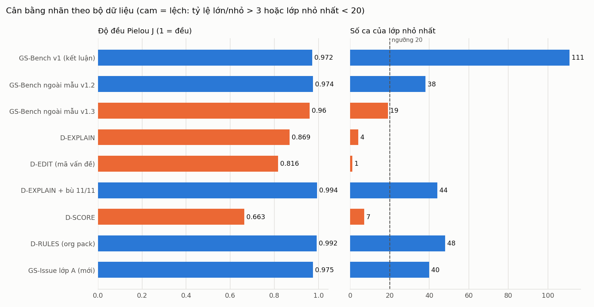
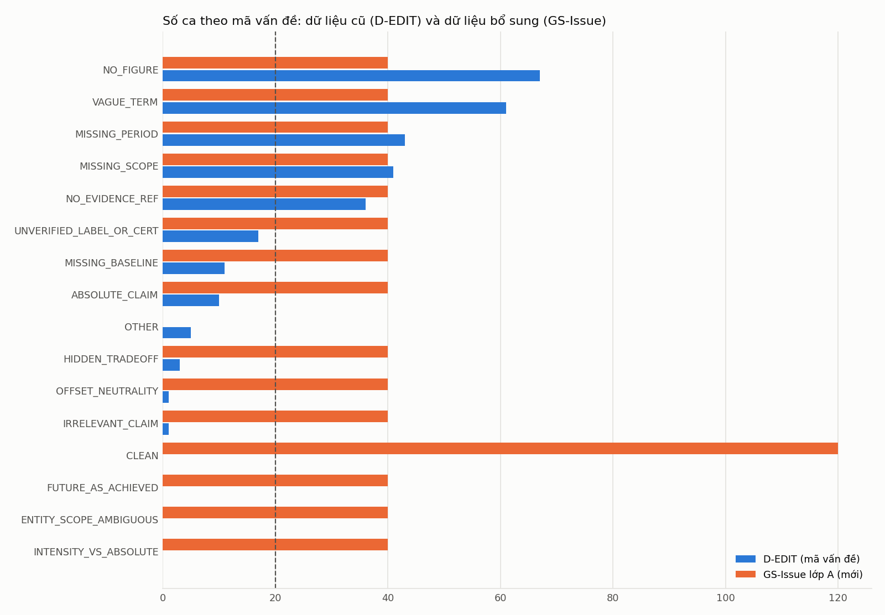

# Thẻ dữ liệu GreenScan (11/11/2026)

Tài liệu dành cho đội, cho BGK khi hỏi về dữ liệu, và làm phụ lục báo cáo. Số trong tài liệu được sinh lại bằng `python -X utf8 benchmark/data_card.py` (tạo `benchmark/data_card/stats.json` và các tệp `fig_*.png`).
Cách thêm ca: [HUONG_DAN_TAO_THEM_CASE.md](HUONG_DAN_TAO_THEM_CASE.md). Độ đo: [DO_DO_DANH_GIA_2026-11-11.md](DO_DO_DANH_GIA_2026-11-11.md).

## 1. Các bộ dữ liệu và độ cân bằng

Ngưỡng "lệch": tỷ lệ giữa lớp lớn nhất và lớp nhỏ nhất (IR) vượt 3, hoặc lớp nhỏ nhất dưới 20 ca. Cột "J" là độ đều Pielou (1 là đều tuyệt đối).

| Bộ | Dùng để đo | n | Phân bố nhãn | IR | Lớp nhỏ nhất | Nhãn | Tình trạng |
|---|---|---|---|---|---|---|---|
| GS-Bench v1 | kết luận khớp / mâu thuẫn / chưa đủ | 453 | N 200, C 138, S 111 | 1,8 | 111 | đáp án dựng + Claude | cân bằng; BVH chiếm 26 % |
| GS-Bench ngoài mẫu v1.2 | như trên, doanh nghiệp mới | 162 | N 69, C 55, S 38 | 1,8 | 38 | Claude + 32B | cân bằng; đây là tập ngoài mẫu chính |
| GS-Bench ngoài mẫu v1.3 | bản đã làm sạch của v1.2 | 87 | N 40, C 28, S 19 | 2,1 | **19** | như trên | lệch nhẹ (S < 20): báo số trên v1.2, v1.3 chỉ làm phụ |
| D-EXPLAIN | lời giải thích | 200 | không phải tuyên bố 67, khớp một phần 60, chưa đủ 44, khớp 25, **mâu thuẫn 4** | 16,8 | 4 | Claude, chờ người duyệt | **lệch, đã bù** |
| D-EXPLAIN + bù 11/11 | như trên | 285 | khớp 60, mâu thuẫn 54, … | 1,5 | 44 | + nhãn GS-Bench | cân bằng |
| D-EDIT | mã vấn đề và gợi ý sửa | 200 | 12 mã; 5 mã ≤ 11 ca; **3 mã có 0 ca** | 67 | 1 | Claude, chờ người duyệt | **lệch nặng, đã bù bằng GS-Issue** |
| GS-Issue lớp A (mới) | tìm lỗ hổng + đề xuất sửa | 740 | 14 mã × 40, 120 câu sạch, 60 ca hai lỗi | 3,0 | 40 | **đáp án có sẵn** (đột biến) | cân bằng |
| GS-Issue lớp B (mới) | như trên, câu thật | 1 437 câu đã đọc | xem `layer_b_silver.jsonl` và `layer_b_balanced.jsonl` | | | nhãn bạc (14B và 32B cùng gán) | chờ kết quả Kaggle 11/11 |
| D-SCORE | chấm rủi ro | 200 | thấp 138, trung bình 55, **cao 7** | 19,7 | 7 | hai lượt Claude + phân xử 122 | **lệch, đã bù bằng 80 cặp song sinh** |
| D-RULES | quy tắc nội bộ (org pack) | 237 | vi phạm 72, tuân thủ 60, cần soát 57, không áp dụng 48 | 1,5 | 48 | ca dựng | cân bằng |
| Kho câu thật pool A | nguồn câu thật | 1 589 | — | — | — | — | HPG chiếm 40 %: lớp B đặt trần mỗi doanh nghiệp |

## 2. Dữ liệu bổ sung ngày 11/11

| Tệp | Nội dung | Sinh bằng |
|---|---|---|
| `benchmark/gs_issue/data/layer_a.jsonl` | 740 ca đột biến. Mỗi ca có mã đúng, cụm bị cấy, bản sửa mẫu và cách chấm bản sửa. Doanh nghiệp hư cấu, 10 ngành, 6 chỉ số, 3 mẫu câu | `gen_cases.py` (seed 20261111) |
| `benchmark/gs_issue/data/layer_b_all.jsonl` | 1 437 câu thật của pool A, không gồm câu đã có trong D-EDIT | `build_real_pool.py` |
| `benchmark/gs_issue/data/layer_b_silver.jsonl`, `layer_b_balanced.jsonl` | nhãn bạc, rồi tập cân bằng: tối đa 40 ca mỗi mã, 80 câu sạch, mỗi doanh nghiệp tối đa 35 % | `score_issue.py`, `select_real.py` |
| `benchmark/gs_issue/data/d_edit.jsonl` | 200 câu D-EDIT ở dạng đầu vào chung | — |
| `benchmark/gs_issue/data/supp_explain.jsonl` | 50 ca "mâu thuẫn" + 35 ca "khớp" từ GS-Bench v1, tối đa 12 ca mỗi doanh nghiệp, có số then chốt | `build_supplements.py` |
| `benchmark/gs_issue/data/supp_score_pairs.jsonl` | 80 cặp câu sạch / câu có lỗi (8 mã × 10) | `build_supplements.py` |

## 3. Nguồn gốc, quyền và riêng tư

- Câu thật lấy từ báo cáo phát triển bền vững và báo cáo thường niên đã công bố của doanh nghiệp niêm yết (HPG, PAN, CTD, SAB, DHG, TRA, PNJ, …) và từ hồ sơ vụ việc công khai (KLM, BNY, DWS, KDP). Không có dữ liệu cá nhân.
- Lớp A và phần bù song sinh dùng tên doanh nghiệp, nhà máy, đơn vị bảo đảm và tổ chức chứng nhận **hư cấu**. Không câu nào gán thành tích hay lỗi cho một doanh nghiệp có thật.
- Nhãn Claude được coi như nhãn thường, phải ghi rõ khi dùng và phải được người duyệt (`review_status`). Hiện tại **chưa nhãn nào là nhãn người**: cả 200 câu D-EXPLAIN và 200 câu D-EDIT đều ở trạng thái `pending_human_review`.

## 4. Hạn chế đã biết

1. **Nhãn chưa qua người.** Số trên D-EXPLAIN, D-EDIT, D-SCORE và lớp B là nhãn máy. Chỉ lớp A có đáp án chắc chắn, vì lỗi do chính ta cấy vào.
2. **Lớp A là ca kiểm soát.** Câu theo mẫu nên dễ hơn câu thật. Điểm cao trên lớp A là điều kiện cần, chưa phải bằng chứng trên báo cáo thật.
3. **Lớp B dùng nhãn bạc từ Qwen3-14B và Qwen3-32B**, nên không chấm hai mô hình này trên lớp B. Mô hình nhỏ cùng họ (4B, 8B) có thể được lợi vì cùng thiên lệch với người gán nhãn.
4. **Kho câu thật lệch về HPG** (40 %). Lớp B đặt trần theo doanh nghiệp, và mọi khoảng tin cậy bootstrap đều theo doanh nghiệp.
5. **Bộ trích bỏ sót câu đứng một mình.** Khi chạy phần bù, hệ thống không trích được tuyên bố nào ở 22/80 câu sạch song sinh và 50/85 câu GS-Bench. Lỗi tập trung ở các chỉ số "nhiên liệu hóa thạch" (9/13 câu bị bỏ) và "lượng nước tiêu thụ" (9/14). Mã HEAD cũng cho kết quả y hệt, nên đây không phải lỗi mới. Vì vậy các số "cặp song sinh" và "giải thích C/S" chỉ tính trên câu đã được trích, và phần bị bỏ được báo riêng.
6. **Nhãn chồng nhau.** Hướng dẫn gán nhãn cho phép MISSING_SCOPE và ENTITY_SCOPE_AMBIGUOUS chồng nhau, NO_FIGURE và VAGUE_TERM cũng vậy, nên số luôn được báo theo cả mã chặt lẫn họ.
