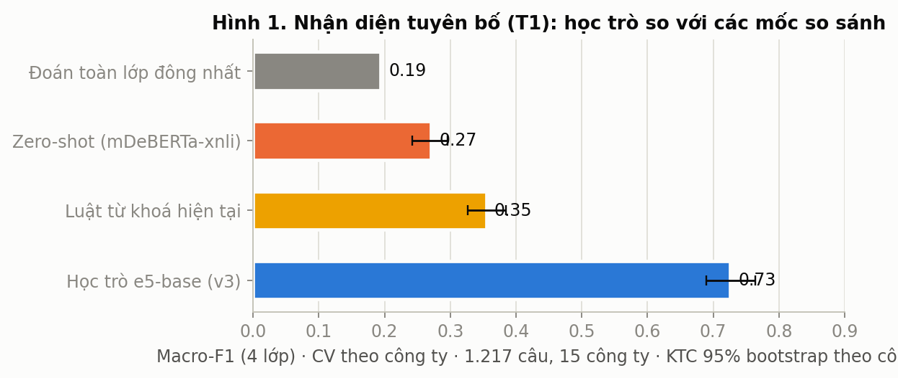
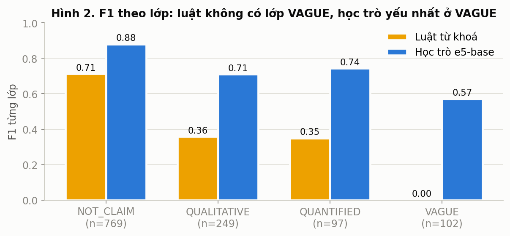
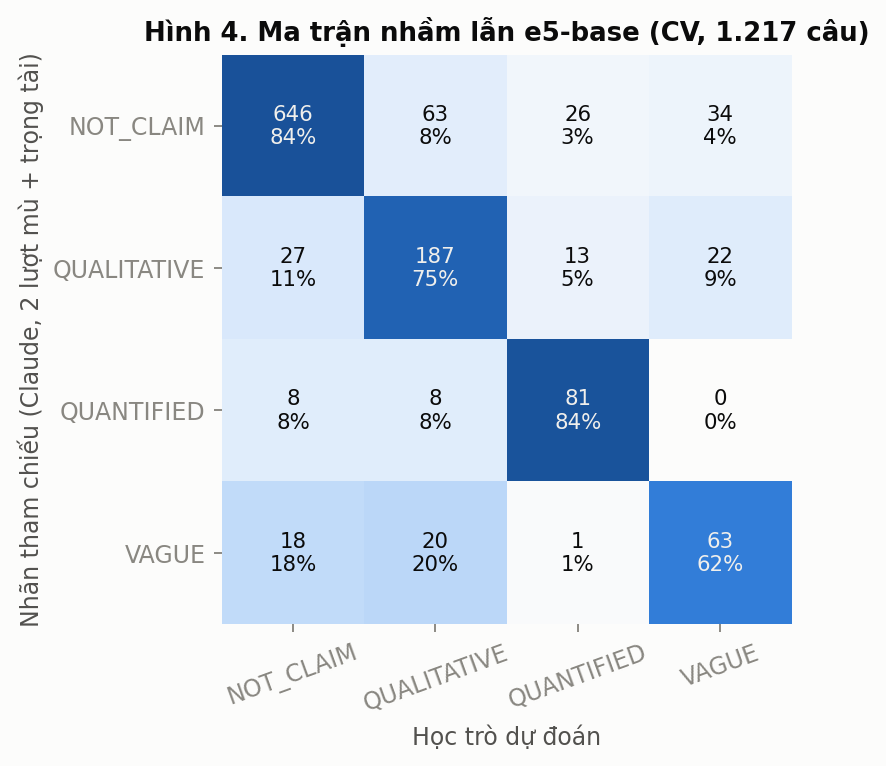
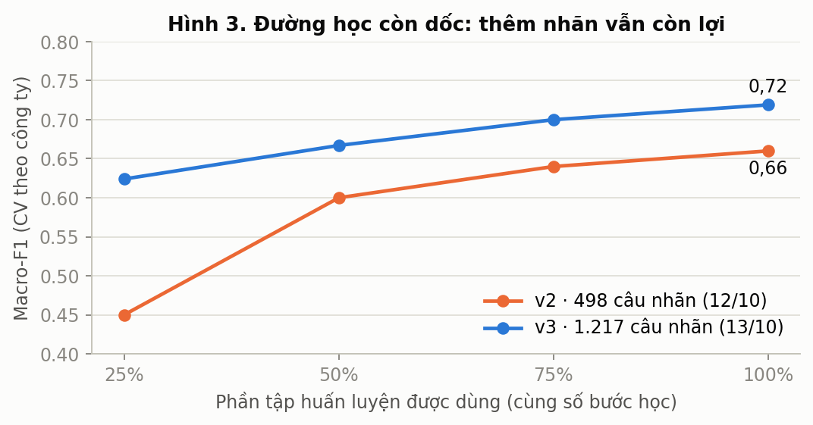
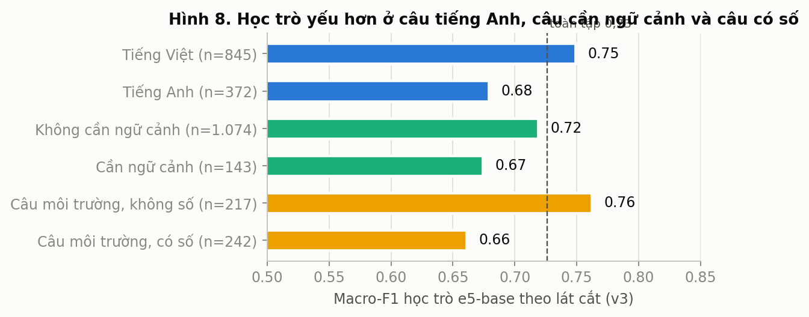
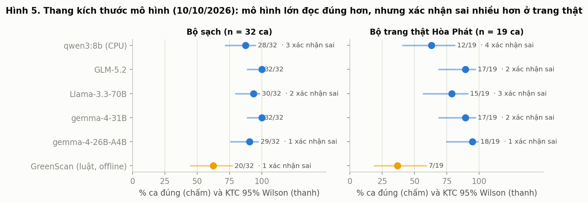
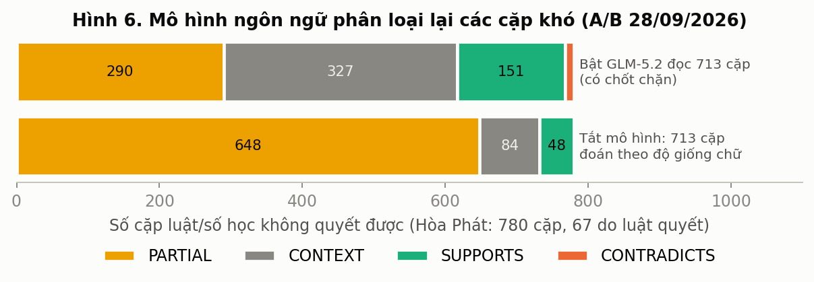
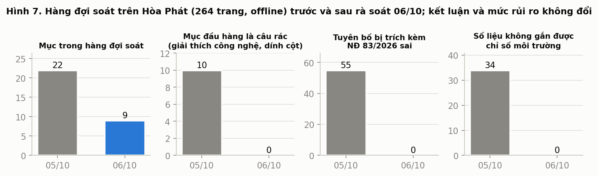
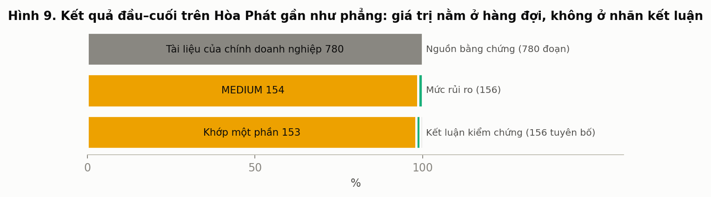

# GreenScan AI: kiểm chứng tuyên bố môi trường trong công bố của doanh nghiệp Việt Nam theo hướng bằng chứng trước

**Bản thảo 15/10/2026 · phục vụ Bán kết 25/10 và Chung kết 10/11/2026 (Cuộc thi Trí tuệ nhân tạo và Lượng tử trong Kinh tế – Tài chính – Kế toán lần thứ I, mã AQ2026-119)**

Nhóm tác giả: nhóm GreenScan (Nhân, Quỳnh, Thảo). Mã nguồn và dữ liệu đo: kho `GreenScan-AI`, commit `ea89809` và các thay đổi chưa commit tới 14/10/2026. Mọi con số trong bài đều có file nguồn trong `benchmark/` hoặc `training/runs/`; hình vẽ dựng lại bằng `docs/07-presentation/paper/figures/` từ chính các file đó.

---

## Tóm tắt

Doanh nghiệp niêm yết Việt Nam ngày càng công bố nhiều tuyên bố môi trường, nhưng hơn một nửa quan sát về phát thải khí nhà kính (KNK) theo Thông tư 96/2020 là trống, chỉ 2/22 báo cáo bền vững độc lập năm 2024 có đảm bảo bên thứ ba, và pháp luật chưa có khái niệm "tẩy xanh". Chúng tôi xây dựng GreenScan, một hệ thống hỗ trợ kiểm toán viên và người soát xét đọc báo cáo doanh nghiệp theo nguyên tắc **bằng chứng trước, mô hình sau, người quyết**. Hệ thống tách bài toán thành mười bước có vết: đọc tài liệu giữ nguồn trang, nhận diện tuyên bố, trích số liệu và thuộc tính, truy xuất bằng chứng lai, kiểm chứng bằng số học và luật tất định, đối chiếu pháp lý theo văn bản đang hiệu lực, chấm rủi ro, xếp hàng đợi soát, cổng chất lượng, và xuất giấy làm việc. Mô hình ngôn ngữ lớn chỉ đọc các cặp tuyên bố–bằng chứng mà luật không quyết được và không bao giờ một mình tạo ra kết luận "mâu thuẫn".

Về thực nghiệm, bài trình bày bốn nhóm kết quả đã đo: (1) học trò phân loại tuyên bố `multilingual-e5-base` huấn luyện trên Kaggle với 1.217 câu nhãn tham chiếu đạt macro-F1 0,73 [0,69; 0,76] theo kiểm định chéo theo công ty, so với 0,36 của luật từ khoá và 0,27 của zero-shot; (2) thang kích thước mô hình trên 51 ca có đáp án cho thấy mô hình lớn đọc đúng hơn luật nhưng xác nhận sai nhiều hơn trên trang thật; (3) bật mô hình đọc 713 cặp khó của Hòa Phát làm lộ 327 cặp chỉ là bối cảnh, nhưng nếu để mô hình tự quyết thì sinh 10 mâu thuẫn sai, nên chốt chặn là bắt buộc; (4) rà soát hàng đợi loại sạch câu rác và trích dẫn pháp lý sai mà không đổi kết luận. Bài cũng nói rõ ba điều chưa có: chưa có con số nào đo trên nhãn người, kết quả đầu–cuối trên Hòa Phát gần như phẳng, và bộ quy tắc pháp lý chưa áp dụng được quy tắc nào. Phần cuối là chương trình thí nghiệm A–H với ngưỡng đăng ký trước, kế hoạch dữ liệu v3 và hướng dẫn tái lập.

---

## 1. Giới thiệu

### 1.1 Vấn đề

Tài chính xanh ở Việt Nam tăng nhanh: tín dụng xanh khoảng 750 nghìn tỷ đồng (30/11/2025), chiếm ~5% dư nợ. Khi dòng vốn "xanh" tăng, rủi ro doanh nghiệp dùng ngôn ngữ bền vững để tạo hình ảnh tốt hơn thực chất cũng tăng. Các cơ quan giám sát châu Âu (ESMA/EBA/EIOPA, 2024) định nghĩa tẩy xanh là khi tuyên bố, hành động hoặc truyền thông về bền vững "không phản ánh rõ ràng và công bằng hồ sơ bền vững thực chất" của tổ chức hay sản phẩm tài chính, cố ý hoặc vô ý.

Thực trạng công bố tại Việt Nam có ba đặc điểm quyết định cách thiết kế hệ thống:

| Phát hiện | Số liệu | Nguồn |
| --- | --- | --- |
| Tỷ lệ công ty HOSE có báo cáo phát triển bền vững | 1,06% (2015) → 28,38% (2024) | Hąbek & Bui 2025, 673 công ty |
| Báo cáo định tính (không số) | 72,5% (2024) | như trên |
| Báo cáo độc lập có đảm bảo bên thứ ba | 2/22 (2024) | như trên |
| Quan sát công bố KNK theo TT 96 đạt 0% | 50,6%; chỉ 21,3% đầy đủ | Lâm Thị Trúc Linh và cs. 2025, 399 quan sát |
| Tuân thủ công bố môi trường bắt buộc | 40,75%, thấp nhất trong các mục | Phạm Đức Hiếu và cs. 2019, 160 công ty |

Hệ quả: kết quả phổ biến nhất khi kiểm chứng một báo cáo thật sẽ là **"chưa đủ bằng chứng"**, không phải "mâu thuẫn". Một hệ thống trả về 156 dòng cùng một nhãn là vô dụng. Giá trị thực nằm ở việc chỉ ra **tuyên bố nào nên mở trước, vì sao, và thiếu gì**.

### 1.2 Vì sao không hỏi "AI có phát hiện tẩy xanh không"

Seele & Gatti (2017) chỉ ra tẩy xanh là một **cáo buộc bên ngoài**, không phải thuộc tính tự thân của văn bản. Khảo sát mới nhất về phát hiện tẩy xanh bằng NLP (Calamai và cs., 2025; v2 01/2026) kết luận rằng chưa tồn tại bộ dữ liệu tẩy xanh đã được xác minh, các tác vụ con có tính chủ quan hay cần suy luận vẫn khó, và khuyến nghị kiến trúc phân rã có người giám sát, dùng nguồn bên thứ ba (hồ sơ cơ quan quản lý) để giảm chủ quan. GreenScan chọn đúng kiến trúc đó. Câu hỏi trục của hệ thống là:

> Với tuyên bố này, hệ thống đã tìm bằng chứng nào, chúng có so sánh được không, phép tính nào đã chạy, quy tắc pháp lý nào thực sự áp dụng, và phần nào vẫn chưa biết.

### 1.3 Đóng góp

1. Một pipeline mười bước, mỗi bước có vết, đã chạy trên báo cáo thật 264 trang trong ~2 phút trên laptop không GPU, không gửi dữ liệu ra ngoài ở chế độ `offline` (kiểm 09/10: 0 kết nối).
2. Mười bất biến kiến trúc được thi hành bằng test (14 test trong CI), trong đó quan trọng nhất là: số học do code, mô hình không ghi đè; `INSUFFICIENT_EVIDENCE` là kết quả hợp lệ; truy xuất và kiểm chứng được đo tách nhau.
3. Quy trình đo đăng ký trước ngưỡng (29/09/2026) với bootstrap theo công ty, báo kết quả âm.
4. Bộ học trò nhận diện tuyên bố tiếng Việt–Anh nhỏ (278 triệu tham số, 119 ms/câu trên CPU) kèm toàn bộ chuỗi tái lập trên Kaggle.
5. Kho tri thức pháp lý Việt Nam với 12 văn bản đã đối chiếu bản ký, chuỗi sửa đổi theo vấn đề.

---

## 2. Nghiên cứu liên quan

### 2.1 Phát hiện tuyên bố môi trường và tẩy xanh bằng NLP

Nhóm Leippold (Zurich) đặt nền cho hướng này: ClimateBERT (Webersinke và cs., 2022, arXiv:2110.12010) tiền huấn luyện trên văn bản khí hậu; Bingler và cs. (2022) dùng nó để đo "nói suông" và chọn lọc thông tin trong công bố khí hậu; **Environmental Claim Detection** (Stammbach và cs., ACL 2023) định nghĩa tác vụ phân loại câu có phải tuyên bố môi trường hay không với bộ nhãn chuyên gia, báo SVM n-gram F1 ~69–71 so với transformer ~84–85, khoảng cách recall tới 25 điểm vì "không phải tuyên bố nào cũng chứa từ khoá". ClimateBERT-NetZero (Schimanski và cs., EMNLP 2023) nhận diện mục tiêu net-zero và giảm phát thải. ClimRetrieve (Schimanski và cs., EMNLP 2024) là bộ chuẩn truy xuất trên báo cáo khí hậu doanh nghiệp. A3CG (Ong và cs., ACL 2025) phân tích cặp khía cạnh–hành động để bền với tẩy xanh khi doanh nghiệp đổi trọng tâm báo cáo; Braun và cs. (2026, arXiv:2601.21722) nối tiếp bằng học tương phản. Climate-ModernBERT (Yu và cs., 09/2026, arXiv:2609.07798) đạt 76,3 F1 trung bình trên 9 benchmark khí hậu. EmeraldMind (Kaoukis và cs., 2026) dùng đồ thị tri thức; DeepGreen (Xu và cs., 2026) là hệ thống giám sát dựa LLM trên dữ liệu Trung Quốc.

Điều GreenScan rút ra: bộ trích tuyên bố bằng từ khoá **chắc chắn bỏ sót**, nên cần một học trò nơ-ron (mục 6.1), và cần đo recall trên các câu không được trích.

### 2.2 Kiểm chứng tuyên bố và lớp "không đủ bằng chứng"

FEVER (Thorne và cs., 2018), SciFact (Wadden và cs., 2020), AVeriTeC (Schlichtkrull và cs., NeurIPS 2023) và Climate-FEVER (Diggelmann và cs., 2020; 1.535 tuyên bố, 7.675 cặp) đều có lớp *không đủ thông tin*; AVeriTeC còn có lớp *bằng chứng xung đột / chọn lọc*. Joren và cs. (ICLR 2025) cho thấy LLM lớn thường trả lời thay vì từ chối khi ngữ cảnh không đủ. GreenScan vì vậy để **luật** quyết `INSUFFICIENT_EVIDENCE`, và có lớp `PARTIALLY_SUPPORTED` với quy tắc gộp tất định.

### 2.3 Số học trong văn bản tài chính

LLM giảm tới 62% độ chính xác khi số bị nhiễu (NumPert, Aarnes & Setty 2025); mô hình tiên tiến chỉ ~74% trên cặp khác đúng một con số (Aarnes & Setty, 30/09/2026); FinQA (Chen và cs., 2021) với suy luận ≥ 3 bước chỉ 22,78%; FinDVer (Zhao và cs., EMNLP 2024) trên báo cáo tài chính: LLM tốt nhất 77,2% so với chuyên gia 93,3%. Đây là lý do bất biến "số học do code": dung sai làm tròn, cộng lại bảng, so cùng chỉ số–kỳ–phạm vi–ranh giới đều là phép tính tất định.

### 2.4 Thiết kế RAG và đo lường

Zhao và cs. (ACM TOSEM 2026; arXiv:2411.19463, v3 đổi tên) cho thấy tài liệu gây nhiễu làm hỏng RAG, recall cao không bảo đảm sinh đúng, và thiết kế phải theo từng tác vụ. Barnett và cs. (2024) liệt kê bảy điểm hỏng của RAG. GreenScan tách chỉ số truy xuất (Recall@k, MRR, nDCG) khỏi chỉ số kiểm chứng (accuracy, macro-F1, mâu thuẫn sai, abstain), giữ top-k cấu hình được và bắt đầu từ baseline tất định. Về pooling bias: nếu ứng viên cho người gán chỉ đến từ BM25, mô hình dense bị đánh giá thấp có hệ thống (BEIR: 31,8% tài liệu chưa gán trong top-10 dense so với 6,4% của BM25), nên quy trình gold gộp ứng viên từ mọi bộ truy xuất.

### 2.5 Người và máy

Bansal và cs. (CHI 2021): lời giải thích của AI có thể làm người tin cả khi AI sai. Warren và cs. (CHI 2025): kiểm chứng viên chuyên nghiệp đòi giải thích dựa trên bằng chứng. Wang và cs. (ACL 2024) và Zheng và cs. (2023): LLM-as-judge thiên lệch vị trí và tự ưu tiên; To và cs. (2024): dữ liệu kiểm chứng tiếng Việt do LLM sinh kém dữ liệu người viết. Vì vậy GreenScan hiện bằng chứng gốc (ảnh trang có tô sáng), người chốt, và **không dùng LLM tự chấm gold**.

### 2.6 Tài nguyên tiếng Việt

VN-MTEB (Findings of EACL 2026, dữ liệu dịch máy): `multilingual-e5-large-instruct` (560M, MIT) cao nhất nhóm ≤ 600M; `multilingual-e5-small` (118M) hợp CPU 8 GB; `AITeamVN/Vietnamese_Embedding` (đang dùng qua FPT) thấp hơn bge-m3 trên ClimateFEVER-VN (13,25 so với 21,27) nhưng model card báo điều ngược lại trên văn bản luật. mDeBERTa-v3-base-xnli (He và cs., DeBERTaV3; Laurer) đạt XNLI-vi 0,793. ViFactCheck (7.232 cặp, MIT) là bộ kiểm chứng tiếng Việt thoáng nhất. Bẫy giấy phép: environmental_claims, AVeriTeC, XNLI, ViANLI phi thương mại; phobert-base-v2 AGPL-3.0. Multilingual E5 (Wang và cs., 2024, arXiv:2402.05672) là họ embedding được chọn làm học trò vì giấy phép MIT và có ba cỡ.

### 2.7 Khung pháp lý

EU Directive 2024/825 (Empowering Consumers) áp dụng từ 27/09/2026, cấm tuyên bố môi trường chung chung không chứng minh được và tuyên bố trung hoà dựa trên bù trừ; Green Claims Directive vẫn chưa được thông qua tính đến 07/2026. Báo cáo bền vững gửi nhà đầu tư thường nằm ngoài phạm vi 2024/825. UK CMA Green Claims Code, US FTC Green Guides, ASIC INFO 271 cung cấp bộ câu tự kiểm. Việt Nam: Luật BVMT 72/2020 (sửa bởi 146/2025), NĐ 06/2022 (sửa bởi 119/2025, 83/2026), QĐ 13/2024 và QĐ 21/2025 về danh mục cơ sở kiểm kê KNK (QĐ 42/2026 mở rộng lên 2.441 cơ sở, hiệu lực 25/09/2026, chưa vào registry), TT 96/2020/TT-BTC về công bố thông tin trên thị trường chứng khoán (dự thảo thay thế lấy ý kiến tới 07/10/2026), TT 17/2022/TT-NHNN về quản lý rủi ro môi trường trong cấp tín dụng. **Không văn bản nào định nghĩa tẩy xanh**; gánh nặng chứng minh hiện đặt lên người tiêu dùng.

---

## 3. Định nghĩa bài toán

**Đầu vào.** Tài liệu công bố của một doanh nghiệp (báo cáo thường niên, báo cáo phát triển bền vững, bản cáo bạch; PDF chữ hoặc scan, DOCX, HTML, URL từ 14/10) với vai trò `claim_source`, và tài liệu đối chiếu (`evidence`) gồm tài liệu khác của chính doanh nghiệp, văn bản pháp lý, nguồn độc lập.

**Đầu ra.** Với mỗi tuyên bố môi trường: 5 thuộc tính (chỉ số, giá trị–đơn vị, kỳ, phạm vi/ranh giới, năm gốc), danh sách bằng chứng có trang–khối, kết luận một trong năm nhãn `SUPPORTED · PARTIALLY_SUPPORTED · UNSUPPORTED · CONTRADICTED · INSUFFICIENT_EVIDENCE`, kết quả pháp lý (văn bản đang hiệu lực, quy tắc áp dụng), điểm rủi ro 0–100 có phân rã, và vị trí trong hàng đợi soát kèm lý do tiếng Việt. Ở cấp lượt chạy: trạng thái `BLOCKED / PENDING_HUMAN_REVIEW / RELEASABLE` và giấy làm việc.

**Ba lớp định nghĩa** (tài liệu `PROBLEM_DEFINITION.md`): tẩy xanh chung; tẩy xanh tài chính; và **rủi ro tẩy xanh** cho hệ thống AI, tức mức không nhất quán giữa tuyên bố, bằng chứng định lượng (phát thải, năng lượng, nước, chất thải, CAPEX/doanh thu xanh), bằng chứng pháp lý và nguồn ngoài. Hệ thống ước lượng rủi ro; không kết luận pháp lý, không thay kiểm toán viên.

**Phân loại tuyên bố (T1).** Bốn lớp: `NOT_CLAIM`, `QUALITATIVE_CLAIM` (cam kết, mô tả không số), `QUANTIFIED_CLAIM` (có giá trị–đơn vị), `VAGUE` (ngôn ngữ xanh mơ hồ, không kiểm được). Quy ước gán nhãn trong `data/gold/LABELING_CONVENTIONS.md` và sổ quy ước Q1–Q17.

---

## 4. Nguyên lý hoạt động

### 4.1 Kiến trúc tổng thể

Một bộ điều phối với các mô-đun chuyên biệt; không đa tác tử tự trị cho tới khi benchmark có đối chứng cho thấy lợi ích. Sơ đồ: `docs/07-presentation/diagrams/pipeline_16x9_vi.png`.

| # | Bước | Làm gì | Đầu ra |
| --- | --- | --- | --- |
| 1 | `validate_inputs` | Kiểm danh sách tài liệu, tạo `run_id`, ghi `manifest.json` | `RunManifest` |
| 2 | `parse_and_ocr_documents` | PyMuPDF đọc theo khối; trang < 40 ký tự → Tesseract tại máy; pdfplumber giữ bảng nguyên khối; cắt đoạn ≤ 3 câu / ~600 ký tự; hồ sơ độ phủ kho | `EvidenceChunk[]`, `CorpusProfile` |
| 3 | `extract_green_claims` | Bộ trích bằng luật (từ điển `configs/taxonomy.yaml`, loại tiêu đề/mục lục/dòng bảng/câu cụt có ghi lý do), gán 5 thuộc tính bằng regex; học trò e5 sẽ thay/lọc bước này | `Claim[]` |
| 4 | `build_hybrid_retrieval_index` | Dựng bộ truy xuất, kiểm chứng, pháp lý, chấm điểm | — |
| 5 | `retrieve_evidence_per_claim` | Điểm = 0,55·BM25 + 0,45·n-gram ký tự 3–5 (hoặc embedding khi bật); RRF chỉ đổi thứ tự; 30 ứng viên → giữ 5, luôn giữ 3 tốt nhất có cờ; gắn cờ dấu hiệu tiêm lệnh | `RetrievedEvidence[]` |
| 6 | `verify_claim_evidence_pairs` | Chỉ khi bật mô hình: hỏi một lượt mọi cặp luật không quyết được (batch, cache) | sự kiện `llm_stance_prefetch` |
| 7 | `check_applicable_law` | Kiểm chứng (số học → cụm từ → chiều thay đổi → độ giống; mô hình chỉ cho cặp khó) · pháp lý (văn bản hiệu lực theo ngày, chuỗi sửa đổi theo vấn đề) · chấm rủi ro | `VerificationResult`, kết quả pháp lý, `RiskAssessment` |
| 8 | `score_greenwashing_risk` | Đọc số liệu công bố, cộng lại bảng, đối chiếu chéo tài liệu, nhận diện chủ thể, xếp hàng đợi | `priorities`, `figure_checks` |
| 9 | `apply_quality_gates` | 8 cổng G0–G7 | `release_status` |
| 10 | `write_evidence_pack` | `result.json`, `evidence_pack.md`, 3 tầng dữ liệu `contract/` | — |

### 4.2 Quy tắc kết luận (verifier)

- Mâu thuẫn do luật hoặc số học → `CONTRADICTED`. Mâu thuẫn do mô hình → chỉ `PARTIALLY_SUPPORTED` kèm cờ chuyển người xem (chốt chặn `llm_stance_decisive: false`).
- `SUPPORTED` cần đoạn từ **tài liệu khác**, điểm ≥ 0,22, và khớp số hoặc cụm từ xác nhận cùng chỉ số/kỳ/phạm vi với ≥ 2 thuộc tính.
- `UNSUPPORTED` chỉ khi hồ sơ độ phủ kho đủ để suy ra vắng bằng chứng; còn lại `INSUFFICIENT_EVIDENCE`.
- Số học: dung sai = ½ chữ số cuối đã công bố (trần 10%); lệch ≥ 0,35 → bác bỏ; ở giữa → khớp một phần. Cộng lại bảng KNK: 22.540.603 + 933.876 = 23.474.479 so với công bố 23.474.480 → khớp (làm tròn).
- 17 "bẫy xanh" trong `tests/test_verdict_traps.py` (gộp dấu "thiếu/thiêu", số nhãn, chéo chỉ số, tuyên bố ở tiêu đề…) là cổng hồi quy: mọi thay đổi ở trích xuất, verifier hay stance phải giữ 17/17 và các con số Hòa Phát.

### 4.3 Chấm rủi ro và hàng đợi

Điểm cấp tuyên bố theo 7 tiêu chí (C1 thiếu cụ thể, C2 thiếu định lượng, C3 thiếu năm gốc/kỳ/phạm vi, C4 bằng chứng yếu, C5 không có đảm bảo độc lập, C6 bằng chứng mâu thuẫn, C7 ngôn ngữ phóng đại) với bộ điều chỉnh trọng yếu, tài chính xanh, net-zero; điểm cấp doanh nghiệp gộp có rào chắn (`RISK_SCORING_SPEC.md`). Hàng đợi `priority-v1.1`: trọng yếu 40 · nghĩa vụ pháp lý 25 · khoảng trống bằng chứng 25 · bất thường 10 (chưa tính). Mỗi mục kèm lý do tiếng Việt ("nhóm phát thải khí nhà kính; kết quả 'ủng hộ một phần', thiếu 4/5 thuộc tính").

### 4.4 Pháp lý

Registry 12 văn bản đã đối chiếu bản ký trên datafiles.chinhphu.vn, mỗi văn bản có ba ngày (ký, hiệu lực, sửa đổi bởi) và sửa đổi chỉ gắn với vấn đề nó sửa. Ví dụ bài học: NĐ 83/2026 chỉ sửa thủ tục chất được kiểm soát ô-dôn/HFC; trước 06/10 nó bị gắn nhãn `emissions` nên được trích kèm 55 tuyên bố phát thải (Hình 7). Bộ quy tắc hiện chỉ có một quy tắc nháp và chưa áp dụng được cho tuyên bố nào; các quy tắc thật đang chờ Thảo duyệt (mục 7).

### 4.5 Mô hình ngôn ngữ ở đâu, và dữ liệu rời máy ở đâu

Ba chế độ `QUANTUM_PROFILE`: `offline` (mặc định, 0 kết nối), `cloud` (cặp khó → FPT AI Marketplace, định tuyến GLM-5.2), `gpu` (vLLM tại máy). Chỉ ba nhóm mã gọi HTTP: nhà cung cấp mô hình, embedding, reranker. Mô hình nhận lời dặn cố định ~600 ký tự cộng nguyên văn câu tuyên bố và đoạn bằng chứng; câu trả lời cache theo băm của phiên bản prompt + tuyến + câu + đoạn. Điểm cần sửa: chế độ `gpu` có chuỗi dự phòng sang FPT, mâu thuẫn với lời hứa "không rời máy"; chưa có sổ ghi từng lần gửi đi.

### 4.6 Mười bất biến (hiến pháp kỹ thuật, D-2026-09-25-01)

Thi hành bằng 14 test. Các bất biến quan trọng cho bài này: số học do code; `INSUFFICIENT_EVIDENCE` hợp lệ; mô hình không tự quyết `SUPPORTED/CONTRADICTED`; đánh giá tách đôi truy xuất và kiểm chứng; ngưỡng đăng ký trước khi đo; Definition of Done là "giữ được bài học" (mỗi lỗi thành một test). Thứ tự làm việc cũ (UI → thêm AI → GraphRAG → luật → fine-tune) bị thay bằng: đo trước, sửa theo bằng chứng.

### 4.7 Giao diện và GreenScan Studio

Ba bước trên một cổng: Tải tài liệu → Soát theo hàng đợi → Giấy làm việc (tiếng Việt, in/PDF). Từ 14/10: xem trước intake, nhận DOCX/HTML/URL, cảnh báo khi trang scan cho 0 đoạn; GreenScan Studio kiểu IDE biến "danh sách thuộc tính còn thiếu" thành sửa đổi cụ thể và xuất DOCX có tracked changes. Quyết định người soát ghi chỉ-thêm qua `POST /v1/reviews`.

---

## 5. Dữ liệu

### 5.1 Kho văn bản

Crawl có mục tiêu theo `data/COLLECTION_PLAN_v2.md`: doanh nghiệp phát thải cao và các mỏ neo pháp lý QĐ 13/TT 96 (hàng đợi cũ chỉ 26% đúng chủ đề nên đã chuyển hướng). Tổng 66.539 câu ứng viên trong `claim_sentences.jsonl`; 15 công ty vào tập huấn luyện v3. Phụ lục QĐ 13 tính theo TOE, không phải tCO2e, là quy ước được ghi vào gold.

### 5.2 Ba tập nhãn, ba câu hỏi tách bạch

| Tập | Nguồn | Cỡ | Ai gán | Trả lời câu hỏi |
| --- | --- | --- | --- | --- |
| train | câu từ kho crawl, lấy mẫu phân tầng | 1.217 (v3; 4.000 dự kiến) | Claude, 2 lượt mù, κ 0,92, trọng tài 170 câu | học trò bắt chước thầy giỏi đến đâu |
| dev (`audit`) | 160 câu thầy đã gán, cân bằng theo nhãn, 12 công ty, 79 vi / 81 en | 160 | Quỳnh, Thảo, Nhân (không thấy nhãn thầy) | thầy có đúng không |
| test (`hpg`) | HPG BCPTBV 2025, cắt câu bằng chính parser sản phẩm: 151 câu luật giữ, 348 câu có thuật ngữ môi trường luật bỏ, 95 câu ngẫu nhiên | 594 | người, họp đồng thuận | học trò và luật có đúng không; recall của luật |

Gold kiểm chứng (cặp tuyên bố–bằng chứng–kết luận): lô 1 κ 20 hàng, lô 2 và 3 mỗi lô 30 hàng, chưa trọng tài. Ngưỡng nói số với hội đồng: ≥ 60 hàng và κ ≥ 0,70 (D-2026-09-22-05). Lô gold 28/09 lấy ứng viên từ bộ truy xuất 08/2026 nên mọi so sánh dense–lexical trên lô đó là cận dưới.

Kết quả gán nhãn đầu tiên của người (11/10, hàng đợi Hòa Phát): 12/14 mục đồng ý với hệ thống; hàng đợi hiện tại khoảng 6/9 đúng theo người.

### 5.3 Ca thật và đối chứng

Bốn ca đã có phán quyết: Keurig Dr Pepper 2024, BNY Mellon 2022, DWS 2023, KLM 2024 (nguồn chính thức, checksum, gói PDF tiếng Việt). Hai đối chứng Việt Nam chưa có nhãn: Hòa Phát, Bảo Việt. Nguyên tắc: đối chứng **không bao giờ** được gán nhãn tẩy xanh chỉ vì thiếu dữ liệu. Cổng hồi quy `run_case.py --all` 4/4 khớp dù bật hay tắt mô hình.

### 5.4 Nguồn độc lập dự kiến (kế hoạch v3)

Climate TRACE (CC BY), Global Energy Monitor steel tracker, danh sách vi phạm MAE, SBTi cho Việt Nam; ASIC (Mercer, Vanguard, Active Super), ASA, ESMA cho quy trình và đáp án đã phán quyết; EnvironmentalClaims, Climate-FEVER, ClimRetrieve, A3CG, EmeraldData làm dữ liệu phụ. Dữ liệu nước ngoài không bao giờ là tập test.

---

## 6. Thí nghiệm và kết quả

Tất cả so sánh đều kèm khoảng tin cậy 95% bootstrap theo **công ty** (đơn vị độc lập là công ty, không phải câu). Chỉ nói "hơn" khi cận dưới của hiệu số lớn hơn 0. Mọi con số T1 là **đồng thuận với nhãn Claude, chưa phải độ chính xác trên nhãn người**.

### 6.1 Huấn luyện học trò T1 trên Kaggle (v1 → v3)

**Cấu hình.** Kernel `greenscan-t1-train`, GPU Tesla T4, `multilingual-e5-base` (278M), 4 lớp, kiểm định chéo theo công ty, 3 seed; so sánh với đoán lớp đông nhất, zero-shot mDeBERTa-xnli, luật hiện tại (4 lớp đoán) và luật nhị phân. Mã: `training/kaggle/t1_kaggle.py`, phân tích `analyze.py`, báo cáo `benchmark/t1_kaggle/T1_ket_qua_v3.html`.

**Kết quả v3 (13/10, 1.217 câu, 15 công ty).**

| Hệ thống | Accuracy | Macro-F1 [KTC 95%] | κ | F1 nhị phân "là tuyên bố" |
| --- | --- | --- | --- | --- |
| Đoán toàn NOT_CLAIM | — | 0,19 | — | 0,00 |
| Zero-shot mDeBERTa-xnli | 0,45 | 0,27 [0,24; 0,30] | 0,11 | 0,49 |
| Luật từ khoá | 0,55 | 0,36 [0,33; 0,38] | 0,25 | 0,61 |
| **e5-base** | **0,80** | **0,73 [0,69; 0,76]** | **0,66** | **0,82 [0,79; 0,85]** |

Hiệu số theo cặp: e5 hơn luật +0,37 [0,33; 0,41], hơn zero-shot +0,45 [0,41; 0,50]. Trên cùng 498 câu lượt 1: v2 0,665 → v3 0,726, Δ +0,061 [+0,021; +0,098]. Trên 79 câu lô 1 so với người: +0,053 [−0,06; +0,16], không có ý nghĩa.





Theo lớp (Hình 2): QUANT 0,74, QUAL 0,71, VAGUE 0,57; luật không có lớp VAGUE (F1 0). Ma trận nhầm lẫn (Hình 4): nhầm chính là QUAL↔NOT_CLAIM (63 + 27) và VAGUE→QUAL (20).



**Đường học** (Hình 3) ở cùng số bước: 0,62 / 0,67 / 0,70 / 0,72 tại 25/50/75/100%, còn dốc. Lượt 1 từng báo 0,20 / 0,31 / 0,58 / 0,66 nhưng bị nhiễu vì ít bước hơn ở phần nhỏ, một kết quả âm đã ghi.



**Lát cắt** (Hình 8): tiếng Việt 0,75 (n = 845) so với tiếng Anh 0,68 (372); câu cần ngữ cảnh 0,67 (143); câu môi trường có số 0,66 (242) thấp hơn không số 0,76 (217).



**Ablation.** Che số (masked) so với giữ số (raw): Δ +0,014 [−0,02; +0,04], không kết luận. Thêm ngữ cảnh câu kề (pair): Δ −0,012 [−0,06; +0,02], không kết luận; kết quả "pair gây hại" ở v2 (−0,07 [−0,14; −0,01]) không lặp lại ở v3.

**Kết quả âm.** mDeBERTa-xnli fine-tune sụp về toàn NOT_CLAIM qua 18 lần thử (lr 5e-5, 20 epoch): thất bại của công thức, không phải bằng chứng nó kém e5. e5-large OOM trên T4 hai lần; cần gradient checkpointing hoặc 8-bit Adam. Dao động theo seed trên tập so sánh: 0,66–0,71.

**Chi phí suy luận.** 118,7 ms/câu trên CPU (batch 1, 4 luồng); 278M tham số.

### 6.2 Thang kích thước mô hình: kích thước có phải giới hạn?

Trả lời nhận xét "mô hình của nhóm quá bé". 32 ca sạch (13 nhóm lỗi: làm tròn, lệch một con số, khác Scope, khác kỳ, mục tiêu/thực hiện, khác ranh giới, đơn vị, cộng bảng, phủ định…) và 19 ca trang thật của Hòa Phát (bảng dàn phẳng, chữ dính cột, nhiều số nhiều ranh giới). Nhãn S/C/N suy từ GHG Protocol, không từ luật GreenScan. Cùng prompt tiếng Việt có định nghĩa ba nhãn, nhiệt độ 0.



| | Bộ sạch (32) | Trang thật (19) | Xác nhận sai (trang thật) | Thời gian/ca |
| --- | --- | --- | --- | --- |
| GreenScan luật, offline | 20 (45–77%) | 7 (19–59%) | 0 | ~0 |
| gemma-4-26B-A4B | 29 | 18 | 1 | 1,2 s |
| gemma-4-31B | 32 | 17 | 2 | 1,5 s |
| Llama-3.3-70B | 30 | 15 | 3 | 2,8 s |
| GLM-5.2 | 32 | 17 | 2 | 13,7 s |
| qwen3:8b CPU | 28 | 12 | 4 | 66–257 s |

Đọc: mô hình lớn đọc đúng hơn luật (McNemar p ≤ 0,02 trên bộ sạch), nhưng ở trang thật mọi mô hình đều sinh xác nhận sai, còn luật thì không. Kết luận thiết kế: mô hình làm **bộ đọc gợi ý**, luật và số học làm **bộ quyết định**. Mô hình 8B tại máy quá chậm trên CPU (bật suy nghĩ: không xong ca đầu sau 15 phút).

### 6.3 Bật mô hình đọc cặp khó trên Hòa Phát (A/B 28/09)

Cùng hai tài liệu (BCPTBV 2025 + BCTN 2024, 264 trang), 780 cặp, 67 do luật quyết, 713 còn lại.



| | Tắt | Bật, tự quyết | **Bật, chốt chặn** |
| --- | --- | --- | --- |
| Quan hệ PARTIAL/CONTEXT/SUPPORTS/CONTRADICTS | 648/84/48/0 | 290/327/151/12 | như bật |
| Kết luận PARTIAL/SUPPORTED/CONTRADICTED/INSUFFICIENT | 153/2/0/1 | 136/6/**10**/4 | 150/2/0/4 |
| Rủi ro HIGH + CRITICAL trên đối chứng | 0 | 8 + 2 | 0 |
| Câu chuyển người xem vì mô hình | 0 | 156 | 13 |
| Thời gian | 144 s | 632 s (710 gọi, 0 lỗi) | 188 s (cache) |

Mô hình đọc được nội dung: 327 cặp lộ ra chỉ là bối cảnh, 3 tuyên bố chuyển đúng sang `INSUFFICIENT_EVIDENCE`. Nhưng 10 `CONTRADICTED` khi tự quyết phần lớn sai khi soát tay (câu dính cột, dòng bảng "GIỚI TÍNH: 100 %" đọc thành "100 % nam", trực tiếp so với gián tiếp). Chốt chặn giữ 0 mâu thuẫn sai trên đối chứng.

### 6.4 Chất lượng hàng đợi và chi phí vận hành (06/10)



Laptop i7-1355U, 16 GB, offline: 107–121 s cho 264 trang, RAM đỉnh 1,33 GB. Sau sửa hai lỗi gốc (gộp dấu "cộng/công" ở nhận diện dòng tổng; nhãn vấn đề của NĐ 83/2026), hàng đợi còn 9/172 mục, cả 9 là câu doanh nghiệp tự nói về mình; 0 trích dẫn pháp lý sai; kết luận và mức rủi ro **không đổi**, đúng như mong đợi của một thay đổi chỉ chạm thứ tự soát.



Hình 9 là bức tranh trung thực: 153/156 khớp một phần, 154/156 MEDIUM, 780/780 bằng chứng từ chính doanh nghiệp. Đây là thực trạng công bố (mục 1.1), không phải lỗi hệ thống, nhưng nó có nghĩa là phần trình bày phải nói về hàng đợi và thuộc tính còn thiếu, không nói "phát hiện tẩy xanh".

### 6.5 Kiểm thử và tái lập

351 test (35 file) gồm 14 test bất biến kiến trúc, 17 bẫy xanh, test lớp pháp lý, hàng đợi, khung đánh giá; 4/4 ca thật và 4/4 golden khớp; CI GitHub Actions. Mỗi lượt chạy ghi manifest phiên bản pipeline, commit, cấu hình; mỗi con số huấn luyện ghi phiên bản dataset, kernel, seed, codebook, prompt.

---

## 7. Thảo luận và hạn chế

1. **Chưa có con số nào trên nhãn người.** Mọi số T1 là đồng thuận với nhãn Claude (κ hai lượt mù 0,92 cho biết thầy nhất quán, không cho biết thầy đúng). Gold kiểm chứng 80 hàng chưa trọng tài. Đây là rủi ro lớn nhất trước hội đồng và chỉ người gán mới gỡ được.
2. **Kết quả đầu–cuối phẳng** vì 100% bằng chứng là tài liệu nội bộ; cần nguồn độc lập (Climate TRACE, GEM, MAE) để có cơ hội `SUPPORTED` hay `CONTRADICTED` thật.
3. **Pháp lý chưa áp dụng được quy tắc nào** (0/156); registry đúng ngày nhưng bộ quy tắc đang chờ duyệt. Luật BVMT trong repo mới có Điều 1–89, thiếu Đ.91 (KNK), 145.
4. **Thuộc tính thiếu**: 133/156 thiếu kỳ, 152/156 thiếu năm gốc; chưa đo đó là thực trạng công bố hay lỗi trích.
5. **Gold nhỏ**: với 60–100 cặp, κ = 0,70 có KTC khoảng [0,52; 0,88]; chênh lệch phát hiện được giữa hai cấu hình là 9–17 điểm; cụm theo doanh nghiệp làm cỡ mẫu hiệu dụng giảm còn ~một nửa. Mọi ablation nhỏ sẽ chỉ được nói "không phát hiện khác biệt".
6. **Giấy phép**: nhiều bộ dữ liệu phụ phi thương mại; `Vietnamese_Embedding` có hai giấy phép khác nhau trên HF và FPT.
7. **Mô hình đám mây và dữ liệu**: chế độ `cloud` chỉ cho tài liệu công khai; chưa có sổ ghi từng lần gửi; chế độ `gpu` còn chuỗi dự phòng sang FPT.

---

## 8. Kế hoạch hệ thống

### 8.1 Bốn luận điểm phải chứng minh

| # | Luận điểm | Câu hỏi hội đồng | Thí nghiệm |
| --- | --- | --- | --- |
| L1 | Thước đo đáng tin | "Tự gán rồi tự chấm?" | A1–A5: κ người–người lô 1 kèm KTC; thầy so với gold; học trò so với gold |
| L2 | Nhận diện và đối chiếu tốt hơn cách đang có | "ChatGPT có làm được không?" | B1–B9 (T1 trên HPG gold, bỏ-một-công-ty, hiệu chỉnh và từ chối trả lời, e5-large), C1–C3 (truy xuất: lite · BGE-M3 · + reranker, Recall@k, MRR, Hole@k), D1–D4 (kiểm chứng: luật · mô hình chốt · mô hình tự quyết) |
| L3 | Bắt được tẩy xanh thật, không vu oan | "Có bắt được vụ đã bị xử lý? Có quy kết sai?" | E1–E4 (4 ca phán quyết + 2 đối chứng, Climate TRACE/GEM cho HPG), G1–G3 (quy tắc pháp lý do Thảo duyệt) |
| L4 | Dùng được thật | "Kiểm toán viên tiết kiệm thời gian không?" | F1–F4 (5 người dùng: thời gian ra quyết định, SUS, trước/sau Studio), B7 (độ trễ CPU) |

Ngưỡng đã đăng ký trong `configs/measurement_decisions.yaml`: không nói số nếu gold < 60 hoặc κ < 0,70; bật BGE-M3 mặc định chỉ khi ΔRecall@5 ≥ +10 điểm và thời gian ≤ 2× lite; muốn đổi ngưỡng phải thêm phiên bản mới và ghi lý do vào `DECISIONS_LOG`.

### 8.2 Lịch

| Mốc | Việc |
| --- | --- |
| Đến 18/10 | Gold T1 lô 1 (A1, A2); kiểm tỷ lệ cơ sở (D4); bỏ-một-công-ty (B3); độ trễ (F4); kernel e5-large với gradient checkpointing |
| Đến 25/10 (Bán kết) | B1 trên HPG gold đã có; B6 hiệu chỉnh và abstain; E3 HPG với Climate TRACE + GEM; F1 thử nghiệm người dùng đầu; gói minh chứng: bảng chỉ số + KTC so với ngưỡng, thư viện ca hỏng, ablation, độ trễ, demo trước/sau Studio |
| Đến 10/11 (Chung kết) | Đủ gold; B4, B5, B7, B8; C1; D1, D2; E1, E2, E4; F1 đủ, F2, F3; G1–G3; mở rộng 2–3 công ty phát thải cao; cập nhật QĐ 42/2026 và dự thảo thay TT 96 vào registry |
| Sau cuộc thi | C2, D3, H2 (công bằng, độ vững); ngành ngân hàng (kiểm nhất quán chuỗi thời gian tín dụng xanh thay vì KNK) |

### 8.3 Nguyên tắc để kết luận chặt (giữ nguyên trong mọi thí nghiệm)

Tách ba câu hỏi (nhãn tin được không; thầy đúng không; học trò đúng không); đơn vị độc lập là công ty; đăng ký trước; tập test chạm một lần; so sánh theo cặp kèm KTC, chỉnh Holm khi nhiều phép so; mốc so sánh mạnh (đa số, luật, zero-shot, LLM lớn, luật nhị phân); báo chỉ số trên phân phối tự nhiên bằng trọng số ngược xác suất lấy mẫu; nhiều seed; báo kết quả âm; truy vết đủ; không vòng tròn (nhãn AI không làm test, dữ liệu nước ngoài không thay test Việt Nam).

### 8.4 Lộ trình mô hình

- **T1**: học trò e5-base thay bộ trích từ khoá khi đạt ngưỡng trên HPG gold; e5-small cho máy 8 GB; e5-large khi có kernel phù hợp; thử Climate-ModernBERT làm thầy phụ tiếng Anh.
- **Truy xuất**: A/B `Vietnamese_Embedding` với bge-m3 và `multilingual-e5-large-instruct` trên gold có gộp ứng viên; reranker ViRanker/PhoRanker so với bge-reranker-v2-m3.
- **Kiểm chứng**: mDeBERTa-xnli làm tiền lọc quan hệ trước khi gọi GLM-5.2; giữ chốt chặn cho tới khi A/B trên gold cho thấy mô hình tự quyết không tăng mâu thuẫn sai.
- **Pháp lý**: quy tắc do Thảo duyệt với `reviewed_by`; nguồn độc lập vào vai trò `external`.

---

## 9. Tái lập

```bash
# Chạy hệ thống (Windows: nhấp đúp GreenScan.bat; mở http://localhost:8000)
pip install -e ".[dev,crawl,docs]"
quantum-agent app                      # UI + API một cổng
quantum-agent analyze bcptbv.pdf bctn.pdf --roles claim_source,evidence
quantum-agent evaluate-real            # 4 ca thật
python tools/run_case.py --all         # cổng hồi quy
pytest                                 # 351 test

# Đo (ngày có gold)
python tools/measure_all.py            # đọc ngưỡng từ configs/measurement_decisions.yaml

# Huấn luyện T1 trên Kaggle (chép thư mục sang C:\gskg vì đường dẫn tiếng Việt)
python training/kaggle/prepare.py
kaggle kernels push -p C:\gskg\kernel   # lekiman1902/greenscan-t1-train, T4
python training/kaggle/analyze.py --run training/runs/kaggle_t1_v3 --prose training/kaggle/prose_v3.html

# Thang kích thước mô hình
python benchmark/size_ladder_2026-10-10/run_ladder.py

# Dựng lại hình trong bài
python docs/07-presentation/paper/make_figs.py docs/07-presentation/paper/figures
```

Kết quả gốc: `benchmark/t1_kaggle/report_v3.json`, `benchmark/size_ladder_2026-10-10/results_*.json`, `benchmark/llm_stance_ab_2026-09-28.md`, `benchmark/queue_quality_2026-10-06.md`, `training/runs/kaggle_t1_v{1,2,3}`.

---

## Tài liệu tham khảo

**Tẩy xanh và NLP khí hậu**

- Calamai, T., Balalau, O., Le Guenedal, T., Suchanek, F. M. (2025; v2 29/01/2026). Detecting Greenwashing: A Natural Language Processing Literature Survey. arXiv:2502.07541. https://arxiv.org/abs/2502.07541
- Moodaley, W., Telukdarie, A. (2023). Greenwashing, Sustainability Reporting, and AI: A Systematic Literature Review. Sustainability 15(2), 1481. https://doi.org/10.3390/su15021481
- Webersinke, N., Kraus, M., Bingler, J. A., Leippold, M. (2022). ClimateBERT: A Pretrained Language Model for Climate-Related Text. arXiv:2110.12010.
- Bingler, J. A., Kraus, M., Leippold, M., Webersinke, N. (2022). Cheap talk and cherry-picking. Finance Research Letters 47, 102776.
- Stammbach, D., Webersinke, N., Bingler, J. A., Kraus, M., Leippold, M. (2023). Environmental Claim Detection. ACL 2023 Short, 1051–1066. https://aclanthology.org/2023.acl-short.91
- Schimanski, T., Bingler, J., Hyslop, C., Kraus, M., Leippold, M. (2023). ClimateBERT-NetZero. EMNLP 2023.
- Schimanski, T., Ni, J., Spacey Martín, R., Ranger, N., Leippold, M. (2024). ClimRetrieve. EMNLP 2024, 17509–17524.
- Ong, K., Mao, R., Varshney, D., Cambria, E., Mengaldo, G. (2025). Towards Robust ESG Analysis Against Greenwashing Risks (A3CG). ACL 2025 Long. https://aclanthology.org/2025.acl-long.723 · arXiv:2502.15821
- Braun, Ong, Mao, Cambria, Mengaldo (2026). Enhancing Language Models for Robust Greenwashing Detection. arXiv:2601.21722.
- Yu, T., Raj, Ni, Vaghefi, Stammbach, Leippold (2026). Climate-ModernBERT. arXiv:2609.07798.
- Kaoukis, G. và cs. (2026). EmeraldMind: A Knowledge Graph–Augmented Framework for Greenwashing Detection.
- Xu, C., Liu, J., Li, Z., Lin, C. (2026). DeepGreen. Computational Economics.
- Leippold, M. và cs. (2025). Automated fact-checking of climate claims (Climinator).
- Seele, P., Gatti, L. (2017). Greenwashing revisited. Business Strategy and the Environment. · Lyon, T., Montgomery, A. W. (2015). The means and end of greenwash. Organization & Environment.

**Kiểm chứng, số học, RAG**

- Thorne, J. và cs. (2018). FEVER. NAACL 2018. · Wadden, D. và cs. (2020). SciFact. EMNLP 2020. · Schlichtkrull, M., Guo, Z., Vlachos, A. (2023). AVeriTeC. NeurIPS 2023 D&B.
- Diggelmann, T., Boyd-Graber, J., Bulian, J., Ciaramita, M., Leippold, M. (2020). CLIMATE-FEVER. arXiv:2012.00614. https://arxiv.org/abs/2012.00614
- Joren, H. và cs. (2025). Sufficient Context: A New Lens on RAG Systems. ICLR 2025. arXiv:2411.06037.
- Zhao, S. và cs. (2024; v3 2026). Understanding the Fundamental Design Decisions of RAG Systems. ACM TOSEM 2026. arXiv:2411.19463.
- Barnett, S. và cs. (2024). Seven Failure Points When Engineering a RAG System. arXiv:2401.05856.
- Aarnes, P. R., Setty, V. (2025). NumPert. arXiv:2511.09971. · (2026). Towards Robust Numerical Claim Verification. arXiv:2610.00689.
- Chen, Z. và cs. (2021). FinQA. EMNLP 2021. · Zhao, Y. và cs. (2024). FinDVer. EMNLP 2024.
- Bansal, G. và cs. (2021). Does the whole exceed its parts? CHI 2021. · Warren và cs. (2025). CHI 2025. · Wang, P. và cs. (2024). LLMs are not Fair Evaluators. ACL 2024. · Zheng, L. và cs. (2023). Judging LLM-as-a-Judge. NeurIPS 2023.

**Mô hình và tài nguyên tiếng Việt**

- Wang, L., Yang, N., Huang, X., Yang, L., Majumder, R., Wei, F. (2024). Multilingual E5 Text Embeddings: A Technical Report. arXiv:2402.05672. https://arxiv.org/abs/2402.05672
- He, P., Gao, J., Chen, W. (2021). DeBERTaV3. arXiv:2111.09543. · Laurer, M. mDeBERTa-v3-base-xnli-multilingual-nli-2mil7 (Hugging Face).
- VN-MTEB (Findings of EACL 2026). · ViFactCheck (2024). · To và cs. (2024) về dữ liệu kiểm chứng tiếng Việt do LLM sinh.

**Pháp lý và thực trạng Việt Nam**

- ESAs (2024). Final Report on Greenwashing, 04/06/2024. · EU Directive 2024/825 (áp dụng 27/09/2026). · UK CMA Green Claims Code (2021). · US FTC Green Guides. · ASIC INFO 271.
- Luật BVMT 72/2020/QH14 và 146/2025; NĐ 08/2022, 05/2025, 48/2026; NĐ 06/2022, 119/2025, 83/2026; QĐ 13/2024/QĐ-TTg, 21/2025, 42/2026; TT 96/2020/TT-BTC; TT 17/2022/TT-NHNN (bản ký trên datafiles.chinhphu.vn).
- Hąbek, P., Bui, T. T. (2025). Sustainability reporting by Vietnamese listed companies (673 công ty). · Lâm Thị Trúc Linh và cs. (2025). Công bố KNK theo TT 96/GRI 305 (399 quan sát). · Phạm Đức Hiếu và cs. (2019). Tuân thủ công bố TT 155/2015 (160 công ty HOSE). · Nishitani, K. và cs. (2021). SDG activities in Vietnam.

Danh mục đầy đủ có nhãn ADOPT/TEST/AVOID/CONTEXT, số liệu và đường dẫn: `docs/08-knowledge/sources/2026-10-05_tong-quan-tai-lieu-AI-NLP.md` và `2026-10-05_phap-ly-thi-truong-an-le-VN.md`.

---

## Phụ lục A. Danh mục hình

| Hình | Tệp | Nguồn số liệu |
| --- | --- | --- |
| 1 | `figures/fig1_t1_macro_f1.png` | `benchmark/t1_kaggle/report_v3.json` → `methods.*.macro_f1`, `macro_f1_ci`, `majority` |
| 2 | `figures/fig2_t1_per_class.png` | `report_v3.json` → `methods.*.per_class` |
| 3 | `figures/fig3_learning_curve.png` | `report_v2.json`, `report_v3.json` → `learning_curve` |
| 4 | `figures/fig4_confusion.png` | `report_v3.json` → `methods.e5-base.confusion` |
| 5 | `figures/fig5_size_ladder.png` | `benchmark/size_ladder_2026-10-10/README.md`, `results_*.json` |
| 6 | `figures/fig6_stance_ab.png` | `benchmark/llm_stance_ab_2026-09-28.md` |
| 7 | `figures/fig7_queue_quality.png` | `benchmark/queue_quality_2026-10-06.md` |
| 8 | `figures/fig8_slices.png` | `report_v3.json` → `slices` |
| 9 | `figures/fig9_hpg_flat.png` | `docs/00-project/AUDIT_HE_THONG_2026-10.md` §0 |

## Phụ lục B. Bảng mã thí nghiệm A–H

Xem `docs/04-data-ai/CHUONG_TRINH_THI_NGHIEM_VA_DU_LIEU_v3_2026-10-13.md` mục 2 (ma trận ~35 thí nghiệm với ngưỡng đề xuất và hạn BK/CK/Sau).
