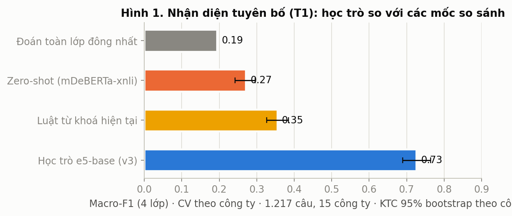
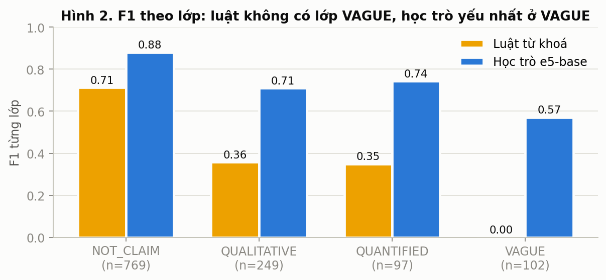
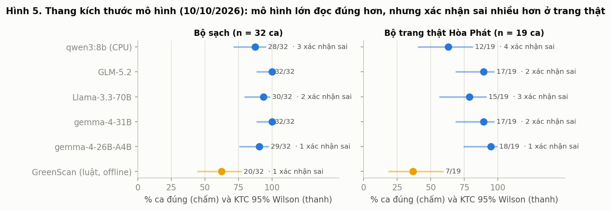
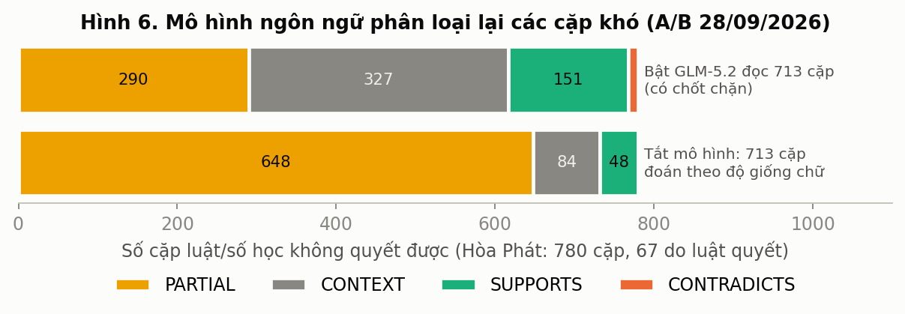
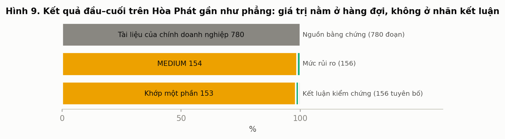

# Chương 5. Kết quả

*Chương này trả lời: các thành phần của GreenScan làm được gì trên dữ liệu đã mô tả ở Chương 4, và những dự đoán đã đăng ký trước có đứng vững không. Kết quả đi theo thứ tự thời gian và mức độ gần với dữ liệu thật: học trò T1 và thang kích thước mô hình, chuỗi thí nghiệm AG-0 đến AG-3 cùng bộ đọc ngoại tuyến, rồi GS-Eval v2 trên câu thật. Mỗi bảng ghi loại nhãn, cỡ mẫu, ngày và nguồn; các số "0 kết luận sai" trên ca dựng và trên câu thật được tách bạch ở mục 5.3.3.*

Quy ước đọc bảng: "độ phủ / precision / `false_S` / `false_C`" là độ phủ (tỷ lệ ca hệ dám kết luận), precision trên phần dám kết luận, số SUPPORTED sai và số CONTRADICTED sai (mục 4.6). "Trong mẫu" là số trên dữ liệu đã dùng để rút ra cách sửa, không phải bằng chứng.

## 5.1 Học trò T1 và thang kích thước mô hình

### 5.1.1 T1: phân loại câu thành bốn lớp (so với nhãn Claude)

Cấu hình: `multilingual-e5-base` (278 triệu tham số), bốn lớp, kiểm định chéo theo công ty, 3 seed, GPU Tesla T4 trên Kaggle; n = 1.217 câu của 15 công ty; kết quả ngày 13/10/2026 (`training/runs/kaggle_t1_v3/results.json`; `docs/07-presentation/paper/GREENSCAN_PAPER_2026-10-15.md`, mục 6.1). Mọi số là **đồng thuận với nhãn Claude**, chưa phải độ chính xác trên nhãn người.

| Hệ | Accuracy | Macro-F1 [KTC 95 %, bootstrap theo công ty] | κ | F1 nhị phân "là tuyên bố" |
|---|---|---|---|---|
| Đoán toàn NOT_CLAIM | n/a | 0,19 | n/a | 0,00 |
| Zero-shot mDeBERTa-xnli | 0,45 | 0,27 [0,24; 0,30] | 0,11 | 0,49 |
| Luật từ khoá hiện tại | 0,55 | 0,36 [0,33; 0,38] | 0,25 | 0,61 |
| **e5-base** | **0,80** | **0,73 [0,69; 0,76]** | **0,66** | **0,82 [0,79; 0,85]** |

**Hình 5.1.** Macro-F1 của bốn hệ trên T1 v3 kèm khoảng tin cậy (số liệu: `benchmark/t1_kaggle/report_v3.json`). Cột e5-base nằm cao hơn rõ rệt; cột luật và zero-shot thấp hơn nhiều.

Hiệu số theo cặp: e5 hơn luật +0,37 [0,33; 0,41] và hơn zero-shot +0,45 [0,41; 0,50]. Trên cùng 498 câu của lượt 1, macro-F1 tăng từ 0,665 (v2) lên 0,726 (v3), Δ = +0,061 [+0,021; +0,098]. Theo seed, macro-F1 dao động 0,706–0,719 (`R2_he_thong_va_thuc_nghiem.md`, mục 3.7). Trên 79 câu lô 1 so với người, hiệu số chỉ +0,053 [−0,06; +0,16], không có ý nghĩa thống kê.

Theo lớp (Hình 5.2): QUANT 0,74, QUAL 0,71, VAGUE 0,57; luật không có lớp VAGUE (F1 = 0). Nhầm lẫn chính là QUAL↔NOT_CLAIM (63 + 27 câu) và VAGUE→QUAL (20 câu). Theo lát cắt: tiếng Việt 0,75 (n = 845) so với tiếng Anh 0,68 (n = 372); câu cần ngữ cảnh 0,67 (n = 143); câu môi trường có số 0,66 (n = 242) thấp hơn không số 0,76 (n = 217).

**Hình 5.2.** F1 theo từng lớp (QUANT, QUAL, VAGUE, NOT_CLAIM) của e5-base và luật; luật có cột F1 bằng 0 ở lớp VAGUE.

Hai ablation không kết luận được: che số so với giữ số +0,014 [−0,02; +0,04]; thêm câu kề −0,012 [−0,06; +0,02]. Kết quả âm đã ghi: mDeBERTa-xnli sau fine-tune sụp về toàn NOT_CLAIM qua 18 lần thử, và e5-large hết bộ nhớ trên T4 hai lần. Chi phí suy luận 118,7 ms/câu trên CPU (batch 1, 4 luồng). T1 chưa được nối vào sản phẩm.

### 5.1.2 Thang kích thước mô hình trên ca dựng (ngày 10/10)

Trên 51 ca dựng (32 ca sạch và 19 ca dùng nguyên văn ba trang Hòa Phát; B-a, Mục 4.4), cùng một prompt tiếng Việt và nhiệt độ 0 (`docs/04-data-ai/MO_HINH_CO_QUA_BE_KHONG_2026-10-10.md`; paper, mục 6.2).

| Hệ | Đúng / 32 ca sạch | Đúng / 19 trang thật | Xác nhận sai trên trang thật | Thời gian mỗi ca |
|---|---|---|---|---|
| Luật GreenScan, offline | 20 | 7 | 0 | gần 0 |
| gemma-4-26B-A4B | 29 | 18 | 1 | 1,2 s |
| gemma-4-31B | 32 | 17 | 2 | 1,5 s |
| Llama-3.3-70B | 30 | 15 | 3 | 2,8 s |
| GLM-5.2 | 32 | 17 | 2 | 13,7 s |
| qwen3:8b (CPU) | 28 | 12 | 4 | 66–257 s |

**Hình 5.3.** Số ca đúng của luật và năm mô hình trên bộ sạch và trang thật. Mô hình lớn đúng nhiều hơn luật ở bộ sạch nhưng đều có xác nhận sai ở trang thật.

Mô hình lớn đọc đúng hơn luật trên bộ sạch (McNemar chính xác p ≤ 0,022). Nhưng ở trang thật mọi mô hình đều sinh xác nhận sai còn luật thì không; mọi mô hình từ 26B trở lên báo SUPPORTED sai ở hai ca N02 ("phạm vi 1 là 23.369.500", thực ra là số của mảng thép) và N05 ("nông nghiệp 933.876", thực ra là số phạm vi 2) vì bảng PDF bị dàn phẳng. Luật hiện tại đúng 20/32 và 7/19 nhưng dám kết luận chỉ 8/32 (đúng 6) và 3/19 (đúng 3) (`experiments/AG-0/out/score_rules.json`). Kết luận thiết kế rút ra: mô hình làm **bộ đọc gợi ý**, luật và số học làm **bộ quyết định**.

### 5.1.3 Bật mô hình đọc cặp khó trên Hòa Phát (28/09) và chất lượng hàng đợi (06/10)

Trên 780 cặp tuyên bố–bằng chứng của hai báo cáo Hòa Phát (264 trang), đếm không nhãn, soát tay (paper, mục 6.3):

| | Tắt mô hình | Bật, tự quyết | Bật, có chốt chặn |
|---|---|---|---|
| Kết luận PARTIAL / SUPPORTED / CONTRADICTED / INSUFFICIENT | 153 / 2 / 0 / 1 | 136 / 6 / **10** / 4 | 150 / 2 / 0 / 4 |
| Rủi ro HIGH + CRITICAL trên đối chứng | 0 | 8 + 2 | 0 |
| Câu chuyển cho người xem | 0 | 156 | 13 |
| Thời gian | 144 s | 632 s (710 lời gọi) | 188 s (có cache) |

**Hình 5.4.** Ba cấu hình bật hay tắt mô hình đọc lập trường. Khi mô hình tự quyết, xuất hiện 10 kết luận CONTRADICTED mà phần lớn sai khi soát tay; chốt chặn đưa số đó về 0.

Mô hình đọc được nội dung (327 cặp lộ ra chỉ là bối cảnh, 3 tuyên bố chuyển đúng sang INSUFFICIENT_EVIDENCE), nhưng 10 CONTRADICTED khi tự quyết phần lớn sai (câu dính cột, dòng bảng "GIỚI TÍNH: 100 %" đọc thành "100 % nam"). Đây là bằng chứng ban đầu cho thiết kế "mô hình không được tự quyết dứt khoát".

Sau khi sửa hai lỗi gốc (gộp dấu "cộng/công" ở nhận diện dòng tổng; nhãn vấn đề của NĐ 83/2026), hàng đợi còn 9/172 mục, cả 9 là câu doanh nghiệp tự nói về mình, 0 trích dẫn pháp lý sai; kết luận và mức rủi ro không đổi (paper, mục 6.4; `benchmark/queue_quality_2026-10-06.md`). Laptop i7-1355U, 16 GB, offline, xử lý 264 trang trong 107–121 s, RAM đỉnh 1,33 GB. Trên lượt Hòa Phát ngày 22/10, 153/156 tuyên bố là "khớp một phần", 154/156 mức MEDIUM, 0/156 quy tắc pháp lý áp được (`KE_HOACH_AGENT_KAGGLE_LUAN_VAN_2026-10-31.md`, mục 2): đây là thực trạng công bố và giới hạn của gói luật chứ không phải thành tích.

**Hình 5.5.** Phân bố kết luận và mức rủi ro trên lượt Hòa Phát: gần như toàn bộ nằm ở "khớp một phần" và MEDIUM, nghĩa là kết luận phẳng.

## 5.2 AG-0 đến AG-3 và bộ đọc ngoại tuyến

Chuỗi này kiểm một thiết kế: để mô hình nhỏ chỉ **điền biểu diễn trung gian (IR)** của số liệu, còn code tất định (`irlib`) đưa ra kết luận. Phần dưới nêu, với mỗi khối, điều đã đăng ký và điều xảy ra. Toàn bộ số là **trên GS-Bench (ca sinh có kiểm soát)**, đáp án theo họ nhiễu, không phải trên câu thật; nguồn: `experiments/AG-1/README.md`, `configs/measurement_decisions.yaml`, `docs/00-project/KE_HOACH_AGENT_KAGGLE_LUAN_VAN_2026-10-31.md` mục 10. Khi mục 10 của kế hoạch cập nhật số cũ, số mới được dùng.

### 5.2.1 AG-0: mốc của luật và trần của IR vàng

Trên 142 ca B-b của GS-Bench v1 (ngày 31/10; `experiments/AG-0/out/score_rules.json`): luật có độ phủ 0,028 (4/142), precision 0,75 [0,5; 1,0], bắt được 0/44 ca C và nhận ra 3/26 ca S0. Trên B-a luật đúng 20/32 và 7/19, lặp lại đúng kết quả của thang kích thước. Trần (IR vàng cộng `irlib`): đúng 140/142, độ phủ 0,528, precision 1,0, 0 kết luận sai; hai ca hụt là câu gộp hai nhiên liệu mà thư viện thận trọng trả N. Trần 0,528 là mức tối đa mà đường IR có thể đạt trên tập này.

### 5.2.2 AG-1: bộ đọc IR và thư viện so sánh tất định

**Lượt đầu (31/10 11:45; v1 B-b, 142 ca)** (`experiments/AG-1/README.md`, mục 5):

| Hệ | Độ phủ | Precision (CI 95 %) | `false_C` | `false_S` | B-a sạch đúng |
|---|---|---|---|---|---|
| Luật hiện tại | 0,028 | 0,75 | 0 | 1 | 20/32 |
| Qwen3-0.6B | 0,127 | 0,39 | 4 | 7 | 16/32 |
| Qwen3-1.7B | 0,183 | 0,54 | 8 | 4 | 18/32 |
| Qwen3-4B-Instruct | 0,134 | 1,00 [1,0; 1,0] | 0 | 0 | 17/32 |
| Qwen3-32B-AWQ | 0,423 | 0,82 [0,69; 1,0] | 7 | 4 | 23/32 |
| Qwen3-8B (lượt B) | 0,232 | 0,636 | n/a | n/a | n/a |
| Qwen3-14B-AWQ (lượt B) | 0,254 | 0,944 | n/a | n/a | n/a |
| Trần (IR vàng) | 0,528 | 1,00 | 0 | 0 | n/a |

Gemma-3-12b trả rỗng cho cả 230 câu (hết bộ nhớ khi nạp rồi sinh rỗng) nên bị loại; đây là lỗi chạy, không phải kết quả của mô hình. Chưa mô hình nào qua cổng `ag1_ir_path_usable`: 4B không vu oan nhưng độ phủ thấp, 32B có độ phủ cao nhưng 7 `false_C`.

**Phân loại lỗi** (`experiments/AG-1/errors.py`): cả 11 kết luận sai của 32B có cùng một lỗi, mô hình tự thêm bội số mà câu không viết ("10.730 m3" thành "10.730 ngàn m3"); 4B mất 50 tuyên bố vì nhét bội số và đơn vị vào `value_text` ("23,5 triệu tCO2e"), nên bộ đọc số từ chối cả số liệu; 1.7B chủ yếu không đọc được bằng chứng (25 ca). Cách sửa là tất định: `irlib.ground(fig, sentence)` giữ mỗi số liệu mô hình đọc đúng với những gì câu viết (số phải có trong câu, bội số là chữ câu viết ngay sau số, năm là năm câu có viết), kèm 9 test hồi quy trong `tests/test_irlib_ground.py`.

**Sau `ground`, trong mẫu** (142 ca B-b, chấm lại từ đầu ra thô đã lưu; không phải bằng chứng vì cách sửa được rút ra từ chính các ca này):

| Hệ | Độ phủ trước → sau | Precision trước → sau | `false_C` trước → sau | `false_S` trước → sau |
|---|---|---|---|---|
| Qwen3-1.7B | 0,183 → 0,183 | 0,54 → 0,85 | 8 → 0 | 4 → 4 |
| Qwen3-4B-Instruct | 0,134 → 0,437 | 1,00 → 0,984 | 0 → 1 | 0 → 0 |
| Qwen3-8B | 0,232 → 0,408 | 0,64 → 0,983 | 6 → 0 | 6 → 1 |
| Qwen3-14B-AWQ | 0,254 → 0,451 | 0,94 → 0,984 | 1 → 0 | 1 → 1 |
| Qwen3-32B-AWQ | 0,423 → 0,465 | 0,82 → 0,985 | 7 → 1 | 4 → 0 |

**Ngoài mẫu: 246 ca B-b mới (lượt D, E, F; 31/10)** (`configs/measurement_decisions.yaml`, khối `agentic_v1_1`). Luật: 0,077 / 0,632 / 7 / 0.

| Hệ (có `ground`, v1.1) | Độ phủ | Precision (CI 95 %) | `false_S` | `false_C` | `false_C` khi chấm thô |
|---|---|---|---|---|---|
| Qwen3-4B | 0,126 | 0,903 [0,81; 1,0] | 1 | 2 | 3 |
| Qwen3-8B | 0,220 | 0,963 [0,90; 1,0] | 1 | 1 | 12 |
| Qwen3-14B-AWQ | 0,256 | 0,921 [0,815; 0,986] | 2 | 3 | 7 |
| Qwen3-32B-AWQ | 0,329 | 0,951 [0,891; 0,992] | 2 | 2 | 3 |

Mọi `false_C` của mọi mô hình đều rơi vào cùng một câu của Coteccons: một số con (2.175 hoặc 8.000 cây) bị so với số tổng (10.175 cây). Đối chiếu kế hoạch ngày 31/10 chiều với báo cáo 22:40: ở báo cáo 14:35, 4B được coi là qua vì đạt dự đoán (`false_C` ≤ 2); khi đo bằng đúng cổng `ag1_ir_path_usable` (`false_C` ≤ luật + 1 = 1) thì chỉ 8B qua, còn 4B (2), 14B (3) và 32B (2) **trượt**. Báo cáo 14:35 vì thế đã được sửa.

**v1.2 và tập ngoài mẫu G (162 ca, 9 công ty)**: v1.2 coi số đếm bằng tuyệt đối khi đơn vị cho phép, và hạ một C dựa trên chênh giá trị về N khi văn bản bằng chứng có viết đúng số và bội số của tuyên bố ("C-guard"); hướng lật và sai độ lớn vẫn là C. Kết quả (độ phủ / precision / `false_S` / `false_C`):

| Hệ (v1.2) | Tập G, 162 ca | Sạch v1.3, ngoài mẫu, 87 ca | Hiệu chỉnh sạch v1.3 (trong mẫu, n = 383–397) |
|---|---|---|---|
| Luật | 0,006 / 1,0 / 0 / 0 | 0,011 / 1,0 / 0 / 0 | 0,060 / 0,625 / 9 / 0 |
| Qwen3-4B | 0,093 / 1,0 / 0 / 0 | 0,138 / 1,0 / 0 / 0 | 0,243 / 0,989 / 1 / 0 |
| Qwen3-8B | 0,068 / 0,909 / 1 / 0 | 0,115 / 1,0 / 0 / 0 | 0,292 / 0,982 / 2 / 0 |
| Qwen3-14B-AWQ | 0,086 / 0,929 / 1 / 0 | 0,115 / 1,0 / 0 / 0 | 0,347 / 0,970 / 3 / 1 |
| Qwen3-32B-AWQ (tập lệch về 32B) | 0,228 / 0,973 / 1 / 0 | 0,253 / 1,0 / 0 / 0 | 0,373 / 0,986 / 2 / 0 |

Trên tập sạch 87 ca, số ca dám kết luận là luật 1, 4B 12, 8B 10, 14B 10, 32B 22; khoảng tin cậy của độ phủ 4B là [0,045; 0,314]. Mô hình kết luận được gấp 10–20 lần luật mà không sai. Phải đọc cùng các giới hạn: n ca dám kết luận nhỏ (4B chỉ 15 ca trên G; 0 sai trên 87 ca cho tỷ lệ vu oan có thể tới khoảng 3,4 %, trên 162 ca khoảng 1,9 %; `R6_do_luong_du_lieu_van_hanh.md`, mục 4, phần câu hỏi dự kiến); tập G có 37 % ca `other_env` (lỗi tập phát hiện hậu kiểm, đã loại ở v1.3); điểm của 32B lạc quan theo cách dựng tập, vì người đọc A của tập là chính 32B. Kết luận cũ "4B mất độ phủ vì đọc sai năm bằng chứng" đã bị rút lại: đó là lỗi của tập (năm lấy từ tiêu đề trang).

### 5.2.3 AG-2: chính sách hai đường

Chính sách `union_noloneS` kết luận khi mọi đường dám kết luận cùng nhãn, nhưng một S chỉ do luật đưa ra thì thành N (vì S đơn độc của luật chỉ đúng 1/6 trên lượt D ngoài mẫu). Hiệu chỉnh trên 388 ca v1.1, kiểm trên G (`agentic_ag2_v1.result_2026-10-31_23h50`; mỗi ô độ phủ / precision / `false_S` / `false_C`):

| Chính sách | Hiệu chỉnh | G, 162 ca | Phần tăng độ phủ so với luật trên G, CI 95 % | Qua phần thống kê của cổng? |
|---|---|---|---|---|
| Luật | 0,059 / 0,652 / 8 / 0 | 0,006 / 1,0 / 0 / 0 | n/a | n/a |
| **Luật + 4B, `noloneS`** | 0,242 / 0,989 / 1 / 0 | 0,093 / 1,0 / 0 / 0 | [0,016; 0,185] | Có |
| Luật + 4B, `union` | 0,278 / 0,926 / 8 / 0 | 0,099 / 1,0 / 0 / 0 | n/a | Không (giữ 8 `false_S` của luật ở hiệu chỉnh) |
| Luật + 32B, `noloneS` | 0,369 / 0,986 / 2 / 0 | 0,228 / 0,973 / 1 / 0 | n/a | Không (`false_S` 1 > 0) |
| Luật + 4 mô hình, `noloneS` | 0,459 / 0,961 / 6 / 1 | 0,247 / 0,95 / 2 / 0 | n/a | Không (`false_S` 2 > 0) |

Trên cùng 246 ca của lượt E/F, chính sách "bốn đường đồng ý" cho 0,419 / 0,903 / 9 / 1, kém luật (7 và 0), và chính sách xô OOF quyết 0 ca vì chỉ có 7 công ty để chia xô. Kết luận: bỏ phiếu S đơn độc của luật là điều kiện để đường kép an toàn. Số G là bằng chứng một lần trên 15 ca dám kết luận, không phải cận chặt.

### 5.2.4 Bộ đọc ngoại tuyến: tương đương với bản Kaggle

Câu hỏi: bộ đọc Qwen3-4B nén, chạy qua Ollama với đúng `ir_reader.py` của sản phẩm, có cho cùng kết quả với bản bf16 trên Kaggle không? Phép đo chạy trên Kaggle (`rehoanzun/gs-ag2-q4-parity`) vì laptop chỉ còn 0,3 GB RAM trống khi Ollama cần 3,3 GiB (`agentic_ag2_product.result_2026_11_01`):

| Chỉ số trên G (162 ca) | Q4_K_M | Q8_0 |
|---|---|---|
| Khớp nhãn từng ca với 4B bf16 | 0,963 (S→N 1, C→N 3, N→S 1, N→C 1) | 0,981 (S→N 1, C→N 2) |
| Luật + bộ đọc cục bộ, `noloneS`: độ phủ / precision / `false_S` / `false_C` | 0,080 / 1,0 / 0 / 0 | 0,074 / 1,0 / 0 / 0 |
| Phần tăng độ phủ so với luật, CI 95 % | [0,016; 0,175] | [0,011; 0,171] |
| Bộ đọc cục bộ đứng một mình, sạch 87 ca | 0,149 / 1,0 / 0 / 0 | 0,138 / 1,0 / 0 / 0 |

Thời gian đọc là 1,7 s/câu **trên GPU T4**, chưa phải thời gian trên laptop; phần còn lại của cổng (thời gian trên laptop, thời gian chạy Hòa Phát ≤ 2 lần, 17 bẫy xanh, test bất biến khi bật `QUANTUM_VERIFY=dual`) chưa đo tại ngày 01/11. Đến 05/11, theo `DANH_GIA_HE_THONG_2026-11-05.md`, mọi đề xuất sửa đổi kết luận đứng sau cờ và không áp vào sản phẩm trước Chung kết.

### 5.2.5 AG-3 v0: dựng hàng bảng từ toạ độ chữ

Mục tiêu là sửa lỗi bảng dàn phẳng (mục 5.1.2). Trang 39 của báo cáo bền vững Hòa Phát 2025 dựng được đủ 10 hàng dữ liệu; phép **cộng dọc** khớp 3/3 (phạm vi 1 + 2 bằng tổng, lệch 1; 5 mảng bằng tổng, lệch 1; tỷ trọng cộng lại 100 %). Trên 7 ca N01–N06 và N08, cùng bộ đọc `gpt-oss-120b` của Groq và cùng `verdict` v1.2 (`experiments/AG-3/README.md`, `agentic_ag3_v0`):

| Điều kiện | Đúng | Dám kết luận | `false_S` | `false_C` |
|---|---|---|---|---|
| Trang thô | 1/7 | 0 | 0 | 0 |
| Hàng dựng lại | 3/7 | 2 (N04 S, N08 S, đều đúng) | 0 | 0 |

Nguyên nhân các ca còn N: IR thiếu chiều "mảng kinh doanh" (`segment`), và C-guard hạ C khi số trùng nằm ở hàng của mảng khác (N02, N03); hàng "Cộng" không ghi rõ là "phạm vi 1 + 2" (N01). Phát hiện phụ: tiêu đề trang 39 ghi "NĂM 2024" trong khi bảng ghi năm 2025, một mâu thuẫn nội bộ của báo cáo. Đây chỉ là một trang và 7 ca dựng.

### 5.2.6 Dự đoán đã đăng ký: đúng hay sai

Khoảng 31/10–01/11 đăng ký 21 dự đoán; 13 đúng và 8 sai (`docs/10-chung-ket-2026-11/doc-tai-lieu/R2_he_thong_va_thuc_nghiem.md`, mục 3.9; đếm lại theo khối yaml cho cùng 21 và 13/8). Bảng dưới liệt kê 21 dự đoán; riêng dự đoán "1.7B kém 4B ít nhất 0,10 độ phủ" tính là sai theo kết quả lượt đầu.

| Khối | Dự đoán | Kết quả | Đúng / Sai |
|---|---|---|---|
| `agentic_v1` | 4B: độ phủ ≥ 0,35, precision ≥ 0,90, `false_C` ≤ 2, B-a sạch ≥ 26/32 | 0,134; 1,0; 0; 17/32 | Sai (độ phủ, B-a); precision và `false_C` đạt |
| | 1.7B kém 4B ≥ 0,10 độ phủ | 1.7B 0,183 cao hơn 4B 0,134 | Sai (chỉ đúng sau `ground`, trong mẫu) |
| | 0.6B không dùng được | 0,127 / 0,39 | Đúng |
| | 8B, 14B trong ±0,05 độ phủ của 4B | 0,232 và 0,254 so với 0,134 | Sai |
| `agentic_v1_1` | 4B ngoài mẫu: precision ≥ 0,90, CI dưới ≥ 0,80, `false_C` ≤ 2 | 0,903; 0,81; 2 | Đúng, sát nút |
| | 4B độ phủ ≥ 0,30 | 0,126 | Sai |
| | 32B: precision ≥ 0,90 và `false_C` ≤ 2 | 0,951; 2 | Đúng |
| | Chấm không `ground` có nhiều `false_C` hơn ở mọi mô hình ≥ 4B | 3→2, 12→1, 7→3, 3→2 | Đúng |
| | 8B, 14B, 32B trong ±0,07 độ phủ của 4B | 0,220 / 0,256 / 0,329 so với 0,126 | Sai |
| `agentic_v1_2` | 4B: `false_C` ≤ 1, precision ≥ 0,90 trên tập ngoài mẫu kế | 0; 1,0 (15 ca) | Đúng |
| | 4B độ phủ < 0,25 trên công ty mới | 0,093 | Đúng |
| | 8B, 14B: `false_C` ≤ 1 | 0; 0 | Đúng |
| `agentic_ag2_v1` | Luật + 4B `noloneS`: 0 `false_C`, 0 `false_S`, độ phủ ≥ 0,09, cận dưới phần tăng > 0 | 0; 0; 0,093; 0,016 | Đúng |
| | Luật + 4B `bucket`: độ phủ ≤ `noloneS`, 0 `false_C` | 0,093; 0 | Đúng |
| | Luật + 4 mô hình `noloneS`: độ phủ ≥ 0,15, `false_C` ≤ 1 | 0,247; 0 (nhưng 2 `false_S`, trượt cổng) | Đúng |
| `agentic_ag2_product` | Khớp từng ca ≥ 0,95 | 0,963 | Đúng |
| | Luật + 4B cục bộ: 0 `false_C`, 0 `false_S`, độ phủ ≥ 0,06 | 0; 0; 0,080 | Đúng |
| `agentic_ag3_v0` | N02 và N05 thành C | cả hai vẫn N | Sai |
| | Đúng ≥ 5/7 ca trang 39 | 3/7 | Sai |
| | 0 `false_S` | 0 | Đúng |
| | Trang thô có ≥ 1 `false_S` | 0 (bộ đọc không kết luận ca nào) | Sai |

Hai cổng sản phẩm: `ag1_ir_path_usable` có kết quả hỗn hợp (chỉ 8B qua trên 246 ca với v1.1; ở tập G, 4B qua nhưng 8B và 14B trượt vì cận dưới CI; 32B qua nhưng tập lệch), còn `ag2_dual_path_to_product` đã qua phần thống kê cho luật + 4B với `noloneS`. Kế hoạch gốc có hai kỳ vọng không nằm trong yaml (AG-2 "độ phủ tăng từ khoảng 25 % lên ≥ 50 %" và AG-3 "kiểm tổng chặn ≥ 80 % bảng dựng sai") không đạt hoặc chưa đo được (R2, mục 3.9). Dự đoán "kích thước không quan trọng trên 4B" từng được ghi là đúng trong mẫu (báo cáo 14:10) rồi bị bác ngoài mẫu (22:40); báo cáo mới nhất được dùng.

## 5.3 GS-Eval v2: hệ thống hiện tại trên câu thật

Mọi số của mục này là của **mã hiện tại**, chế độ `offline`, chạy ngày 05/11/2026 (`benchmark/gs_eval_v2/results/EVAL_REPORT.md` và `eval_results.json`; tổng hợp: `docs/10-chung-ket-2026-11/DANH_GIA_HE_THONG_2026-11-05.md`), so với nhãn Claude đã được tác giả đọc lại, không phải độ chính xác trên nhãn người. D-EXPLAIN có 146 mẫu với đầu ra của mã hiện tại trong 200 mẫu; D-SCORE 148/200.

### 5.3.1 Độ đồng thuận giữa hai lượt nhãn: trần của phép đo

Trước khi so hệ thống với nhãn, cần biết hai lượt nhãn đồng thuận đến đâu (D-SCORE, 200 mẫu, `results/eval_results.json`, khóa `score.inter_pass_agreement`). Tổng điểm: Spearman 0,734; QWK dải tổng thể 0,752; κ kết luận tổng thể 0,691. Có 122/200 mẫu vào phân xử.

| Thành phần | QWK hai lượt | Trùng đúng mức | Trong phạm vi ±1 mức |
|---|---|---|---|
| specificity | 0,585 | 0,730 | 0,915 |
| quantitative_evidence | 0,660 | 0,715 | 0,890 |
| baseline | 0,777 | 0,905 | 0,955 |
| period | 0,596 | 0,640 | 0,885 |
| scope_boundary | 0,697 | 0,705 | 0,960 |
| evidence_support | 0,663 | 0,755 | 0,945 |
| independent_assurance | 0,645 | 0,670 | 0,875 |
| contradiction | 0,826 | 0,925 | 1,000 |
| vague_or_exaggerated_language | 0,838 | 0,805 | 0,990 |

Theo thang Landis và Koch (1977), κ 0,691 ở mức "đáng kể". Các thành phần cần phán đoán về loại tuyên bố (specificity, period, quantitative_evidence) đồng thuận thấp hơn các thành phần dựa trên chữ trong câu (contradiction, vague). Đây là trần thực tế của mọi hệ chấm tự động trên bộ này.

### 5.3.2 Trích tuyên bố

Trong 146 câu mã hiện tại trích ra, **44 câu không phải tuyên bố**: 30 % (Wilson 95 % [0,23; 0,38]); ước tính toàn kho sau tái trọng số theo tầng là 0,367 (xấp xỉ). Theo kết luận hệ thống: P 21/55, C 11/38, I 10/48, S 2/5. Nguyên nhân: câu ghép từ ô bảng, mục lục, chỉ mục GRI, chân trang lặp lại và câu bối cảnh không nói về doanh nghiệp. Ngược lại, 54 mẫu của D-EXPLAIN (nhãn NOT_A_CLAIM 23, PARTIALLY_SUPPORTED 11, INSUFFICIENT_EVIDENCE 10, SUPPORTED 9, CONTRADICTED 1) không còn được bộ trích hiện tại trích; trong đó có 9 câu nhãn SUPPORTED và 1 câu nhãn CONTRADICTED, nên không thể kết luận mã hiện tại bỏ sót ít hơn hay nhiều hơn mã cũ.

### 5.3.3 Kết luận và an toàn

Ma trận trên 146 mẫu D-EXPLAIN (hàng = hệ thống, cột = nhãn):

| Hệ thống \ Nhãn | CONTRADICTED | INSUFFICIENT | NOT_A_CLAIM | PARTIALLY | SUPPORTED | Tổng |
|---|---|---|---|---|---|---|
| CONTRADICTED | 3 | 9 | 11 | 11 | 4 | 38 |
| INSUFFICIENT | 0 | 17 | 10 | 14 | 7 | 48 |
| PARTIALLY | 0 | 8 | 21 | 21 | 5 | 55 |
| SUPPORTED | 0 | 0 | 2 | 3 | 0 | 5 |

Trên **102 tuyên bố thật** (loại 44 câu không phải tuyên bố): kết luận trùng nhãn 0,402 (bootstrap theo công ty [0,34; 0,456]; trọng số toàn kho 0,574), κ = 0,15, macro-F1 0,294. PARTIALLY: P 0,62, R 0,43; INSUFFICIENT: P 0,45, R 0,50.

**Kết luận dứt khoát (S hoặc C): 43 ca, chỉ 3 đúng nhãn (precision trên phần dám kết luận 0,07).** CONTRADICTED sai: **35** trên 38 (24 trên tuyên bố thật, nhãn đúng là P 11, I 9, S 4; 11 trên câu không phải tuyên bố). SUPPORTED sai: 5/5 (3 nhãn PARTIALLY, 2 không phải tuyên bố). Mã hiện tại chỉ kết luận SUPPORTED 8 lần trên 1.138 tuyên bố.

Hai nguyên nhân gốc của 35 CONTRADICTED sai:

| Nguyên nhân | Số ca | Cơ chế |
|---|---|---|
| Luật "từ phủ định" | 22 | Đoạn bằng chứng chứa "vi phạm", "do not"… bị coi là bác bỏ, kể cả trong câu "không ghi nhận vi phạm". Danh sách cụm phủ định lành tính trong `configs/stance_cues.yaml` chỉ khớp nguyên cụm, nên "Không ghi nhận **trường hợp nào** vi phạm" vẫn bị coi là bác bỏ |
| So số của hai đối tượng khác nhau | 13 | Ví dụ khay giấy 23 tấn so với lót PET 14 tấn của một sáng kiến khác. Cổng "so sánh được" mới kiểm đơn vị và chiều, chưa kiểm cùng đối tượng |

Theo công ty, CONTRADICTED sai gồm PAN 7, DHG 7, SAB 6, CTD 6, PNJ 5, TRA 3, KLM 1; lượt demo Hòa Phát (`c892c13727c24bb9`) không có CONTRADICTED nào. Cả 5 SUPPORTED đều sai: câu tự lặp lại trong tài liệu khác của cùng doanh nghiệp bị coi là xác nhận.

**Đối chiếu với con số "0 vu oan" đã nói trước đây.** Hai kết quả không mâu thuẫn vì chúng đo hai thứ khác nhau:

| | GS-Bench (ca dựng và ca sinh) | GS-Eval v2 (câu thật) |
|---|---|---|
| Phép đo | Luật trên GS-Bench v1.3 ngoài mẫu, 87 ca | Mã hiện tại trên 146 câu thật của 8 doanh nghiệp |
| CONTRADICTED sai | 0 | **35 trên 38 CONTRADICTED** |
| Nguồn | `experiments/AG-1/README.md`, mục 01/11 17:00 | `benchmark/gs_eval_v2/results/EVAL_REPORT.md` |
| Lưu ý | Luật dám kết luận 1/87 ca (độ phủ 0,011), nên "0 sai" dựa trên rất ít ca; tuyên bố được dựng từ một ô bảng rồi so với chính ô đó | Kho thật có câu bối cảnh, phủ định lành tính và nhiều sáng kiến cùng đơn vị trên một trang |

Vì vậy: "0 CONTRADICTED sai" là kết quả **trên ca dựng và ca sinh có kiểm soát** của GS-Bench; trên 146 câu thật, CONTRADICTED còn sai nhiều, với hai nguyên nhân đã tìm ra và có cách sửa (đề xuất P0 trong `DANH_GIA_HE_THONG_2026-11-05.md`, mục 4). Mọi CONTRADICTED đi vào hàng đợi người soát. Kết quả này cũng cho câu trả lời ban đầu cho giả thuyết ở mục 4.4: B-b không đại diện cho câu thật về mặt tỷ lệ vu oan.

**Ca an toàn của quy tắc nội bộ** thuộc mục 5.3.7.

### 5.3.4 Lời giải thích và kết quả chấm của judge

Lời giải thích trung bình 34,3 từ, không câu nào quá 80 từ, nhưng chỉ có 54 câu khác nhau trên 146 mẫu: lời giải thích là mẫu cố định theo nhánh luật. 17/146 lời giải thích chứa số không có trong câu hay đoạn bằng chứng được hiển thị (số này có thể lấy từ bằng chứng nằm ngoài ba đoạn đầu, nên chưa chắc là bịa; cần soát).

Thuộc tính thiếu so với nhãn (P / R / F1):

| Thuộc tính | P | R | F1 |
|---|---|---|---|
| metric | 0,231 | 0,188 | 0,207 |
| value | 0,412 | 0,233 | 0,298 |
| period | 0,391 | 0,205 | 0,269 |
| baseline | 0,000 | 0,000 | 0,000 |
| scope | 0,190 | 0,167 | 0,178 |

Hệ thống báo thiếu năm gốc cho mọi tuyên bố có chiều thay đổi, trong khi nhãn chỉ ghi khi tuyên bố thực sự cần; không báo thiếu khi bộ trích luật nhận nhầm thuộc tính.

**Judge** (một agent Sonnet, 146 lời giải thích, theo `must_mention` và `must_not_say` của từng mẫu; `benchmark/gs_eval_v2/explain/judge/judge_output.jsonl`): độ phủ ý bắt buộc 0,022 (137/146 lời giải thích không nêu ý riêng nào của mẫu); 19 mẫu nói điều không được nói; trung thực với bằng chứng 0,575 (Wilson [0,494; 0,653]); chỉ ra việc cần làm 0,397; độ rõ 2,68/5.

| Kết luận hệ thống | n | Phủ ý | Trung thực | Chỉ việc cần làm | Độ rõ | Vi phạm `must_not_say` |
|---|---|---|---|---|---|---|
| CONTRADICTED | 38 | 0,019 | 0,079 | 0,000 | 2,00 | 14 |
| SUPPORTED | 5 | 0,000 | 0,000 | 0,000 | 2,00 | 5 |
| INSUFFICIENT_EVIDENCE | 48 | 0,051 | 0,604 | 0,979 | 3,00 | 0 |
| PARTIALLY_SUPPORTED | 55 | 0,000 | 0,945 | 0,200 | 2,93 | 0 |

Khi hệ thống dừng phán đoán (INSUFFICIENT, PARTIALLY), lời giải thích phần lớn trung thực; riêng INSUFFICIENT gần như luôn chỉ ra việc cần làm. Khi hệ thống kết luận dứt khoát, lời giải thích gần như luôn sai lệch vì nó lặp lại đúng lỗi của kết luận: trích từ phủ định, so số không cùng đối tượng, coi câu tự lặp lại là xác nhận. Lời giải thích không bao giờ nói câu là mảnh bảng hay tiêu đề, cũng không nói phần nào của câu có bằng chứng. Judge cùng họ mô hình với người gán nhãn, nên số này cần đọc kèm giới hạn ở mục 4.8.

### 5.3.5 Chấm rủi ro so với nhãn đồng thuận

Đồng thuận của hệ thống với nhãn đồng thuận (hai lượt cộng phân xử) trên 148 mẫu có đầu ra: Spearman của điểm tổng **0,227** (bootstrap theo công ty [0,048; 0,368]), so với 0,734 giữa hai lượt nhãn. Điểm trung bình hệ thống 55,9, nhãn 30,2. Dải tổng thể: trùng 0,365, lệch không quá một bậc 0,811.

| Thành phần | QWK hệ thống–nhãn | QWK hai lượt (để so) | Mức TB hệ thống / nhãn (0–3) | Nhãn "không áp dụng" | Hệ thống vẫn phạt |
|---|---|---|---|---|---|
| specificity | 0,268 | 0,585 | 1,26 / 1,16 | 43 | 43 |
| quantitative_evidence | 0,419 | 0,660 | 2,09 / 1,41 | 45 | 45 |
| baseline | 0,109 | 0,777 | 1,82 / 0,41 | 120 | 69 |
| period | 0,201 | 0,596 | 2,35 / 0,98 | 50 | 44 |
| scope_boundary | −0,092 | 0,697 | 2,15 / 1,08 | 43 | 34 |
| evidence_support | 0,150 | 0,663 | 1,83 / 1,24 | 41 | 39 |
| independent_assurance | −0,062 | 0,645 | 2,92 / 1,82 | 43 | 43 |
| contradiction | 0,181 | 0,826 | 0,81 / 0,15 | 35 | 10 |
| vague_or_exaggerated_language | 0,378 | 0,838 | 0,51 / 0,95 | 28 | 3 |

Hệ thống chấm đúng hướng ở hai thành phần dựa trên chữ trong câu (ngôn ngữ mơ hồ, có số), nhưng chấm sai ở các thành phần cần hiểu loại tuyên bố (năm gốc, phạm vi, đảm bảo độc lập). Nó phạt cả thành phần không áp dụng (baseline: 69/120 ca) và chấm `independent_assurance` gần như luôn tối đa (mức TB 2,92). Câu không phải tuyên bố vẫn nhận điểm rủi ro cao, vì mọi thành phần "thiếu" đều bị phạt. Hệ quả cho cách dùng: điểm rủi ro là chỉ báo xếp hàng đợi, tương quan yếu với chuyên gia (ρ 0,23), không dùng để kết luận.

### 5.3.6 Gợi ý sửa của Studio (D-EDIT, 200 mẫu)

Trong 200 mẫu có 151 tuyên bố xanh, 135 cần sửa. Hệ nhận ra câu cần sửa với P 0,894, R 1,0, F1 0,944 (tp 135, fp 16, fn 0). Rào chắn `assert_no_new_numbers` hoạt động: **0/527 gợi ý thêm số mới**. Mặt trái: hệ gợi ý cho cả 200/200 câu, gồm 16/16 câu đã ổn và 130 gợi ý trên 49 câu không phải tuyên bố xanh. Gợi ý theo loại: add_scope 194, evidence_ref 200, placeholder 117, soften 16.

| Loại sửa (trên 151 tuyên bố xanh) | tp / fp / fn | P | R | F1 |
|---|---|---|---|---|
| placeholder | 63 / 22 / 26 | 0,741 | 0,708 | 0,724 |
| add_scope | 72 / 74 / 2 | 0,493 | 0,973 | 0,655 |
| evidence_ref | 52 / 99 / 0 | 0,344 | 1,000 | 0,512 |
| soften | 8 / 7 / 11 | 0,533 | 0,421 | 0,471 |

Theo mã vấn đề, macro-F1 0,359. Mạnh nhất là VAGUE_TERM (P 0,676, tp 23/fp 11/fn 35) và NO_FIGURE (P 0,564, tp 31/fp 24/fn 34). Yếu nhất: ABSOLUTE_CLAIM với R = 0 (0/10 ca, vì mẫu "100 %", "hoàn toàn" của bộ gợi ý quá hẹp) và MISSING_BASELINE với P 0,139 (11/68 fp). Nhiều vấn đề nằm ngoài từ vựng của hệ thống: chứng nhận hoặc nhãn không nêu bên cấp (17 ca), che đánh đổi (3 ca), tuyệt đối hoá (10 ca). Hai kết luận: Studio an toàn (không thêm số) nhưng không phân biệt được câu cần sửa với câu đã ổn, và recall cao có được nhờ gợi ý cho gần như mọi câu.

### 5.3.7 Quy tắc nội bộ (org pack)

Với 14 pack, 76 quy tắc, 237 ca và thuộc tính đúng, engine đạt accuracy **0,945** (224/237; Wilson 95 % [0,908; 0,968]), macro-F1 0,945. Theo lớp: COMPLIANT P 0,965 / R 0,917; VIOLATION P 0,985 / R 0,917; NEEDS_REVIEW P 1,000 / R 0,965; NOT_APPLICABLE P 0,828 / R 1,000. Đầu–cuối (thuộc tính do bộ trích luật lấy): accuracy 0,907 (Wilson [0,863; 0,938]), macro-F1 0,908.

| Loại ca | Đúng / tổng |
|---|---|
| Bình thường | 131/140 |
| Biên | 35/39 |
| Quy tắc nháp | 11/11 |
| Hết hiệu lực | 6/6 |
| Tiêm lệnh | 11/11 |
| Vượt quyền | 11/11 |
| Trái luật | 6/6 |
| Khác ngành | 13/13 |

Ca an toàn lệch kỳ vọng: 0. Cộng theo `eval_results.json`, các loại nháp, hết hiệu lực, tiêm lệnh, vượt quyền và trái luật đúng 45/45; thêm 13/13 ca khác ngành là 58/58. Kết luận kiểm chứng không đổi khi bật pack: tính chất này được kiểm bằng test bất biến `tests/test_org_pack.py` (toàn bộ khoảng 453 test qua ngày 05/11).

13 ca sai: 10 ca kỳ vọng COMPLIANT, VIOLATION hoặc NEEDS_REVIEW nhưng engine trả NOT_APPLICABLE (8 ca vì loại tuyên bố do bộ trích luật gán, thường là `generic_sustainability`, không khớp `claim_types` của quy tắc; 2 ca vì điều kiện `when` thiếu từ đồng nghĩa); 3 ca còn lại (2 VIOLATION thành COMPLIANT, 1 NEEDS_REVIEW thành VIOLATION) do `numeric_threshold` xét mọi số trong đoạn bằng chứng, nên một số bất kỳ thoả ngưỡng là đạt.

### 5.3.8 UX lint và người dùng

Trên 15 lượt (9.621 chuỗi, 8.015 đoạn bằng chứng):

| Kiểm | Kết quả | Số liệu |
|---|---|---|
| UXL-01 độ dài | Đạt | 0 chuỗi > 80 từ, 0 câu > 40 từ |
| UXL-03 lộ mã nội bộ hay tiếng Anh | Đạt | 0 và 0 trong mã hiện tại |
| UXL-10 gợi ý sửa an toàn | Đạt | |
| UXL-07 từ cấm | **Không đạt** | 24 chuỗi hiện nguyên "vi phạm", "xử phạt" khi trích từ phủ định, mang tính cáo buộc |
| UXL-06a cụm trung tính | **Không đạt** | 73/74 kết luận chưa đủ bằng chứng có cụm trung tính |
| UXL-04 tài liệu và trang | **Không đạt** | 8 đoạn bằng chứng không có trang (ca thật dạng .txt) |
| UXL-13 pack lỗi | **Không đạt** | 8/9 pack lỗi bị từ chối đúng; E8 (`source_document` không có trong `documents`) chỉ bị cảnh báo, lệch đặc tả |

Thử với người: giao thức, 16 nhiệm vụ, thang SUS tiếng Việt và ngưỡng vòng A đã sẵn sàng, nhưng **chưa có người tham gia (n = 0)**, nên chưa có điểm SUS, tỷ lệ hoàn thành hay niềm tin của người dùng.

### 5.3.9 Nhãn được kiểm định thế nào

Kiểm định đối nghịch trên 20 mẫu mỗi bộ cho D-EXPLAIN 2 lỗi đã sửa (10,0 %, Wilson [2,8; 30,1]), cả hai là lỗi văn bản và không có lỗi kết luận, và D-EDIT 3 lỗi đã sửa (15,0 %, Wilson [5,2; 36,0]) (`benchmark/gs_eval_v2/AUDIT_EXPLAIN_EDIT.md`). Mỗi bộ còn 1–2 mẫu nghi vấn để tác giả quyết (trong đó có một mẫu CONTRADICTED của DWS mà bằng chứng chỉ làm suy yếu vế ESG Engine). Với n = 20, kết quả không cho phép khẳng định bộ nhãn sạch ở mức dưới 30 %.

### 5.3.10 Sửa lỗi và đo lại: chốt chặn mâu thuẫn (05/11/2026)

Phân tích 35 ca CONTRADICTED sai cho thấy một điểm chung: bằng chứng bác bỏ đều đến từ chính doanh nghiệp. Ở 19/20 ca so số, hai con số nằm trong cùng tài liệu của tuyên bố nhưng nói về hai đối tượng khác nhau (ví dụ 926 tấn CO2 từ gạch không nung so với 1.936 tấn từ bê tông khoáng hoá). Ở mọi ca từ phủ định, cụm từ nằm trong văn bản của doanh nghiệp: "không ghi nhận trường hợp nào vi phạm", hay một mục lục GRI liệt kê "Nghị định về xử phạt vi phạm hành chính".

Chốt chặn có hai luật. Thứ nhất, một đoạn thuộc chính tài liệu của tuyên bố không được bác bỏ tuyên bố đó; hai con số vẫn hiện cho người soát. Thứ hai, từ phủ định trong tài liệu của doanh nghiệp (nội bộ, tài chính) chỉ tính khi nằm trong một phán quyết về tuyên bố. Chốt chặn đi sau một cờ cấu hình để có thể quay lại hành vi cũ.

| Chỉ số (GS-Eval v2, câu thật của 8 doanh nghiệp) | Trước sửa | Sau sửa 05/11 |
|---|---|---|
| CONTRADICTED đúng nhãn | 3/38 | **3/4** |
| CONTRADICTED sai trên tuyên bố thật (vu oan) | 24 | **0** |
| CONTRADICTED sai, tính cả câu không phải tuyên bố | 35 | 1 |
| Độ chính xác kết luận (n = 102 tuyên bố) | 0,40 | 0,51 |
| Cohen κ / macro-F1 | 0,15 / 0,29 | 0,18 / 0,52 |
| Điểm rủi ro: Spearman với điểm đồng thuận (n = 148) | 0,23 [0,05; 0,37] | 0,39 [0,16; 0,51] |
| Điểm rủi ro: trung bình hệ thống / nhãn | 55,9 / 30,2 | 49,2 / 30,2 |
| UXL-07: chuỗi hiện nguyên từ "vi phạm" | 24 | 0 |
| GS-Bench v1.1: 453 ca, nhãn từng ca | — | giống hệt trước (453/453) |
| 4 ca án lệ thật (BNY, DWS, KDP, KLM) | 4/4 CONTRADICTED | 4/4 CONTRADICTED |
| Toàn bộ test | qua | qua (thêm 6 test `tests/test_contradiction_guard.py`) |

Kết quả cho thấy lỗi được sửa đúng loại: các bộ kiểm cũ không đổi, còn vu oan trên câu thật về 0. Giới hạn: chỉ còn 4 ca CONTRADICTED trên mẫu, nên chưa đo được độ phủ của bác bỏ trên báo cáo thật. Đánh đổi có chủ ý là một mâu thuẫn nội tại thật trong cùng một báo cáo sẽ không được tự kết luận; nó vẫn hiện số cho người soát.

## 5.4 Tóm tắt chương

1. **T1 và thang mô hình.** Học trò e5-base đạt macro-F1 0,73 [0,69; 0,76] so với nhãn Claude (luật 0,36; n = 1.217; 15 công ty). Trên ca dựng, mô hình lớn đọc đúng hơn luật nhưng đều xác nhận sai trên bảng dàn phẳng, nên mô hình làm bộ đọc gợi ý, không làm bộ quyết định.
2. **AG-0 đến AG-3 (trên GS-Bench, ca sinh).** Trên 87 ca ngoài mẫu sạch, đường mô hình đọc cộng code tính có 0 kết luận sai (4B dám kết luận 12/87, 32B 22/87, luật 1/87); bộ đọc Q4 ngoại tuyến khớp bản Kaggle 0,963. Trong 21 dự đoán đăng ký trước, 13 đúng và 8 sai; 4B ngoài mẫu nhìn chung an toàn nhưng độ phủ thấp (0,093 đến 0,138).
3. **GS-Eval v2: kết luận.** Trên 146 câu thật, 35/38 CONTRADICTED sai (22 do luật từ phủ định, 13 do so số hai đối tượng khác nhau) và 5/5 SUPPORTED sai; 30 % câu được trích không phải tuyên bố. Con số "0 vu oan" chỉ đúng trên GS-Bench. Sau chốt chặn mâu thuẫn (mục 5.3.10): CONTRADICTED đúng 3/4, 0 vu oan trên tuyên bố thật.
4. **GS-Eval v2: điểm rủi ro và giải thích.** Spearman với nhãn đồng thuận chỉ 0,227 so với 0,734 giữa hai lượt nhãn; lời giải thích trung thực 0,945 với PARTIALLY nhưng 0,079 với CONTRADICTED.
5. **Hai bảo đảm thiết kế đứng vững.** Gợi ý sửa không thêm số nào (0/527); quy tắc nội bộ không đổi kết luận kiểm chứng và engine đúng 0,945 (Wilson [0,908; 0,968]) trên 237 ca. Độ dễ dùng với người chưa đo (n = 0).

## Tài liệu tham khảo của chương

- Landis, J. R. và Koch, G. G. (1977). The measurement of observer agreement for categorical data. *Biometrics*, 33(1), 159–174. (Thang diễn giải κ, theo ghi chú `docs/10-chung-ket-2026-11/doc-tai-lieu/R6_do_luong_du_lieu_van_hanh.md`, mục 2, và `R8_web_paper_ai_dataset.md`.)
- Các nguồn số liệu nội bộ được dẫn trực tiếp trong từng bảng bằng đường dẫn trong kho mã.
