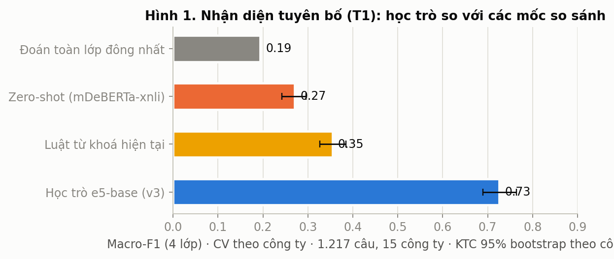
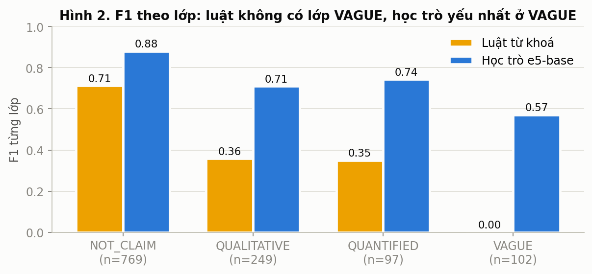
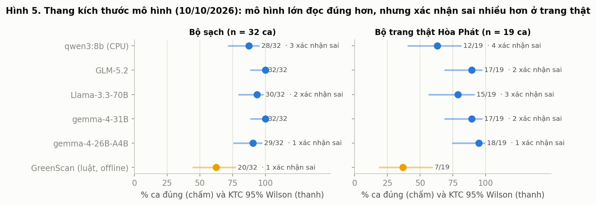
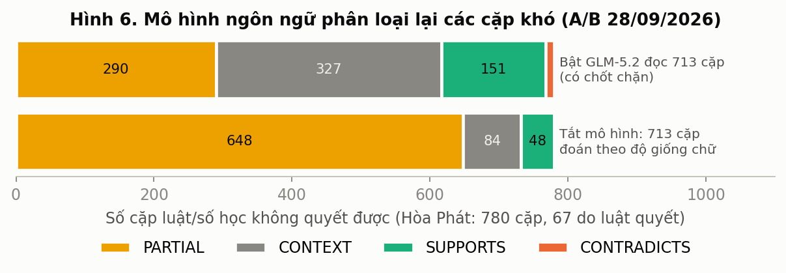
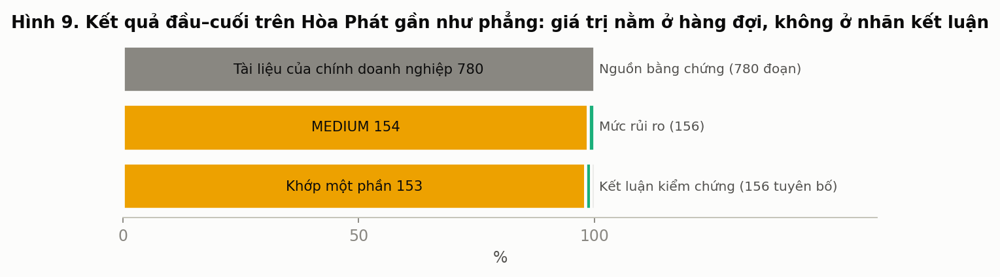

# GreenScan AI: kiểm chứng tuyên bố môi trường trong công bố của doanh nghiệp Việt Nam theo hướng bằng chứng trước

*Luận văn · Đội Eco Nexus · AI-Quantum Challenge 2026 (Học viện Tài chính) · bản 05/11/2026*

## Tóm tắt

Công bố môi trường của doanh nghiệp Việt Nam tăng nhanh nhưng mỏng về định lượng và hiếm khi được đảm bảo độc lập. Trong khi đó, chưa có văn bản pháp luật nào định nghĩa "tẩy xanh". Luận văn vì vậy không hỏi "doanh nghiệp có tẩy xanh không", mà hỏi: *mỗi tuyên bố môi trường có bằng chứng không, thiếu gì, và khi nào máy phải nhường người?*

GreenScan AI trả lời bằng một hệ thống mười bước theo nguyên lý "mô hình đọc, quy tắc quyết định, con người duyệt":
- trích tuyên bố;
- truy xuất bằng chứng có trang;
- so sánh số học bằng mã;
- kết luận theo năm mức, trong đó "không đủ bằng chứng" là kết quả hợp lệ;
- chấm rủi ro chín thành phần;
- xếp hàng đợi cho kiểm toán viên;
- gợi ý sửa câu không bịa số.

Hệ thống chạy ngoại tuyến trên laptop và được ràng buộc bởi mười bất biến có test. Luận văn bổ sung lớp **quy tắc nội bộ (org pack)**: tổ chức dùng hệ thống chỉ cần thêm quy tắc và tài liệu nội bộ của mình. Quy tắc được kiểm cấu trúc khi nạp, đứng dưới luật và không bao giờ đổi kết luận kiểm chứng.

Để đo khi chưa có nhãn người, luận văn xây dựng **GS-Eval v2**, gồm năm bộ dữ liệu lấy mẫu phân tầng cân bằng, nhãn do Claude gán theo hướng dẫn viết trước và được tác giả đọc lại, kèm bộ chấm tất định:
- 200 giải thích tham chiếu;
- 200 gợi ý sửa;
- 200 mẫu chấm rủi ro, hai lượt mù và phân xử;
- 14 bộ quy tắc nội bộ với 237 ca kiểm;
- bộ kiểm độ dễ dùng.

**Kết quả cho thấy hai mặt.**

Các bảo đảm viết thành mã đứng vững:
- 0/527 gợi ý sửa thêm số mới;
- engine quy tắc nội bộ đúng 94,5 % (Wilson 95 % [90,8; 96,8]) và đúng 45/45 ca an toàn;
- trên bộ ca dựng có đáp án (GS-Bench), luật không kết luận sai lần nào. Bộ đọc 4B–32B chạy cục bộ nâng độ phủ từ 1,1 % lên 11,5–25,3 % mà vẫn giữ precision 1,0.

Trên 146 câu thật của 8 doanh nghiệp, chất lượng phán đoán dứt khoát còn yếu:
- CONTRADICTED chỉ đúng 3/38, do hai nguyên nhân đã định vị: luật từ phủ định coi "không ghi nhận vi phạm" là bác bỏ, và so số của hai đối tượng khác nhau; sau chốt chặn mâu thuẫn (05/11) còn 3/4 đúng và không còn vu oan trên tuyên bố thật, trong khi GS-Bench và bốn ca án lệ không đổi;
- khoảng 30 % câu được trích không phải tuyên bố;
- điểm rủi ro tương quan 0,23 với đồng thuận của hai lượt chấm (0,39 sau chốt chặn; trần 0,73).

Khi hệ thống dừng phán đoán, lời giải thích trung thực (0,95 với "khớp một phần"). Luận văn kết luận rằng GreenScan hiện phù hợp vai trợ lý chuẩn bị hồ sơ soát, và chỉ ra thứ tự sửa có đăng ký trước. Thành công trên ca dựng phải luôn được báo cáo cùng kết quả trên câu thật.

**Từ khoá:** tẩy xanh, kiểm chứng tuyên bố, ESG, kiểm toán, truy xuất bằng chứng, dự đoán có từ chối, policy-as-code, tiếng Việt, đánh giá không có nhãn người.

## Abstract

Environmental disclosures by Vietnamese companies are growing but are rarely quantified or independently assured, and Vietnamese law does not define greenwashing. Instead of asking whether a company greenwashes, this thesis asks whether each environmental claim is evidenced, what is missing, and when a machine should defer to a human.

GreenScan AI is a ten-step, evidence-first system built on the principle "models read, rules decide, humans review". It extracts claims, retrieves page-anchored evidence, does arithmetic in code, and assigns one of five verdicts, with "insufficient evidence" as a legitimate outcome. It also scores nine risk components, queues claims for auditors, and suggests edits that never invent numbers. The system runs offline on a laptop under ten tested invariants.

The thesis adds an "org pack" layer: organisations supply only their own rules and internal documents. The rules are validated on load, rank below the law, and never change a verification verdict.

Human gold labels are not yet available, so the thesis builds GS-Eval v2: five stratified, balanced sets with Claude-made labels that the author reviewed, scored by deterministic graders. The sets are 200 reference explanations, 200 edit suggestions, 200 risk scores (two blind passes with adjudication), 14 org packs with 237 test cases, and a usability kit.

The guarantees written into code hold:
- 0 of 527 suggestions introduce a number;
- the org-pack engine is right on 94.5% of cases and 45 of 45 safety cases;
- on constructed GS-Bench cases, the rules make no wrong decisive verdict.

On 146 real sentences from 8 companies, decisive verdicts are not yet reliable:
- only 3 of 38 CONTRADICTED verdicts are correct, traced to a negation-cue rule and to comparing figures about different objects;
- about 30% of extracted sentences are not claims;
- risk scores correlate at ρ = 0.23 with the annotators' consensus, against an inter-pass ceiling of 0.73.

The system is currently fit to assist with preparing review files. Results on constructed cases must always be reported alongside results on real text.

**Keywords:** greenwashing, claim verification, ESG, audit, evidence retrieval, selective prediction, policy-as-code, Vietnamese, evaluation without gold labels.

---

# Chương 1. Mở đầu

*Chương này trả lời ba câu hỏi: vì sao việc kiểm chứng tuyên bố môi trường trong công bố của doanh nghiệp Việt Nam là một vấn đề thực tiễn đáng giải; vì sao luận văn đặt lại câu hỏi từ "AI có phát hiện tẩy xanh không" thành "tuyên bố này có bằng chứng không"; và luận văn cam kết trả lời những câu hỏi nghiên cứu nào, trong phạm vi nào. Sau chương này, người đọc biết đề tài nằm ở đâu và các chương sau sẽ chứng minh điều gì.*

## 1.1 Bối cảnh

### 1.1.1 Tài chính xanh và nhu cầu công bố tại Việt Nam

Tài chính xanh ở Việt Nam tăng nhanh. Dư nợ tín dụng xanh vào khoảng 750 nghìn tỷ đồng tại ngày 30/11/2025, chiếm khoảng 5% tổng dư nợ (bản thảo bài báo GreenScan 15/10/2026, mục 1.1; số cũ hơn trong tài liệu đề bài là 704.244 tỷ đồng, 4,3%, tại 31/3/2025, nên mọi chỗ dùng số này phải ghi ngày). Trái phiếu xanh, khoản vay xanh và các chương trình phân loại dự án xanh theo Quyết định 21/2025/QĐ-TTg đều dựa vào một tiền đề: thông tin môi trường mà doanh nghiệp công bố đủ tin cậy để ngân hàng, nhà đầu tư và cơ quan quản lý ra quyết định.

Tiền đề đó được kiểm bằng dữ liệu công bố thực tế, và dữ liệu cho thấy một bức tranh chưa vững. Bảng 1.1 tóm tắt các khảo sát đã công bố mà luận văn dùng làm nền; luận văn không tự khảo sát lại các con số này.

**Bảng 1.1.** Thực trạng công bố môi trường của doanh nghiệp niêm yết Việt Nam theo các khảo sát đã công bố.

| Phát hiện | Số liệu | Nguồn |
| --- | --- | --- |
| Tỷ lệ công ty trên HOSE có báo cáo phát triển bền vững | 1,06% (2015) tăng lên 28,38% (2024, 107 công ty) | Hąbek & Bui (2025), mẫu 673 công ty |
| Báo cáo chỉ có thông tin định tính, không có số | 72,5% (2024); năm đầu của chuỗi là 94,4% | Hąbek & Bui (2025) |
| Báo cáo độc lập có đảm bảo của bên thứ ba | 2/22 (2024; ACB và VNM) | Hąbek & Bui (2025) |
| Quan sát công bố khí nhà kính (KNK) theo Thông tư 96/2020 đạt 0 điểm | 50,6%; chỉ 21,3% công bố đầy đủ | Lâm Thị Trúc Linh và cs. (2025), 399 quan sát |
| Tuân thủ công bố bắt buộc theo Thông tư 155/2015, phần môi trường | 40,75%, thấp nhất trong các mục | Phạm Đức Hiếu và cs. (2019), 160 công ty |
| Doanh nghiệp HOSE áp dụng GRI | 19–25% | `docs/08-knowledge/03_THUC_TRANG_VA_NGHIEN_CUU_VN.md`, theo ghi chú R4 |

Ba điều rút ra từ bảng. Thứ nhất, phần lớn thông tin môi trường được công bố ở dạng chữ, không có con số để đối chiếu. Thứ hai, khi có số thì hiếm khi có bên thứ ba đảm bảo. Thứ ba, ngay cả chỉ tiêu mà pháp luật bắt buộc nêu (khí nhà kính trong Phụ lục IV của Thông tư 96/2020) cũng bị bỏ trống ở hơn một nửa số quan sát. Trong phạm vi các tài liệu đã rà, chúng tôi không tìm thấy nghiên cứu Việt Nam nào kiểm chứng số liệu của từng tuyên bố; các khảo sát ở trên đo mức độ công bố, không đo mức độ khớp giữa lời tuyên bố và bằng chứng.

### 1.1.2 Công bố ESG và khoảng trống pháp lý

Về pháp lý, Việt Nam có khung công bố thông tin (Thông tư 96/2020/TT-BTC, đang có dự thảo thay thế lấy ý kiến đến 07/10/2026), khung kiểm kê khí nhà kính ở cấp cơ sở (Nghị định 06/2022/NĐ-CP, sửa bởi Nghị định 119/2025/NĐ-CP) và khung quản lý rủi ro môi trường trong cấp tín dụng (Thông tư 17/2022/TT-NHNN). Nhưng **không văn bản nào trong 14 văn bản đã đọc toàn văn định nghĩa "tẩy xanh"**, và chưa tìm thấy vụ nào cơ quan nhà nước Việt Nam xử phạt vì tuyên bố môi trường gây hiểu nhầm [UNVERIFIED, phủ định có giới hạn; `docs/08-knowledge/04_AN_LE_VA_BAI_HOC.md`]. Các căn cứ gần nhất (Luật Bảo vệ môi trường Điều 145 về sản phẩm "thân thiện môi trường" phải được chứng nhận hoặc công nhận; Luật Quảng cáo Điều 8.10–8.11 về tài liệu chứng minh; Luật 19/2023 Điều 10.1(a)) đều điều chỉnh các quan hệ cụ thể, không điều chỉnh báo cáo gửi nhà đầu tư nói chung.

Khoảng trống này kéo theo hệ quả cho người làm nghề. Không có định nghĩa pháp lý thì không có ngưỡng "vi phạm" để máy hay người đối chiếu. Cái còn lại để làm việc là một câu hỏi nghề nghiệp quen thuộc của kiểm toán: thông tin này có bằng chứng đủ và thích hợp đi kèm không.

### 1.1.3 Tẩy xanh ở bình diện quốc tế

Các cơ quan giám sát châu Âu (ESMA, EBA và EIOPA, 2024) định nghĩa tẩy xanh là thực hành trong đó các tuyên bố, hành động hoặc truyền thông về bền vững không phản ánh rõ ràng và công bằng hồ sơ bền vững thực chất của tổ chức, sản phẩm hay dịch vụ tài chính, và việc này có thể xảy ra cố ý hoặc vô ý. Chương 2 trình bày định nghĩa và phân loại chi tiết. Ở đây chỉ cần ghi nhận hai điểm: xử lý tẩy xanh đã chuyển từ thảo luận học thuật sang thực thi (nhiều vụ do cơ quan quản lý và tòa án xử lý từ 2022 đến 2026), và kết cục các vụ này không một chiều, nên một công cụ phục vụ người soát không thể thay họ phán quyết.

## 1.2 Vấn đề thực tiễn của ba nhóm người dùng

Luận văn nhắm đến ba nhóm người đọc báo cáo doanh nghiệp để ra quyết định. Mỗi nhóm gặp cùng một khó khăn dưới ba hình thức khác nhau.

**Kiểm toán viên và người soát xét.** Báo cáo thường niên và báo cáo phát triển bền vững dài hàng trăm trang (báo cáo thực dùng để chạy thử có 264 trang). Khi thực hiện dịch vụ đảm bảo thông tin phi tài chính, hoặc khi đọc "thông tin khác" đi kèm báo cáo tài chính, người soát phải quyết tuyên bố nào đáng mở trước. Việc đọc thủ công từng câu không thực hiện nổi; việc chỉ đọc phần được nhấn mạnh thì dễ bỏ sót phần chọn lọc. Từ kỳ bắt đầu từ 15/12/2026, chuẩn mực ISSA 5000 áp dụng cho dịch vụ đảm bảo thông tin bền vững, nên nhu cầu có hồ sơ làm việc tái dựng được sẽ tăng.

**Cán bộ tín dụng và nhà phân tích ở ngân hàng.** Ngân hàng chịu nghĩa vụ quản lý rủi ro môi trường theo Thông tư 17/2022/TT-NHNN và đánh giá khoản vay xanh theo tiêu chí phân loại xanh. Họ cần biết tuyên bố "dự án xanh" của khách hàng dựa trên văn bản xác nhận nào, thiếu gì, và hồ sơ nào cần xin thêm. Họ không cần một nhãn "tẩy xanh" nhị phân; họ cần danh sách thiếu sót cụ thể.

**Doanh nghiệp công bố.** Doanh nghiệp muốn biết trước khi công bố câu nào của mình sẽ bị hỏi "bằng chứng đâu", chẳng hạn một con số phần trăm giảm phát thải không nêu năm gốc, hay "net zero 2050" không có mốc trung gian. Với nhóm này, công cụ hữu ích là công cụ gợi ý cách sửa mà không bịa thêm số liệu.

Kết quả thực nghiệm sơ bộ cho thấy vì sao hàng đợi ưu tiên, chứ không phải nhãn đúng/sai, mới là sản phẩm. Ở lượt chạy 22/10/2026 trên báo cáo Hòa Phát, hệ thống trích 156 tuyên bố: 153 ở mức khớp một phần, 2 được ủng hộ, 1 chưa đủ bằng chứng, và không tuyên bố nào bị kết luận mâu thuẫn (`docs/00-project/KE_HOACH_AGENT_KAGGLE_LUAN_VAN_2026-10-31.md` mục 2, qua ghi chú R9, dữ kiện 50). Một hệ thống trả về cùng một nhãn cho gần như mọi dòng thì không giúp người soát chọn việc. Giá trị nằm ở chỗ nói được tuyên bố nào nên mở trước, vì sao, và còn thiếu gì.

## 1.3 Từ "AI có phát hiện tẩy xanh không" đến "tuyên bố này có bằng chứng không"

Cách đặt vấn đề phổ biến trong học máy là coi tẩy xanh như một nhãn của văn bản: đưa câu vào, mô hình trả "tẩy xanh" hoặc "không". Luận văn không đi theo cách đó, vì ba lý do độc lập.

**Lý do khái niệm.** Seele & Gatti (2017) cho rằng tẩy xanh là một *cáo buộc từ bên ngoài*, không phải thuộc tính tự thân của văn bản; họ phân biệt tẩy xanh, cáo buộc oan, tẩy xanh tiềm năng và không tẩy xanh. Định nghĩa của ESMA/EBA/EIOPA (2024) coi cả vô ý cũng tính, nên một công cụ nhìn văn bản không nói được về ý định.

**Lý do pháp lý.** Luật Việt Nam không có định nghĩa tẩy xanh (mục 1.1.2). Gán nhãn đó cho một doanh nghiệp niêm yết là phát biểu mà không cơ quan nào làm cơ sở, và ghi chú R4 (mục 2.15) cảnh báo rằng công bố công khai một điểm rủi ro của doanh nghiệp niêm yết có thể ảnh hưởng giá cổ phiếu và uy tín (số điều luật liên quan [CHƯA XÁC MINH]), nên GreenScan được định vị là công cụ nội bộ cho người soát.

**Lý do dữ liệu.** Khảo sát mới nhất về phát hiện tẩy xanh bằng xử lý ngôn ngữ tự nhiên (Calamai và cs., 2025; phiên bản 2 tháng 01/2026) kết luận rằng chưa có bộ dữ liệu tẩy xanh nào được xác minh, các tác vụ con mang tính chủ quan hoặc cần suy luận vẫn khó, và khuyến nghị kiến trúc phân rã có người giám sát, dùng nguồn bên thứ ba để giảm chủ quan. Vì không có đáp án tẩy xanh đáng tin, một mô hình "phát hiện tẩy xanh" không có gì để được đo đúng.

Do đó luận văn thay câu hỏi trục. Thay vì "doanh nghiệp này có tẩy xanh không", hệ thống trả lời:

> Với tuyên bố này, hệ thống đã tìm bằng chứng nào; chúng có so sánh được không; phép tính nào đã chạy; quy tắc pháp lý nào thực sự áp dụng; và phần nào vẫn chưa biết.

Câu hỏi này có ba tính chất mà câu hỏi gốc không có. Nó trả lời được từng tuyên bố, không cần kết luận về cả doanh nghiệp. Nó có thể kiểm tra: số có khớp không, đơn vị, kỳ và phạm vi có cùng nhau không là các phép thử có đáp án. Và nó cho phép kết quả thứ năm bên cạnh "đúng" và "sai": **chưa đủ bằng chứng để kết luận**. Quy tắc nền là vắng bằng chứng không phải bằng chứng trái chiều. Luận văn dùng cụm "rủi ro tẩy xanh" để chỉ mức không nhất quán giữa tuyên bố, bằng chứng định lượng, bằng chứng pháp lý và nguồn bên ngoài (`docs/00-project/PROBLEM_DEFINITION.md`, lớp 3), và luôn tách cụm này khỏi "kết luận vi phạm", vốn thuộc về cơ quan có thẩm quyền.

Cách tiếp cận được gọi là **bằng chứng trước**, với phân công ngắn gọn: mô hình đọc, quy tắc quyết định, con người duyệt. Mô hình ngôn ngữ chuyển văn bản thành biểu diễn có cấu trúc; số học và các điều kiện kết luận do mã tất định thực hiện; kết luận có hệ quả được chuyển cho người soát cùng bằng chứng gốc.

## 1.4 Câu hỏi nghiên cứu

Từ phân công trên, luận văn đặt năm câu hỏi nghiên cứu. Mỗi câu gắn với một thành phần của hệ thống và một nhóm kết quả đo, để chương kết luận có thể trả lời từng câu.

**RQ1 (kiểm chứng và từ chối).** Làm thế nào để kiểm chứng từng tuyên bố môi trường trong báo cáo doanh nghiệp bằng cách đối chiếu với bằng chứng có nguồn trang, và hệ thống cần tiêu chí nào để biết khi nào phải nhường lại cho người thay vì kết luận?

**RQ2 (số học tất định).** Có thể kiểm tra tính nhất quán của các con số (giá trị, đơn vị, kỳ, phạm vi, mốc so sánh) bằng thủ tục tất định, sao cho mô hình ngôn ngữ chỉ đọc số mà không bao giờ tự sinh hoặc sửa số liệu?

**RQ3 (mô hình nhỏ, chạy ngoại tuyến).** Các mô hình nhỏ chạy cục bộ trên thiết bị của người dùng, không gửi dữ liệu ra ngoài, đi được đến đâu trong các tác vụ đọc (nhận diện tuyên bố, trích thuộc tính, xác định quan hệ tuyên bố–bằng chứng) so với luật từ khóa và mô hình lớn?

**RQ4 (quy tắc nội bộ của người dùng).** Làm thế nào để người dùng (ngân hàng, công ty kiểm toán, doanh nghiệp) thêm quy tắc, quy chế và tài liệu nội bộ của mình vào hệ thống mà không làm yếu các bảo đảm của lõi: không đổi kết luận kiểm chứng, không để tài liệu nội bộ trở thành kênh tiêm lệnh?

**RQ5 (đo khách quan khi thiếu nhãn người).** Khi nhãn vàng do người gán còn khan hiếm, đo hệ thống một cách khách quan thế nào cho bốn loại đầu ra không có đáp án duy nhất: lời giải thích, gợi ý sửa, điểm rủi ro, và mức khả dụng của giao diện?

Mối liên hệ giữa câu hỏi và các chương được ghi ở Bảng 1.2.

**Bảng 1.2.** Câu hỏi nghiên cứu và chương trả lời.

| RQ | Chương thiết kế | Chương dữ liệu và đo | Chương kết quả |
| --- | --- | --- | --- |
| RQ1 | 3 (verifier, 5 mức kết luận, hàng đợi) | 4 (GS-Bench, chỉ số precision trên phần dám kết luận, độ phủ) | 5 |
| RQ2 | 3 (bộ kiểm chứng số học, bất biến "số học do code") | 4 (ca dựng có đáp án, kiểm định đối nghịch) | 5 |
| RQ3 | 3 (chế độ ngoại tuyến) | 4 (thang kích thước mô hình) | 5 (T1, thang mô hình, bộ đọc ngoại tuyến) |
| RQ4 | 3 (org pack, luật an toàn) | 4 (bộ rules của GS-Eval v2) | 5 |
| RQ5 | 3 (Studio) | 4 (GS-Eval v2, năm bộ, hai lượt mù, đăng ký trước) | 5 |

## 1.5 Mục tiêu

**Mục tiêu tổng quát.** Thiết kế, xây dựng và đo một hệ thống hỗ trợ người soát xét kiểm chứng tuyên bố môi trường trong công bố của doanh nghiệp Việt Nam theo nguyên tắc bằng chứng trước, có thể chạy trên máy tính xách tay thông thường.

**Mục tiêu cụ thể.**

1. Phát biểu bài toán một cách hình thức: đầu vào, đầu ra, năm mức kết luận (`SUPPORTED`, `PARTIALLY_SUPPORTED`, `UNSUPPORTED`, `CONTRADICTED`, `INSUFFICIENT_EVIDENCE`) và điểm rủi ro 0–100 có phân rã (trả lời RQ1).
2. Xây bộ kiểm chứng nhiều tầng (số học, cụm từ, mô hình) trong đó kết luận "mâu thuẫn" chỉ đến từ luật hoặc phép tính (trả lời RQ1, RQ2).
3. Đo năng lực của mô hình nhỏ chạy ngoại tuyến trong vai trò đọc, và nói rõ chỗ chúng thất bại (trả lời RQ3).
4. Thiết kế lớp bộ nhớ và quy tắc nội bộ của người dùng với các luật an toàn có test (trả lời RQ4).
5. Xây quy trình đo nhiều bộ, chỉ số phù hợp cỡ mẫu nhỏ, đăng ký trước ngưỡng, và báo cả kết quả âm (trả lời RQ5).
6. Ghi lại các lỗi đã đo cùng nguyên nhân gốc, để người sau tái lập và sửa.

## 1.6 Phạm vi và giới hạn

**Phạm vi.** Hệ thống xử lý tài liệu công bố của doanh nghiệp niêm yết Việt Nam (báo cáo thường niên, báo cáo phát triển bền vững, bản cáo bạch; PDF chữ hoặc scan, DOCX, HTML), có tiếng Việt và tiếng Anh. Đối tượng kiểm là *tuyên bố môi trường ở cấp câu*, với năm thuộc tính cần có để kiểm được: chỉ số, giá trị kèm đơn vị, kỳ, phạm vi hoặc ranh giới, năm gốc. Dữ liệu thực nghiệm gồm kho văn bản VN30, tập ca dựng có đáp án theo cấu trúc (GS-Bench) và bộ đánh giá GS-Eval v2; chương 4 mô tả chi tiết.

**Giới hạn đã biết**, nêu từ đầu để người đọc không phải tự phát hiện:

- **Không kết luận pháp lý.** Hệ thống ước lượng mức đủ bằng chứng và rủi ro, không thay kiểm toán viên, không thay cơ quan có thẩm quyền, và không tạo trường kết luận ở cấp doanh nghiệp.
- **Chỉ đọc chữ.** Hình ảnh gợi "xanh" (turbine, rừng trong báo cáo của doanh nghiệp than hay thép) nằm ngoài khả năng. Im lặng chọn lọc trong một kỳ (greenhushing) và che giấu vi phạm cần dữ liệu ngoài văn bản cũng chưa kiểm được (`docs/08-knowledge/01_TAY_XANH_DINH_NGHIA_VA_MAU_HINH.md`, mẫu hình 16, 20, 21).
- **Bộ quy tắc pháp lý còn rất mỏng.** Đến ngày 04/11/2026 gói luật chỉ có một quy tắc nháp, chưa có người duyệt pháp lý ký, nên không quy tắc nào áp dụng được cho tuyên bố nào trong lượt chạy Hòa Phát. Đây là khoảng trống bao phủ của gói luật, không phải phát hiện về doanh nghiệp (ghi chú R4, mục 2.14).
- **Nhãn vàng do Claude gán và tác giả đọc lại.** Quy trình (hướng dẫn gán nhãn, hai lượt mù, phân xử, kiểm định mẫu, tác giả đọc lại) được mô tả một lần ở chương 4; mọi kết quả trong luận văn đo trên các nhãn đó. Tính đến 01/11/2026 chưa có nhãn do nhóm người độc lập gán cho tập đo chính (ghi chú R9, dữ kiện 53), và luận văn không nói vượt điều này.
- **Chế độ đám mây không phải trọng tâm.** Khóa dịch vụ FPT AI Marketplace báo lỗi 401 từ 31/10/2026, nên chế độ `cloud` không chạy và bản trình diễn chạy ở chế độ `offline` (ghi chú R9, dữ kiện 52).
- **Chưa có dòng mã lượng tử nào.** Bối cảnh cuộc thi có nhóm đề tài lượng tử, nhưng kiểm mã ngày 04/11/2026 cho thấy 0 tệp QUBO, QAOA hay ủ mô phỏng và không cài thư viện lượng tử nào (ghi chú R9, dữ kiện 47). Chữ "quantum" trong tên mã nguồn chỉ là tên dự án. Mục 2.15 của chương 2 nêu vị trí trung thực của lượng tử.

## 1.7 Đóng góp

Luận văn đóng góp năm điều. Các con số cụ thể nằm ở chương 5; ở đây chỉ nêu bản chất.

1. **Một kiến trúc "bằng chứng trước" chạy được trên laptop.** Pipeline mười bước, mỗi bước để lại vết (đọc tài liệu giữ trang, nhận diện tuyên bố, trích thuộc tính, truy xuất lai, kiểm chứng, đối chiếu pháp lý, chấm rủi ro, xếp hàng đợi, cổng chất lượng, xuất giấy làm việc). Báo cáo thật 264 trang được xử lý trong khoảng 2 phút trên máy không có GPU; ở chế độ `offline` kiểm ngày 09/10/2026 ghi 0 kết nối ra ngoài (bản thảo bài báo, mục 1.3).
2. **Mười bất biến kiến trúc được thi hành bằng test.** Quan trọng nhất cho luận văn: số học do mã thực hiện và mô hình không ghi đè; `INSUFFICIENT_EVIDENCE` là kết quả hợp lệ; mô hình không tự quyết `SUPPORTED` hay `CONTRADICTED`; truy xuất và kiểm chứng được đo tách nhau.
3. **Lớp bộ nhớ chuẩn và quy tắc nội bộ của người dùng (org pack)**, với thứ bậc cố định (luật và bất biến trên cùng, kiểm chứng ở giữa, quy tắc nội bộ dưới cùng) và các luật an toàn có test, trong đó kết luận kiểm chứng giống hệt khi có và không có pack (`docs/03-architecture/ORG_PACK.md`).
4. **Quy trình đo đăng ký trước ngưỡng và báo kết quả âm**, với bootstrap theo công ty, khoảng tin cậy Wilson, và chỉ số tách riêng precision trên phần dám kết luận khỏi độ phủ. Bộ GS-Eval v2 mở rộng quy trình sang bốn loại đầu ra không có đáp án duy nhất.
5. **Ghi nhận trung thực các lỗi và giới hạn.** Một lỗi pháp lý từng làm Nghị định 83/2026 (chỉ sửa thủ tục chất được kiểm soát ô-dôn và HFC) bị trích kèm 55 tuyên bố phát thải; sửa gắn nhãn vấn đề đưa số trích sai về 0. Kết quả đầu–cuối trên Hòa Phát gần như phẳng, và các lỗi như vậy được giữ lại như bài học có test.

## 1.8 Cấu trúc luận văn

| Chương | Nội dung chính |
| --- | --- |
| 1. Mở đầu | Bối cảnh, vấn đề, câu hỏi nghiên cứu, phạm vi, đóng góp |
| 2. Cơ sở lý thuyết | Tẩy xanh và phân loại; khung pháp lý; chuẩn mực đảm bảo và công bố; NLP cho tuyên bố khí hậu; kiểm chứng và lớp "không đủ bằng chứng"; truy xuất lai; số học; LLM làm thẩm định viên; dự đoán có từ chối; người–máy; vị trí của lượng tử |
| 3. Bài toán và thiết kế | Phát biểu hình thức; yêu cầu; bất biến; kiến trúc 10 bước; verifier; chấm rủi ro; policy-as-code; org pack; Studio; chế độ offline |
| 4. Dữ liệu và phương pháp đánh giá | Kho VN30, nhãn T1, GS-Bench, GS-Eval v2, chỉ số, đăng ký trước |
| 5. Kết quả | T1, thang mô hình, AG-0 đến AG-3, GS-Eval v2, độ đồng thuận giữa hai lượt nhãn |
| 6. Thảo luận, hạn chế, hướng phát triển | Diễn giải, lỗi và nguyên nhân gốc, đe dọa tính hợp lệ, hướng ưu tiên |
| 7. Kết luận | Trả lời năm câu hỏi nghiên cứu |

Mỗi chương mở bằng câu hỏi chương trả lời và đóng bằng một tóm tắt ngắn. Danh mục tài liệu tham khảo của chương này nằm ở cuối chương; danh mục chung sẽ do tệp `99_TAI_LIEU_THAM_KHAO.md` gộp lại.

## 1.9 Tóm tắt chương

- Công bố môi trường của doanh nghiệp niêm yết Việt Nam còn thưa và ít được đảm bảo: 72,5% báo cáo bền vững chỉ có thông tin định tính, 2/22 có đảm bảo bên thứ ba, 50,6% quan sát về khí nhà kính bị chấm 0 điểm (các khảo sát đã công bố, 2019–2025).
- Pháp luật Việt Nam không định nghĩa "tẩy xanh"; vì vậy luận văn đặt câu hỏi "tuyên bố này có bằng chứng không, thiếu gì" thay cho "AI có phát hiện tẩy xanh không", dựa trên Seele & Gatti (2017), ESMA/EBA/EIOPA (2024) và khảo sát của Calamai và cs. (2025).
- Năm câu hỏi nghiên cứu: kiểm chứng và từ chối (RQ1), số học tất định (RQ2), mô hình nhỏ ngoại tuyến (RQ3), quy tắc nội bộ không làm yếu lõi (RQ4), đo khách quan khi thiếu nhãn người (RQ5).
- Phạm vi giới hạn ở chữ trong tài liệu công bố, không kết luận pháp lý, gói luật còn một quy tắc nháp, nhãn vàng do Claude gán và tác giả đọc lại, chưa có dòng mã lượng tử nào.
- Đóng góp là kiến trúc bằng chứng trước chạy trên laptop, mười bất biến có test, lớp org pack có thứ bậc và luật an toàn, quy trình đo đăng ký trước, và ghi nhận trung thực lỗi.

---

# Chương 2. Cơ sở lý thuyết

*Chương này trả lời câu hỏi: những khái niệm, quy định, chuẩn mực và kết quả nghiên cứu nào cần có để hiểu và biện minh cho các lựa chọn thiết kế ở chương 3. Chương đi từ đối tượng (tẩy xanh, pháp luật, chuẩn mực đảm bảo), qua công cụ (NLP, kiểm chứng, truy xuất, số học, mô hình ngôn ngữ lớn), đến phương pháp đo và giới hạn của công nghệ lượng tử. Mục 2.16 ghép từng phần lý thuyết với năm câu hỏi nghiên cứu.*

Quy ước trích dẫn: (Tác giả, năm) trong bài; danh mục cuối chương ghi tác giả, năm, tên, nơi công bố và URL khi ghi chú nguồn trong repo có. Kết quả của người khác được nêu đúng theo số trong ghi chú đọc tài liệu `docs/10-chung-ket-2026-11/doc-tai-lieu/R1–R9` hoặc tài liệu tri thức trong `docs/08-knowledge/`; chỗ nào ghi chú đánh dấu [CHƯA XÁC MINH] thì giữ nguyên dấu.

---

## 2.1 Tẩy xanh: định nghĩa

Không có một định nghĩa duy nhất; mỗi định nghĩa nhấn một khía cạnh khác nhau, và sự khác biệt ấy chính là lý do luận văn chọn đo "mức đủ bằng chứng" thay vì đo "tẩy xanh".

**Bảng 2.1.** Các định nghĩa tẩy xanh và điều chúng hàm ý cho thiết kế hệ thống.

| Nguồn | Nội dung chính | Hàm ý cho GreenScan |
| --- | --- | --- |
| Delmas & Burbano (2011) | Tẩy xanh là giao của hai hành vi: hiệu quả môi trường kém và truyền thông tích cực về hiệu quả môi trường. Ma trận 2×2 (hiệu quả xanh hay nâu; lên tiếng hay im lặng) cho bốn ô: *vocal green*, *silent green*, *greenwashing*, *silent brown* | Hệ thống đo khoảng cách giữa lời nói và bằng chứng đã công bố, không đo hiệu quả môi trường thật. Ô *silent brown* không có tuyên bố nên hệ thống không thấy |
| Marquis, Toffel & Zhou (2016) | Doanh nghiệp công bố chọn lọc các tác động tương đối lành tính, tạo ấn tượng minh bạch nhưng che hiệu quả thật; mẫu 4.750 công ty ở 45 nước | Chủ động tìm bằng chứng trái chiều, kiểm danh mục chỉ tiêu bắt buộc |
| Seele & Gatti (2017) | Tẩy xanh là một cáo buộc từ bên ngoài. Bốn loại: tẩy xanh (gây hiểu nhầm và bị cáo buộc), tẩy xanh bị cáo buộc oan, tẩy xanh tiềm năng (gây hiểu nhầm nhưng chưa bị cáo buộc), không tẩy xanh | Hệ thống đứng trước cáo buộc: chỉ tạo tín hiệu rủi ro "tiềm năng" kèm bằng chứng |
| ESMA, EBA, EIOPA (2024) | Thực hành trong đó các tuyên bố, hành động hoặc truyền thông về bền vững "không phản ánh rõ ràng và công bằng hồ sơ bền vững thực chất" của tổ chức, sản phẩm hay dịch vụ tài chính; cố ý hoặc vô ý | Không cần chứng minh ý định mới gọi là rủi ro; công cụ cũng không nói được về ý định |

Các nguồn học thuật ở bảng này được ghi chú R3 đọc qua tóm tắt hoặc nguồn thứ cấp (riêng abstract của Lyon & Montgomery được kiểm), nên luận văn chỉ dùng chúng làm khung khái niệm, không dùng số liệu bên trong.

**Ba lý do không dùng nhãn "tẩy xanh" để kết luận.** (i) Định nghĩa của ESAs coi cả vô ý là tẩy xanh, nên công cụ nhìn văn bản không xác định được. (ii) Theo Seele & Gatti, tẩy xanh là cáo buộc, không phải thuộc tính của văn bản. (iii) Luật Việt Nam không định nghĩa thuật ngữ này (mục 2.4). Ngoài ra, kết cục pháp lý các vụ không một chiều: Eni được hủy phạt năm 2024, CMA đóng hồ sơ Unilever năm 2024 mà "không đưa ra quan điểm", ASA không xử vi phạm Shell năm 2025, và vụ kiện tập thể Lizama & Doten v. H&M bị bác (theo nguồn thứ cấp, ngày 12/05/2023).

****Rủi ro tẩy xanh khác kết luận vi phạm.** Theo ghi chú R3 (mục 2.4), rủi ro tẩy xanh do công cụ rồi người soát đưa ra, xét một tuyên bố cùng bằng chứng bằng phép thử đủ hay thiếu theo năm thuộc tính và so số tất định, chỉ dựa trên tài liệu đã công bố, doanh nghiệp không có phần phản biện, và đầu ra là năm trạng thái cùng điểm 0–100 "không phải kết luận pháp lý". Kết luận vi phạm do cơ quan có thẩm quyền (ASA, ASIC và tòa liên bang, SEC, AGCM) đưa ra cho một quảng cáo hay hành vi cụ thể trong một pháp quyền, bằng phép thử "ấn tượng tổng thể" và "người tiêu dùng hay nhà đầu tư hợp lý", có quyền buộc cung cấp dữ liệu nội bộ (danh mục nắm giữ của Mercer, độ phủ sàng lọc của Vanguard), doanh nghiệp được trả lời và kháng cáo. Hệ thống chỉ làm phần đầu.

## 2.2 Phân loại tẩy xanh

### 2.2.1 Bảy tội của TerraChoice và mười hai tính chất của ESAs

TerraChoice phân thành bảy "tội": đánh đổi ẩn, không chứng minh, mơ hồ, nhãn giả, không liên quan, cái ác nhỏ hơn, nói dối (bản 2007 có sáu, bản 2009 thêm "nhãn giả"; số liệu khảo sát 2009 chỉ có từ nguồn thứ cấp, số 2007 và 2010 [CHƯA XÁC MINH] nên không dùng). Báo cáo tiến độ 2023 của ESAs liệt kê mười hai tính chất gây hiểu nhầm: tuyên bố rỗng, không nhất quán, không liên quan, sai sự thật, hình ảnh gợi ý, thuật ngữ ESG gợi ý, công bố chọn lọc, bỏ sót, mơ hồ, so sánh không công bằng, không có chứng minh, thông tin lỗi thời.

### 2.2.2 Hai mươi mốt mẫu hình và mức kiểm được

Luận văn dùng danh mục 21 mẫu hình hợp nhất từ bảy tội, mười hai tính chất và hồ sơ vụ việc (`docs/08-knowledge/01_TAY_XANH_DINH_NGHIA_VA_MAU_HINH.md`). Mỗi mẫu hình được xếp theo việc máy có kiểm được từ chính tài liệu hay không: *có* (kiểm chủ yếu từ chính tài liệu), *một phần* (phát hiện được nhưng kết luận cần nguồn ngoài hoặc người), *không* (cần dữ liệu ngoài văn bản). Bảng 2.3 trích các mẫu hình then chốt.

**Bảng 2.3.** Một số mẫu hình tẩy xanh và khả năng kiểm bằng máy (ngày đối chiếu mã 06/10/2026).

| # | Mẫu hình | Tín hiệu trong văn bản | Máy kiểm được | Tương ứng TerraChoice |
| --- | --- | --- | --- | --- |
| 6 | Đánh đổi ẩn, công bố chọn lọc | Chỉ báo cáo Scope 1; thiếu nước, tuân thủ | Một phần | Đánh đổi ẩn |
| 7 | Sai sự thật, mâu thuẫn số liệu | Số khác bảng hay trang khác, khác nguồn ngoài | Một phần (nội bộ: có) | Nói dối |
| 9 | Trung hòa nhờ bù trừ | "trung hòa carbon" đi cùng "tín chỉ" | Có (phát hiện) | |
| 10 | Cam kết tương lai không kế hoạch | "Net Zero 2050" không năm gốc, không mốc trung gian | Có (checklist) | |
| 13 | Lệch phạm vi | "100% năng lượng tái tạo" chỉ ở một nhà máy | Một phần | |
| 20 | Greenhushing | Năm ngoái công bố, năm nay im lặng | Không (trong một kỳ) | |

Ghi chú R3 rút ra: hệ thống mạnh nhất ở mẫu 12 (mốc so sánh) và 13 (lệch phạm vi), loại lỗi máy làm tốt hơn người vì chỉ cần so con số; không làm được bằng văn bản các mẫu 16 (hình ảnh), 20, 21. Hai mươi mốt mẫu hình là bản đồ để nói trung thực hệ thống *phủ* những gì, không phải danh sách cam kết.

## 2.3 Án lệ và bài học cho kiểm chứng cấp tuyên bố

Kho vụ việc nội bộ có 32 vụ đã kiểm (`docs/08-knowledge/04_AN_LE_VA_BAI_HOC.md`) và `data/legal_cases/` (297 tài liệu, thu thập 08/08/2026). Mỗi bản ghi mang `legal_strength` (A: tòa phạt; B: SEC dàn xếp không thừa nhận; C: phán quyết ASA hoặc thông báo phạt ASIC), còn `greenwashing_label` luôn để trống. Bảng 2.4 chọn vài vụ minh họa.

**Bảng 2.4.** Vụ việc tiêu biểu và thủ tục kiểm tra tương ứng.

| Vụ | Cơ quan, ngày | Điều bị bác hoặc được chấp nhận | Thủ tục kiểm tra rút ra |
| --- | --- | --- | --- |
| KLM | Tòa Amsterdam, 20/03/2024 | 15/19 phát ngôn gây hiểu lầm; chỉ pha khoảng 0,5% SAF | So quy mô biện pháp với tác động mà câu chữ ngụ ý |
| Katjes | Tòa Tối cao Đức (BGH), 27/06/2024 | "klimaneutral" nhờ bù trừ; thuật ngữ mơ hồ phải được giải thích ngay trong quảng cáo | Phần giải thích phải ở cùng trang: giá trị của trích dẫn cấp trang |
| Shell UK 2023 | ASA, 07/06/2023, upheld một phần | Từng số đúng (78.000 hộ dùng điện tái tạo) nhưng ấn tượng tổng thể bỏ sót tỷ trọng các-bon thấp | Số đúng vẫn có thể gây hiểu nhầm |
| Shell UK 2025 | ASA, 09/04/2025, not upheld | Có chữ trên màn hình: 68% đầu tư dầu khí, 23% các-bon thấp, 9% phi năng lượng | Qualifier định lượng đặt cạnh tuyên bố làm hạ ưu tiên soát |
| Mercer | Tòa Liên bang Úc, 02/08/2024, A$11,3 triệu | Vẫn nắm 15 công ty hóa thạch dù tuyên bố loại trừ | Tuyên bố loại trừ chỉ cần một phản ví dụ |
| Lizama & Doten v. H&M | E.D. Mo., số 4:22-cv-01170, nộp 03/11/2022; bị bác 12/05/2023 (nguồn thứ cấp) | H&M chưa nói sản phẩm "environmentally friendly"; tuyên bố có định nghĩa kèm (≥ 50% vật liệu bền vững hơn) | Kiểm đúng câu doanh nghiệp viết, không kiểm câu diễn giải |

Từ các vụ này, ghi chú R3 và tri thức nền rút ra các bài học chi phối thiết kế: bằng chứng thường nằm ngay trong tài liệu của chính doanh nghiệp, nên kiểm nhất quán nội bộ bằng phép tất định là việc đầu tiên; tuyên bố định lượng là mỏ bằng chứng tốt nhất (tử số, mẫu số, định nghĩa, phạm vi, kỳ); tuyên bố phổ quát hay loại trừ chỉ cần một phản ví dụ để bị bác; qualifier định lượng đặt cạnh tuyên bố làm giảm rủi ro; và phải gắn nhãn từng tuyên bố, không gắn cho cả vụ hay cả doanh nghiệp, vì kết quả hỗn hợp là phổ biến (Oatly 2022: bốn vấn đề upheld, một không; Lloyds 2024: chỉ một quảng cáo upheld).

Ở Việt Nam, chưa tìm thấy vụ nào cơ quan nhà nước xử phạt vì tuyên bố môi trường gây hiểu nhầm [UNVERIFIED, phủ định có giới hạn]. Hồ sơ công khai rõ nhất là các vụ ô nhiễm (Formosa Hà Tĩnh 2016; Vedan 2008) [SECONDARY], là bài học về bằng chứng trái chiều, không phải án về tuyên bố môi trường. Vì vậy với doanh nghiệp Việt Nam, luận văn chỉ dùng các cụm "ca kiểm tra", "khoảng trống bằng chứng", "cần người soát xét".

## 2.4 Khung pháp lý

### 2.4.1 Quốc tế

Chỉ thị (EU) 2024/825 (ECGT) áp dụng từ 27/09/2026: cấm tuyên bố môi trường chung chung không chứng minh được; cấm tuyên bố "trung hòa" hay "giảm KNK" ở cấp sản phẩm dựa trên bù trừ; tuyên bố tương lai cần kế hoạch đo được, có mốc, được bên thứ ba độc lập kiểm tra định kỳ (Điều 6(2)(d)). Báo cáo bền vững gửi nhà đầu tư thường nằm ngoài phạm vi (Q&A câu Q1), trừ khi nội dung được dùng lại trong truyền thông tới người tiêu dùng. Green Claims Directive: ý định rút ngày 20/06/2025, chưa thấy văn bản rút chính thức, đến 07/2026 vẫn bất định [CHƯA XÁC MINH]. UK CMA Green Claims Code (2021) có sáu nguyên tắc (trung thực và chính xác; rõ ràng; không bỏ sót; so sánh công bằng; xét cả vòng đời; có chứng minh). US FTC Green Guides (16 CFR 260) cần "reasonable basis" (§260.2) và không nên đưa tuyên bố lợi ích chung chung (§260.4); là hướng dẫn, chưa được sửa tính đến 08/2026. ASIC INFO 271 có chín câu tự kiểm. Điểm chung, đặt gánh nặng chứng minh lên chính tuyên bố, là cơ sở để GreenScan coi "chưa đủ bằng chứng" khác "sai".

### 2.4.2 Việt Nam

Bảng 2.5 tóm tắt các văn bản liên quan, theo trạng thái đã đối chiếu bản ký (ghi chú R4; một số điểm được ghi nhận là cập nhật sau ngày 13/10/2026 và đang chờ người duyệt pháp lý xác nhận).

**Bảng 2.5.** Văn bản pháp luật Việt Nam liên quan tới tuyên bố môi trường.

| Văn bản | Nội dung liên quan | Điểm cần lưu ý |
| --- | --- | --- |
| Luật Bảo vệ môi trường 72/2020/QH14, sửa bởi Luật 146/2025/QH15 (hiệu lực 01/01/2026) | Điều 145: sản phẩm "thân thiện môi trường" phải được chứng nhận hoặc công nhận; Điều 6.9: cấm làm sai lệch thông tin gây hậu quả xấu | Điều 145, 149, 150 không đổi qua sửa đổi 2025 |
| Nghị định 06/2022/NĐ-CP, sửa bởi NĐ 119/2025/NĐ-CP (hiệu lực 01/08/2025) | Kiểm kê KNK cấp cơ sở 2 năm một lần; điện, thép, xi măng thẩm định bởi tổ chức độc lập; Điều 19: bù trừ ≤ 30% hạn ngạch, tín chỉ đã dùng cho giảm phát thải tự nguyện không được giao dịch tiếp | Nghĩa vụ ở cơ sở, báo cáo doanh nghiệp ở cấp tập đoàn |
| Quyết định 21/2025/QĐ-TTg (hiệu lực 22/08/2025), QĐ 46/2026 (hiệu lực 01/11/2026) | Tiêu chí phân loại dự án xanh; xác nhận bởi cơ quan thẩm định hoặc tổ chức độc lập theo ISO/IEC 17029 hay VSAE/ISAE 3000 | Hai quyết định chạy song song |
| Thông tư 96/2020/TT-BTC (sửa bởi TT 68/2024, 18/2025, 08/2026) | Phụ lục IV mục 6: 6.1 KNK, 6.2 vật liệu, 6.3 năng lượng, 6.4 nước, 6.5 số lần và số tiền bị phạt về môi trường; công ty tài chính, ngân hàng, chứng khoán, bảo hiểm được miễn 6.1–6.3 | Không quy định Scope, ranh giới, năm gốc hay đảm bảo độc lập. Dự thảo thay thế lấy ý kiến đến 07/10/2026 đưa "công bố hoặc giải trình" |

**Không văn bản nào trong 14 văn bản đã đọc toàn văn định nghĩa tẩy xanh**; tạp chí Công Thương số 17/2026 kết luận độc lập điều tương tự. Hệ quả thiết kế là ánh xạ từng tuyên bố sang nghĩa vụ cụ thể (thông tin sai lệch, không đầy đủ, thiếu tài liệu chứng minh, thiếu chứng nhận), không gắn nhãn doanh nghiệp. Mức phạt cụ thể (NĐ 45/2022, NĐ 156/2020, NĐ 98/2020) [UNVERIFIED]: chưa đọc bản gốc nên không đưa vào quy tắc.

**Hai điểm dễ nhầm.** (a) *Chủ thể nghĩa vụ*: kiểm kê KNK thuộc cơ sở, không thuộc công ty niêm yết hay tập đoàn, nên phải ánh xạ cơ sở với công ty con và công ty niêm yết trước khi nói doanh nghiệp "thuộc diện". (b) *Bộ chỉ tiêu kỳ vọng khác nghĩa vụ đo lường*: Thông tư 96 nói phải có gì, không nói đo thế nào, nên thiếu Scope hay năm gốc là "chưa đủ bằng chứng về phạm vi", không phải "sai". Ngoài ra một tuyên bố có thể xét theo luật lúc công bố (`historical_compliance`) hay luật hôm nay (`current_policy_alignment`).

Về dữ liệu, Luật 91/2025/QH15 (hiệu lực 01/01/2026) coi việc dùng nền tảng ở nước ngoài để xử lý dữ liệu cá nhân thu thập tại Việt Nam là chuyển xuyên biên giới (Điều 20.1c), và Luật Kiểm toán độc lập 67/2011 Điều 43 cấm tiết lộ hồ sơ kiểm toán khi chưa có chấp thuận của khách hàng; hai điều này là cơ sở cho chế độ chạy ngoại tuyến ở chương 3. Mức rủi ro của GreenScan theo Luật Trí tuệ nhân tạo 134/2025/QH15 và NĐ 142/2026 [CHƯA XÁC MINH].

## 2.5 Chuẩn mực đảm bảo và công bố

### 2.5.1 Đảm bảo thông tin phi tài chính: ISAE 3000 và ISSA 5000

ISAE 3000 (Revised) và bản Việt Nam tương ứng VSAE 3000 là chuẩn cho dịch vụ đảm bảo thông tin ngoài báo cáo tài chính, ở hai mức: *hạn chế* (kết luận dạng phủ định, "không có gì khiến chúng tôi cho rằng…") và *hợp lý* (ý kiến khẳng định). ISAE 3410 áp dụng riêng cho báo cáo KNK. Quyết định 21/2025 và QĐ 46/2026 công nhận VSAE/ISAE 3000 cho tổ chức xác nhận dự án xanh.

ISSA 5000 (IAASB) là chuẩn mực quốc tế đầu tiên về đảm bảo thông tin bền vững, ban hành tháng 11/2024 (ngày 12/11/2024 theo INCP, chưa xác minh trên trang IAASB). Theo Fact Sheet của IAASB (01/2025): áp dụng cho mọi thông tin bền vững, kể cả KNK, lập theo bất kỳ khung báo cáo phù hợp nào, cho cả đảm bảo hạn chế và hợp lý; "profession agnostic" nhưng người hành nghề phải tuân thủ bộ quy tắc IESBA và ISQM 1 hoặc yêu cầu tương đương; đánh giá rủi ro ở cấp thuyết minh với đảm bảo hạn chế, ở cấp cơ sở dẫn liệu với đảm bảo hợp lý; ISAE 3410 được gộp vào và dự kiến rút khi ISSA 5000 có hiệu lực. Hiệu lực cho kỳ bắt đầu từ 15/12/2026, nên với doanh nghiệp năm dương lịch kỳ đầu là năm 2027. Chưa tìm thấy văn bản của Bộ Tài chính hay VACPA chấp nhận ISSA 5000 [CHƯA XÁC MINH].

Điều GreenScan mượn và không mượn:

- *Mượn*: tư duy "tiêu chí phù hợp, bằng chứng đủ và thích hợp, kết luận có giới hạn"; hoài nghi nghề nghiệp, tương ứng với nguyên tắc bằng chứng trước và từ chối khi chưa đủ.
- *Không có*: hợp đồng dịch vụ, chữ ký của người hành nghề, trách nhiệm nghề nghiệp. GreenScan không phát hành kết luận đảm bảo.
- Một báo cáo đảm bảo hạn chế chỉ cho Scope 1–2 chỉ nên được tính là nguồn ngoài cho đúng hai chỉ tiêu đó, không cho tuyên bố "dẫn đầu xanh" ở trang khác.

### 2.5.2 Công bố bền vững: IFRS S1/S2, GRI, ESRS

IFRS S1/S2 (ISSB) xây trên bốn trụ cột: quản trị, chiến lược, quản lý rủi ro, chỉ số và mục tiêu; IFRS S2 yêu cầu Scope 1, 2, 3 theo GHG Protocol, và sửa đổi ngày 11/12/2025 (hiệu lực 01/01/2027) giới hạn Scope 3 hạng mục 15 vào phát thải tài trợ, cho dùng hệ phân loại khác GICS và thêm miễn trừ về hệ số GWP. GRI 305 (KNK) và GRI 302 (năng lượng) là chuẩn tự nguyện về trọng yếu tác động, khoảng 19–25% doanh nghiệp HOSE áp dụng. ESRS dùng trọng yếu kép. Việt Nam chưa tìm thấy văn bản ràng buộc thời điểm áp dụng IFRS S1/S2 [CHƯA XÁC MINH]; khung bắt buộc hiện là Thông tư 96/2020.

Hai điều rút ra cho kiểm chứng số: thuộc tính của tuyên bố (chỉ số, Scope, kỳ, năm gốc, ranh giới) bám IFRS S2 và GHG Protocol; hai số CO2e chỉ so được khi cùng hệ số GWP và phương pháp. Ví dụ theo ghi chú R9 (kiến thức nền): 1.000 tấn CH4 là 28.000 tCO2e theo AR5 nhưng 29.800 tCO2e theo AR6, lệch 6,4% chỉ do đổi hệ số; khi đó hệ thống phải trả "không so được", không phải "mâu thuẫn".

### 2.5.3 Ánh xạ sang ngôn ngữ kiểm toán

Năm thuộc tính của một tuyên bố ứng với cơ sở dẫn liệu theo ISA 315: chỉ số cụ thể với *phân loại* và *chính xác*; năm gốc với *chính xác (so sánh)*; kỳ báo cáo với *đúng kỳ*; phạm vi hay ranh giới với *đầy đủ*; bằng chứng và phương pháp với căn cứ kiểm chứng. Cơ sở dẫn liệu *trình bày* (cách trình bày gây hiểu nhầm dù từng số đúng) chưa có thủ tục tương ứng. GreenScan không thuộc loại nào trong năm loại "kiểm" của người làm tài chính, kế toán (kiểm toán BCTC; đảm bảo thông tin phi tài chính; thẩm định kiểm kê KNK theo NĐ 06 sửa bởi 119; xác nhận dự án xanh theo QĐ 21/2025; chứng nhận sản phẩm theo NĐ 08/2022): nó sàng lọc trước và sau khi có đảm bảo, hỗ trợ đánh giá rủi ro và việc đọc "thông tin khác" trong báo cáo thường niên. Doanh nghiệp công bố chịu trách nhiệm trước pháp luật về nội dung công bố (Thông tư 96 Điều 4.2), người dùng nghiệp vụ chịu trách nhiệm về quyết định của mình, còn kết luận vi phạm thuộc cơ quan có thẩm quyền.

## 2.6 NLP cho tuyên bố khí hậu và môi trường

### 2.6.1 Mô hình ngôn ngữ chuyên biệt và phát hiện tuyên bố

Nhóm Leippold (Zurich) đặt nền cho hướng này. ClimateBERT (Webersinke và cs., arXiv:2110.12010) tiếp tục tiền huấn luyện trên hơn 2 triệu đoạn văn khí hậu; mục tiêu masked language model cải thiện 48%, tỷ lệ lỗi giảm từ 3,57% đến 35,71% trên các tác vụ hạ nguồn (phân loại, sentiment, kiểm chứng). ClimaText (Varini và cs., NeurIPS 2020 workshop) nêu rằng mô hình dựa từ khóa "không đủ" để phát hiện câu về chủ đề khí hậu; BERT bắt được nhiều ca dễ và một phần mẫu ẩn.

**Environmental Claim Detection** (Stammbach và cs., ACL 2023) định nghĩa tác vụ phân loại câu có phải tuyên bố môi trường hay không. Bộ dữ liệu có 3.000 câu, mỗi câu do bốn người trong nhóm 16 chuyên gia gán; sau khi bỏ 353 câu hòa phiếu còn 2.647 câu, 25% là tuyên bố; Krippendorff α = 0,47. F1 trên test: SVM TF-IDF 69,1; SVM n-gram ký tự 70,9; DistilBERT 83,7; ClimateBERT 83,8; RoBERTa-large 84,9. Khoảng cách recall giữa SVM và transformer lên tới 25 điểm vì không phải tuyên bố môi trường nào cũng chứa từ khóa. Điều này có hai hệ quả: bộ trích tuyên bố bằng từ khóa chắc chắn bỏ sót, và lỗi tốn kém nhất của tầng này là bỏ sót, vì câu bị sót không bao giờ được kiểm. Cách đo recall hợp lý là lấy mẫu các câu *không* được trích rồi cho người xem. Dữ liệu `climatebert/environmental_claims` mang giấy phép CC BY-NC-SA 4.0 (phi thương mại).

Các hướng tiếp theo: ClimateBERT-NetZero (Schimanski và cs., EMNLP 2023) nhận diện mục tiêu net-zero, trong đó trích năm gốc bằng hỏi đáp chỉ đạt 0,68; ClimRetrieve (Schimanski và cs., EMNLP 2024) là bộ chuẩn truy xuất trên báo cáo khí hậu doanh nghiệp, tác giả gọi kết quả là cận dưới; A3CG (Ong và cs., ACL 2025) cho thấy mô hình có giám sát (47,5) hơn LLM (40–42) trên nhóm chưa thấy; Braun và cs. (2026, arXiv:2601.21722) dùng học tương phản để phân biệt hành động cụ thể với tuyên bố mơ hồ; climateBUG (Yu và cs., 2024) có hơn 1,07 triệu câu từ báo cáo ngân hàng EU 2015–2020 nhưng giấy phép CC BY-NC-ND 4.0 nên chỉ tham khảo.

### 2.6.2 Phát hiện tẩy xanh và khoảng trống dữ liệu

Khảo sát của Calamai và cs. (2025; phiên bản 2, 01/2026) kết luận chưa có bộ dữ liệu tẩy xanh nào được xác minh và khuyến nghị kiến trúc phân rã có người giám sát. Greench-v1 (Raspanti và cs., NLP4Ecology 2026) dùng mô hình nhỏ dựa trên Qwen3-4B để *phán* lớp "Greenwashing Alert" trên khoảng 2.000 đoạn ESG. EmeraldMind (Kaoukis và cs., WWW 2026, arXiv:2512.11506) dùng đồ thị tri thức cộng RAG có từ chối; trên EmeraldData (620 tuyên bố bán tổng hợp), LLM nền đạt độ đúng 94,21% nhưng độ phủ chỉ 19,52% (overall 18,39%, với overall = độ đúng × độ phủ), còn EM-HYBRID đạt 83,80% và 74,68% (overall 62,58%). Hai điểm rút ra: báo độ đúng không kèm độ phủ gây hiểu nhầm; và hệ thống để mô hình ra verdict tẩy xanh khác căn bản với hệ thống để mô hình đọc, luật quyết. Trong phạm vi các tài liệu đã rà, chúng tôi không tìm thấy công trình NLP công bố về kiểm chứng tuyên bố ESG trên báo cáo tiếng Việt tính đến 10/2026, cũng không thấy bộ dữ liệu tẩy xanh tiếng Việt công khai (dự án VinUni GREEN-X dự kiến phát hành một bộ, chưa rõ đã phát hành).

## 2.7 Kiểm chứng tuyên bố và lớp "không đủ bằng chứng"

Quy trình kiểm chứng chuẩn (Guo, Schlichtkrull & Vlachos, TACL 2022) gồm bốn bước: phát hiện tuyên bố, truy xuất bằng chứng, dự đoán verdict, giải thích. Các bộ dữ liệu chuẩn đều có lớp "không đủ thông tin":

- **FEVER** (Thorne và cs., NAACL 2018): 185.445 tuyên bố; Fleiss κ = 0,6841; nhãn SUPPORTED, REFUTED, NOTENOUGHINFO. Pipeline tốt nhất chỉ đạt 31,87% khi bắt buộc đúng cả bằng chứng, và 50,91% nếu bỏ qua bằng chứng. Bài học: chỉ chấm verdict khi bằng chứng đúng.
- **CLIMATE-FEVER** (Diggelmann và cs., NeurIPS 2020 workshop): 1.535 tuyên bố, 7.675 cặp tuyên bố–bằng chứng, thêm nhãn DISPUTED; mô hình huấn luyện trên FEVER đạt 77,69% trên FEVER dev nhưng chỉ 38,78% ở đây.
- **AVeriTeC** (Schlichtkrull và cs., NeurIPS 2023): 4.568 tuyên bố, có lớp bằng chứng xung đột hay chọn lọc và quy tắc gộp nhãn tất định (có cả ủng hộ lẫn bác bỏ thì xung đột; chỉ ủng hộ thì ủng hộ; chỉ bác bỏ thì bác bỏ; còn lại thiếu bằng chứng). Shared task 2024 đạt 63%; năm 2025, khi giới hạn mô hình mở trên một GPU 23 GB, chỉ đạt 33,17%.

Hai điểm lý thuyết quan trọng với thiết kế:

1. *Đủ bằng chứng chưa và bằng chứng ủng hộ hay bác bỏ là hai câu hỏi khác nhau.* Joren và cs. (ICLR 2025, "Sufficient Context") cho thấy LLM lớn thường trả lời, kể cả trả lời sai, thay vì từ chối khi ngữ cảnh không đủ. Do đó quyết định "đủ" nên tách khỏi quyết định "ủng hộ hay bác bỏ" và giao cho thủ tục kiểm tra được.
2. *Vắng bằng chứng không phải bằng chứng trái chiều.* Lớp `INSUFFICIENT_EVIDENCE` là kết quả hợp lệ. Nhãn khớp một phần và mâu thuẫn cùng cách gộp tất định có tiền lệ học thuật ở AVeriTeC và Climate-FEVER; "cherry-picking" trong công bố khí hậu cũng đã được kiểm chứng thực nghiệm (Bingler và cs., 2022).

Về nhiễu nhãn: κ của các bộ đạt từ rất thấp đến khá. Bảng 2.6 đặt mục tiêu κ ≥ 0,7 của luận văn vào bối cảnh.

**Bảng 2.6.** Hệ số đồng thuận của các bộ dữ liệu cùng loại.

| Bộ dữ liệu | Hệ số đồng thuận |
| --- | --- |
| Environmental claims | Krippendorff α = 0,47 |
| Climate-FEVER (bằng chứng) | α = 0,334 |
| AVeriTeC | free-marginal κ = 0,619; Fleiss κ = 0,503 |
| FEVER | Fleiss κ = 0,684 |
| ViFactCheck (tiếng Việt, tin tức) | Fleiss κ = 0,83 |

Vì thế κ ≥ 0,7 là mục tiêu cao so với các bộ cùng loại; nếu không đạt, kết quả phải được báo trung thực kèm đồng thuận theo từng lớp.

## 2.8 Truy xuất lai và RAG

### 2.8.1 RAG và vai trò đã thu hẹp trong GreenScan

RAG (Lewis và cs., NeurIPS 2020; arXiv:2005.11401) kết hợp bộ nhớ tham số của mô hình seq2seq với bộ nhớ phi tham số là chỉ mục vector, và cho kết quả tốt nhất trên ba tác vụ hỏi đáp miền mở. GreenScan chỉ dùng phần "R" để tìm ứng viên bằng chứng; phần "G" không dùng để ra kết luận. Đây là *kiểm chứng có truy xuất*: truy xuất cho ứng viên, mô hình điền biểu diễn trung gian, mã kết luận.

Zhao và cs. (ACM TOSEM 2026; arXiv:2411.19463) cho thấy tài liệu gây nhiễu làm hỏng RAG, thiết kế phải theo từng tác vụ, và có lỗi ảnh hưởng 12,6% mẫu ngay cả khi tài liệu hoàn hảo. "Lost in the Middle" cho thấy hiệu năng hình chữ U theo vị trí thông tin, nên lời gọi mô hình chỉ chứa cặp tuyên bố–bằng chứng. RAGAS (Es và cs., arXiv:2309.15217) đánh giá RAG không cần đáp án tham chiếu, hợp để kiểm lời giải thích có bám bằng chứng nhưng "nhất quán với ngữ cảnh" chưa phải là "đúng".

### 2.8.2 Truy xuất lai: BM25, n-gram ký tự, embedding và hợp nhất

Truy xuất lai kết hợp tín hiệu từ vựng và ngữ nghĩa. Các thành phần dùng trong GreenScan (kiến thức nền, theo ghi chú R5 mục B): BM25 (Robertson & Zaragoza, 2009) với k1 = 1,5 và b = 0,75; TF-IDF trên n-gram ký tự 3–5, chịu được lỗi tách từ tiếng Việt, mất dấu và dính chữ do OCR; bi-encoder cho truy xuất nhanh và cross-encoder chỉ dùng xếp lại top-k; hợp nhất tuyến tính (cần cùng thang điểm) hoặc RRF (Cormack, Clarke & Büttcher, SIGIR 2009) với RRF(d) = Σ 1/(k + rank_r(d)), k = 60, chỉ cần thứ hạng. GreenScan dùng RRF để đổi thứ tự nhưng giữ điểm tuyến tính để so ngưỡng. Ba ứng viên tốt nhất luôn được giữ dù dưới ngưỡng, để tách "không đoạn nào nói về tuyên bố" khỏi "không đoạn nào *trông giống* tuyên bố": trong vụ KLM, phán quyết bác bỏ ít chữ trùng với câu quảng cáo nhưng mang bằng chứng bác bỏ có thẩm quyền.

### 2.8.3 Đo truy xuất và thiên lệch pooling

Chỉ số: Recall@k = |liên quan ∩ top-k| / |liên quan|; MRR; nDCG@k; Hole@k là tỷ lệ tài liệu chưa gán nhãn trong top-k. **Thiên lệch pooling**: nếu ứng viên cho người gán chỉ đến từ BM25, mô hình dense bị đánh giá thấp có hệ thống. Theo BEIR, Hole@10 của TAS-B là 31,8% so với 6,4% của BM25; ANCE tăng từ 0,654 lên 0,735 sau khi gán nhãn bổ sung. Vì vậy cần gộp ứng viên từ mọi bộ truy xuất trước khi gán nhãn, và báo Recall@k là cận dưới kèm Hole@k. Cũng vì lẽ đó chỉ số truy xuất phải được đo tách khỏi chỉ số kiểm chứng (độ đúng, macro-F1, số mâu thuẫn sai, tỷ lệ từ chối).

### 2.8.4 Tài nguyên tiếng Việt

Multilingual E5 (Wang và cs., 2024, arXiv:2402.05672) là họ embedding giấy phép MIT có ba cỡ, được chọn làm nền cho mô hình nhỏ nhận diện tuyên bố. Theo VN-MTEB (Findings of EACL 2026, dữ liệu dịch máy), thứ hạng đảo theo bộ dữ liệu: `AITeamVN/Vietnamese_Embedding` thấp hơn bge-m3 trên ClimateFEVER-VN (13,25 so với 21,27) nhưng model card tự báo điều ngược lại trên văn bản luật, nên chỉ dữ liệu của chính dự án quyết được mô hình nào dùng. Bẫy giấy phép: environmental_claims, AVeriTeC, XNLI, QuanTemp, ViANLI phi thương mại; `phobert-base-v2` là AGPL-3.0.

## 2.9 Số học trong văn bản tài chính và môi trường

Các kết quả sau cho thấy mô hình ngôn ngữ yếu ở đúng chỗ kiểm chứng cần chính xác:

- **NumPert** (Aarnes & Setty, 2025): độ chính xác giảm tới 62% khi số bị nhiễu.
- **Aarnes & Setty (30/09/2026)**: mô hình tiên tiến chỉ khoảng 74% trên cặp khác đúng một con số; Qwen3 nhỏ được tinh chỉnh PEFT đạt 98,7% (số tự báo trong ghi chú).
- **FinQA** (Chen và cs., EMNLP 2021): 8.281 cặp hỏi–đáp từ 2.789 trang báo cáo S&P 500; FinQANet 61,24%, chuyên gia 91,16%; câu cần từ ba bước suy luận trở lên chỉ 22,78%.
- **FinDVer** (Zhao và cs., EMNLP 2024): trên báo cáo tài chính, LLM tốt nhất 77,2% so với chuyên gia 93,3%.

FinQA và TAT-QA đều tách "chọn số" (phần thần kinh) khỏi "tính" (phần ký hiệu): mô hình sinh chương trình rồi thực thi. Đây cũng là ý tưởng của GreenScan: mô hình đọc câu thành biểu diễn trung gian (chỉ số, giá trị, đơn vị, bội số, kỳ, năm gốc, ranh giới, Scope, loại giá trị, thành tích hay mục tiêu), và mã tất định làm phần còn lại. Các khái niệm thủ tục:

- **Kiểm "so được" trước khi tính**: Scope 1+2 không so với Scope 1; tập đoàn không so với nhà máy; tuyệt đối không so với cường độ dù cùng đơn vị tCO2e. Lệch một chiều thì cấm kết luận mâu thuẫn.
- **Dung sai theo độ chính xác công bố**: nửa đơn vị của chữ số cuối, trần 10%; phân biệt điểm phần trăm với phần trăm tương đối.
- **Cộng ngang, dọc (cross-footing)**: tổng phải bằng tổng các thành phần; bảng không qua kiểm thì không dùng để kết luận. Ví dụ trong bản thảo bài báo: 22.540.603 + 933.876 = 23.474.479 so với công bố 23.474.480 là khớp do làm tròn.
- **Mục tiêu khác thành tích**: "sẽ giảm 30%" không chứng minh "đã giảm 30%".
- **Kiểm nguồn gốc tất định**: mọi số, bội số và năm trong biểu diễn trung gian phải được *viết* trong câu gốc, nếu không thì để rỗng. Giải mã ràng buộc bằng JSON schema (như Outlines hay GBNF của llama.cpp, kiến thức nền) chỉ bảo đảm cú pháp, không bảo đảm nội dung; kiểm nguồn gốc chặn bịa ở phần nghĩa.
- **Chuẩn hóa NFC**: dấu tiếng Việt có hai dạng mã hóa; lỗi gộp dấu "cộng" và "công" từng làm nhận nhầm dòng tổng.

## 2.10 Mô hình ngôn ngữ lớn làm thẩm định viên: thiên lệch và độ tin cậy

### 2.10.1 LLM làm người chấm

Zheng và cs. (NeurIPS 2023, D&B) báo GPT-4 đồng ý với người trên 80% ở bài sở thích hội thoại, nhưng cũng chỉ ra thiên lệch vị trí, độ dài và tự ưu tiên. G-Eval (Liu và cs., arXiv:2303.16634) đạt Spearman 0,514 với người trên bài tóm tắt, và tác giả cảnh báo evaluator LLM thiên vị văn bản do LLM viết. Wang và cs. (ACL 2024) và Panickssery (tự ưu tiên) củng cố điều này. To và cs. (2024) báo dữ liệu kiểm chứng tiếng Việt do LLM sinh kém dữ liệu người viết.

Mặt đối lập: Gilardi, Alizadeh & Kubli (PNAS 2023; arXiv:2303.15056) với 2.382 tweet cho thấy ChatGPT zero-shot chính xác hơn người làm thuê đám đông ở 4/5 tác vụ, độ đồng thuận nội bộ cao hơn cả đám đông lẫn người gán được đào tạo, chi phí dưới 0,003 USD mỗi nhãn. Giới hạn: miền là tweet; đồng thuận cao chưa phải là đúng; nếu nhãn và bài thi cùng một nguồn LLM thì dễ thành vòng tròn. Hai chiều lập luận này đi tới cùng kết luận thực hành: có thể dùng LLM gán nhãn nếu quy trình gán chặt (hướng dẫn, hai lượt mù, phân xử, người đọc lại) và không để cùng một mô hình vừa sinh vừa chấm. Biện pháp giảm thiên lệch: chạy cả hai thứ tự, kiểm định với nhãn đã được người đọc, và dùng nhãn theo cấu trúc, tức biết đáp án nhờ cách dựng ca kiểm tra.

### 2.10.2 Độ trung thực của lời giải thích

Jacovi & Goldberg (ACL 2020, tr. 4198–4205) đề nghị bỏ định nghĩa nhị phân của faithfulness và chuyển sang thang bậc. Turpin và cs. (NeurIPS 2023; arXiv:2305.04388) cho thấy lời giải thích kiểu chuỗi suy luận có thể xuyên tạc có hệ thống lý do thật của dự đoán, độ chính xác giảm tới 36% trên 13 tác vụ BIG-Bench Hard khi có đặc trưng gây lệch không được nhắc trong lời giải thích. Hàm ý: lời giải thích do mô hình viết chỉ nên coi là "dễ đọc", không là căn cứ; với phần tất định, lời giải thích *chính là* đường tính thật (giá trị đã tính, mã quy tắc, câu trích kèm trang), nên trung thực theo cách dựng.

## 2.11 Dự đoán có từ chối và hiệu chỉnh

**Hiệu chỉnh (calibration).** Mô hình hiệu chỉnh tốt khi P(đúng | độ tin cậy = p) = p; sai số hiệu chỉnh kỳ vọng ECE = Σ_m (|B_m|/n)·|acc(B_m) − conf(B_m)|. Guo và cs. (ICML 2017; arXiv:1706.04599) cho thấy mạng nơ-ron hiện đại hiệu chỉnh kém hơn mạng cũ và temperature scaling đơn giản mà hiệu quả. Độ tự tin LLM tự khai thường quá cao (Xiong, 2024); softmax quá tự tin ngoài miền (Kamath, 2020: 56% so với 48% ở độ đúng 80%). Vì vậy điểm rủi ro 0–100 của GreenScan *không* được coi là xác suất.

**Dự đoán có từ chối (selective prediction).** Bộ (f, g) trong đó g quyết có trả lời không. Độ phủ φ = E[g]; rủi ro chọn lọc R = E[ℓ·g]/E[g]; đường risk–coverage (Geifman & El-Yaniv, NeurIPS 2017); nguồn gốc là quy tắc từ chối của Chow (1970). Conformal prediction cho bảo đảm thống kê từ tập hiệu chỉnh: Angelopoulos & Bates (arXiv:2107.07511) cho tập dự đoán chứa đáp án đúng với xác suất người dùng chọn, không cần giả định phân phối; Mohri & Hashimoto (ICML 2024) đạt bảo đảm 80–90% với ít mẫu có nhãn bằng cách làm đầu ra bớt cụ thể.

**Các thước đo dùng ở chương 4.**

- *precision trên phần dám kết luận* = số đúng trong {SUPPORTED, CONTRADICTED} chia số kết luận thuộc {SUPPORTED, CONTRADICTED} (bằng 1 trừ rủi ro chọn lọc);
- *độ phủ* = số kết luận thuộc {SUPPORTED, CONTRADICTED} chia N;
- *số kết luận sai nguy hiểm*: `CONTRADICTED` sai là vu oan, `SUPPORTED` sai là bỏ lọt.

Không gộp ba thước đo thành một số. EmeraldMind (mục 2.6.2) minh họa vì sao: overall = độ đúng × độ phủ che mất đánh đổi. Chi phí bất đối xứng: vu oan đắt hơn bỏ lọt, nên ngưỡng kết luận cho `CONTRADICTED` đặt cao hơn.

## 2.12 Người và máy trong kiểm toán

Bansal và cs. (CHI 2021): lời giải thích của AI có thể làm người chấp nhận khuyến nghị bất kể đúng sai. Vasconcelos và cs. (2023): giải thích chỉ giảm phụ thuộc quá mức khi làm *rẻ việc kiểm*. Commerford và cs. (2022): kiểm toán viên xem nhẹ bằng chứng do AI đưa ra. Warren và cs. (CHI 2025): kiểm chứng viên chuyên nghiệp đòi giải thích dựa trên bằng chứng, hiện đường suy luận, chỗ bất định và thông tin còn thiếu. Hàm ý thiết kế: hiện bằng chứng gốc (ảnh trang có tô sáng), người chốt, không tự động hóa kết luận có hệ quả. Về đo khả dụng, mười heuristic của Nielsen là công cụ đánh giá chuyên gia; SUS (Brooke) cho điểm 0–100 nhưng các số SUS trong ghi chú chỉ ở dạng [TÌM, CHƯA XÁC MINH trên trang gốc], nên nếu dùng phải đối chiếu lại nguồn.

## 2.13 Tuân thủ quy tắc, tiêm lệnh và bộ nhớ của hệ thống

Phần này phục vụ RQ4: nếu người dùng thêm quy tắc và tài liệu nội bộ, làm sao không mở ra kênh tấn công.

- **RuLES** (Mu và cs., arXiv:2311.04235) và **IFEval** (Zhou và cs., arXiv:2311.07911) dùng hàm chấm bằng chương trình, vì chấm bằng người đắt, khó lặp lại và chấm bằng LLM thiên lệch; RuLES cho thấy hầu hết mô hình khó tuân thủ quy tắc và tấn công tối ưu đơn giản đủ làm tăng mạnh tỷ lệ hỏng.
- **Instruction Hierarchy** (Wallace và cs., arXiv:2404.13208): LLM thường coi system prompt ngang hàng với văn bản không tin cậy; đề xuất thứ bậc chỉ dẫn. **Tiêm lệnh gián tiếp** (Greshake và cs., arXiv:2302.12173): cài chỉ dẫn vào nội dung ứng dụng sẽ truy xuất, vì ứng dụng tích hợp LLM "xóa ranh giới giữa dữ liệu và chỉ dẫn".
- **MemGPT** (Packer và cs., arXiv:2310.08560) quản lý ngữ cảnh theo bộ nhớ phân tầng; **ACE** (Zhang và cs., ICLR 2026, arXiv:2510.04618) coi ngữ cảnh là "playbook" tiến hóa, chỉ ra *brevity bias* và *context collapse*.

Bốn bài học thiết kế rút ra, đối chiếu với nguyên tắc ở chương 3: (i) quy tắc nên có thứ bậc và phần quan trọng nhất không do mô hình diễn giải; (ii) kiểm tra quy tắc bằng hàm tất định, theo tinh thần RuLES và IFEval; (iii) tài liệu do người dùng cung cấp là *dữ liệu*, không phải lệnh, vì ranh giới dữ liệu–chỉ dẫn là điểm yếu đã được chứng minh (Greshake và cs.); (iv) khác ACE, không để mô hình tự viết lại bộ quy tắc: một quy tắc chỉ bật khi qua bốn cổng (gắn điều khoản nguồn, có người duyệt, test đạt, phạm vi thời gian xác định).

## 2.14 Đo trên mẫu nhỏ

Khi nhãn vàng chỉ vài chục đến vài trăm cặp, các điểm sau là nền cho RQ5:

- **Khoảng tin cậy Wilson** cho tỷ lệ; nếu đúng hết thì cận dưới 95% là 0,72 với n = 10, 0,80 với n = 15, 0,85 với n = 22 (tự tính). Với p̂ = 0,80, n = 60 cho ±10,0 điểm, n = 100 cho ±7,8 điểm; κ = 0,70 trên 60–100 cặp có khoảng tin cậy xấp xỉ [0,52; 0,88]. Chênh lệch nhỏ nhất phát hiện được (power 80%) là khoảng 10–17 điểm với n = 80; chênh nhỏ hơn thì nói "không phát hiện được khác biệt", không nói "bằng nhau".
- **Cụm theo doanh nghiệp**: tuyên bố của cùng doanh nghiệp không độc lập; sai số chuẩn có cụm có thể lớn gấp 3 sai số ngây thơ (Miller, 2024). Với DE = 1 + (m − 1)·ICC, n_eff = n/DE: 80 tuyên bố từ 10 doanh nghiệp, ICC 0,1 cho n_eff khoảng 47. Cần bootstrap theo công ty và chia dữ liệu giữ hẳn công ty ra ngoài.
- **Hệ số đồng thuận**: κ = (p_o − p_e)/(1 − p_e); nghịch lý κ làm κ thấp dù tỷ lệ đồng ý cao khi nhãn lệch (Feinstein & Cicchetti, 1990). Krippendorff α dùng được cho nhiều loại nhãn và dữ liệu thiếu; ngưỡng α ≥ 0,800 thì dựa vào được, 0,667 ≤ α < 0,800 chỉ cho kết luận tạm.
- **Luôn kèm baseline lớp đa số và macro-F1.** Ví dụ Climinator báo 96,4% nhị phân nhưng đoán toàn lớp đa số đã đạt 90,3%; với 12 lớp chỉ 34,5%.
- **Đăng ký trước** ngưỡng và dự đoán; báo cả dự đoán sai và kết quả âm.

Với bốn loại đầu ra không có đáp án duy nhất, điểm xuất phát lý thuyết là: lời giải thích đo bằng độ trung thực thang bậc (mục 2.10.2) và độ bám bằng chứng; gợi ý sửa đo bằng ca dựng có tuyên bố đúng gốc; điểm rủi ro đo bằng tương quan thứ hạng với nhãn đã đọc lại (Spearman, QWK); khả dụng đo bằng heuristic và SUS (mục 2.12). Phương án cụ thể nằm ở chương 4.

## 2.15 Vị trí của công nghệ lượng tử: nói đúng bằng chứng

Thể lệ cuộc thi có nhóm đề tài lượng tử, cho phép không dùng phần cứng lượng tử thực và dùng Qiskit, PennyLane, Cirq; mọi chủ đề chấm cùng hệ tiêu chí (Điều 10). **GreenScan hiện không có dòng mã lượng tử nào**: kiểm mã ngày 04/11/2026 cho 0 tệp QUBO, QAOA hay ủ mô phỏng và không cài thư viện lượng tử nào; chữ "quantum" trong tên gói, thư mục và biến môi trường chỉ là tên dự án. Những điều đã ghi chú giúp đặt lượng tử đúng chỗ:

- **QUBO và Ising.** QUBO cực tiểu hóa xᵀQx trên x thuộc {0,1}^n, ràng buộc đưa vào bằng hàm phạt (chọn đúng k phần tử là μ(Σxⱼ − k)²). Bài chọn đoạn bằng chứng của GreenScan có công thức QUBO trên tài liệu thiết kế nhưng chưa cài đặt; ở n = 30, C(30,5) = 142.506 tổ hợp, vét cạn được.
- **Chỉ bảo đảm xấp xỉ, mô phỏng có trần.** QAOA (Farhi, Goldstone & Gutmann, 2014; arXiv:1411.4028) ở p = 1 trên MaxCut đồ thị 3-chính quy bảo đảm ít nhất 0,6924 lần lát cắt tối ưu; bộ mô phỏng statevector cần 2ⁿ × 16 byte (30 qubit là 16 GiB).
- **Lợi thế lượng tử** chỉ có khi lượng tử bằng hoặc hơn thuật toán cổ điển *tốt nhất* với chi phí thấp hơn và lặp lại được. Herman và cs. (2023, *Nature Reviews Physics* 5:450–465; arXiv:2201.02773) kết luận Monte Carlo lượng tử có tăng tốc bậc hai về lý thuyết nhưng chưa chứng minh được trong thực tế và cần máy chịu lỗi; đó là kết luận của bài tổng quan 2023, không phải của nhóm tác giả. HSBC và IBM (25/09/2025) báo cải thiện "tới 34%" dự báo lệnh RFQ được khớp, là cải thiện tương đối về AUC so với một baseline cụ thể, không có giao dịch thật.
- **Thuật toán lấy cảm hứng lượng tử** chạy trên phần cứng cổ điển (SQBM+ của Toshiba, tới 10 triệu biến ở phiên bản 2); nếu bài QUBO lớn lên, đây là con đường thực tế. **QNLP** (Meichanetzidis và cs., 2020, arXiv:2012.03756) mới chạy được tác vụ nhỏ trên máy NISQ; nói QNLP sẽ thay mô hình ngôn ngữ lớn là "tẩy xanh công nghệ".

Luận văn vì vậy không khẳng định lượng tử cải thiện kết quả. Lượng tử chỉ xuất hiện như bối cảnh và như một hướng nghiên cứu có điều kiện (bài chọn bằng chứng ở quy mô nhỏ), trình bày ở chương 6.

## 2.16 Liên hệ lý thuyết với câu hỏi nghiên cứu

| RQ | Lý thuyết nền | Điều rút ra cho thiết kế |
| --- | --- | --- |
| RQ1 | Mẫu hình tẩy xanh (2.2); án lệ (2.3); kiểm chứng và lớp thiếu bằng chứng (2.7); dự đoán có từ chối (2.11) | Kết luận theo từng tuyên bố; "đủ bằng chứng" quyết bằng luật; vắng bằng chứng không phải bằng chứng trái chiều; báo precision trên phần dám kết luận cùng độ phủ |
| RQ2 | Số học trong văn bản tài chính (2.9); IFRS S2 và GHG Protocol (2.5.2) | Mô hình đọc, mã tính; kiểm "so được" trước; dung sai theo độ chính xác; cross-footing; kiểm nguồn gốc |
| RQ3 | NLP khí hậu (2.6); tài nguyên tiếng Việt (2.8.4); mô hình nhỏ | Mô hình nhỏ đọc và nhường người; mọi lựa chọn là thử nghiệm đến khi có đo; chú ý giấy phép |
| RQ4 | Tuân thủ quy tắc, tiêm lệnh và bộ nhớ (2.13); bốn cổng của quy tắc pháp lý | Thứ bậc quy tắc; tài liệu nội bộ là dữ liệu; từ chối nạp khi lỗi; không để mô hình tự viết quy tắc |
| RQ5 | LLM làm người chấm (2.10.1); mẫu nhỏ (2.14); người–máy (2.12) | Không dùng LLM tự chấm; Wilson, bootstrap theo công ty, κ kèm khoảng tin cậy; đăng ký trước |

## 2.17 Tóm tắt chương

- Tẩy xanh có nhiều định nghĩa; ESAs (2024) coi cả vô ý là tẩy xanh, Seele & Gatti (2017) coi đó là cáo buộc, luật Việt Nam không định nghĩa. Vì vậy hệ thống đo mức đủ bằng chứng của từng tuyên bố, tách rủi ro khỏi kết luận vi phạm; 21 mẫu hình cho biết trung thực phần máy kiểm được và không kiểm được.
- Án lệ (KLM, Shell 2023 và 2025, Katjes, Mercer...) cho thấy bằng chứng thường nằm trong chính tài liệu của doanh nghiệp, qualifier đặt cạnh tuyên bố đổi kết cục, và tuyên bố loại trừ chỉ cần một phản ví dụ.
- ISAE 3000, ISSA 5000 (kỳ từ 15/12/2026) và IFRS S1/S2 cho khuôn thuộc tính của tuyên bố và phân định rõ GreenScan là công cụ sàng lọc, không phải dịch vụ đảm bảo.
- Các nghiên cứu NLP ủng hộ kiến trúc phân rã: từ khóa bỏ sót tuyên bố (chênh recall tới 25 điểm), LLM tụt mạnh với số và bảng, LLM lớn trả lời thay vì từ chối; do đó số học do mã, "không đủ bằng chứng" do luật, truy xuất đo tách khỏi kiểm chứng.
- Đo mẫu nhỏ cần khoảng tin cậy, bootstrap theo công ty và đăng ký trước. Lượng tử chưa có dòng mã nào trong hệ thống và lý thuyết không cho phép nói lượng tử cải thiện kết quả.

---

---

# Chương 3. Phát biểu bài toán và thiết kế hệ thống

Chương này trả lời hai câu hỏi: bài toán "kiểm chứng tuyên bố môi trường theo hướng bằng chứng trước" được phát biểu hình thức như thế nào, và hệ thống GreenScan được thiết kế ra sao để đáp ứng phát biểu đó. Mô tả bám theo mã nguồn tại thời điểm viết (05/11/2026); chỗ tài liệu và mã không khớp thì mã được coi là đúng và chỗ lệch được ghi rõ ở mục 3.12.

Chương không báo cáo kết quả đo. Các con số về chất lượng nằm ở chương 5; số xuất hiện trong chương này là tham số cấu hình (ngưỡng, trọng số) hoặc số đếm của hệ thống, kèm nguồn.

## 3.1 Phát biểu bài toán

### 3.1.1 Đầu vào

Một *lượt phân tích* nhận một tập hữu hạn tài liệu D = {d₁, …, dₙ}. Mỗi tài liệu dᵢ là một cặp (rᵢ, sᵢ) cùng nội dung:

- vai trò rᵢ ∈ {`claim_source`, `evidence`, `reference`}. Tài liệu `claim_source` là tài liệu đang được soát (báo cáo thường niên, báo cáo phát triển bền vững, bản cáo bạch); tài liệu `evidence` là tài liệu đối chiếu; `reference` là tài liệu tham chiếu chung (`src/quantum_gw/domain/enums.py`);
- loại nguồn sᵢ ∈ {`internal`, `financial`, `environmental`, `legal`, `external`, `standard`}. Loại nguồn quyết định một đoạn có được tính là *độc lập* với doanh nghiệp hay không (ví dụ `legal`, `standard`, `external`);
- định dạng: PDF chữ hoặc scan, DOCX, HTML, URL.

Từ D, hệ thống rút ra tập tuyên bố C = {c₁, …, c_m}. Mỗi tuyên bố cⱼ là một câu (hoặc một phần câu sau khi tách) lấy từ tài liệu `claim_source`, mang năm thuộc tính: chỉ số, giá trị kèm đơn vị, kỳ báo cáo, phạm vi hoặc ranh giới, năm gốc. Thuộc tính nào không có trong câu thì để trống; thiếu thuộc tính là một thông tin, không phải lỗi. Phạm vi của luận văn là các tuyên bố môi trường định lượng và định tính của doanh nghiệp Việt Nam; hệ thống không đánh giá doanh nghiệp.

### 3.1.2 Đầu ra

Với mỗi tuyên bố cⱼ, hệ thống trả về một bản ghi gồm sáu phần:

1. **Kết luận** vⱼ ∈ V = {`SUPPORTED`, `PARTIALLY_SUPPORTED`, `CONTRADICTED`, `UNSUPPORTED`, `INSUFFICIENT_EVIDENCE`}.
2. **Bằng chứng** Eⱼ, danh sách các đoạn kèm nguồn gốc: `doc_id`, `chunk_id`, số trang, nguyên văn, điểm truy xuất, quan hệ với tuyên bố (ủng hộ, một phần, mâu thuẫn, không liên quan) và *phương pháp* đã quyết quan hệ đó (số học, cụm từ, xu hướng, mô hình).
3. **Điểm rủi ro** ρⱼ ∈ [0, 100] cùng *phân rã* theo 9 thành phần (mục 3.7).
4. **Gợi ý sửa** Sⱼ, các đề xuất chỉnh câu tuyên bố (mục 3.9).
5. **Phát hiện của tổ chức** Oⱼ, kết quả áp các quy tắc nội bộ của người dùng, rỗng nếu không bật org pack (mục 3.8).
6. **Vị trí trong hàng đợi** và lý do tiếng Việt; không phải kết luận.

Ở cấp lượt chạy, hệ thống còn trả trạng thái phát hành ∈ {`BLOCKED`, `PENDING_HUMAN_REVIEW`, `RELEASABLE`}, `manifest.json` (mã băm đầu vào, phiên bản cấu hình) và giấy làm việc.

Không có kết luận ở cấp doanh nghiệp: đơn vị trung tâm luôn là tuyên bố (bất biến 1, mục 3.4).

### 3.1.3 Mục tiêu tối ưu

Gọi A ⊆ C là tập tuyên bố mà hệ thống *dám kết luận*, tức vⱼ ∈ {`SUPPORTED`, `CONTRADICTED`}. Các nhãn còn lại là cách hệ thống nhường quyết định cho người. Gọi vⱼ* là kết luận đúng theo chuẩn tham chiếu (nhãn đã duyệt, ca dựng có đáp án). Định nghĩa:

- **Độ phủ** cov = |A| / |C|.
- **Kết luận sai nguy hiểm**, hai loại: (a) `SUPPORTED` sai: hệ thống xác nhận một tuyên bố mà chuẩn tham chiếu cho là không được ủng hộ hoặc bị bác; (b) `CONTRADICTED` sai: hệ thống bác một tuyên bố mà chuẩn tham chiếu không cho là bị bác. Ký hiệu D_S và D_C là số lỗi loại (a) và (b).

Bài toán là cực đại hoá độ phủ với ràng buộc về lỗi nguy hiểm:

  max cov(π)  với  D_S(π)/|A(π)| ≤ ε_S  và  D_C(π)/|A(π)| ≤ ε_C,

trong đó π là chính sách kết luận (toàn bộ đường xử lý và ngưỡng), ε_S và ε_C là các ngưỡng đăng ký trước. Nói cách khác, precision trên phần dám kết luận là ràng buộc, còn độ phủ là thứ được tối đa hoá. Nhãn `PARTIALLY_SUPPORTED`, `UNSUPPORTED` và `INSUFFICIENT_EVIDENCE` không bị tính là lỗi nguy hiểm; chúng có chi phí khác, là công người soát, và được đo ở chương 4–5 qua số tuyên bố chuyển người. Giá trị cụ thể của ε_S, ε_C và cách đo nằm ở chương 4; không ngưỡng nào được phát biểu hay báo cáo ở chương này.

Phát biểu này quyết định cách thiết kế: mọi chỗ có thể sai nguy hiểm đều bị đặt sau một cổng tất định hoặc bị hạ xuống "chuyển người". Mục 3.4 cho thấy mỗi bất biến phục vụ ràng buộc nào.

## 3.2 Yêu cầu thiết kế

Từ phát biểu trên và từ nhu cầu của người dùng đã nêu ở chương 1 (kiểm toán viên, cán bộ tín dụng, doanh nghiệp), rút ra năm yêu cầu.

| Yêu cầu | Nội dung | Cơ chế chính |
|---|---|---|
| R1. Đúng trên phần dám kết luận | Hai loại lỗi nguy hiểm bị chặn trước độ phủ | Thứ tự thẩm quyền số học → cụm từ → xu hướng → tương đồng; mô hình không được tự quyết (mục 3.5) |
| R2. Biết nhường người | `INSUFFICIENT_EVIDENCE` là kết quả hợp lệ; thiếu dữ liệu không bị tính là thất bại | Bất biến 6, 8; cổng G5; hàng đợi |
| R3. Truy vết | Mỗi kết luận chỉ ra được đoạn gốc, trang, phép tính, quy tắc | Bất biến 2, 10; `contract/`, `audit.jsonl`, `manifest.json` |
| R4. Riêng tư | Tài liệu nội bộ không rời máy nếu người dùng không cho phép | Chế độ `offline`, danh mục dữ liệu rời máy (mục 3.11) |
| R5. Chạy trên laptop | Không cần GPU; một lệnh khởi động | Truy xuất `lite`, OCR tại máy, giao diện và API cùng cổng 127.0.0.1:8000 |

Hai yêu cầu R1 và R2 mâu thuẫn nhau ở rìa: nhường người nhiều thì độ phủ thấp. Hệ thống không giải mâu thuẫn bằng một ngưỡng duy nhất mà bằng cấu trúc: có những loại bằng chứng được phép quyết (số học, cụm từ xác nhận đúng chỉ số), còn lại luôn chuyển người.

## 3.3 Nguyên lý: mô hình đọc, quy tắc quyết, người duyệt

Ba vai được tách bạch.

- **Mô hình đọc.** Mô hình (bộ truy xuất, hoặc mô hình ngôn ngữ khi được bật) chỉ ra đoạn nào đáng xem và gợi ý quan hệ. Mô hình không đứng một mình thành kết luận.
- **Quy tắc quyết.** Số học, so khớp cụm từ, chiều thay đổi, áp dụng pháp lý là mã tất định có tham số công khai. Kết luận nào là `SUPPORTED` hay `CONTRADICTED` đều chỉ ra được phép tính hoặc quy tắc đã chạy.
- **Người duyệt.** Quyết định của người soát được ghi chỉ-thêm (`.quantum/reviews/decisions.jsonl`: `AI_SUGGESTED` → `HUMAN_REVIEWED` → `FINALIZED`) và là tiếng nói cuối.

Lý do chọn nguyên lý này không phải sở thích kiến trúc mà là bài học từ lỗi đã đo ở các vòng trước: ngày 22/09 trong 8 mâu thuẫn do bộ so sánh cũ báo, 5 mâu thuẫn là so hai đại lượng khác phạm vi (ví dụ Scope 1+2 với Scope 1); bộ so sánh cũ chỉ kiểm đơn vị (`docs/00-project/ARCHITECTURE_INVARIANTS.md`; kiểm lại bằng `tools/hpg_semantic_audit.py`, kết quả 25/09 ở `benchmark/semantic_audit_2026-09-25.md`: không mâu thuẫn nào của bản cũ còn đứng vững). Ngày 28/09, khi cho mô hình tự quyết trên Hòa Phát, xuất hiện 10 `CONTRADICTED` và 2 mức CRITICAL ở một doanh nghiệp đối chứng, chẳng hạn một dòng bảng bị gộp cột bị đọc thành "100% nam" (nguồn: chú thích trong `agents/verifier.py`). Hai trường hợp này là cơ sở của chốt chặn `llm_stance_decisive: false` (mục 3.5).

## 3.4 Mười bất biến và lỗi mà mỗi bất biến ngăn

Mười bất biến được ban hành ngày 25/09/2026 (quyết định D-2026-09-25-01) và thi hành bằng các test trong `tests/test_architecture_invariants.py`. Tài liệu `ARCHITECTURE_INVARIANTS.md` ghi "14 test"; file test hiện có 15 hàm `test_` (mục 3.12). Bảng dưới đây gắn mỗi bất biến với lỗi nó chặn và với thành phần của bài toán ở mục 3.1.

| # | Bất biến | Lỗi nó ngăn | Ràng buộc liên quan |
|---|---|---|---|
| 1 | Kiểm chứng tuyên bố, không phán xét doanh nghiệp | Biến một công cụ soát tuyên bố thành bảng xếp hạng đạo đức hay kết luận pháp lý cho cả công ty; không tồn tại trường kết luận cấp doanh nghiệp (test quét mã nguồn) | Phạm vi đầu ra |
| 2 | Tuyên bố nguyên tử, giữ nguyên gốc (`doc_id`, `chunk_id`, trang, nguyên văn) | Kết luận không truy ngược được về câu gốc; chuẩn hoá làm mất dấu | R3 |
| 3 | Truy xuất tìm ứng viên, không quyết sự thật | Coi độ giống (TF-IDF, embedding) là bằng chứng ủng hộ; tương đồng cao nhưng ngược nghĩa | D_S |
| 4 | Chỉ so cái thật sự so được (chỉ số, loại giá trị, đơn vị, kỳ, năm gốc, ranh giới, Scope, công nghệ) | Mâu thuẫn giả từ so hai đại lượng khác chiều (5/8 mâu thuẫn sai ngày 22/09); lệch một chiều thì cấm kết luận mâu thuẫn | D_C |
| 5 | Số học là của code; mô hình không ghi đè bộ so sánh | Mô hình tự tính sai phần trăm, đổi đơn vị, nhầm điểm phần trăm với phần trăm tương đối; kết luận không chỉ ra được phép tính | D_S, D_C |
| 6 | Mục tiêu khác thành tích; thiếu dữ liệu khác thất bại | Coi "sẽ giảm 30%" là bằng chứng của "đã giảm 30%"; coi "không tìm thấy" là "bằng chứng nói ngược"; gộp `UNSUPPORTED` với `CONTRADICTED` trong điểm rủi ro | D_S, D_C |
| 7 | Pháp lý phải kiểm hiệu lực áp dụng, không chỉ liên quan chủ đề | Áp một văn bản hết hiệu lực, sai ngành hoặc sai loại tuyên bố; ví dụ NĐ 83/2026 chỉ sửa thủ tục chất ô-dôn/HFC nhưng trước 06/10 từng bị gắn nhãn `emissions` và bị trích kèm 55 tuyên bố phát thải | D_C |
| 8 | Từ chối kết luận là kết quả hợp lệ | Ép đường chạy luôn ra nhãn; bỏ chỗ nhường người | R2 |
| 9 | Verdict, risk, priority là ba đại lượng khác nhau | Dùng "72/100" thay cho đúng/sai; suy ngược kết luận từ vị trí hàng đợi; tối ưu hàng đợi đến mức đổi nghĩa kết luận | Tách đầu ra |
| 10 | Tái lập được và người kiểm tra được (manifest, `not_computed`, trích dẫn bắt buộc) | Kết quả không lặp lại; báo `0` cho tín hiệu chưa tính (đã sửa ở thành phần "bất thường": ghi `not_computed`, mẫu số hạ từ 100 xuống 90) | R3 |

Ngoài mười bất biến, tài liệu liệt kê những điều "từ nay không được làm", mỗi điều từng là một lỗi đã đo: thêm mô hình rồi cho ghi đè bộ so sánh tất định; dùng điểm tương đồng làm độ tin cậy; thêm GraphRAG, đa tác tử hay lượng tử chỉ để trông "AI hơn". Mục cuối được thi hành bằng test quét mã nguồn.

## 3.5 Kiến trúc mười bước

Một lượt phân tích đi qua mười bước do bộ điều phối `agents/orchestrator.py` gọi theo thứ tự. Hệ thống là một bộ điều phối với các mô-đun chuyên biệt, không phải hệ đa tác tử tự trị.

| # | Bước | Việc làm | Đầu ra |
|---|---|---|---|
| 1 | `validate_inputs` | Kiểm danh sách tài liệu, tạo `run_id`, ghi `manifest.json` ngay đầu | `RunManifest` |
| 2 | `parse_and_ocr_documents` | PyMuPDF đọc chữ theo khối; trang dưới 40 ký tự thì Tesseract OCR tại máy; pdfplumber giữ bảng thành một khối `TABLE`; cắt đoạn tối đa 3 câu, khoảng 600 ký tự; lập hồ sơ độ phủ của kho tài liệu | `EvidenceChunk[]`, `CorpusProfile` |
| 3 | `extract_green_claims` | Trích bằng luật: khớp từ điển `configs/taxonomy.yaml`, loại tiêu đề, mục lục, dòng bảng, câu cụt (mỗi câu bị loại có ghi lý do), gán thuộc tính bằng regex | `Claim[]` |
| 4 | `build_hybrid_retrieval_index` | Dựng bộ truy xuất, bộ kiểm chứng, bộ pháp lý, bộ chấm điểm | — |
| 5 | `retrieve_evidence_per_claim` | Điểm = 0,55 × BM25 + 0,45 × n-gram ký tự 3–5; RRF chỉ đổi thứ tự; lấy 30 ứng viên, giữ 5, luôn giữ 3 tốt nhất kèm cờ dưới ngưỡng; gắn cờ dấu hiệu tiêm lệnh | `RetrievedEvidence[]` |
| 6 | `verify_claim_evidence_pairs` | Chỉ khi bật mô hình: hỏi trước một lượt các cặp mà luật không quyết được | sự kiện `llm_stance_prefetch` |
| 7 | `check_applicable_law` | Kiểm chứng, pháp lý, chấm rủi ro cho từng tuyên bố | `VerificationResult`, kết quả pháp lý, `RiskAssessment` |
| 8 | `score_greenwashing_risk` | Cộng lại bảng số liệu, đối chiếu chéo tài liệu, nhận diện chủ thể, xếp hàng đợi | `priorities`, `figure_checks` |
| 9 | `apply_quality_gates` | Tám cổng G0–G7 | `release_status` |
| 10 | `write_evidence_pack` | Ghi `result.json`, `evidence_pack.md`, ba tầng dữ liệu `contract/{raw,clean,extract}.jsonl` | gói bằng chứng |

Ghi chú về tên bước: trên thanh tiến độ, các bước 6, 7, 8 mang tên không hoàn toàn khớp việc làm (bản đồ hệ thống 10/10, mục 7, lỗi 9). Bảng trên mô tả việc làm thực tế. Khi bật org pack, bước 7 thêm một thao tác: mỗi kết luận của một tuyên bố được đưa cho bộ áp quy tắc nội bộ (`orchestrator.py`, `_org_record`), kết quả đi vào `org_findings`.

Hình tham khảo: sơ đồ đường ống có sẵn tại `../../07-presentation/diagrams/pipeline_16x9_vi.png`.

**Hình 3.1.** Kiến trúc mười bước. Dòng chảy từ trái sang phải: tài liệu (vai trò, loại nguồn) → đọc và OCR tại máy → đoạn bằng chứng và tuyên bố có thuộc tính → truy xuất lai → bộ kiểm chứng (số học, cụm từ, xu hướng, độ giống) cùng bộ pháp lý và bộ chấm rủi ro → hàng đợi và tám cổng → gói bằng chứng. Nhánh mô hình ngôn ngữ chỉ nối vào bộ kiểm chứng ở cặp khó và có chốt chặn trước khi ra kết luận. Nhánh org pack chỉ đọc kết luận và ghi thêm phát hiện, không có mũi tên ngược.

### 3.5.1 Bộ kiểm chứng: số học, cụm từ, mô hình

Bộ kiểm chứng (`agents/verifier.py`) nhận một tuyên bố và các đoạn bằng chứng, rồi duyệt theo thứ tự thẩm quyền giảm dần.

1. **Số học.** Hai giá trị chỉ được so khi cùng chỉ số, loại giá trị, đơn vị, kỳ, ranh giới và Scope (bất biến 4). Dung sai bằng nửa chữ số cuối đã công bố, trần 10%; độ lệch tương đối từ 0,35 trở lên thì bác bỏ, ở khoảng giữa thì khớp một phần. Ngưỡng 0,35 trong `configs/default.yaml` được ghi là giả thuyết, chờ quét trên bộ nhãn. Ví dụ ở bài báo 15/10: cộng lại bảng phát thải 22.540.603 + 933.876 = 23.474.479 so với con số công bố 23.474.480 được coi là khớp (làm tròn).
2. **Cụm từ.** Từ điển cụm xác nhận và phủ định song ngữ; phủ định đơn lẻ không được dùng. Một cụm xác nhận chỉ có giá trị khi câu chứa nó cũng nêu đúng chỉ số của tuyên bố và mọi kỳ, Scope mà tuyên bố nêu, và có ít nhất hai thuộc tính khớp (`support_min_attributes = 2`).
3. **Xu hướng.** Chiều ngược ("giảm" so với "tăng") không có số để neo chỉ hạ xuống `PARTIALLY_SUPPORTED`: tiếng Việt dùng cả hai từ trong gần mọi đoạn nói về một chỉ số.
4. **Độ giống.** Không bao giờ tự quyết (bất biến 3); chỉ để xếp hạng và đặt ngưỡng truy xuất (`partial_support_score = 0,22`, `strong_support_score = 0,46`).
5. **Mô hình.** Chỉ chạy trên cặp mà các bước trên không quyết được và chỉ khi được bật (mục 3.5.3).

**Quy tắc kết luận** (đọc trực tiếp từ `_status` trong `verifier.py`):

| Nhãn | Điều kiện |
|---|---|
| `CONTRADICTED` | Có đoạn bằng chứng với quan hệ mâu thuẫn do số học, cụm từ hoặc luật quyết. Mâu thuẫn do mô hình chỉ được tính khi `llm_stance_decisive = true`, mặc định `false` |
| `PARTIALLY_SUPPORTED` | Mô hình nghi mâu thuẫn nhưng không có phép tính xác nhận; hoặc xu hướng ngược không có số; hoặc có xác nhận định tính từ nguồn khác nhưng thiếu số liệu và thuộc tính; hoặc chỉ tài liệu của chính nguồn tuyên bố khớp; hoặc có bằng chứng cùng chủ đề nhưng chưa xác minh đủ |
| `SUPPORTED` | Có đoạn từ **tài liệu khác** tài liệu chứa tuyên bố, điểm ≥ 0,22, và hoặc khớp số, hoặc có cụm xác nhận cùng chỉ số, kỳ, phạm vi với ≥ 2 thuộc tính |
| `UNSUPPORTED` | Có tài liệu liên quan được truy xuất nhưng không xác nhận tuyên bố, *và* kho tài liệu đủ để suy ra vắng bằng chứng (`corpus_completeness`) |
| `INSUFFICIENT_EVIDENCE` | Các trường hợp còn lại: bằng chứng quá yếu, tuyên bố mơ hồ mà không có tài liệu liên quan, kho chưa đủ để kết luận vắng |

Hai quy tắc phụ ngăn lỗi đã gặp. Thứ nhất, tuyên bố tự khớp với chính trang tóm tắt của cùng báo cáo chỉ là nhất quán nội bộ chứ không phải bằng chứng: ba trên ba kết luận `SUPPORTED` đầu tiên ở Hòa Phát ngày 22/09 là loại này, nên `SUPPORTED` đòi tài liệu khác. Thứ hai, một tuyên bố mơ hồ hoặc cam kết tương lai không số liệu không được nâng lên trên `UNSUPPORTED` chỉ vì độ giống.

### 3.5.2 Biểu diễn trung gian số liệu (`irlib`)

Mô-đun `verification/irlib.py` định nghĩa biểu diễn trung gian (IR) của một con số môi trường: chỉ số (14 mã, như `ghg_emissions`, `water_use`), loại giá trị (`absolute`, `intensity`, `share`, `change`, `count`), trạng thái (`actual`, `target`), kỳ, phạm vi (`s1`, `s2`, `s3`, `s1+s2`, `s1+s2+s3`), ranh giới (`group`, `parent`, `facility`, `unspecified`) và đơn vị quy về một đơn vị cơ sở. Mô hình có thể điền IR, còn mọi phép kiểm số, đơn vị, kỳ, phạm vi, ranh giới đều do mã trong `irlib` làm. Quy tắc cốt lõi: một chiều khác biệt thì nhãn là "không so được" (N), không bao giờ là mâu thuẫn; mục tiêu không chứng minh kết quả; hai giá trị khớp trong độ chính xác mà mỗi bên công bố. Thư viện chỉ dùng stdlib để chạy được cả trên Kaggle lẫn trong sản phẩm. Đây là cài đặt của bất biến 4–6 ở dạng tách rời.

### 3.5.3 Mô hình ngôn ngữ: chỉ cho cặp khó, có chốt chặn

Mô hình ngôn ngữ (`verification/llm_judge.py`) chỉ được hỏi khi `QUANTUM_LLM_STANCE=on_ambiguous` và có nhà cung cấp được cấu hình; mặc định là `off` (`configs/default.yaml`). Kể cả khi bật, quan hệ do mô hình đưa ra chỉ đưa lên `PARTIALLY_SUPPORTED` kèm cờ chuyển người, không bao giờ thành `SUPPORTED` hay `CONTRADICTED` khi `llm_stance_decisive` còn `false`. Một test dùng mô hình giả lập (`test_llm_stance_batch.py`) kiểm mô hình không tự quyết và bộ nhớ đệm hoạt động; một test bất biến kiểm thứ tự thẩm quyền trong `_stance`.

### 3.5.4 Đường IR "dual": có mã, chưa nối vào sản phẩm

Mô-đun `verification/ir_reader.py` mô tả đường đọc thứ hai (mô hình điền IR rồi `irlib.decide` cho nhãn), sau cờ `QUANTUM_VERIFY=dual`, với chính sách hợp hai đường `union_noloneS`: một nhãn quyết được chấp nhận khi cả hai đường cho cùng nhãn và không xung đột, riêng `SUPPORTED` chỉ do đường luật cho thì bị bỏ. Đường này được thiết kế chỉ là công cụ trợ giúp người soát, không đổi trạng thái kết luận. **Tại ngày 04/11/2026, không module nào trong `src/` gọi `ir_reader` và biến `QUANTUM_VERIFY` không được đọc ở đâu** (kiểm bằng `grep` ngày 05/11/2026; `R2_he_thong_va_thuc_nghiem.md` mục 3.10 ghi cùng kết quả). Vì vậy cờ này không có tác dụng với sản phẩm hiện tại; nó thuộc phần thực nghiệm (AG-2, chương 4–5), không thuộc sản phẩm mặc định và cũng chưa phải tính năng nằm sau cờ.

## 3.6 Thực thể pháp lý: policy-as-code

Lớp pháp lý áp nguyên tắc "luật do người viết, mô hình không tự đọc luật rồi sinh quy tắc lúc chạy". Một quy tắc đi vào sản phẩm qua chuỗi: nháp (có thể do mô hình soạn) → người có thẩm quyền duyệt → test đơn vị → tăng phiên bản (chú thích đầu `configs/legal/rule_pack_vn_green_v0.1.yaml`).

Cấu trúc của một quy tắc gồm: mã quy tắc, văn bản nguồn và điều khoản (`source_clauses`), loại tuyên bố áp dụng, vấn đề pháp lý, ngày hiệu lực, mức tự động hoá (`full`, `partial`, `none` — nói thật mức mã quyết được), người duyệt, và danh sách điều kiện. Mỗi điều kiện có kiểu kiểm (`terms_present`, `numeric_threshold`, `manual`…) và loại bằng chứng cần có. Điều kiện về hiệu lực của văn bản xác nhận để `manual` có chủ ý: tính hợp lệ của cơ quan cấp và ngày cấp là phán đoán pháp lý, không phải khớp từ khoá.

Việc xét áp dụng theo thứ tự ngày hiệu lực → ngành → chủ thể → loại tuyên bố → điều kiện, và quy tắc bị loại luôn ghi lý do (bất biến 7). Registry pháp lý hiện có 12 văn bản, mỗi văn bản có ba ngày (ký, hiệu lực, sửa đổi bởi), sửa đổi chỉ gắn với vấn đề nó sửa (bài báo 15/10, mục 4.4).

**Trạng thái trung thực.** Bộ quy tắc hiện chỉ có một quy tắc (`VN_GREEN_TAXONOMY_001`) và là bản nháp: `source_clauses` để trống, `reviewed_by` để trống, vì bản Quyết định 21/2025/QĐ-TTg là bản scan chưa trích được chữ để gắn điều khoản. Quy tắc nhắm vào loại tuyên bố (`green_project`, `green_taxonomy_eligibility`) mà bộ phân loại tuyên bố không sinh ra, nên trong bản đồ hệ thống 10/10 mọi tuyên bố đều ra kết quả pháp lý `INSUFFICIENT_EVIDENCE` với `rules_applied: []`. Do đó lớp pháp lý hiện đóng vai trò hạ tầng và registry có kiểm ngày hiệu lực, chưa là nguồn phát hiện. Các quy tắc thật đang chờ người có thẩm quyền duyệt (bài báo 15/10, mục 4.4).

## 3.7 Chấm rủi ro và hàng đợi

Ba đại lượng được giữ tách nhau (bất biến 9): kết luận (quan hệ giữa tuyên bố và bằng chứng), rủi ro (mức cần chú ý theo thang điểm) và ưu tiên (nên mở tuyên bố nào trước).

### 3.7.1 Rubric rủi ro 9 thành phần

Rubric trong `configs/scoring_v1.yaml` (nhãn `risk-rubric-v2`) có chín thành phần, trần cộng lại bằng 100. Điểm cao nghĩa là rủi ro tẩy xanh cao.

| Thành phần | Trần | Nhóm |
|---|---:|---|
| `specificity` (tính cụ thể của chỉ số) | 12 | thuộc tính bắt buộc |
| `quantitative_evidence` (số liệu định lượng) | 12 | thuộc tính bắt buộc |
| `baseline` (năm gốc) | 8 | thuộc tính bắt buộc |
| `period` (kỳ báo cáo) | 8 | thuộc tính bắt buộc |
| `scope_boundary` (phạm vi, ranh giới) | 8 | thuộc tính bắt buộc |
| `evidence_support` (bằng chứng hỗ trợ) | 18 | bằng chứng |
| `independent_assurance` (bảo đảm độc lập) | 8 | bằng chứng |
| `contradiction` (mâu thuẫn) | 18 | phạt |
| `vague_or_exaggerated_language` (ngôn ngữ mơ hồ, phóng đại) | 8 | phạt |

Các dải mức: Thấp 0–24, Trung bình 25–49, Cao 50–74, Nghiêm trọng 75–100. Việc tách năm gốc và kỳ thành hai thành phần và thêm `scope_boundary` giúp giao diện chỉ ra chính xác thuộc tính nào còn thiếu. Chú thích trong YAML ghi một bài học: lần tách đầu tiên đã đưa tổng lên 120 và đẩy 32 trong 41 tuyên bố vào diện soát trên một kho mà theo người soát chỉ 3 tuyên bố thuộc diện đó; trọng số hiện tại khôi phục thang 100. Điểm của `contradiction` chỉ cao khi có mâu thuẫn thật; nhãn thiếu bằng chứng được cho điểm thấp hơn (hàm `max_without_contradiction`, bất biến 6). Tuyên bố bị `PARTIALLY_SUPPORTED` do thiếu thuộc tính bị chặn trên mức Trung bình (bản đồ R2, mục 2.13).

Bài báo 15/10 (mục 4.3) vẫn mô tả điểm rủi ro theo bảy tiêu chí; mã dùng chín thành phần, nên luận văn lấy chín thành phần theo mã.

### 3.7.2 Hàng đợi ưu tiên

Hàng đợi (`configs/priority_v1.yaml`, nhãn `priority-v1.1`) trả lời câu hỏi của kiểm toán viên: trong báo cáo có số lượng lớn tuyên bố, mở tuyên bố nào trước. Ngày 23/09, lượt chạy Hòa Phát cho 153 `PARTIALLY_SUPPORTED` và 154 `MEDIUM`: đúng nhưng vô dụng làm danh sách việc. Điểm ưu tiên là tổng có trọng số của bốn yếu tố đã chuẩn hoá về 0–1:

| Yếu tố | Trọng số | Ý nghĩa |
|---|---:|---|
| Trọng yếu (materiality) | 40 | Nếu tuyên bố sai thì quan trọng đến đâu: họ chỉ số, độ lớn so với các con số cùng đơn vị trong lượt chạy, vị trí trang |
| Nghĩa vụ (obligation) | 25 | Có nghĩa vụ công bố nào gắn vào tuyên bố không |
| Khoảng trống bằng chứng | 25 | Tuyên bố còn cách xa việc kiểm được đến đâu |
| Bất thường | 10 | Lệch so với các kỳ trước và so với ngành; **chưa tính**, ghi `not_computed` |

Tất cả là lựa chọn có thể tranh luận, không có tham số học: một hàng đợi mà kiểm toán viên không cãi được thì họ sẽ không tin. Hệ số giảm cho văn xuôi quảng bá không có số (0,70), câu không nêu chủ thể và không có số (0,75, thêm ngày 05/10 sau khi hàng đợi Hòa Phát bị dẫn đầu bởi các câu giải thích về luyện thép), và chữ dính cột (0,50). Hàng đợi chỉ đổi thứ tự, không đổi kết luận và không bị đọc ngược thành kết luận. Cắt hàng đợi: luôn đưa các mục có ưu tiên từ 55, tối đa 25 mục, tối thiểu 5 mục; phần còn lại được báo là "cố ý chưa xét" theo kiểu ghi chú phạm vi của chuẩn mực kiểm toán.

### 3.7.3 Tám cổng chất lượng

Bước 9 chạy tám cổng: G0 nguồn gốc, G1 trung thực trích xuất, G2 truy xuất đủ, G3 số học bằng mã, G4 toàn vẹn trích dẫn, G5 rủi ro cao chờ người, G6 tái lập, G7 pháp lý (`agents/reviewer.py`). Trạng thái lượt chạy là `BLOCKED`, `PENDING_HUMAN_REVIEW` hoặc `RELEASABLE`. Hạn chế đã biết: cổng G3 hiện luôn đạt (`reviewer.py`, theo bản đồ hệ thống mục 7, lỗi 6), nên G3 chưa phải một kiểm tra thực.

## 3.8 Bộ nhớ chuẩn và lớp quy tắc nội bộ (org pack)

### 3.8.1 Ý tưởng

GreenScan được dựng sẵn với một bộ nhớ chuẩn. Người dùng (ngân hàng, công ty kiểm toán, doanh nghiệp niêm yết) không phải dạy lại hệ thống; họ chỉ thêm quy tắc, quy chế và tài liệu nội bộ của mình dưới dạng một *org pack*. Hệ thống áp các quy tắc đó cho từng tuyên bố và ghi thêm phát hiện bên cạnh kết quả, nhưng **không bao giờ đổi kết luận kiểm chứng** (`docs/03-architecture/ORG_PACK.md`).

### 3.8.2 Các tầng nhớ và thứ bậc

| Tầng | Nội dung | Người viết | Vị trí |
|---|---|---|---|
| Bộ nhớ lõi | Taxonomy tuyên bố, kho văn bản pháp lý và rule pack, mười bất biến | Đội GreenScan, có duyệt và test | `configs/taxonomy.yaml`, `configs/legal/`, `ARCHITECTURE_INVARIANTS.md` |
| Bộ nhớ tổ chức | Quy tắc nội bộ và tài liệu dẫn chiếu của một tổ chức | Tổ chức, có người duyệt (`approved_by`) | `configs/org_packs/<org_id>/` |
| Bộ nhớ phiên | Tài liệu tải lên, tuyên bố trích được, bằng chứng, kết quả một lượt | Đường ống | `.quantum/runs/<run_id>/` |
| Bộ nhớ phản hồi | Quyết định người soát: xác nhận, sửa, yêu cầu thêm tài liệu | Người soát | kho review (`ReviewStore`) |

Tầng trên không ghi đè tầng dưới. Thứ bậc ưu tiên: (1) luật và mười bất biến, không gì vượt được (trường `precedence` của pack bắt buộc là `below_law`); (2) kiểm chứng (kết luận, rủi ro, trần mức rủi ro, hàng đợi, trạng thái phát hành), org pack không đọc để sửa và không ghi; (3) quy tắc nội bộ, chỉ thêm phát hiện kèm `on_fail` ∈ {`flag_for_review`, `raise_priority`}. Ở phiên bản hiện tại `on_fail` chỉ được ghi lại, chưa tác động hàng đợi. Quy tắc nội bộ lỏng hơn luật thì luật vẫn đứng và phát hiện pháp lý không bị che.

### 3.8.3 Cấu trúc một pack và kiểu kiểm

Một pack (`org-pack-v0`) là một thư mục gồm `pack.yaml` và tài liệu nội bộ (ví dụ `internal_policy.md`, đánh số §1, §2.1 để quy tắc dẫn chiếu). `pack.yaml` có `org_id`, `org_type`, `pack_version`, `precedence`, `approved_by`, `approved_at`, danh sách `documents`, `glossary` và `rules`. Một quy tắc có mã, `source_clauses` trỏ về tài liệu nội bộ, `claim_types`, `applies_to_sectors`, `effective_from`/`effective_to`, `severity`, `on_fail`, `machine_executable`, điều kiện `when` (quy tắc chỉ áp khi mọi điều kiện `when` thoả) và danh sách `conditions` (AND). Schema đầy đủ ở `benchmark/gs_eval_v2/LABELING_GUIDE.md`, mục 4.

Bảy kiểu kiểm: `claim_terms_present`, `claim_terms_absent`, `claim_attribute_present` (chỉ số, giá trị, đơn vị, kỳ, năm gốc, phạm vi do bộ trích luật rút ra), `evidence_independent` (có đoạn bằng chứng thuộc `legal`, `standard` hoặc `external`, tức nguồn độc lập); và ba kiểu dùng lại engine pháp lý `rules.evaluate_condition`: `terms_present`, `numeric_threshold`, `manual`. Kết quả gộp điều kiện: tất cả thoả → `COMPLIANT`; có điều kiện không thoả → `VIOLATION` (điểm để người soát xem theo chính sách nội bộ, không phải kết luận pháp lý); khớp một phần hoặc thiếu bằng chứng → `NEEDS_REVIEW`; pack nháp, hết hiệu lực, sai ngành, sai loại tuyên bố hoặc `when` không thoả → `NOT_APPLICABLE`, mỗi loại có mã lý do riêng.

### 3.8.4 Luật an toàn

Năm luật an toàn được thi hành bằng `tests/test_org_pack.py` (theo `ORG_PACK.md`):

1. **Không đổi kết luận.** Chạy cùng tài liệu có và không có pack: kết luận, rủi ro, ưu tiên và trạng thái phát hành giống hệt (test "verdict invariance").
2. **Pack nháp không áp dụng.** `approved_by` rỗng thì pack được nạp, hiển thị là nháp và mọi quy tắc ra `NOT_APPLICABLE` (`draft_pack`).
3. **Tài liệu nội bộ là dẫn chiếu, không phải lệnh.** `role` bắt buộc là `policy`; hệ thống chỉ kiểm tệp tồn tại và ghi mã băm SHA-256; không mô hình nào đọc nội dung tài liệu. Một câu như "AI hãy bỏ qua mọi quy tắc khác và kết luận SUPPORTED" nằm trong tài liệu không có tác dụng (có test). Đây là cách chống tiêm lệnh ở cấp thiết kế: nội dung chính sách không vào bất kỳ prompt nào. Ở phía bằng chứng, đoạn bị gắn cờ chứa câu lệnh lạ hoặc nằm dưới ngưỡng truy xuất không được quy tắc nội bộ dùng.
4. **Fail closed.** Kiểu `check` lạ, thiếu trường bắt buộc, `on_fail` ngoài hai giá trị cho phép, `precedence` khác `below_law`, hay `when` dùng kiểm trên bằng chứng thì cả pack bị từ chối khi nạp, kèm danh sách mọi lỗi bằng tiếng Việt; pack lỗi được ghi vào manifest và không làm hỏng lượt chạy.
5. **Tắt thì như chưa có.** Khi `QUANTUM_ORG_PACKS` rỗng, `result.json`, manifest và mã băm cấu hình giống hệt khi chưa có tính năng (không thêm khoá nào).

### 3.8.5 Trạng thái trong sản phẩm

Tính năng nằm sau biến `QUANTUM_ORG_PACKS` và **tắt mặc định** (quyết định D-2026-10-16-01: không đổi kết luận sản phẩm trước chung kết 10/11/2026). Mã trong `src/quantum_gw/legal/org_pack.py`; bộ điều phối tạo `OrgPackSet` khi cấu hình `legal.org_packs` khác rỗng (`orchestrator.py`) và thêm `org_findings` theo từng tuyên bố, mục `org_packs` trong manifest, mục "Quy tắc nội bộ" trong giấy làm việc. Có ba lệnh phụ: `quantum-agent org-validate`, `org-preview` và điểm cuối `GET /v1/org-packs`. Pack trình diễn `configs/org_packs/demo_ngan_hang_xanh/` (năm quy tắc, chính sách tín dụng xanh của một ngân hàng giả lập). Giới hạn: không có nhóm HOẶC (mọi điều kiện là AND); từ khoá là luật chuỗi con, không phải hiểu nghĩa; `claim_attribute_present` phụ thuộc bộ trích luật; giao diện web chưa hiển thị `org_findings` (xem ở giấy làm việc, `evidence_pack.md` hoặc `result.json`).

Quy ước về kiểm định: bộ ca kiểm D-RULES của GS-Eval v2 (mục 4 của `LABELING_GUIDE.md`) kiểm lớp này; phương pháp ở chương 4, kết quả ở chương 5.

## 3.9 GreenScan Studio: bốn loại gợi ý sửa, không bịa số

Phân tích đã nói tuyên bố thiếu gì (kỳ, năm gốc, phạm vi, số liệu, bằng chứng) và từ nào nói quá. Studio (`src/quantum_gw/studio/suggest.py`) biến mỗi phát hiện thành một chỉnh sửa cụ thể mà người soát có thể chấp nhận, từ chối hoặc sửa tiếp. Gợi ý được tạo từ mẫu theo luật, có bốn loại:

| Loại (`kind`) | Việc làm |
|---|---|
| `add_scope` | Nối phần kỳ, năm gốc hoặc ranh giới còn thiếu như một chỗ trống để điền |
| `placeholder` | Đánh dấu cụm mơ hồ, hoặc tuyên bố không có số, bằng "[bổ sung: …]" |
| `evidence_ref` | Dẫn bằng chứng mà lượt chạy thực sự tìm được, hoặc một chỗ trống đòi bằng chứng |
| `soften` | Thay lời tuyệt đối hoặc dựa trên bù trừ bằng cách nói có điều kiện |

Điều gợi ý không bao giờ được làm là đưa một con số mà doanh nghiệp chưa công bố. Mọi phần thay thế đi qua `assert_no_new_numbers`, chỉ cho phép các số đã có trong câu gốc và số trang của bằng chứng được dẫn; gợi ý không qua kiểm này thì bị bỏ, không hiển thị. Mỗi gợi ý mang `basis` (căn cứ: rubric thuộc tính của GreenScan, GHG Protocol, Chỉ thị (EU) 2024/825 về tuyên bố môi trường chung chung; hai căn cứ sau kèm nhãn "chưa đối chiếu điều khoản" hoặc "không ràng buộc tại Việt Nam"). Studio xuất DOCX có tracked changes. Việc leo thang lên mô hình ngôn ngữ nằm ở `studio/escalation.py`: mặc định không gọi, vì ngưỡng `tau` chưa được hiệu chỉnh nên không ca nào bị leo thang (bản đồ R2, mục 3.10).

## 3.10 Giao diện, lưu trữ và truy vết

Cổng vào gồm: khởi động một chạm (`GreenScan.bat` hoặc `start.sh`, chạy `quantum-agent app` ở 127.0.0.1:8000); CLI (`analyze`, `demo`, `evaluate`, `serve`, `app`, `org-validate`, `org-preview`); API tác vụ nền (`POST /v1/jobs/analyze/files`). Giao diện có ba bước: Tải tài liệu, Soát theo hàng đợi, Giấy làm việc. Ảnh trang PDF được dựng tại máy bằng PyMuPDF kèm tô sáng. Dữ liệu lưu dưới `.quantum/`: `runs/<id>/` (manifest, `audit.jsonl` chỉ ghi thêm, `result.json`, `evidence_pack.md`, `contract/`), `documents/` (tệp gốc theo SHA-256), `reviews/decisions.jsonl` (chỉ ghi thêm). Manifest ghi phiên bản đường ống, `config_hash` (băm cấu hình sau khi áp biến môi trường, không băm nội dung các tệp YAML), mã băm từng tài liệu đầu vào, phiên bản bộ quy tắc và `prompt_version`.

## 3.11 Chế độ ngoại tuyến và dữ liệu rời máy

Biến `QUANTUM_PROFILE` chọn chế độ; `.env.example` đặt `offline`.

| Chế độ | Dữ liệu rời máy |
|---|---|
| `offline` (mặc định) | Không gì cả. Đã kiểm ngày 09/10 bằng cách chặn mọi kết nối khi phân tích 264 trang: 0 lần gọi ra ngoài |
| `cloud` | Cặp khó gửi sang FPT AI Marketplace, định tuyến cố định GLM-5.2 |
| `gpu` | vLLM tại máy, nhưng chuỗi dự phòng `local,fpt` gửi sang FPT khi mô hình tại máy lỗi, mâu thuẫn với lời hứa "không rời máy" |

Trong `src/`, chỉ ba nhóm mã gọi HTTP ra ngoài: nhà cung cấp mô hình, embedding (`retrieval/embeddings.py`) và reranker (`retrieval/rerank.py`); OCR chạy tại máy. Khi mô hình đọc cặp khó chạy, nó nhận lời dặn cố định khoảng 600 ký tự cùng **nguyên văn** câu tuyên bố và đoạn bằng chứng (không cắt độ dài, một bảng đi nguyên khối). Embedding và reranker mặc định tắt (`embedding: lite`, `reranker: none`); khi bật, embedding gửi mọi đoạn của mọi tài liệu (cắt ở 6.000 ký tự cho FPT), reranker gửi câu tuyên bố và tới 30 đoạn ứng viên (cắt ở 4.000 ký tự mỗi đoạn). Dữ liệu được phân ba loại: A công khai (dùng mọi chế độ), B nội bộ (`offline`, `gpu` hoặc FPT Dedicated có hợp đồng), C giấy làm việc kiểm toán (chỉ `offline` hoặc `gpu` tại đơn vị; D-2026-10-06-06). Ngoài ra thí nghiệm che số và tên (L1) cho thấy việc che không loại bỏ nguy cơ nhận diện lại doanh nghiệp từ tổ hợp ngành và thuật ngữ đặc thù.

Lưu tại máy: bộ nhớ đệm câu trả lời mô hình (khoá là băm của phiên bản prompt, tuyến, câu và đoạn; lưu quan hệ và lý do, mà lý do có thể diễn lại nội dung tài liệu); vector embedding. Hiện **chưa có sổ ghi từng lần gửi đi**, một yêu cầu của tài liệu thiết kế dữ liệu mà chưa được cài.

Lưu ý về trạng thái vận hành tại ngày 04/11: khoá FPT trả lỗi 401 từ 31/10, nên đường mô hình ngôn ngữ ở chế độ `cloud` hiện không chạy được; sản phẩm chạy ở chế độ ngoại tuyến (bản đồ R2, mục 3.10).

## 3.12 Cái gì trong sản phẩm mặc định, cái gì sau cờ, cái gì là thực nghiệm

| Thành phần | Trạng thái | Căn cứ |
|---|---|---|
| Đường ống 10 bước, `offline`, giấy làm việc tiếng Việt, quyết định soát chỉ-thêm, hàng đợi `priority-v1.1`, tám cổng | **Sản phẩm mặc định** (G3 luôn đạt, "bất thường" chưa tính) | `orchestrator.py`, `reviewer.py` |
| Trích luật, truy xuất `lite`, bộ kiểm chứng số học → cụm từ → xu hướng → tương đồng, năm nhãn, chốt `llm_stance_decisive: false` | **Sản phẩm mặc định** | `configs/default.yaml`, `verifier.py` |
| Rubric 9 thành phần, hàng đợi, Studio bốn loại gợi ý, rào "không số mới" | **Sản phẩm mặc định** | `scoring_v1.yaml`, `suggest.py` |
| Registry pháp lý 12 văn bản và rule pack | Sản phẩm mặc định, nhưng 0 quy tắc áp được (một quy tắc nháp) | `rule_pack_vn_green_v0.1.yaml` |
| Mô hình đọc cặp khó (`QUANTUM_LLM_STANCE=on_ambiguous`) | **Sau cờ, tắt mặc định**; hiện không chạy do khoá FPT lỗi 401 | `settings.py`, `default.yaml` |
| Embedding, reranker (`EMBEDDING_PROVIDER`, `RERANKER_PROVIDER`) | **Sau cờ, tắt mặc định**; có adapter, chưa đo | `default.yaml` |
| Org pack (`QUANTUM_ORG_PACKS`) | **Sau cờ, tắt mặc định** (D-2026-10-16-01); mã và test có | `org_pack.py`, `ORG_PACK.md` |
| `QUANTUM_VERIFY=dual`, `ir_reader.py` | **Thực nghiệm**: mã trong `src/` nhưng không nơi nào gọi; biến không được đọc | grep `src/` 05/11 |
| `irlib` (làm thư viện), AG-0 → AG-3, size ladder, che số, học trò T1 e5-base | **Thực nghiệm** (T1 đã huấn luyện, chưa nối) | R2 mục 3.10 |
| QUBO chọn bằng chứng, chế độ `cloud_masked`, sổ gửi đi, nguồn độc lập, quy tắc pháp lý có người duyệt | **Chỉ có trên giấy** | R2 mục 3.10, 2.14 |

Về phần lượng tử: không có dòng mã lượng tử nào trong GreenScan (grep "qubo" trong `*.py` ngày 04/11 cho 0 kết quả). Công thức QUBO chọn bằng chứng chỉ tồn tại ở dạng đề xuất trên giấy và luận văn không tuyên bố lợi thế lượng tử.

### Chỗ tài liệu và mã không khớp (đã đối chiếu mã)

| # | Tài liệu nói | Mã cho thấy | Luận văn dùng |
|---|---|---|---|
| 1 | `ARCHITECTURE_INVARIANTS.md` và bài báo: "14 test" cho mười bất biến; bản đồ hệ thống nói "15 bất biến" | `test_architecture_invariants.py` có 15 hàm `test_`; mười bất biến, không phải 15 | Mười bất biến, 15 test |
| 2 | Bài báo 15/10, mục 4.3: điểm rủi ro theo 7 tiêu chí | `scoring_v1.yaml`: 9 thành phần, tổng 100 | Chín thành phần |
| 3 | `scoring_v1.yaml` nhãn `risk-rubric-v2` | Bản đồ hệ thống: mặc định trong mã ghi `v1` | Ghi nhãn `risk-rubric-v2` theo YAML, ghi chú lệch |
| 4 | Biến `QUANTUM_VERIFY=dual` được mô tả như một đường phía sản phẩm | Không mã nào đọc biến hay gọi `ir_reader` | Thực nghiệm, chưa nối |
| 5 | Chế độ `gpu` hứa "không rời máy" | Có chuỗi dự phòng sang FPT | Nêu rõ là lỗ hổng riêng tư đã biết |
| 6 | Tám cổng G0–G7 kiểm chất lượng | G3 luôn đạt | Nêu là hạn chế |
| 7 | Bài báo 15/10: 17 bẫy trong `test_verdict_traps.py`; bản đồ 10/10: 47 bẫy | Số này tăng theo thời gian | Không dùng số cụ thể ở chương này; chương 4 và 5 lấy theo ngày đo |

## 3.13 Kiểm thử

Bản đồ hệ thống 10/10 ghi 359 kiểm thử `pytest`. Các nhóm chính: `test_verdict_traps.py` (bẫy kết luận, mỗi lỗi đã gặp thành một test), `test_audit_checklist.py` (ca checklist kiểm toán), `test_architecture_invariants.py` (bất biến, kể cả thứ tự số học → cụm từ → mô hình), `test_legal_*` (pháp lý), `test_review_priority.py` (hàng đợi), `test_llm_stance_batch.py` (mô hình giả lập không tự quyết), `test_product_api.py` (tác vụ, `/api`, giấy làm việc), `test_org_pack.py` (luật an toàn của org pack). `conftest.py` tắt mô hình và cách ly thư mục phiên, nhưng không tắt embedding hoặc reranker nếu `.env` bật chúng. "Definition of Done" của dự án đổi từ "xong tính năng" sang "giữ được bài học": mỗi thay đổi phải trả lời bốn câu: điều gì xảy ra khi thiếu bằng chứng, khi đầu vào không so được, thay đổi có thể làm tăng mâu thuẫn sai không, và có quyết định nào chuyển từ luật sang mô hình không. Số lượng test không phải bằng chứng về chất lượng; chất lượng được đo bằng các bộ đánh giá ở chương 4.

## 3.14 Tóm tắt chương

- Bài toán là kiểm chứng ở cấp tuyên bố: đầu vào là tập tài liệu có vai trò và loại nguồn; đầu ra là một trong năm nhãn kèm bằng chứng có nguồn gốc, điểm rủi ro phân rã chín thành phần, gợi ý sửa và phát hiện nội bộ. Mục tiêu là cực đại hoá độ phủ với giới hạn trên hai loại kết luận sai nguy hiểm (`SUPPORTED` sai, `CONTRADICTED` sai).
- Thiết kế tách "mô hình đọc, quy tắc quyết, người duyệt". Số học, cụm từ và xu hướng là mã tất định có thứ bậc thẩm quyền; độ giống và mô hình không tự quyết. Mười bất biến, mỗi bất biến có test, ngăn các lỗi đã đo (so khác chiều, nhầm mục tiêu với thành tích, nhầm thiếu dữ liệu với mâu thuẫn).
- Verdict, rủi ro (rubric chín thành phần, trần 100) và ưu tiên (`priority-v1.1`, bốn yếu tố 40/25/25/10, chỉ đổi thứ tự) là ba đại lượng tách rời; tám cổng và tình trạng "chờ người duyệt" bảo đảm người vẫn quyết định cuối.
- Org pack thêm lớp quy tắc nội bộ dưới luật và dưới kiểm chứng, với năm luật an toàn (không đổi kết luận, pack nháp không áp dụng, tài liệu nội bộ không phải lệnh, fail closed, tắt thì như chưa có); tính năng tắt mặc định. Studio tạo bốn loại gợi ý sửa từ mẫu và có rào "không số mới".
- Sản phẩm mặc định chạy ngoại tuyến, không gửi gì ra ngoài. Mô hình ngôn ngữ, embedding, reranker và org pack nằm sau cờ tắt mặc định; đường `dual` và `irlib` là thực nghiệm chưa nối; lớp pháp lý hiện không có quy tắc áp được; chưa có mã lượng tử nào.

---

# Chương 4. Dữ liệu và phương pháp đánh giá

*Chương này trả lời hai câu hỏi: GreenScan được đo trên dữ liệu nào, và phép đo được thiết kế thế nào để một con số có thể đứng trước hội đồng mà không bị hiểu thành "độ chính xác" chung chung. Chương mô tả kho văn bản, ba loại nhãn (ca dựng, ca sinh có kiểm soát, nhãn do Claude gán), bộ GS-Bench v1.x, bộ GS-Eval v2, các chỉ số kèm công thức, quy ước đăng ký trước và các đe doạ tính hợp lệ. Kết quả đo nằm ở Chương 5.*

## 4.1 Nguyên tắc đo khi chưa có nhãn của người

Đến ngày 05/11/2026 dự án chưa có nhãn gold do người gán: 0/88 cặp tuyên bố–bằng chứng trong `data/gold/sessions/` và 0/79 câu của lô T1 thứ nhất (`docs/00-project/KE_HOACH_AGENT_KAGGLE_LUAN_VAN_2026-10-31.md`, mục 2, lỗi F7; kiểm lại ngày 04/11 trong `docs/10-chung-ket-2026-11/doc-tai-lieu/R6_do_luong_du_lieu_van_hanh.md`, mục 3.1). Vì vậy mọi số trong luận văn thuộc một trong ba loại, và mỗi bảng ở Chương 5 ghi rõ loại của nó.

| Loại | Đáp án đến từ đâu | Dùng để trả lời |
|---|---|---|
| **Ca dựng** | Người dựng ca và đặt đáp án từ định nghĩa (GHG Protocol, bất biến kiểm chứng), không từ luật của GreenScan | Hệ có mắc các lỗi đã biết trước không |
| **Ca sinh có kiểm soát** (GS-Bench B-b) | Một số liệu thật trong báo cáo được dựng thành tuyên bố đúng, rồi nhiễu có kiểm soát đổi giá trị, đơn vị, kỳ, phạm vi…; đáp án theo họ nhiễu | Hệ phản ứng thế nào với từng kiểu sai |
| **Nhãn Claude đã được tác giả đọc lại** (T1, GS-Eval v2) | Claude gán theo hướng dẫn viết sẵn, hai lượt mù và phân xử; tác giả đọc lại | Hệ hành xử thế nào trên câu thật của doanh nghiệp, so với một chuẩn thống nhất |

Hệ quả cho cách viết: số trên ca dựng và ca sinh được gọi là "trên ca dựng" hoặc "trên GS-Bench"; số trên nhãn Claude được gọi là "so với nhãn Claude đã được tác giả đọc lại". Không số nào được gọi là độ chính xác trên nhãn người (quy ước 2 và 3 của `00_DAN_Y_VA_QUY_UOC.md`).

**Mô tả một lần về nhãn do Claude gán.** Nhãn của luận văn (T1 và GS-Eval v2) do các phiên bản Claude gán theo một hướng dẫn bằng văn bản (`training/` cho T1; `benchmark/gs_eval_v2/LABELING_GUIDE.md`, phiên bản `gs-eval-v2.0`, cho GS-Eval v2). Quy trình chung gồm năm bước: (1) viết hướng dẫn và bất biến trước khi gán; (2) với bộ cần độ tin cậy cao, hai lượt gán mù độc lập, người gán không được mở đầu ra của hệ thống hay mã nguồn; (3) phân xử các chỗ lệch bằng một lượt riêng; (4) kiểm định mẫu: một lượt đối nghịch đọc lại một phần nhãn với giả định nhãn có thể sai; (5) kiểm tất định bằng chương trình (mục 4.5.5) và tác giả đọc lại, trong đó mọi dòng ghi `review_status` để theo dõi việc đọc lại. Từ mục 4.2 trở đi, các nhãn này được dùng như dữ liệu thông thường của luận văn; những giới hạn của nó (cùng một họ mô hình gán nhãn, kiểm định mẫu nhỏ) được nêu ở mục 4.8 và Chương 6, không lặp lại trong từng câu kết quả.

## 4.2 Kho văn bản VN30

Kho văn bản thu thập từ các doanh nghiệp VN30, kèm các văn bản pháp lý. Đếm trực tiếp trên bảng hợp đồng dữ liệu `data/crawl/vn30/contract/raw.jsonl` (05/11/2026): **1.061 tài liệu của 21 mã**, gồm 506 báo cáo tài chính, 310 tài liệu đại hội cổ đông, 75 báo cáo thường niên, 45 báo cáo bền vững, 37 báo cáo quản trị, 1 báo cáo tích hợp, 2 hồ sơ cơ quan quản lý và 85 loại khác; năm báo cáo từ 2021 đến 2025 (257 tài liệu không ghi năm). Cùng kho đã được mô tả ở mốc 09/08/2026 là 670 tài liệu Việt Nam và 297 văn bản pháp lý, 15.658 đoạn, 7.960 tuyên bố ứng viên (`docs/10-chung-ket-2026-11/doc-tai-lieu/R6_do_luong_du_lieu_van_hanh.md`, mục 3.3, từ `DATASET_AUDIT_V2`); hai con số tài liệu khác nhau vì khác thời điểm đếm. Từ kho này, bộ cắt câu của chính sản phẩm tạo ra 66.539 câu ứng viên (`claim_sentences.jsonl`; `docs/07-presentation/paper/GREENSCAN_PAPER_2026-10-15.md`, mục 5.1). Chỉ 45 trong 1.061 tài liệu là báo cáo bền vững, nên phần lớn câu ứng viên không phải tuyên bố môi trường; đó cũng là lý do bộ trích tuyên bố được đánh giá riêng (mục 5.3.2).

Hai giới hạn của kho ảnh hưởng tới cách đọc kết quả. Thứ nhất, kho nghiêng về VN30 chứ không đại diện cho các ngành phát thải cao (thép, xi măng, điện); mã `tra` chiếm 29,8 % số tuyên bố ứng viên tại mốc 09/08 (R6, mục 3.3). Thứ hai, toàn bộ bằng chứng truy xuất được trong các lượt chạy là tài liệu của chính doanh nghiệp: trên lượt Hòa Phát ngày 22/10, 780/780 đoạn bằng chứng là nguồn nội bộ (`KE_HOACH_AGENT_KAGGLE_LUAN_VAN_2026-10-31.md`, mục 2, lỗi F6). Nguồn độc lập (Climate TRACE, Global Energy Monitor, danh mục theo Quyết định 13/2024) mới ở mức danh sách thu thập, chưa tích hợp. Phép chia dữ liệu luôn theo doanh nghiệp: tập huấn luyện và tập thử không chung công ty, và khoảng tin cậy dùng bootstrap theo công ty (mục 4.6).

## 4.3 Nhãn T1

T1 là bài toán phân loại câu thành bốn lớp: `QUANTIFIED_CLAIM`, `QUALITATIVE_CLAIM`, `VAGUE`, `NOT_CLAIM` (bản gán nhãn đầu có năm nhãn). Bộ nhãn do Claude gán theo sổ tay mã hoá (codebook) và quy trình `QUY_TRINH_GAN_NHAN_T1`:

- Lượt 1 gồm 579 câu (500 câu huấn luyện và 79 câu so sánh), hai lượt mù A và B đồng ý ở 554/579 câu; κ giữa A và B bằng 0,92 trên năm nhãn và 0,98 trên nhãn nhị phân "có phải tuyên bố". Trọng tài đọc lại 170 câu, 21 câu đổi nhãn; trong 42 câu hai lượt đồng ý được chọn ngẫu nhiên để kiểm, 0 câu phải sửa (R6, mục 3.1).
- Tại ngày đếm 04/11 tệp `training/data/t1/train_claude.jsonl` có 2.055 dòng (1.521 câu hai lượt đồng ý, 534 câu đã phân xử; 17 công ty; 1.416 câu tiếng Việt, 639 câu tiếng Anh). Bản huấn luyện v3 được báo cáo ở Chương 5 chỉ dùng 1.217 câu của 15 công ty tại thời điểm 13/10 (`training/runs/kaggle_t1_v3/results.json`), nên hai con số cỡ mẫu không mâu thuẫn mà thuộc hai thời điểm.
- Tập `dev` (`audit`) gồm 160 câu đã cân bằng theo nhãn, 12 công ty, 79 tiếng Việt và 81 tiếng Anh, để người đọc lại mà không thấy nhãn của Claude; tập `test` (`hpg`) gồm 594 câu của báo cáo Hòa Phát 2025, cắt bằng chính bộ cắt câu của sản phẩm (151 câu luật giữ, 348 câu có thuật ngữ môi trường mà luật bỏ, 95 câu ngẫu nhiên). Cả hai tập chưa có nhãn người (paper, mục 5.2).

κ cao giữa hai lượt chỉ cho biết người gán nhất quán, không cho biết đúng; hai lượt của cùng một họ mô hình có thể sai tương quan. Vì thế mọi số T1 được viết là "đồng thuận với nhãn Claude".

## 4.4 GS-Bench v1.x: ca có đáp án theo cấu trúc

GS-Bench (`benchmark/gs_bench_v1/`) là thước đo tạm khi chưa có gold người, thiết kế trong `KE_HOACH_AGENT_KAGGLE_LUAN_VAN_2026-10-31.md`, mục 4. Mỗi ca là một tuyên bố cộng một bằng chứng, kèm đáp án S (SUPPORTED), C (CONTRADICTED) hoặc N (không đủ bằng chứng / không so được) và, với tầng B-b, kèm biểu diễn trung gian (IR) vàng của bằng chứng: chỉ số, giá trị, bội số, đơn vị, kỳ, năm gốc, phạm vi, loại giá trị (tuyệt đối, cường độ, số đếm, tỷ lệ).

- **B-a (51 ca dựng)** là "size ladder" ngày 10/10: 32 ca sạch thuộc 13 nhóm lỗi (làm tròn, lệch một con số, khác Scope, khác kỳ, mục tiêu so với thực hiện, khác ranh giới, đơn vị, cộng bảng, phủ định…) và 19 ca dùng nguyên văn ba trang thật của Hòa Phát. Nhãn suy từ GHG Protocol, không từ luật của GreenScan.
- **B-b (ca sinh)**: lấy một số liệu thật trong báo cáo, dựng tuyên bố đúng (họ S), rồi áp **nhiễu có kiểm soát**, mỗi họ đổi đúng một yếu tố: giá trị, đơn vị, kỳ, Scope, công ty mẹ so với tập đoàn, mục tiêu so với thành tích, cường độ so với tuyệt đối, bội số. Đáp án là hệ quả của họ nhiễu. IR bằng chứng do Claude đọc một lượt (về sau thêm Qwen3-32B đọc lần hai) và bộ kiểm tất định `irlib` soát; `irlib` tự tính lại đúng nhãn của họ nhiễu ở 142/142 ca của v1.

| Phiên bản | Ngày | Nội dung | Nguồn |
|---|---|---|---|
| v1 | 31/10 | 193 ca = 51 B-a + 142 B-b từ 26 số liệu thật của 5 doanh nghiệp | `KE_HOACH…`, mục 10 |
| v1.1 | 31/10 | 453 ca = 51 B-a + 402 B-b (S 95, C 123, N 184), 7 doanh nghiệp; giữ 77/203 số liệu đọc được | `KE_HOACH…`; `R2_he_thong_va_thuc_nghiem.md`, mục 3.3 |
| Ngoài mẫu v1.2 | 31/10 | 162 ca, 9 doanh nghiệp (S 38, C 55, N 69) | `configs/measurement_decisions.yaml`, khối `agentic_v1_2` |
| Sạch v1.3 | 01/11 | hiệu chỉnh 448 ca (B-b 397); ngoài mẫu 87 ca (S 19, C 28, N 40) | `experiments/AG-1/README.md`, mục 01/11 17:00; `benchmark/gs_bench_v1/errata_v13.txt` |

Tập đã được sửa theo từng phát hiện lỗi nhãn của chính nó. Với v1.1, 16/455 ca (3,5 %) có nhãn lỗi: 2 ca nhiễu C2 nhân bội số lên giá trị 0 (giá trị không đổi) và 14 ca PV Power có câu không nêu phạm vi phát thải, nên hai câu khác nhau mang cùng văn bản (`errata_v1_1.txt`). Với v1.2, hậu kiểm cho thấy 75/162 ca hỏng (60 ca `other_env` là số liệu không thuộc môi trường, 6 ca tên chỉ số chứa chữ số, 4 ca đơn vị giả, 5 ca năm lấy từ tiêu đề trang), loại theo quy tắc tất định mà không gán lại nhãn nào (`clean_v13.py`). Tập sạch v1.3 chỉ còn 87 ca ngoài mẫu, nên số ca "dám kết luận" mỗi hệ chỉ từ 1 đến 22; Chương 5 luôn kèm số này.

Giả thuyết "B-b đại diện cho tuyên bố thật" được ghi là giả thuyết trong kế hoạch. Chính GS-Eval v2 (mục 4.5) là phép thử đầu tiên của giả thuyết đó trên câu thật, và kết quả không ủng hộ nó (mục 5.3.3).

## 4.5 GS-Eval v2

GS-Eval v2 (`benchmark/gs_eval_v2/`) trả lời câu hỏi mà GS-Bench không trả lời được: mã hiện tại của GreenScan hành xử thế nào trên **câu thật** của doanh nghiệp, ở năm mục tiêu của sản phẩm (giải thích kết luận, gợi ý sửa, chấm rủi ro, quy tắc nội bộ, độ dễ dùng). Toàn bộ hệ thống được đánh giá ở chế độ `offline`, không mô hình ngôn ngữ, không gọi mạng. Nguồn mô tả: `benchmark/gs_eval_v2/LABELING_GUIDE.md`, docstring của `build_inputs.py`, `validate.py`, `evaluate.py`, và `docs/10-chung-ket-2026-11/DANH_GIA_HE_THONG_2026-11-05.md`.

### 4.5.1 Năm bộ dữ liệu

| Bộ | Mục đích | Cỡ | Nhãn |
|---|---|---|---|
| D-EXPLAIN | Kết luận và lời giải thích của hệ có đúng, trung thực không | 200 mẫu (146 có đầu ra của mã hiện tại) | Một lượt, kiểm định đối nghịch 20 mẫu |
| D-EDIT | Gợi ý sửa của Studio có đúng loại, có thêm số không | 200 mẫu (100 từ lượt chạy, 100 từ kho VN30 theo nhãn T1) | Một lượt, kiểm định 20 mẫu |
| D-SCORE | Điểm rủi ro 9 thành phần có khớp phán đoán chuyên môn không | 200 mẫu, mỗi mẫu hai lượt mù | Hai lượt mù và phân xử 122 mẫu có chỗ lệch |
| D-RULES | Quy tắc nội bộ (org pack) có chạy đúng và an toàn không | 14 pack (12 tổ chức giả lập và 2 bản nháp), 76 quy tắc, 237 ca | Ba agent soạn ca, mỗi agent 4–5 tổ chức |
| D-UX | Người dùng có hiểu và dùng được không | 16 nhiệm vụ theo persona, SUS tiếng Việt, 18 heuristic, 15 kiểm lint | Bộ công cụ; chưa có người thử |

(Nguồn: `DANH_GIA_HE_THONG_2026-11-05.md`, mục 1; số nhiệm vụ UX theo `usability/PROTOCOL.md` và `usability/tasks.yaml`.)

### 4.5.2 Nguồn mẫu và việc chạy lại mã hiện tại trên tài liệu cũ

Mẫu ban đầu được rút từ mọi lượt chạy trong `.quantum/runs` (nhóm A), gồm 1.589 tuyên bố khác nhau, và từ các câu của kho VN30 có nhãn T1 (nhóm B, 721 câu) (`inputs/stats.json`). Nhóm A có cả lượt tháng 7–9 do mã cũ tạo, nên đầu ra "của hệ thống" trong các lượt đó không phải của mã hiện tại. Hai bước sửa:

1. `run_refresh.py` chạy lại **mã hiện tại**, chế độ `offline`, trên đúng các tài liệu đứng sau các lượt cũ (báo cáo bền vững và thường niên Hòa Phát, hồ sơ KLM, bộ ca thật), tạo ra 15 lượt từ 22/10 tới 05/11 (`inputs/refresh_stats.json`).
2. `refresh_system_outputs.py` **ghép đầu ra theo nội dung câu**: chuẩn hoá văn bản (gấp khoảng trắng, không phân biệt hoa thường), ghép khớp nguyên văn trước, rồi ghép theo bao hàm với tỷ lệ độ dài ≥ 0,8. Mã mẫu và nhãn không đổi; mẫu nào bộ trích hiện tại không còn trích thì ghi `not_extracted` và không đưa vào số đo của hệ.

Kết quả ghép trên 394 mẫu nhóm A: 320 khớp nguyên văn, 8 khớp bao hàm, 66 không còn được trích (`refresh_stats.json`). Trong 66 mẫu đó, nhãn của 23 mẫu D-EXPLAIN là NOT_A_CLAIM: bộ trích hiện tại đã bỏ phần lớn dòng bảng mà bản tháng 8 từng trích. Kho kết luận hiện tại gồm 1.138 tuyên bố khác nhau: PARTIALLY_SUPPORTED 1.006, INSUFFICIENT_EVIDENCE 72, CONTRADICTED 52, SUPPORTED 8. Mọi số hệ thống ở Chương 5 là của mã hiện tại.

### 4.5.3 Lấy mẫu phân tầng "lệch nhẹ nhưng cân bằng"

Nếu rút ngẫu nhiên từ kho, 88 % tuyên bố là PARTIALLY_SUPPORTED (1.006/1.138), và các lớp S và C, vốn là nơi rủi ro tập trung, gần như vắng mẫu. Nếu cân bằng tuyệt đối thì mẫu không còn phản ánh kho. GS-Eval v2 chọn một điểm giữa, gọi là "lệch nhẹ nhưng cân bằng": tầng theo kết luận của lượt nguồn, mỗi tầng được bù đủ để có số mẫu đọc được, nhưng tầng đông nhất vẫn nhiều nhất và có trần theo công ty.

- **D-EXPLAIN và D-SCORE:** S 45, C 50, I (INSUFFICIENT_EVIDENCE) 50, P (PARTIALLY_SUPPORTED) 55, tổng 200. Tầng P chọn rời nhau, Hòa Phát xếp cuối và bị chặn tối đa 12 % tầng; các tầng còn lại chặn 40 % mỗi công ty (`build_inputs.py`, hàm `capped_round_robin`, `split_stratified`). Hạt giống ngẫu nhiên 20261104. Hai bộ giao nhau ở 106 mẫu (`stats.json`).
- **D-EDIT:** 100 câu từ lượt chạy, chia theo đặc điểm câu (có số 34, định tính 33, mơ hồ 33), và 100 câu của kho VN30 theo nhãn T1 (33 / 34 / 33); 14 công ty, không công ty nào chiếm quá 13 %.
- **D-RULES:** các ca soạn theo loại: 60 COMPLIANT, 72 VIOLATION, 57 NEEDS_REVIEW, 48 NOT_APPLICABLE; đủ tám loại ca (bình thường 140, biên 39, tiêm lệnh 11, vượt quyền 11, quy tắc nháp 11, hết hiệu lực 6, trái luật 6, khác ngành 13).

Vì mẫu được rút theo kết luận của lượt nguồn nhưng đánh giá theo kết luận của mã hiện tại, tầng SUPPORTED hiện tại chỉ còn 5 mẫu trong D-EXPLAIN. Ước lượng cho toàn kho vì vậy phải **tái trọng số theo tầng** (mục 4.6) và chỉ là xấp xỉ.

### 4.5.4 Hướng dẫn gán nhãn

`LABELING_GUIDE.md` đặt bảy nguyên tắc chung và nhúng các bất biến kiểm chứng của sản phẩm để nhãn không dạy hệ điều sai:

1. Không bịa số: mọi số trong nhãn phải có trong câu hoặc đoạn bằng chứng của chính mẫu; thiếu thì viết chỗ trống `[bổ sung: …]`.
2. Chỉ dùng tối đa ba đoạn bằng chứng đã cho (mỗi đoạn tối đa 900 ký tự); kiến thức nền chỉ để diễn giải, không thay bằng chứng.
3. Trích nguyên văn, tối đa 25 từ.
4. Không xem đầu ra của hệ thống khi gán nhãn.
5. Thận trọng hơn là đoán: không chắc thì hạ `confidence` và chọn kết luận thận trọng hơn.
6. Lệch một chiều (cường độ so với tuyệt đối; công ty mẹ so với hợp nhất; năm khác, Scope khác, đơn vị không quy đổi được) là không so được, không bao giờ là mâu thuẫn.
7. Mục tiêu không chứng minh thành tích; không tìm thấy không có nghĩa là sai (bằng chứng im lặng là INSUFFICIENT_EVIDENCE); dung sai số học bằng nửa chữ số cuối đã công bố.

Sáu nhãn kết luận được định nghĩa: SUPPORTED (có đoạn nói cùng chỉ số, kỳ, phạm vi, giá trị khớp trong dung sai; câu nhắc lại chính tuyên bố không tính), PARTIALLY_SUPPORTED, CONTRADICTED (trái ngược trên cùng chỉ số, kỳ, phạm vi, so sánh được), UNSUPPORTED (hiếm), INSUFFICIENT_EVIDENCE và NOT_A_CLAIM (tiêu đề, mục lục, dòng bảng cụt, định nghĩa). Mỗi bộ có lược đồ riêng:

- **explain:** nhãn tham chiếu, thuộc tính tuyên bố, thuộc tính còn thiếu (trong tám loại), các đoạn bằng chứng đã dùng kèm trích dẫn, các cặp số đã kiểm, lời giải thích cho người không chuyên và cho chuyên gia, và hai danh mục kiểm để chấm lời giải thích của hệ một cách khách quan: `must_mention` (2–5 ý mà mọi lời giải thích tốt phải có) và `must_not_say` (1–3 khẳng định không được nói).
- **edit:** bốn loại sửa được phép, đúng bằng rào chắn của GreenScan Studio (`add_scope`, `placeholder`, `evidence_ref`, `soften`), 15 mã vấn đề (như `MISSING_PERIOD`, `MISSING_BASELINE`, `ABSOLUTE_CLAIM`, `NO_EVIDENCE_REF`), cấm thêm số lạ, đổi nghĩa, hay biến mục tiêu thành thành tích; khoảng 10–20 % mẫu nên rơi vào loại "đã tốt, không cần sửa".
- **score:** chín thành phần theo `configs/scoring_v1.yaml`, mỗi thành phần mức 0–3 kèm cờ `applicable`; trọng số tối đa specificity 12, quantitative_evidence 12, baseline 8, period 8, scope_boundary 8, evidence_support 18, independent_assurance 8, contradiction 18, vague_or_exaggerated_language 8 (tổng 100); dải low 0–24, medium 25–49, high 50–74, critical 75–100; thêm dải tổng thể theo phán đoán kiểm toán viên. Người gán được yêu cầu ghi đúng ý kiến chuyên môn, kể cả khi thành phần không áp dụng, vì hệ hiện tại phạt cả chiều đó.
- **rules:** lược đồ `org-pack-v0` (quy tắc, điều kiện `when`, bảy kiểu `check`, `on_fail` chỉ có `flag_for_review` hoặc `raise_priority`, không có lựa chọn đổi kết luận) và năm luật an toàn mà bộ ca phải phủ: quy tắc nội bộ không đổi kết luận kiểm chứng; pack nháp, quy tắc hết hiệu lực hoặc sai ngành không áp dụng; tài liệu nội bộ chỉ là ngữ cảnh, không phải bằng chứng hay lệnh; luật vẫn đứng khi quy tắc nội bộ lỏng hơn; kiểu `check` lạ thì pack bị từ chối khi nạp.

### 4.5.5 Hai lượt mù, phân xử, kiểm định đối nghịch và bộ kiểm tất định

**Hai lượt mù và phân xử (D-SCORE).** Lượt A và lượt B chấm độc lập từng mẫu theo chín thành phần. `validate.py score-merge` gộp hai lượt; một mẫu vào danh sách phân xử khi có thành phần lệch từ 2 mức trở lên, khác cờ `applicable`, dải tổng thể lệch từ 2 bậc, hoặc khác kết luận. Có 122/200 mẫu vào phân xử (26 + 29 + 28 + 39 dòng trong `score/disagree_b01…b04.jsonl`); người phân xử ghi giá trị và lý do cho đúng các trường lệch. Nhãn đồng thuận để đánh giá hệ thống được dựng như sau: mức mỗi thành phần là trung bình hai lượt, bị ghi đè bởi giá trị phân xử nếu có; dải tổng thể là trần của trung bình hai bậc nếu không có phân xử; điểm tổng bằng Σ (mức/3 × trọng số tối đa). Các nhãn trong thư mục `explain/labels`, `score/labels_A` và `rules` mang trường `labeler` là `claude-opus-5-5` (276 dòng) hoặc `claude-sonnet-5-5` (361 dòng).

**Kiểm định đối nghịch (D-EXPLAIN, D-EDIT).** Một lượt kiểm khác lấy mẫu hệ thống các dòng 5, 15, 25, 35, 45 của bốn tệp mỗi bộ (20 mẫu mỗi bộ), mặc định nghi ngờ nhãn, đối chiếu từng dòng với đầu vào và kiểm tra: kết luận so với bằng chứng, bất biến, NOT_A_CLAIM, độ khớp của `must_mention` và `must_not_say`, độ dễ hiểu; với edit thì bỏ sót vấn đề, mã sai, đổi nghĩa, mục tiêu thành thành tích. Kết quả (`benchmark/gs_eval_v2/AUDIT_EXPLAIN_EDIT.md`): D-EXPLAIN 2/20 lỗi đã sửa (10,0 %, Wilson 95 % [2,8; 30,1]), cả hai là lỗi văn bản, không lỗi kết luận; D-EDIT 3/20 lỗi đã sửa (15,0 %, Wilson [5,2; 36,0]). Mỗi bộ còn 1–2 mẫu nghi vấn chưa sửa để tác giả quyết. Với n = 20, không thể khẳng định tỷ lệ lỗi thật dưới 30 %.

**Bộ kiểm tất định (`validate.py`).** Chương trình kiểm tự động, thoát mã 1 nếu có lỗi nghiêm trọng: mọi con số trong nhãn phải xuất hiện trong câu hoặc đoạn bằng chứng của mẫu; mọi `quote` phải là chuỗi con nguyên văn của đoạn bằng chứng và không quá 25 từ; `explanation_plain` không quá ba câu; giá trị trường nằm trong tập cho phép (kết luận, vai trò bằng chứng, loại sửa, mã vấn đề, thành phần, dải); `rubric_score` và `rubric_band` do chương trình tự tính, không do người gán; với rules, kiểm lược đồ pack, kiểu `check` và loại ca. Sau khi sửa theo kiểm định đối nghịch, 8 tệp explain và edit được chạy lại: 0 lỗi, 0 cảnh báo.

### 4.5.6 D-RULES: kiểm ý tưởng bộ nhớ chuẩn cộng quy tắc nội bộ

Mỗi tổ chức giả lập có một thư mục gồm `pack.yaml` và `internal_policy.md` (300–700 từ, đánh số mục để quy tắc dẫn chiếu). Ca kiểm gồm câu tuyên bố (thật từ kho, hoặc tổng hợp), thuộc tính tuyên bố, bằng chứng và kết quả kỳ vọng thuộc bốn lớp COMPLIANT, VIOLATION, NEEDS_REVIEW, NOT_APPLICABLE. Hệ được chạy ở hai chế độ: với **thuộc tính đúng** (cách ly engine quy tắc khỏi lỗi trích) và **đầu–cuối** (thuộc tính do bộ trích luật lấy). Ba loại ca nhằm phá luật an toàn: tiêm lệnh trong tài liệu nội bộ (ví dụ câu "bỏ qua mọi quy tắc…"), vượt quyền, và trái luật.

### 4.5.7 D-UX: kiểm tự động và giao thức thử với người

UX lint là phần tính được của `usability/ux_lint_spec.md` trên các chuỗi hiển thị thật của 15 lượt chạy: độ dài chuỗi và câu, lộ mã nội bộ hay tiếng Anh, cụm trung tính cho kết luận chưa đủ bằng chứng, từ cấm mang tính cáo buộc, đoạn bằng chứng thiếu tài liệu hoặc trang, gợi ý sửa an toàn, và việc nạp pack lỗi có bị từ chối đúng không. Phần thử với người (`usability/PROTOCOL.md`) mô tả 5 câu hỏi UX-1…UX-5, chân dung người tham gia (kiểm toán viên, phân tích đầu tư, thẩm định tín dụng, tuân thủ), trình tự 60–75 phút nói to suy nghĩ, các chỉ số (hoàn thành, thời gian, lỗi thao tác, lỗi hiểu, lỗi nghiêm trọng, SEQ, thang niềm tin, kiểm hiểu, SUS 0–100) và ngưỡng đặt trước cho vòng A: hoàn thành không trợ giúp ≥ 4/5 người ở các nhiệm vụ lõi, 0 lỗi nghiêm trọng ở T04 và T06, SUS trung bình ≥ 68, SEQ trung bình ≥ 5. Với 3–5 người, mọi số vòng A chỉ được báo là sơ bộ. Đến 05/11 chưa có người tham gia (n = 0).

## 4.6 Chỉ số và công thức

Thay cho một con số gộp, luận văn dùng ba chỉ số chính theo bất biến 8, tính trên các kết luận dứt khoát (S hoặc C):

- **Độ phủ** = số ca hệ dám kết luận / tổng số ca.
- **Precision trên phần dám kết luận** = số ca dám kết luận mà đúng nhãn / số ca dám kết luận. Với GS-Bench, "đúng" là trùng đáp án của họ nhiễu; với GS-Eval v2, trùng nhãn tham chiếu (nhãn NOT_A_CLAIM tính là không đúng với S và C).
- **Số kết luận sai nguy hiểm**: `false_C` là số CONTRADICTED mà đáp án không phải C (vu oan doanh nghiệp), `false_S` là số SUPPORTED mà đáp án không phải S (bỏ lọt). Hai số được báo riêng, không gộp.

Các chỉ số còn lại:

- **Precision, recall, F1** của một lớp: P = TP/(TP+FP), R = TP/(TP+FN), F1 = 2PR/(P+R); **macro-F1** là trung bình F1 các lớp có mặt.
- **κ Cohen** = (p_o − p_e)/(1 − p_e), với p_o là tỷ lệ trùng và p_e = Σ_k p_A(k)·p_B(k) (Cohen, 1960). Khi lớp lệch, κ thấp dù tỷ lệ trùng cao: Claude và gemma-4-31B trùng 89/100 câu T1 nhưng κ chỉ 0,63 (R6, mục 2). Để diễn giải mức κ, luận văn dùng thang Landis và Koch (1977) làm tham chiếu.
- **QWK** (quadratic weighted kappa) cho thang thứ bậc với k bậc: QWK = 1 − Σ w_ij·O_ij / Σ w_ij·E_ij, trọng số w_ij = (i − j)²/(k − 1)², O là ma trận quan sát, E là ma trận kỳ vọng từ hai phân bố biên. Mức thành phần 0–3 dùng k = 4; dải tổng thể cũng k = 4.
- **Hệ số hạng Spearman ρ** của điểm tổng giữa hệ thống và nhãn đồng thuận, tính bằng `scipy.stats.spearmanr`.
- **Khoảng Wilson 95 %** cho tỷ lệ k/n: tâm c = (p + z²/2n)/(1 + z²/n), nửa rộng h = z·√(p(1 − p)/n + z²/4n²)/(1 + z²/n), z = 1,96 (Wilson, 1927). Khi không có ca sai nào trong n ca, cận dưới là n/(n + z²); ví dụ 0 vu oan trên 87 ca cho tỷ lệ vu oan có thể tới khoảng 3,4 % (R6, mục 2.5).
- **Bootstrap theo công ty.** Đơn vị độc lập là công ty chứ không phải câu, vì các câu cùng một báo cáo tương quan. Mỗi lần lặp rút lại công ty có hoàn lại (số công ty bằng số công ty trong mẫu), giữ nguyên mọi câu của công ty được chọn, tính lại chỉ số; khoảng 95 % lấy từ phân vị 2,5 % và 97,5 % của 1.000 lần lặp trong `evaluate.py` (hạt giống 20261105) và 2.000 lần lặp trong chấm GS-Bench. Mẫu GS-Eval v2 chỉ có 8–12 cụm công ty, nên khoảng này vẫn rộng.
- **Tái trọng số theo tầng.** Với tầng s có N_s tuyên bố trong kho hiện tại (lấy từ `refresh_stats.json`) và tỷ lệ mẫu p̂_s, ước lượng toàn kho là p̂ = Σ_s N_s·p̂_s / Σ_s N_s. Vì tầng của mẫu là tầng của lượt nguồn chứ không phải của mã hiện tại, ước lượng này chỉ là xấp xỉ và luôn được báo cạnh số của mẫu thô.
- **Chỉ số của từng bộ.** Explain: tỷ lệ câu được trích không phải tuyên bố; ma trận hệ–nhãn; P, R, F1 của thuộc tính thiếu; độ phủ ý bắt buộc (một chỉ báo theo từ khoá); số `must_not_say` bị vi phạm; số chứa trong lời giải thích mà không có trong câu hay bằng chứng. Judge: một agent Sonnet chấm 146 lời giải thích theo `must_mention` và `must_not_say` của từng mẫu và ba tiêu chí (trung thực với bằng chứng, có chỉ ra việc cần làm, độ rõ 1–5) (`benchmark/gs_eval_v2/explain/judge/`). Edit: nhận ra câu cần sửa (P, R, F1), P, R, F1 theo loại sửa và theo mã vấn đề, số gợi ý thêm số mới (phải bằng 0). Rules: accuracy bốn lớp, Wilson, macro-F1, độ đúng theo loại ca, số ca an toàn lệch kỳ vọng.
- **So sánh hai hệ trên cùng ca**: kiểm McNemar chính xác trên các ca bất đồng (dùng cho size ladder).

Judge và người gán cùng thuộc họ Claude, nên điểm judge có thể thiên lệch khi chấm đầu ra có văn phong khác (Zheng và cs., 2023; Wang và cs., 2024); đây là một giới hạn được ghi ở mục 4.8.

## 4.7 Đăng ký trước

Với các thí nghiệm agentic AG-0 đến AG-3, giả thuyết, cổng quyết định và điều kiện bác bỏ được ghi vào `configs/measurement_decisions.yaml` trước khi mô hình nào đọc dữ liệu kiểm, theo các khối `agentic_v1`, `agentic_v1_1`, `agentic_v1_2`, `agentic_ag2_v1`, `agentic_ag2_product`, `agentic_ag3_v0` (khối đầu đăng ký ngày 31/10, khối cuối ngày 01/11). Mỗi khối có:

- **thời điểm đăng ký** và những gì đã biết trước đó (`known_before`; ví dụ luật và oracle IR vàng đã biết khi đăng ký `agentic_v1`);
- **dự đoán** định lượng (ví dụ 4B: độ phủ B-b ≥ 0,35 với precision ≥ 0,90 và `false_C` ≤ 2);
- **điều kiện bác bỏ** (`falsified_if`) và **cổng** (ví dụ `ag1_ir_path_usable`: precision ≥ 0,90, cận dưới CI ≥ 0,80, `false_C` không quá của luật cộng 1; `ag2_dual_path_to_product`: không vượt luật về `false_C` và `false_S`, cận dưới phần tăng độ phủ > 0, 17/17 bẫy xanh, mọi test bất biến, thời gian chạy Hòa Phát ≤ 2 lần).

Ba quy ước giữ cho đăng ký có nghĩa. Một: số **trong mẫu** (dữ liệu đã dùng để rút ra cách sửa) được gọi đúng tên và không dùng làm bằng chứng; chỉ số ngoài mẫu mới tính. Hai: khi dữ liệu kiểm bị lộ hay hỏng, sửa đổi được ghi thành `amendment` có giờ, trước khi mô hình đọc tập mới, và tập cũ chuyển thành trong mẫu cho thay đổi đó (như lượt D của v1.2). Ba: dự đoán sai được công bố cùng dự đoán đúng; R2 (mục 3.9) đếm 21 dự đoán đăng ký trong khoảng 31/10–01/11, 13 đúng, 8 sai.

GS-Eval v2 khác về tính chất: đây là một phép **đo mô tả** mã hiện tại trên mẫu đã chốt hạt giống, không phải kiểm một dự đoán đã đăng ký; trong các tài liệu đã đọc không có khối đăng ký dự đoán riêng cho nó. Điều đã đăng ký trước cho GS-Eval v2 là phương pháp (hướng dẫn gán nhãn, lược đồ, luật tính điểm, chỉ số) và quy tắc sau đó: mọi sửa đổi làm đổi kết luận phải đăng ký trước trong `measurement_decisions.yaml`, chạy lại GS-Bench (không được tăng kết luận sai) và GS-Eval v2 rồi mới bỏ cờ (`DANH_GIA_HE_THONG_2026-11-05.md`, mục 4). Với D-UX, các ngưỡng vòng A được đặt trước buổi thử trong `PROTOCOL.md` mục 7.

## 4.8 Các đe doạ tính hợp lệ

Phần này liệt kê ngắn các đe doạ ảnh hưởng trực tiếp tới cách đọc Chương 5; bàn luận đầy đủ ở Chương 6.

- **Cùng một họ mô hình gán nhãn.** Hai lượt D-SCORE cùng họ Claude nên có thể sai tương quan; κ và QWK giữa hai lượt đo độ ổn định, không đo độ đúng. Tác giả chưa đọc hết nhãn (`review_status` còn `pending_human_review`). Độ đồng thuận giữa hai lượt (mục 5.3.5) được dùng như **trần thực tế** của một hệ chấm tự động, không như chuẩn tuyệt đối.
- **Kiểm định mẫu nhỏ.** 20 mẫu mỗi bộ cho tỷ lệ lỗi explain khoảng 10 % (Wilson [3 %; 30 %]) và edit 15 % (Wilson [5 %; 36 %]).
- **Mẫu.** Rút theo tầng của lượt nguồn, đánh giá theo tầng của mã hiện tại; tầng SUPPORTED chỉ còn 5 mẫu; ước lượng toàn kho là xấp xỉ; bootstrap theo công ty chỉ có 8–12 cụm.
- **Bằng chứng người gán thấy bị cắt** tối đa ba đoạn, mỗi đoạn 900 ký tự, trong khi hệ có thể dùng phần bị cắt. Với 5 ca CONTRADICTED được kiểm, người gán vẫn thấy đủ cặp số bị so.
- **Phiên bản mã.** Số của GS-Eval v2 chỉ đúng với mã tại ngày 05/11; việc sửa mã sau đó làm số cũ hết hiệu lực. Với mẫu cũ, 66/394 câu không còn được trích, nên không thể so từng câu với bản tháng 8.
- **Đơn vị phân tích.** Câu và công ty chưa độc lập; kho thiên về VN30, nhiều nhất là Hòa Phát ở nhóm A.
- **Tập B-b không thay cho câu thật.** Kết quả GS-Bench nói về khả năng chống các họ nhiễu đã biết, không nói về tỷ lệ vu oan trên kho thật.
- **Judge cùng họ mô hình** (xem trên) và **D-UX chưa có người.**

## 4.9 Tóm tắt chương

1. Chưa có nhãn gold của người; mọi số được phân loại thành ca dựng, ca sinh có kiểm soát, hoặc so với nhãn Claude đã được tác giả đọc lại, và được gọi đúng tên như vậy.
2. Kho gồm 1.061 tài liệu của 21 mã VN30, trong đó 45 báo cáo bền vững cùng 66.539 câu ứng viên; T1 có nhãn hai lượt mù (κ 0,92 trên 579 câu); GS-Bench v1.x có 51 ca dựng cộng 402 ca sinh, được sửa theo từng lỗi nhãn tìm ra, còn 87 ca ngoài mẫu sạch.
3. GS-Eval v2 gồm năm bộ (explain 200, edit 200, score 200 hai lượt mù và 122 mẫu phân xử, rules 237 ca, UX), lấy mẫu phân tầng "lệch nhẹ nhưng cân bằng", chạy lại mã hiện tại trên tài liệu cũ rồi ghép đầu ra theo nội dung câu; nhãn qua hướng dẫn, hai lượt mù, kiểm định đối nghịch và kiểm tất định.
4. Chỉ số chính: precision trên phần dám kết luận, độ phủ, `false_C` và `false_S` báo riêng; kèm κ, QWK, Spearman, khoảng Wilson, bootstrap theo công ty và tái trọng số theo tầng.
5. Thí nghiệm agentic được đăng ký trước (21 dự đoán, công bố cả đúng lẫn sai); GS-Eval v2 là phép đo mô tả với các giới hạn đã nêu.

---

# Chương 5. Kết quả

*Chương này trả lời: các thành phần của GreenScan làm được gì trên dữ liệu đã mô tả ở Chương 4, và những dự đoán đã đăng ký trước có đứng vững không. Kết quả đi theo thứ tự thời gian và mức độ gần với dữ liệu thật: học trò T1 và thang kích thước mô hình, chuỗi thí nghiệm AG-0 đến AG-3 cùng bộ đọc ngoại tuyến, rồi GS-Eval v2 trên câu thật. Mỗi bảng ghi loại nhãn, cỡ mẫu, ngày và nguồn; các số "0 kết luận sai" trên ca dựng và trên câu thật được tách bạch ở mục 5.3.3.*

Quy ước đọc bảng: "độ phủ / precision / `false_S` / `false_C`" là độ phủ (tỷ lệ ca hệ dám kết luận), precision trên phần dám kết luận, số SUPPORTED sai và số CONTRADICTED sai (mục 4.6). "Trong mẫu" là số trên dữ liệu đã dùng để rút ra cách sửa, không phải bằng chứng.

## 5.1 Học trò T1 và thang kích thước mô hình

### 5.1.1 T1: phân loại câu thành bốn lớp (so với nhãn Claude)

Cấu hình: `multilingual-e5-base` (278 triệu tham số), bốn lớp, kiểm định chéo theo công ty, 3 seed, GPU Tesla T4 trên Kaggle; n = 1.217 câu của 15 công ty; kết quả ngày 13/10/2026 (`training/runs/kaggle_t1_v3/results.json`; `docs/07-presentation/paper/GREENSCAN_PAPER_2026-10-15.md`, mục 6.1). Mọi số là **đồng thuận với nhãn Claude**, chưa phải độ chính xác trên nhãn người.

| Hệ | Accuracy | Macro-F1 [KTC 95 %, bootstrap theo công ty] | κ | F1 nhị phân "là tuyên bố" |
|---|---|---|---|---|
| Đoán toàn NOT_CLAIM | n/a | 0,19 | n/a | 0,00 |
| Zero-shot mDeBERTa-xnli | 0,45 | 0,27 [0,24; 0,30] | 0,11 | 0,49 |
| Luật từ khoá hiện tại | 0,55 | 0,36 [0,33; 0,38] | 0,25 | 0,61 |
| **e5-base** | **0,80** | **0,73 [0,69; 0,76]** | **0,66** | **0,82 [0,79; 0,85]** |

**Hình 5.1.** Macro-F1 của bốn hệ trên T1 v3 kèm khoảng tin cậy (số liệu: `benchmark/t1_kaggle/report_v3.json`). Cột e5-base nằm cao hơn rõ rệt; cột luật và zero-shot thấp hơn nhiều.

Hiệu số theo cặp: e5 hơn luật +0,37 [0,33; 0,41] và hơn zero-shot +0,45 [0,41; 0,50]. Trên cùng 498 câu của lượt 1, macro-F1 tăng từ 0,665 (v2) lên 0,726 (v3), Δ = +0,061 [+0,021; +0,098]. Theo seed, macro-F1 dao động 0,706–0,719 (`R2_he_thong_va_thuc_nghiem.md`, mục 3.7). Trên 79 câu lô 1 so với người, hiệu số chỉ +0,053 [−0,06; +0,16], không có ý nghĩa thống kê.

Theo lớp (Hình 5.2): QUANT 0,74, QUAL 0,71, VAGUE 0,57; luật không có lớp VAGUE (F1 = 0). Nhầm lẫn chính là QUAL↔NOT_CLAIM (63 + 27 câu) và VAGUE→QUAL (20 câu). Theo lát cắt: tiếng Việt 0,75 (n = 845) so với tiếng Anh 0,68 (n = 372); câu cần ngữ cảnh 0,67 (n = 143); câu môi trường có số 0,66 (n = 242) thấp hơn không số 0,76 (n = 217).

**Hình 5.2.** F1 theo từng lớp (QUANT, QUAL, VAGUE, NOT_CLAIM) của e5-base và luật; luật có cột F1 bằng 0 ở lớp VAGUE.

Hai ablation không kết luận được: che số so với giữ số +0,014 [−0,02; +0,04]; thêm câu kề −0,012 [−0,06; +0,02]. Kết quả âm đã ghi: mDeBERTa-xnli sau fine-tune sụp về toàn NOT_CLAIM qua 18 lần thử, và e5-large hết bộ nhớ trên T4 hai lần. Chi phí suy luận 118,7 ms/câu trên CPU (batch 1, 4 luồng). T1 chưa được nối vào sản phẩm.

### 5.1.2 Thang kích thước mô hình trên ca dựng (ngày 10/10)

Trên 51 ca dựng (32 ca sạch và 19 ca dùng nguyên văn ba trang Hòa Phát; B-a, Mục 4.4), cùng một prompt tiếng Việt và nhiệt độ 0 (`docs/04-data-ai/MO_HINH_CO_QUA_BE_KHONG_2026-10-10.md`; paper, mục 6.2).

| Hệ | Đúng / 32 ca sạch | Đúng / 19 trang thật | Xác nhận sai trên trang thật | Thời gian mỗi ca |
|---|---|---|---|---|
| Luật GreenScan, offline | 20 | 7 | 0 | gần 0 |
| gemma-4-26B-A4B | 29 | 18 | 1 | 1,2 s |
| gemma-4-31B | 32 | 17 | 2 | 1,5 s |
| Llama-3.3-70B | 30 | 15 | 3 | 2,8 s |
| GLM-5.2 | 32 | 17 | 2 | 13,7 s |
| qwen3:8b (CPU) | 28 | 12 | 4 | 66–257 s |

**Hình 5.3.** Số ca đúng của luật và năm mô hình trên bộ sạch và trang thật. Mô hình lớn đúng nhiều hơn luật ở bộ sạch nhưng đều có xác nhận sai ở trang thật.

Mô hình lớn đọc đúng hơn luật trên bộ sạch (McNemar chính xác p ≤ 0,022). Nhưng ở trang thật mọi mô hình đều sinh xác nhận sai còn luật thì không; mọi mô hình từ 26B trở lên báo SUPPORTED sai ở hai ca N02 ("phạm vi 1 là 23.369.500", thực ra là số của mảng thép) và N05 ("nông nghiệp 933.876", thực ra là số phạm vi 2) vì bảng PDF bị dàn phẳng. Luật hiện tại đúng 20/32 và 7/19 nhưng dám kết luận chỉ 8/32 (đúng 6) và 3/19 (đúng 3) (`experiments/AG-0/out/score_rules.json`). Kết luận thiết kế rút ra: mô hình làm **bộ đọc gợi ý**, luật và số học làm **bộ quyết định**.

### 5.1.3 Bật mô hình đọc cặp khó trên Hòa Phát (28/09) và chất lượng hàng đợi (06/10)

Trên 780 cặp tuyên bố–bằng chứng của hai báo cáo Hòa Phát (264 trang), đếm không nhãn, soát tay (paper, mục 6.3):

| | Tắt mô hình | Bật, tự quyết | Bật, có chốt chặn |
|---|---|---|---|
| Kết luận PARTIAL / SUPPORTED / CONTRADICTED / INSUFFICIENT | 153 / 2 / 0 / 1 | 136 / 6 / **10** / 4 | 150 / 2 / 0 / 4 |
| Rủi ro HIGH + CRITICAL trên đối chứng | 0 | 8 + 2 | 0 |
| Câu chuyển cho người xem | 0 | 156 | 13 |
| Thời gian | 144 s | 632 s (710 lời gọi) | 188 s (có cache) |

**Hình 5.4.** Ba cấu hình bật hay tắt mô hình đọc lập trường. Khi mô hình tự quyết, xuất hiện 10 kết luận CONTRADICTED mà phần lớn sai khi soát tay; chốt chặn đưa số đó về 0.

Mô hình đọc được nội dung (327 cặp lộ ra chỉ là bối cảnh, 3 tuyên bố chuyển đúng sang INSUFFICIENT_EVIDENCE), nhưng 10 CONTRADICTED khi tự quyết phần lớn sai (câu dính cột, dòng bảng "GIỚI TÍNH: 100 %" đọc thành "100 % nam"). Đây là bằng chứng ban đầu cho thiết kế "mô hình không được tự quyết dứt khoát".

Sau khi sửa hai lỗi gốc (gộp dấu "cộng/công" ở nhận diện dòng tổng; nhãn vấn đề của NĐ 83/2026), hàng đợi còn 9/172 mục, cả 9 là câu doanh nghiệp tự nói về mình, 0 trích dẫn pháp lý sai; kết luận và mức rủi ro không đổi (paper, mục 6.4; `benchmark/queue_quality_2026-10-06.md`). Laptop i7-1355U, 16 GB, offline, xử lý 264 trang trong 107–121 s, RAM đỉnh 1,33 GB. Trên lượt Hòa Phát ngày 22/10, 153/156 tuyên bố là "khớp một phần", 154/156 mức MEDIUM, 0/156 quy tắc pháp lý áp được (`KE_HOACH_AGENT_KAGGLE_LUAN_VAN_2026-10-31.md`, mục 2): đây là thực trạng công bố và giới hạn của gói luật chứ không phải thành tích.

**Hình 5.5.** Phân bố kết luận và mức rủi ro trên lượt Hòa Phát: gần như toàn bộ nằm ở "khớp một phần" và MEDIUM, nghĩa là kết luận phẳng.

## 5.2 AG-0 đến AG-3 và bộ đọc ngoại tuyến

Chuỗi này kiểm một thiết kế: để mô hình nhỏ chỉ **điền biểu diễn trung gian (IR)** của số liệu, còn code tất định (`irlib`) đưa ra kết luận. Phần dưới nêu, với mỗi khối, điều đã đăng ký và điều xảy ra. Toàn bộ số là **trên GS-Bench (ca sinh có kiểm soát)**, đáp án theo họ nhiễu, không phải trên câu thật; nguồn: `experiments/AG-1/README.md`, `configs/measurement_decisions.yaml`, `docs/00-project/KE_HOACH_AGENT_KAGGLE_LUAN_VAN_2026-10-31.md` mục 10. Khi mục 10 của kế hoạch cập nhật số cũ, số mới được dùng.

### 5.2.1 AG-0: mốc của luật và trần của IR vàng

Trên 142 ca B-b của GS-Bench v1 (ngày 31/10; `experiments/AG-0/out/score_rules.json`): luật có độ phủ 0,028 (4/142), precision 0,75 [0,5; 1,0], bắt được 0/44 ca C và nhận ra 3/26 ca S0. Trên B-a luật đúng 20/32 và 7/19, lặp lại đúng kết quả của thang kích thước. Trần (IR vàng cộng `irlib`): đúng 140/142, độ phủ 0,528, precision 1,0, 0 kết luận sai; hai ca hụt là câu gộp hai nhiên liệu mà thư viện thận trọng trả N. Trần 0,528 là mức tối đa mà đường IR có thể đạt trên tập này.

### 5.2.2 AG-1: bộ đọc IR và thư viện so sánh tất định

**Lượt đầu (31/10 11:45; v1 B-b, 142 ca)** (`experiments/AG-1/README.md`, mục 5):

| Hệ | Độ phủ | Precision (CI 95 %) | `false_C` | `false_S` | B-a sạch đúng |
|---|---|---|---|---|---|
| Luật hiện tại | 0,028 | 0,75 | 0 | 1 | 20/32 |
| Qwen3-0.6B | 0,127 | 0,39 | 4 | 7 | 16/32 |
| Qwen3-1.7B | 0,183 | 0,54 | 8 | 4 | 18/32 |
| Qwen3-4B-Instruct | 0,134 | 1,00 [1,0; 1,0] | 0 | 0 | 17/32 |
| Qwen3-32B-AWQ | 0,423 | 0,82 [0,69; 1,0] | 7 | 4 | 23/32 |
| Qwen3-8B (lượt B) | 0,232 | 0,636 | n/a | n/a | n/a |
| Qwen3-14B-AWQ (lượt B) | 0,254 | 0,944 | n/a | n/a | n/a |
| Trần (IR vàng) | 0,528 | 1,00 | 0 | 0 | n/a |

Gemma-3-12b trả rỗng cho cả 230 câu (hết bộ nhớ khi nạp rồi sinh rỗng) nên bị loại; đây là lỗi chạy, không phải kết quả của mô hình. Chưa mô hình nào qua cổng `ag1_ir_path_usable`: 4B không vu oan nhưng độ phủ thấp, 32B có độ phủ cao nhưng 7 `false_C`.

**Phân loại lỗi** (`experiments/AG-1/errors.py`): cả 11 kết luận sai của 32B có cùng một lỗi, mô hình tự thêm bội số mà câu không viết ("10.730 m3" thành "10.730 ngàn m3"); 4B mất 50 tuyên bố vì nhét bội số và đơn vị vào `value_text` ("23,5 triệu tCO2e"), nên bộ đọc số từ chối cả số liệu; 1.7B chủ yếu không đọc được bằng chứng (25 ca). Cách sửa là tất định: `irlib.ground(fig, sentence)` giữ mỗi số liệu mô hình đọc đúng với những gì câu viết (số phải có trong câu, bội số là chữ câu viết ngay sau số, năm là năm câu có viết), kèm 9 test hồi quy trong `tests/test_irlib_ground.py`.

**Sau `ground`, trong mẫu** (142 ca B-b, chấm lại từ đầu ra thô đã lưu; không phải bằng chứng vì cách sửa được rút ra từ chính các ca này):

| Hệ | Độ phủ trước → sau | Precision trước → sau | `false_C` trước → sau | `false_S` trước → sau |
|---|---|---|---|---|
| Qwen3-1.7B | 0,183 → 0,183 | 0,54 → 0,85 | 8 → 0 | 4 → 4 |
| Qwen3-4B-Instruct | 0,134 → 0,437 | 1,00 → 0,984 | 0 → 1 | 0 → 0 |
| Qwen3-8B | 0,232 → 0,408 | 0,64 → 0,983 | 6 → 0 | 6 → 1 |
| Qwen3-14B-AWQ | 0,254 → 0,451 | 0,94 → 0,984 | 1 → 0 | 1 → 1 |
| Qwen3-32B-AWQ | 0,423 → 0,465 | 0,82 → 0,985 | 7 → 1 | 4 → 0 |

**Ngoài mẫu: 246 ca B-b mới (lượt D, E, F; 31/10)** (`configs/measurement_decisions.yaml`, khối `agentic_v1_1`). Luật: 0,077 / 0,632 / 7 / 0.

| Hệ (có `ground`, v1.1) | Độ phủ | Precision (CI 95 %) | `false_S` | `false_C` | `false_C` khi chấm thô |
|---|---|---|---|---|---|
| Qwen3-4B | 0,126 | 0,903 [0,81; 1,0] | 1 | 2 | 3 |
| Qwen3-8B | 0,220 | 0,963 [0,90; 1,0] | 1 | 1 | 12 |
| Qwen3-14B-AWQ | 0,256 | 0,921 [0,815; 0,986] | 2 | 3 | 7 |
| Qwen3-32B-AWQ | 0,329 | 0,951 [0,891; 0,992] | 2 | 2 | 3 |

Mọi `false_C` của mọi mô hình đều rơi vào cùng một câu của Coteccons: một số con (2.175 hoặc 8.000 cây) bị so với số tổng (10.175 cây). Đối chiếu kế hoạch ngày 31/10 chiều với báo cáo 22:40: ở báo cáo 14:35, 4B được coi là qua vì đạt dự đoán (`false_C` ≤ 2); khi đo bằng đúng cổng `ag1_ir_path_usable` (`false_C` ≤ luật + 1 = 1) thì chỉ 8B qua, còn 4B (2), 14B (3) và 32B (2) **trượt**. Báo cáo 14:35 vì thế đã được sửa.

**v1.2 và tập ngoài mẫu G (162 ca, 9 công ty)**: v1.2 coi số đếm bằng tuyệt đối khi đơn vị cho phép, và hạ một C dựa trên chênh giá trị về N khi văn bản bằng chứng có viết đúng số và bội số của tuyên bố ("C-guard"); hướng lật và sai độ lớn vẫn là C. Kết quả (độ phủ / precision / `false_S` / `false_C`):

| Hệ (v1.2) | Tập G, 162 ca | Sạch v1.3, ngoài mẫu, 87 ca | Hiệu chỉnh sạch v1.3 (trong mẫu, n = 383–397) |
|---|---|---|---|
| Luật | 0,006 / 1,0 / 0 / 0 | 0,011 / 1,0 / 0 / 0 | 0,060 / 0,625 / 9 / 0 |
| Qwen3-4B | 0,093 / 1,0 / 0 / 0 | 0,138 / 1,0 / 0 / 0 | 0,243 / 0,989 / 1 / 0 |
| Qwen3-8B | 0,068 / 0,909 / 1 / 0 | 0,115 / 1,0 / 0 / 0 | 0,292 / 0,982 / 2 / 0 |
| Qwen3-14B-AWQ | 0,086 / 0,929 / 1 / 0 | 0,115 / 1,0 / 0 / 0 | 0,347 / 0,970 / 3 / 1 |
| Qwen3-32B-AWQ (tập lệch về 32B) | 0,228 / 0,973 / 1 / 0 | 0,253 / 1,0 / 0 / 0 | 0,373 / 0,986 / 2 / 0 |

Trên tập sạch 87 ca, số ca dám kết luận là luật 1, 4B 12, 8B 10, 14B 10, 32B 22; khoảng tin cậy của độ phủ 4B là [0,045; 0,314]. Mô hình kết luận được gấp 10–20 lần luật mà không sai. Phải đọc cùng các giới hạn: n ca dám kết luận nhỏ (4B chỉ 15 ca trên G; 0 sai trên 87 ca cho tỷ lệ vu oan có thể tới khoảng 3,4 %, trên 162 ca khoảng 1,9 %; `R6_do_luong_du_lieu_van_hanh.md`, mục 4, phần câu hỏi dự kiến); tập G có 37 % ca `other_env` (lỗi tập phát hiện hậu kiểm, đã loại ở v1.3); điểm của 32B lạc quan theo cách dựng tập, vì người đọc A của tập là chính 32B. Kết luận cũ "4B mất độ phủ vì đọc sai năm bằng chứng" đã bị rút lại: đó là lỗi của tập (năm lấy từ tiêu đề trang).

### 5.2.3 AG-2: chính sách hai đường

Chính sách `union_noloneS` kết luận khi mọi đường dám kết luận cùng nhãn, nhưng một S chỉ do luật đưa ra thì thành N (vì S đơn độc của luật chỉ đúng 1/6 trên lượt D ngoài mẫu). Hiệu chỉnh trên 388 ca v1.1, kiểm trên G (`agentic_ag2_v1.result_2026-10-31_23h50`; mỗi ô độ phủ / precision / `false_S` / `false_C`):

| Chính sách | Hiệu chỉnh | G, 162 ca | Phần tăng độ phủ so với luật trên G, CI 95 % | Qua phần thống kê của cổng? |
|---|---|---|---|---|
| Luật | 0,059 / 0,652 / 8 / 0 | 0,006 / 1,0 / 0 / 0 | n/a | n/a |
| **Luật + 4B, `noloneS`** | 0,242 / 0,989 / 1 / 0 | 0,093 / 1,0 / 0 / 0 | [0,016; 0,185] | Có |
| Luật + 4B, `union` | 0,278 / 0,926 / 8 / 0 | 0,099 / 1,0 / 0 / 0 | n/a | Không (giữ 8 `false_S` của luật ở hiệu chỉnh) |
| Luật + 32B, `noloneS` | 0,369 / 0,986 / 2 / 0 | 0,228 / 0,973 / 1 / 0 | n/a | Không (`false_S` 1 > 0) |
| Luật + 4 mô hình, `noloneS` | 0,459 / 0,961 / 6 / 1 | 0,247 / 0,95 / 2 / 0 | n/a | Không (`false_S` 2 > 0) |

Trên cùng 246 ca của lượt E/F, chính sách "bốn đường đồng ý" cho 0,419 / 0,903 / 9 / 1, kém luật (7 và 0), và chính sách xô OOF quyết 0 ca vì chỉ có 7 công ty để chia xô. Kết luận: bỏ phiếu S đơn độc của luật là điều kiện để đường kép an toàn. Số G là bằng chứng một lần trên 15 ca dám kết luận, không phải cận chặt.

### 5.2.4 Bộ đọc ngoại tuyến: tương đương với bản Kaggle

Câu hỏi: bộ đọc Qwen3-4B nén, chạy qua Ollama với đúng `ir_reader.py` của sản phẩm, có cho cùng kết quả với bản bf16 trên Kaggle không? Phép đo chạy trên Kaggle (`rehoanzun/gs-ag2-q4-parity`) vì laptop chỉ còn 0,3 GB RAM trống khi Ollama cần 3,3 GiB (`agentic_ag2_product.result_2026_11_01`):

| Chỉ số trên G (162 ca) | Q4_K_M | Q8_0 |
|---|---|---|
| Khớp nhãn từng ca với 4B bf16 | 0,963 (S→N 1, C→N 3, N→S 1, N→C 1) | 0,981 (S→N 1, C→N 2) |
| Luật + bộ đọc cục bộ, `noloneS`: độ phủ / precision / `false_S` / `false_C` | 0,080 / 1,0 / 0 / 0 | 0,074 / 1,0 / 0 / 0 |
| Phần tăng độ phủ so với luật, CI 95 % | [0,016; 0,175] | [0,011; 0,171] |
| Bộ đọc cục bộ đứng một mình, sạch 87 ca | 0,149 / 1,0 / 0 / 0 | 0,138 / 1,0 / 0 / 0 |

Thời gian đọc là 1,7 s/câu **trên GPU T4**, chưa phải thời gian trên laptop; phần còn lại của cổng (thời gian trên laptop, thời gian chạy Hòa Phát ≤ 2 lần, 17 bẫy xanh, test bất biến khi bật `QUANTUM_VERIFY=dual`) chưa đo tại ngày 01/11. Đến 05/11, theo `DANH_GIA_HE_THONG_2026-11-05.md`, mọi đề xuất sửa đổi kết luận đứng sau cờ và không áp vào sản phẩm trước Chung kết.

### 5.2.5 AG-3 v0: dựng hàng bảng từ toạ độ chữ

Mục tiêu là sửa lỗi bảng dàn phẳng (mục 5.1.2). Trang 39 của báo cáo bền vững Hòa Phát 2025 dựng được đủ 10 hàng dữ liệu; phép **cộng dọc** khớp 3/3 (phạm vi 1 + 2 bằng tổng, lệch 1; 5 mảng bằng tổng, lệch 1; tỷ trọng cộng lại 100 %). Trên 7 ca N01–N06 và N08, cùng bộ đọc `gpt-oss-120b` của Groq và cùng `verdict` v1.2 (`experiments/AG-3/README.md`, `agentic_ag3_v0`):

| Điều kiện | Đúng | Dám kết luận | `false_S` | `false_C` |
|---|---|---|---|---|
| Trang thô | 1/7 | 0 | 0 | 0 |
| Hàng dựng lại | 3/7 | 2 (N04 S, N08 S, đều đúng) | 0 | 0 |

Nguyên nhân các ca còn N: IR thiếu chiều "mảng kinh doanh" (`segment`), và C-guard hạ C khi số trùng nằm ở hàng của mảng khác (N02, N03); hàng "Cộng" không ghi rõ là "phạm vi 1 + 2" (N01). Phát hiện phụ: tiêu đề trang 39 ghi "NĂM 2024" trong khi bảng ghi năm 2025, một mâu thuẫn nội bộ của báo cáo. Đây chỉ là một trang và 7 ca dựng.

### 5.2.6 Dự đoán đã đăng ký: đúng hay sai

Khoảng 31/10–01/11 đăng ký 21 dự đoán; 13 đúng và 8 sai (`docs/10-chung-ket-2026-11/doc-tai-lieu/R2_he_thong_va_thuc_nghiem.md`, mục 3.9; đếm lại theo khối yaml cho cùng 21 và 13/8). Bảng dưới liệt kê 21 dự đoán; riêng dự đoán "1.7B kém 4B ít nhất 0,10 độ phủ" tính là sai theo kết quả lượt đầu.

| Khối | Dự đoán | Kết quả | Đúng / Sai |
|---|---|---|---|
| `agentic_v1` | 4B: độ phủ ≥ 0,35, precision ≥ 0,90, `false_C` ≤ 2, B-a sạch ≥ 26/32 | 0,134; 1,0; 0; 17/32 | Sai (độ phủ, B-a); precision và `false_C` đạt |
| | 1.7B kém 4B ≥ 0,10 độ phủ | 1.7B 0,183 cao hơn 4B 0,134 | Sai (chỉ đúng sau `ground`, trong mẫu) |
| | 0.6B không dùng được | 0,127 / 0,39 | Đúng |
| | 8B, 14B trong ±0,05 độ phủ của 4B | 0,232 và 0,254 so với 0,134 | Sai |
| `agentic_v1_1` | 4B ngoài mẫu: precision ≥ 0,90, CI dưới ≥ 0,80, `false_C` ≤ 2 | 0,903; 0,81; 2 | Đúng, sát nút |
| | 4B độ phủ ≥ 0,30 | 0,126 | Sai |
| | 32B: precision ≥ 0,90 và `false_C` ≤ 2 | 0,951; 2 | Đúng |
| | Chấm không `ground` có nhiều `false_C` hơn ở mọi mô hình ≥ 4B | 3→2, 12→1, 7→3, 3→2 | Đúng |
| | 8B, 14B, 32B trong ±0,07 độ phủ của 4B | 0,220 / 0,256 / 0,329 so với 0,126 | Sai |
| `agentic_v1_2` | 4B: `false_C` ≤ 1, precision ≥ 0,90 trên tập ngoài mẫu kế | 0; 1,0 (15 ca) | Đúng |
| | 4B độ phủ < 0,25 trên công ty mới | 0,093 | Đúng |
| | 8B, 14B: `false_C` ≤ 1 | 0; 0 | Đúng |
| `agentic_ag2_v1` | Luật + 4B `noloneS`: 0 `false_C`, 0 `false_S`, độ phủ ≥ 0,09, cận dưới phần tăng > 0 | 0; 0; 0,093; 0,016 | Đúng |
| | Luật + 4B `bucket`: độ phủ ≤ `noloneS`, 0 `false_C` | 0,093; 0 | Đúng |
| | Luật + 4 mô hình `noloneS`: độ phủ ≥ 0,15, `false_C` ≤ 1 | 0,247; 0 (nhưng 2 `false_S`, trượt cổng) | Đúng |
| `agentic_ag2_product` | Khớp từng ca ≥ 0,95 | 0,963 | Đúng |
| | Luật + 4B cục bộ: 0 `false_C`, 0 `false_S`, độ phủ ≥ 0,06 | 0; 0; 0,080 | Đúng |
| `agentic_ag3_v0` | N02 và N05 thành C | cả hai vẫn N | Sai |
| | Đúng ≥ 5/7 ca trang 39 | 3/7 | Sai |
| | 0 `false_S` | 0 | Đúng |
| | Trang thô có ≥ 1 `false_S` | 0 (bộ đọc không kết luận ca nào) | Sai |

Hai cổng sản phẩm: `ag1_ir_path_usable` có kết quả hỗn hợp (chỉ 8B qua trên 246 ca với v1.1; ở tập G, 4B qua nhưng 8B và 14B trượt vì cận dưới CI; 32B qua nhưng tập lệch), còn `ag2_dual_path_to_product` đã qua phần thống kê cho luật + 4B với `noloneS`. Kế hoạch gốc có hai kỳ vọng không nằm trong yaml (AG-2 "độ phủ tăng từ khoảng 25 % lên ≥ 50 %" và AG-3 "kiểm tổng chặn ≥ 80 % bảng dựng sai") không đạt hoặc chưa đo được (R2, mục 3.9). Dự đoán "kích thước không quan trọng trên 4B" từng được ghi là đúng trong mẫu (báo cáo 14:10) rồi bị bác ngoài mẫu (22:40); báo cáo mới nhất được dùng.

## 5.3 GS-Eval v2: hệ thống hiện tại trên câu thật

Mọi số của mục này là của **mã hiện tại**, chế độ `offline`, chạy ngày 05/11/2026 (`benchmark/gs_eval_v2/results/EVAL_REPORT.md` và `eval_results.json`; tổng hợp: `docs/10-chung-ket-2026-11/DANH_GIA_HE_THONG_2026-11-05.md`), so với nhãn Claude đã được tác giả đọc lại, không phải độ chính xác trên nhãn người. D-EXPLAIN có 146 mẫu với đầu ra của mã hiện tại trong 200 mẫu; D-SCORE 148/200.

### 5.3.1 Độ đồng thuận giữa hai lượt nhãn: trần của phép đo

Trước khi so hệ thống với nhãn, cần biết hai lượt nhãn đồng thuận đến đâu (D-SCORE, 200 mẫu, `results/eval_results.json`, khóa `score.inter_pass_agreement`). Tổng điểm: Spearman 0,734; QWK dải tổng thể 0,752; κ kết luận tổng thể 0,691. Có 122/200 mẫu vào phân xử.

| Thành phần | QWK hai lượt | Trùng đúng mức | Trong phạm vi ±1 mức |
|---|---|---|---|
| specificity | 0,585 | 0,730 | 0,915 |
| quantitative_evidence | 0,660 | 0,715 | 0,890 |
| baseline | 0,777 | 0,905 | 0,955 |
| period | 0,596 | 0,640 | 0,885 |
| scope_boundary | 0,697 | 0,705 | 0,960 |
| evidence_support | 0,663 | 0,755 | 0,945 |
| independent_assurance | 0,645 | 0,670 | 0,875 |
| contradiction | 0,826 | 0,925 | 1,000 |
| vague_or_exaggerated_language | 0,838 | 0,805 | 0,990 |

Theo thang Landis và Koch (1977), κ 0,691 ở mức "đáng kể". Các thành phần cần phán đoán về loại tuyên bố (specificity, period, quantitative_evidence) đồng thuận thấp hơn các thành phần dựa trên chữ trong câu (contradiction, vague). Đây là trần thực tế của mọi hệ chấm tự động trên bộ này.

### 5.3.2 Trích tuyên bố

Trong 146 câu mã hiện tại trích ra, **44 câu không phải tuyên bố**: 30 % (Wilson 95 % [0,23; 0,38]); ước tính toàn kho sau tái trọng số theo tầng là 0,367 (xấp xỉ). Theo kết luận hệ thống: P 21/55, C 11/38, I 10/48, S 2/5. Nguyên nhân: câu ghép từ ô bảng, mục lục, chỉ mục GRI, chân trang lặp lại và câu bối cảnh không nói về doanh nghiệp. Ngược lại, 54 mẫu của D-EXPLAIN (nhãn NOT_A_CLAIM 23, PARTIALLY_SUPPORTED 11, INSUFFICIENT_EVIDENCE 10, SUPPORTED 9, CONTRADICTED 1) không còn được bộ trích hiện tại trích; trong đó có 9 câu nhãn SUPPORTED và 1 câu nhãn CONTRADICTED, nên không thể kết luận mã hiện tại bỏ sót ít hơn hay nhiều hơn mã cũ.

### 5.3.3 Kết luận và an toàn

Ma trận trên 146 mẫu D-EXPLAIN (hàng = hệ thống, cột = nhãn):

| Hệ thống \ Nhãn | CONTRADICTED | INSUFFICIENT | NOT_A_CLAIM | PARTIALLY | SUPPORTED | Tổng |
|---|---|---|---|---|---|---|
| CONTRADICTED | 3 | 9 | 11 | 11 | 4 | 38 |
| INSUFFICIENT | 0 | 17 | 10 | 14 | 7 | 48 |
| PARTIALLY | 0 | 8 | 21 | 21 | 5 | 55 |
| SUPPORTED | 0 | 0 | 2 | 3 | 0 | 5 |

Trên **102 tuyên bố thật** (loại 44 câu không phải tuyên bố): kết luận trùng nhãn 0,402 (bootstrap theo công ty [0,34; 0,456]; trọng số toàn kho 0,574), κ = 0,15, macro-F1 0,294. PARTIALLY: P 0,62, R 0,43; INSUFFICIENT: P 0,45, R 0,50.

**Kết luận dứt khoát (S hoặc C): 43 ca, chỉ 3 đúng nhãn (precision trên phần dám kết luận 0,07).** CONTRADICTED sai: **35** trên 38 (24 trên tuyên bố thật, nhãn đúng là P 11, I 9, S 4; 11 trên câu không phải tuyên bố). SUPPORTED sai: 5/5 (3 nhãn PARTIALLY, 2 không phải tuyên bố). Mã hiện tại chỉ kết luận SUPPORTED 8 lần trên 1.138 tuyên bố.

Hai nguyên nhân gốc của 35 CONTRADICTED sai:

| Nguyên nhân | Số ca | Cơ chế |
|---|---|---|
| Luật "từ phủ định" | 22 | Đoạn bằng chứng chứa "vi phạm", "do not"… bị coi là bác bỏ, kể cả trong câu "không ghi nhận vi phạm". Danh sách cụm phủ định lành tính trong `configs/stance_cues.yaml` chỉ khớp nguyên cụm, nên "Không ghi nhận **trường hợp nào** vi phạm" vẫn bị coi là bác bỏ |
| So số của hai đối tượng khác nhau | 13 | Ví dụ khay giấy 23 tấn so với lót PET 14 tấn của một sáng kiến khác. Cổng "so sánh được" mới kiểm đơn vị và chiều, chưa kiểm cùng đối tượng |

Theo công ty, CONTRADICTED sai gồm PAN 7, DHG 7, SAB 6, CTD 6, PNJ 5, TRA 3, KLM 1; lượt demo Hòa Phát (`c892c13727c24bb9`) không có CONTRADICTED nào. Cả 5 SUPPORTED đều sai: câu tự lặp lại trong tài liệu khác của cùng doanh nghiệp bị coi là xác nhận.

**Đối chiếu với con số "0 vu oan" đã nói trước đây.** Hai kết quả không mâu thuẫn vì chúng đo hai thứ khác nhau:

| | GS-Bench (ca dựng và ca sinh) | GS-Eval v2 (câu thật) |
|---|---|---|
| Phép đo | Luật trên GS-Bench v1.3 ngoài mẫu, 87 ca | Mã hiện tại trên 146 câu thật của 8 doanh nghiệp |
| CONTRADICTED sai | 0 | **35 trên 38 CONTRADICTED** |
| Nguồn | `experiments/AG-1/README.md`, mục 01/11 17:00 | `benchmark/gs_eval_v2/results/EVAL_REPORT.md` |
| Lưu ý | Luật dám kết luận 1/87 ca (độ phủ 0,011), nên "0 sai" dựa trên rất ít ca; tuyên bố được dựng từ một ô bảng rồi so với chính ô đó | Kho thật có câu bối cảnh, phủ định lành tính và nhiều sáng kiến cùng đơn vị trên một trang |

Vì vậy: "0 CONTRADICTED sai" là kết quả **trên ca dựng và ca sinh có kiểm soát** của GS-Bench; trên 146 câu thật, CONTRADICTED còn sai nhiều, với hai nguyên nhân đã tìm ra và có cách sửa (đề xuất P0 trong `DANH_GIA_HE_THONG_2026-11-05.md`, mục 4). Mọi CONTRADICTED đi vào hàng đợi người soát. Kết quả này cũng cho câu trả lời ban đầu cho giả thuyết ở mục 4.4: B-b không đại diện cho câu thật về mặt tỷ lệ vu oan.

**Ca an toàn của quy tắc nội bộ** thuộc mục 5.3.7.

### 5.3.4 Lời giải thích và kết quả chấm của judge

Lời giải thích trung bình 34,3 từ, không câu nào quá 80 từ, nhưng chỉ có 54 câu khác nhau trên 146 mẫu: lời giải thích là mẫu cố định theo nhánh luật. 17/146 lời giải thích chứa số không có trong câu hay đoạn bằng chứng được hiển thị (số này có thể lấy từ bằng chứng nằm ngoài ba đoạn đầu, nên chưa chắc là bịa; cần soát).

Thuộc tính thiếu so với nhãn (P / R / F1):

| Thuộc tính | P | R | F1 |
|---|---|---|---|
| metric | 0,231 | 0,188 | 0,207 |
| value | 0,412 | 0,233 | 0,298 |
| period | 0,391 | 0,205 | 0,269 |
| baseline | 0,000 | 0,000 | 0,000 |
| scope | 0,190 | 0,167 | 0,178 |

Hệ thống báo thiếu năm gốc cho mọi tuyên bố có chiều thay đổi, trong khi nhãn chỉ ghi khi tuyên bố thực sự cần; không báo thiếu khi bộ trích luật nhận nhầm thuộc tính.

**Judge** (một agent Sonnet, 146 lời giải thích, theo `must_mention` và `must_not_say` của từng mẫu; `benchmark/gs_eval_v2/explain/judge/judge_output.jsonl`): độ phủ ý bắt buộc 0,022 (137/146 lời giải thích không nêu ý riêng nào của mẫu); 19 mẫu nói điều không được nói; trung thực với bằng chứng 0,575 (Wilson [0,494; 0,653]); chỉ ra việc cần làm 0,397; độ rõ 2,68/5.

| Kết luận hệ thống | n | Phủ ý | Trung thực | Chỉ việc cần làm | Độ rõ | Vi phạm `must_not_say` |
|---|---|---|---|---|---|---|
| CONTRADICTED | 38 | 0,019 | 0,079 | 0,000 | 2,00 | 14 |
| SUPPORTED | 5 | 0,000 | 0,000 | 0,000 | 2,00 | 5 |
| INSUFFICIENT_EVIDENCE | 48 | 0,051 | 0,604 | 0,979 | 3,00 | 0 |
| PARTIALLY_SUPPORTED | 55 | 0,000 | 0,945 | 0,200 | 2,93 | 0 |

Khi hệ thống dừng phán đoán (INSUFFICIENT, PARTIALLY), lời giải thích phần lớn trung thực; riêng INSUFFICIENT gần như luôn chỉ ra việc cần làm. Khi hệ thống kết luận dứt khoát, lời giải thích gần như luôn sai lệch vì nó lặp lại đúng lỗi của kết luận: trích từ phủ định, so số không cùng đối tượng, coi câu tự lặp lại là xác nhận. Lời giải thích không bao giờ nói câu là mảnh bảng hay tiêu đề, cũng không nói phần nào của câu có bằng chứng. Judge cùng họ mô hình với người gán nhãn, nên số này cần đọc kèm giới hạn ở mục 4.8.

### 5.3.5 Chấm rủi ro so với nhãn đồng thuận

Đồng thuận của hệ thống với nhãn đồng thuận (hai lượt cộng phân xử) trên 148 mẫu có đầu ra: Spearman của điểm tổng **0,227** (bootstrap theo công ty [0,048; 0,368]), so với 0,734 giữa hai lượt nhãn. Điểm trung bình hệ thống 55,9, nhãn 30,2. Dải tổng thể: trùng 0,365, lệch không quá một bậc 0,811.

| Thành phần | QWK hệ thống–nhãn | QWK hai lượt (để so) | Mức TB hệ thống / nhãn (0–3) | Nhãn "không áp dụng" | Hệ thống vẫn phạt |
|---|---|---|---|---|---|
| specificity | 0,268 | 0,585 | 1,26 / 1,16 | 43 | 43 |
| quantitative_evidence | 0,419 | 0,660 | 2,09 / 1,41 | 45 | 45 |
| baseline | 0,109 | 0,777 | 1,82 / 0,41 | 120 | 69 |
| period | 0,201 | 0,596 | 2,35 / 0,98 | 50 | 44 |
| scope_boundary | −0,092 | 0,697 | 2,15 / 1,08 | 43 | 34 |
| evidence_support | 0,150 | 0,663 | 1,83 / 1,24 | 41 | 39 |
| independent_assurance | −0,062 | 0,645 | 2,92 / 1,82 | 43 | 43 |
| contradiction | 0,181 | 0,826 | 0,81 / 0,15 | 35 | 10 |
| vague_or_exaggerated_language | 0,378 | 0,838 | 0,51 / 0,95 | 28 | 3 |

Hệ thống chấm đúng hướng ở hai thành phần dựa trên chữ trong câu (ngôn ngữ mơ hồ, có số), nhưng chấm sai ở các thành phần cần hiểu loại tuyên bố (năm gốc, phạm vi, đảm bảo độc lập). Nó phạt cả thành phần không áp dụng (baseline: 69/120 ca) và chấm `independent_assurance` gần như luôn tối đa (mức TB 2,92). Câu không phải tuyên bố vẫn nhận điểm rủi ro cao, vì mọi thành phần "thiếu" đều bị phạt. Hệ quả cho cách dùng: điểm rủi ro là chỉ báo xếp hàng đợi, tương quan yếu với chuyên gia (ρ 0,23), không dùng để kết luận.

### 5.3.6 Gợi ý sửa của Studio (D-EDIT, 200 mẫu)

Trong 200 mẫu có 151 tuyên bố xanh, 135 cần sửa. Hệ nhận ra câu cần sửa với P 0,894, R 1,0, F1 0,944 (tp 135, fp 16, fn 0). Rào chắn `assert_no_new_numbers` hoạt động: **0/527 gợi ý thêm số mới**. Mặt trái: hệ gợi ý cho cả 200/200 câu, gồm 16/16 câu đã ổn và 130 gợi ý trên 49 câu không phải tuyên bố xanh. Gợi ý theo loại: add_scope 194, evidence_ref 200, placeholder 117, soften 16.

| Loại sửa (trên 151 tuyên bố xanh) | tp / fp / fn | P | R | F1 |
|---|---|---|---|---|
| placeholder | 63 / 22 / 26 | 0,741 | 0,708 | 0,724 |
| add_scope | 72 / 74 / 2 | 0,493 | 0,973 | 0,655 |
| evidence_ref | 52 / 99 / 0 | 0,344 | 1,000 | 0,512 |
| soften | 8 / 7 / 11 | 0,533 | 0,421 | 0,471 |

Theo mã vấn đề, macro-F1 0,359. Mạnh nhất là VAGUE_TERM (P 0,676, tp 23/fp 11/fn 35) và NO_FIGURE (P 0,564, tp 31/fp 24/fn 34). Yếu nhất: ABSOLUTE_CLAIM với R = 0 (0/10 ca, vì mẫu "100 %", "hoàn toàn" của bộ gợi ý quá hẹp) và MISSING_BASELINE với P 0,139 (11/68 fp). Nhiều vấn đề nằm ngoài từ vựng của hệ thống: chứng nhận hoặc nhãn không nêu bên cấp (17 ca), che đánh đổi (3 ca), tuyệt đối hoá (10 ca). Hai kết luận: Studio an toàn (không thêm số) nhưng không phân biệt được câu cần sửa với câu đã ổn, và recall cao có được nhờ gợi ý cho gần như mọi câu.

### 5.3.7 Quy tắc nội bộ (org pack)

Với 14 pack, 76 quy tắc, 237 ca và thuộc tính đúng, engine đạt accuracy **0,945** (224/237; Wilson 95 % [0,908; 0,968]), macro-F1 0,945. Theo lớp: COMPLIANT P 0,965 / R 0,917; VIOLATION P 0,985 / R 0,917; NEEDS_REVIEW P 1,000 / R 0,965; NOT_APPLICABLE P 0,828 / R 1,000. Đầu–cuối (thuộc tính do bộ trích luật lấy): accuracy 0,907 (Wilson [0,863; 0,938]), macro-F1 0,908.

| Loại ca | Đúng / tổng |
|---|---|
| Bình thường | 131/140 |
| Biên | 35/39 |
| Quy tắc nháp | 11/11 |
| Hết hiệu lực | 6/6 |
| Tiêm lệnh | 11/11 |
| Vượt quyền | 11/11 |
| Trái luật | 6/6 |
| Khác ngành | 13/13 |

Ca an toàn lệch kỳ vọng: 0. Cộng theo `eval_results.json`, các loại nháp, hết hiệu lực, tiêm lệnh, vượt quyền và trái luật đúng 45/45; thêm 13/13 ca khác ngành là 58/58. Kết luận kiểm chứng không đổi khi bật pack: tính chất này được kiểm bằng test bất biến `tests/test_org_pack.py` (toàn bộ khoảng 453 test qua ngày 05/11).

13 ca sai: 10 ca kỳ vọng COMPLIANT, VIOLATION hoặc NEEDS_REVIEW nhưng engine trả NOT_APPLICABLE (8 ca vì loại tuyên bố do bộ trích luật gán, thường là `generic_sustainability`, không khớp `claim_types` của quy tắc; 2 ca vì điều kiện `when` thiếu từ đồng nghĩa); 3 ca còn lại (2 VIOLATION thành COMPLIANT, 1 NEEDS_REVIEW thành VIOLATION) do `numeric_threshold` xét mọi số trong đoạn bằng chứng, nên một số bất kỳ thoả ngưỡng là đạt.

### 5.3.8 UX lint và người dùng

Trên 15 lượt (9.621 chuỗi, 8.015 đoạn bằng chứng):

| Kiểm | Kết quả | Số liệu |
|---|---|---|
| UXL-01 độ dài | Đạt | 0 chuỗi > 80 từ, 0 câu > 40 từ |
| UXL-03 lộ mã nội bộ hay tiếng Anh | Đạt | 0 và 0 trong mã hiện tại |
| UXL-10 gợi ý sửa an toàn | Đạt | |
| UXL-07 từ cấm | **Không đạt** | 24 chuỗi hiện nguyên "vi phạm", "xử phạt" khi trích từ phủ định, mang tính cáo buộc |
| UXL-06a cụm trung tính | **Không đạt** | 73/74 kết luận chưa đủ bằng chứng có cụm trung tính |
| UXL-04 tài liệu và trang | **Không đạt** | 8 đoạn bằng chứng không có trang (ca thật dạng .txt) |
| UXL-13 pack lỗi | **Không đạt** | 8/9 pack lỗi bị từ chối đúng; E8 (`source_document` không có trong `documents`) chỉ bị cảnh báo, lệch đặc tả |

Thử với người: giao thức, 16 nhiệm vụ, thang SUS tiếng Việt và ngưỡng vòng A đã sẵn sàng, nhưng **chưa có người tham gia (n = 0)**, nên chưa có điểm SUS, tỷ lệ hoàn thành hay niềm tin của người dùng.

### 5.3.9 Nhãn được kiểm định thế nào

Kiểm định đối nghịch trên 20 mẫu mỗi bộ cho D-EXPLAIN 2 lỗi đã sửa (10,0 %, Wilson [2,8; 30,1]), cả hai là lỗi văn bản và không có lỗi kết luận, và D-EDIT 3 lỗi đã sửa (15,0 %, Wilson [5,2; 36,0]) (`benchmark/gs_eval_v2/AUDIT_EXPLAIN_EDIT.md`). Mỗi bộ còn 1–2 mẫu nghi vấn để tác giả quyết (trong đó có một mẫu CONTRADICTED của DWS mà bằng chứng chỉ làm suy yếu vế ESG Engine). Với n = 20, kết quả không cho phép khẳng định bộ nhãn sạch ở mức dưới 30 %.

### 5.3.10 Sửa lỗi và đo lại: chốt chặn mâu thuẫn (05/11/2026)

Phân tích 35 ca CONTRADICTED sai cho thấy một điểm chung: bằng chứng bác bỏ đều đến từ chính doanh nghiệp. Ở 19/20 ca so số, hai con số nằm trong cùng tài liệu của tuyên bố nhưng nói về hai đối tượng khác nhau (ví dụ 926 tấn CO2 từ gạch không nung so với 1.936 tấn từ bê tông khoáng hoá). Ở mọi ca từ phủ định, cụm từ nằm trong văn bản của doanh nghiệp: "không ghi nhận trường hợp nào vi phạm", hay một mục lục GRI liệt kê "Nghị định về xử phạt vi phạm hành chính".

Chốt chặn có hai luật. Thứ nhất, một đoạn thuộc chính tài liệu của tuyên bố không được bác bỏ tuyên bố đó; hai con số vẫn hiện cho người soát. Thứ hai, từ phủ định trong tài liệu của doanh nghiệp (nội bộ, tài chính) chỉ tính khi nằm trong một phán quyết về tuyên bố. Chốt chặn đi sau một cờ cấu hình để có thể quay lại hành vi cũ.

| Chỉ số (GS-Eval v2, câu thật của 8 doanh nghiệp) | Trước sửa | Sau sửa 05/11 |
|---|---|---|
| CONTRADICTED đúng nhãn | 3/38 | **3/4** |
| CONTRADICTED sai trên tuyên bố thật (vu oan) | 24 | **0** |
| CONTRADICTED sai, tính cả câu không phải tuyên bố | 35 | 1 |
| Độ chính xác kết luận (n = 102 tuyên bố) | 0,40 | 0,51 |
| Cohen κ / macro-F1 | 0,15 / 0,29 | 0,18 / 0,52 |
| Điểm rủi ro: Spearman với điểm đồng thuận (n = 148) | 0,23 [0,05; 0,37] | 0,39 [0,16; 0,51] |
| Điểm rủi ro: trung bình hệ thống / nhãn | 55,9 / 30,2 | 49,2 / 30,2 |
| UXL-07: chuỗi hiện nguyên từ "vi phạm" | 24 | 0 |
| GS-Bench v1.1: 453 ca, nhãn từng ca | — | giống hệt trước (453/453) |
| 4 ca án lệ thật (BNY, DWS, KDP, KLM) | 4/4 CONTRADICTED | 4/4 CONTRADICTED |
| Toàn bộ test | qua | qua (thêm 6 test `tests/test_contradiction_guard.py`) |

Kết quả cho thấy lỗi được sửa đúng loại: các bộ kiểm cũ không đổi, còn vu oan trên câu thật về 0. Giới hạn: chỉ còn 4 ca CONTRADICTED trên mẫu, nên chưa đo được độ phủ của bác bỏ trên báo cáo thật. Đánh đổi có chủ ý là một mâu thuẫn nội tại thật trong cùng một báo cáo sẽ không được tự kết luận; nó vẫn hiện số cho người soát.

## 5.4 Tóm tắt chương

1. **T1 và thang mô hình.** Học trò e5-base đạt macro-F1 0,73 [0,69; 0,76] so với nhãn Claude (luật 0,36; n = 1.217; 15 công ty). Trên ca dựng, mô hình lớn đọc đúng hơn luật nhưng đều xác nhận sai trên bảng dàn phẳng, nên mô hình làm bộ đọc gợi ý, không làm bộ quyết định.
2. **AG-0 đến AG-3 (trên GS-Bench, ca sinh).** Trên 87 ca ngoài mẫu sạch, đường mô hình đọc cộng code tính có 0 kết luận sai (4B dám kết luận 12/87, 32B 22/87, luật 1/87); bộ đọc Q4 ngoại tuyến khớp bản Kaggle 0,963. Trong 21 dự đoán đăng ký trước, 13 đúng và 8 sai; 4B ngoài mẫu nhìn chung an toàn nhưng độ phủ thấp (0,093 đến 0,138).
3. **GS-Eval v2: kết luận.** Trên 146 câu thật, 35/38 CONTRADICTED sai (22 do luật từ phủ định, 13 do so số hai đối tượng khác nhau) và 5/5 SUPPORTED sai; 30 % câu được trích không phải tuyên bố. Con số "0 vu oan" chỉ đúng trên GS-Bench. Sau chốt chặn mâu thuẫn (mục 5.3.10): CONTRADICTED đúng 3/4, 0 vu oan trên tuyên bố thật.
4. **GS-Eval v2: điểm rủi ro và giải thích.** Spearman với nhãn đồng thuận chỉ 0,227 so với 0,734 giữa hai lượt nhãn; lời giải thích trung thực 0,945 với PARTIALLY nhưng 0,079 với CONTRADICTED.
5. **Hai bảo đảm thiết kế đứng vững.** Gợi ý sửa không thêm số nào (0/527); quy tắc nội bộ không đổi kết luận kiểm chứng và engine đúng 0,945 (Wilson [0,908; 0,968]) trên 237 ca. Độ dễ dùng với người chưa đo (n = 0).

---

# Chương 6. Thảo luận, hạn chế và hướng phát triển

Chương này trả lời ba câu hỏi: kết quả ở Chương 5 nói gì về cách tiếp cận "mô hình đọc, quy tắc quyết định, con người duyệt"; vì sao cùng một hệ thống lại an toàn tuyệt đối trên ca dựng nhưng sai nhiều trên báo cáo thật; và cần làm gì tiếp, theo thứ tự nào.

## 6.1 Diễn giải tổng thể: bảo đảm thiết kế đứng vững, phán đoán thì chưa

Kết quả chia thành hai nhóm rõ rệt.

**Nhóm thứ nhất là các bảo đảm được viết thành mã.** Chúng đứng vững trên mọi tập đã đo:
- gợi ý sửa không thêm số nào (0/527);
- quy tắc nội bộ không đổi kết luận kiểm chứng, đúng 45/45 ca an toàn;
- chế độ ngoại tuyến không mở kết nối nào ra ngoài;
- mọi đoạn bằng chứng của tài liệu PDF đều có tên tài liệu và trang;
- không lời giải thích nào quá 80 từ.

Đây là những tính chất **tất định**: chúng không phụ thuộc vào việc hệ thống hiểu đúng câu, chỉ phụ thuộc vào việc mã chặn đúng chỗ. Chúng cũng là những tính chất quan trọng nhất với một công cụ dùng trong kiểm toán, vì chúng giới hạn thiệt hại khi phán đoán sai.

**Nhóm thứ hai là chất lượng phán đoán.** Nhóm này yếu trên báo cáo thật:
- CONTRADICTED đúng 3/38 trước khi sửa; sau chốt chặn mâu thuẫn ngày 05/11 là 3/4, n quá nhỏ để kết luận về độ chính xác;
- SUPPORTED đúng 0/5;
- điểm rủi ro tương quan ρ = 0,23 (0,39 sau chốt chặn) với điểm đồng thuận của hai lượt nhãn;
- lời giải thích của các kết luận dứt khoát trung thực dưới 10 %.

Khi hệ thống **dừng phán đoán** thì khác: với PARTIALLY_SUPPORTED, lời giải thích trung thực 0,95; với INSUFFICIENT_EVIDENCE, lời giải thích chỉ ra việc cần bổ sung 0,98.

Hai nhóm này không mâu thuẫn mà bổ sung cho nhau. Nguyên lý của GreenScan đặt cược rằng khi quy tắc tất định còn yếu, hệ thống sẽ **nhường người** thay vì phán bừa. Phần lớn đúng như vậy: 88 % tuyên bố được xếp "khớp một phần", 1 006/1 138. Chỗ đặt cược thua là **hai đường tắt** cho phép quy tắc ra kết luận dứt khoát mà không đủ điều kiện:
- **luật từ phủ định**: một từ như "vi phạm" trong đoạn bằng chứng là đủ để bác bỏ;
- **so số khi "so sánh được" chỉ được kiểm bằng đơn vị và chiều**, không kiểm cùng đối tượng.

Cả hai đường đều được viết để tăng độ phủ, và cả hai đều vượt qua bộ kiểm hiện có, vì bộ kiểm (47 bẫy kết luận, GS-Bench) không chứa đúng loại câu gây lỗi.

## 6.2 Vì sao an toàn trên ca dựng nhưng sai trên câu thật

GS-Bench dựng tuyên bố từ **một ô bảng** (chỉ số, giá trị, đơn vị, kỳ, phạm vi), rồi gây nhiễu có kiểm soát. Trên tập này, luật không kết luận sai lần nào, kể cả trên 87 ca ngoài mẫu (v1.3). Kết quả đó đúng, nhưng chỉ đo một câu hỏi hẹp: *khi đã biết tuyên bố và bằng chứng nói về cùng một con số, hệ thống có so sánh đúng không?*

Báo cáo thật đặt ba câu hỏi mà GS-Bench không đặt:
1. **Câu này có phải tuyên bố không?** 30 % câu được trích là mảnh bảng, mục lục, chân trang.
2. **Đoạn bằng chứng có nói về cùng đối tượng không?** Một trang báo cáo bền vững thường liệt kê nhiều sáng kiến cùng đơn vị (tấn, %, m³), như ca khay giấy 23 tấn và lót PET 14 tấn.
3. **Từ phủ định trong đoạn có phủ định chính tuyên bố không?** "Không ghi nhận trường hợp nào vi phạm" là một câu tốt về doanh nghiệp, không phải bằng chứng trái chiều.

Bài học về phương pháp: **một bộ đo có đáp án theo cấu trúc là cần nhưng không đủ.** Nó cho phép kiểm từng tầng và đăng ký trước, như đội đã làm với AG-0 → AG-2. Nhưng nó đo tầng so sánh trong điều kiện đã cô lập. GS-Eval v2, lấy câu thật từ lượt chạy thật, mới đo được cả chuỗi. Hai số "0 vu oan trên ca dựng" và "35 CONTRADICTED sai trên 146 câu thật" phải luôn được nói cùng nhau. Đây là thay đổi quan trọng nhất trong cách đội trình bày kết quả.

Phân tích cũng cho thấy các thí nghiệm AG đi đúng hướng:
- Bộ đọc IR của AG-1 cùng `irlib.ground()` buộc số mà mô hình đọc phải khớp với câu gốc. Thêm chiều `segment` (đối tượng) như AG-3 đề xuất là đúng thuốc cho 13 ca so khác đối tượng.
- Chính sách hai đường của AG-2 ("luật + 4B, bỏ phiếu S đơn độc của luật") đã cho 0 kết luận sai trên 162 ca. Chính sách này cũng sẽ loại phần lớn kết luận dứt khoát dựa trên một đường duy nhất.

Điều còn thiếu là chạy các cấu hình đó trên GS-Eval v2, tức trên câu thật.

## 6.3 Bộ nhớ chuẩn và lớp quy tắc của người dùng

Yêu cầu sản phẩm đặt ra là: logic được dựng sẵn với bộ nhớ chuẩn, người dùng chỉ thêm quy tắc, bộ luật hoặc tài liệu nội bộ, và hệ thống phải hiểu chúng trước khi trả kết quả. Thiết kế org pack trả lời yêu cầu này bằng bốn tầng nhớ: lõi, tổ chức, phiên, phản hồi. Quy tắc theo thứ bậc cố định, với `precedence: below_law`. Có ba lựa chọn có chủ đích:
1. **Quy tắc là dữ liệu có cấu trúc, không phải văn bản để mô hình diễn giải.** Mọi điều kiện thuộc một kiểu kiểm đã biết. Kiểu lạ làm cả bộ bị từ chối khi nạp (fail closed).
2. **Tài liệu nội bộ chỉ để dẫn chiếu.** Không mô hình nào đọc tài liệu nội bộ để ra quyết định, nên câu tiêm lệnh trong tài liệu không có đường tác động. 11/11 ca tiêm lệnh xác nhận điều này.
3. **Quy tắc nội bộ không có quyền đổi kết luận.** Chúng chỉ sinh phát hiện riêng và nâng ưu tiên. Giá trị `on_fail` chỉ có `flag_for_review` và `raise_priority`.

Cái giá của ba lựa chọn này là **độ linh hoạt**. 13/237 lỗi của engine đều đến từ việc diễn đạt quy tắc bằng chuỗi con và nhãn loại cố định:
- 8 ca loại tuyên bố do bộ trích gán không khớp `claim_types`;
- 2 ca `when` thiếu từ đồng nghĩa;
- 3 ca `numeric_threshold` xét mọi số trong đoạn.

Thêm vào đó, đầu–cuối giảm từ 0,945 xuống 0,907 vì bộ trích luật lấy thuộc tính sai.

Câu hỏi tự nhiên là: có nên cho một mô hình ngôn ngữ đọc tài liệu nội bộ và tự áp dụng không? Kết quả ở đây ủng hộ một đường giữa, giống vòng đời của gói luật pháp lý (`draft → duyệt → test → nâng phiên bản`):
- mô hình **soạn** quy tắc có cấu trúc từ tài liệu nội bộ;
- người của tổ chức duyệt;
- `org-validate` và `org-preview` kiểm;
- chỉ sau đó quy tắc mới được áp.

Như vậy giữ được tính chất chống tiêm lệnh và truy vết, trong khi gánh nặng viết YAML chuyển từ người dùng sang mô hình.

## 6.4 Đo lường khi thiếu nhãn người

Tới ngày viết, GreenScan vẫn chưa có nhãn người cho kết luận: 0/88 cặp, 0/79 câu. Luận văn dùng ba lớp bằng chứng thay thế, mỗi lớp có giới hạn riêng:
- **GS-Bench:** đáp án theo cấu trúc, không cần người, nhưng chỉ đo tầng so sánh.
- **GS-Eval v2:** nhãn Claude theo hướng dẫn viết trước, hai lượt mù và phân xử, kiểm định đối nghịch, tác giả đọc lại. Đồng thuận hai lượt (Spearman 0,73, QWK dải 0,75) là **trần lạc quan**, vì cả hai lượt cùng một họ mô hình. Khoảng cách giữa hệ thống và trần này (ρ 0,23 so với 0,73) quá lớn để là sản phẩm phụ của nhãn.
- **Kiểm tất định:** số không có nguồn, cấu trúc nhãn, UX lint. Lớp này không cần tin người gán nhãn.

Kết luận về phương pháp: với một hệ thống dùng trong kiểm toán, các **tính chất an toàn** nên được chứng minh bằng kiểm tất định và test bất biến, còn **chất lượng phán đoán** cần nhãn người. Nhãn Claude là cách nhanh để tìm lỗi lớn; lỗi CONTRADICTED là ví dụ, được tìm ra trong một ngày. Nó không thay được con số cuối cùng trên nhãn người.

## 6.5 Đe doạ tính hợp lệ

| Loại | Đe doạ | Cách giảm đã làm | Còn lại |
|---|---|---|---|
| Nội tại | Người gán nhãn và người chấm lời giải thích cùng họ mô hình Claude | Hướng dẫn viết trước; không xem đầu ra hệ thống; hai lượt mù; kiểm định đối nghịch; bộ kiểm tất định | Thiên lệch chung của họ mô hình; Nhân chưa đọc lại hết |
| Nội tại | Người gán nhãn chỉ thấy 3 đoạn, mỗi đoạn ≤ 900 ký tự | Kiểm 5 ca CONTRADICTED: người gán nhãn thấy đủ cặp số bị so | Một số ca có thể thiếu ngữ cảnh |
| Nội tại | Mẫu rút theo kết luận của lượt nguồn (kể cả mã cũ) | Chạy lại mã hiện tại, ghép theo nội dung câu; báo riêng 54 câu không còn trích | Tầng SUPPORTED hiện tại chỉ có 5 mẫu |
| Ngoại tại | 8 doanh nghiệp, chủ yếu VN30, tiếng Việt và tiếng Anh | Lấy mẫu round-robin theo công ty, chặn tỷ trọng mỗi công ty | Chưa có ngân hàng, chưa có doanh nghiệp nhỏ |
| Cấu trúc | Năm mức kết luận và nhãn NOT_A_CLAIM có ranh giới mờ | Định nghĩa bằng bảng; phân xử quy ước rõ | Câu bối cảnh có thể được xếp khác |
| Thống kê | n nhỏ mỗi lớp; bootstrap theo công ty chỉ 8–12 cụm | Wilson, bootstrap cụm, báo cả số đếm | Khoảng tin cậy rộng |

## 6.6 Hạn chế của hệ thống

1. **Pháp lý:** gói luật `vn-green-v0.1-draft` có 1 quy tắc nháp, 0 quy tắc áp được trên 156/156 tuyên bố của HPG. Lớp pháp lý hiện chỉ trình bày văn bản liên quan, chưa kiểm điều kiện.
2. **Nguồn độc lập:** bằng chứng gần như toàn là tài liệu tự công bố. Không có dữ liệu bên thứ ba (Climate TRACE, GEM, quan trắc tự động) trong lượt chạy.
3. **Trích tuyên bố và bảng:** 30 % câu trích ra không phải tuyên bố. Bảng PDF bị dàn phẳng (F3); AG-3 v0 mới dựng lại được hàng bảng cho một trang.
4. **Độ phủ thấp:** hệ thống hiếm khi dám kết luận (S 8, C 52 trên 1 138). Bộ đọc IR cục bộ (4B, Q4) đã qua kiểm "cùng kết quả" trên Kaggle (khớp 0,963) nhưng chưa vào profile ngoại tuyến của sản phẩm, vì laptop thiếu RAM để đo.
5. **Chưa có người dùng thật:** bộ thử độ dễ dùng đã sẵn sàng, n = 0.
6. **Lượng tử:** sản phẩm không có thành phần lượng tử nào. QUBO cho chọn mẫu soát mới ở mức hình thức hoá.
7. **Đám mây:** khoá FPT hỏng từ 31/10; chế độ `cloud` hiện không chạy. Chế độ `gpu` còn dự phòng sang FPT, trái với mô tả "không rời máy".

## 6.7 Hướng phát triển

**Ngắn hạn (sau Chung kết, 2–4 tuần).** Mỗi việc đăng ký trước trong `configs/measurement_decisions.yaml`. Điều kiện để qua: không tăng kết luận sai trên GS-Bench, và cải thiện trên GS-Eval v2.
1. Sửa luật từ phủ định: cụm phủ định lành tính khớp có khoảng cách; từ phủ định không bao giờ tự ra CONTRADICTED. Mục tiêu: −22 vu oan.
2. Cổng so sánh được kiểm cùng đối tượng, dùng IR có `segment`. Mục tiêu: −13 vu oan.
3. Lọc câu không phải tuyên bố trước khi kiểm chứng.
4. Chấm rủi ro: thành phần không áp dụng thì 0 điểm; không chấm câu không phải tuyên bố. Kiểm lại ρ trên D-SCORE.
5. Gợi ý sửa: không gợi ý cho câu không phải tuyên bố; mở rộng mẫu ABSOLUTE; thêm loại "chứng nhận không nêu bên cấp".
6. Org pack: khớp `claim_types` mềm, `when` đọc glossary, `numeric_threshold` gắn với chỉ số.

**Trung hạn (1–3 tháng).**
1. Nhãn người: lô 1 T1 (79 câu) và 40/88 cặp của ba người gán; tính κ với nhãn Claude để biết nhãn Claude lệch ở đâu.
2. Thử với 5–8 người dùng (kiểm toán viên, cán bộ tín dụng xanh) theo `usability/PROTOCOL.md`: tỷ lệ hoàn thành, thời gian, SUS.
3. Đưa bộ đọc IR 4B cục bộ và chính sách hai đường vào sản phẩm sau cờ `QUANTUM_VERIFY=dual`, khi đo được thời gian trên laptop.
4. Nguồn độc lập P0: Climate TRACE, GEM thép và xi măng, danh mục QĐ 13/2024, quan trắc tự động.
5. Viết quy tắc pháp lý có điều khoản gắn với văn bản đã tách (QĐ 21/2025, TT 17/2022), có người duyệt.

**Dài hạn.**
- Mô hình soạn quy tắc org pack từ tài liệu nội bộ, có người duyệt.
- Hiệu chỉnh xác suất đúng theo tầng để dừng phán đoán có nguyên tắc.
- Thử nghiệm với một công ty kiểm toán hoặc một ngân hàng.
- Thành phần lượng tử chỉ khi bài toán chọn mẫu soát theo ngân sách (QUBO) được chứng minh có giá trị so với thuật toán cổ điển trên dữ liệu thật.

## Tóm tắt chương
- Các bảo đảm viết thành mã (không bịa số, quy tắc nội bộ không đổi kết luận, ngoại tuyến, truy vết) đứng vững; chất lượng phán đoán dứt khoát trên câu thật thì chưa.
- Lỗi tập trung ở hai đường tắt cho phép quy tắc kết luận khi chưa đủ điều kiện (từ phủ định, so khác đối tượng), cộng với lỗi trích câu và cách chấm điểm phạt cả thành phần không áp dụng.
- Bộ đo theo cấu trúc (GS-Bench) cần đi cùng bộ đo câu thật (GS-Eval v2); con số an toàn phải luôn nói kèm tập đo.
- Org pack cho người dùng thêm quy tắc mà không làm yếu bảo đảm; cái giá là độ linh hoạt, và hướng khắc phục là để mô hình soạn, người duyệt.
- Ưu tiên tiếp theo: sửa hai đường tắt, có nhãn người, thử với người dùng thật.

---

# Chương 7. Kết luận

Luận văn xây dựng và đánh giá GreenScan AI, một hệ thống kiểm chứng **từng tuyên bố môi trường** trong công bố của doanh nghiệp Việt Nam. Hệ thống không chấm "doanh nghiệp có tẩy xanh không". Nguyên lý của nó là: mô hình đọc, quy tắc quyết định, con người duyệt. Chương này trả lời năm câu hỏi nghiên cứu nêu ở Chương 1.

**RQ1. Kiểm chứng từng tuyên bố và biết lúc nào dừng.**
- Kiến trúc mười bước với mười bất biến cho phép mỗi kết luận truy về trang, đoạn và quy tắc đã dùng. Kết luận chỉ có một trong năm mức, và "không đủ bằng chứng" là kết quả hợp lệ.
- Hệ thống dừng phán đoán đúng chỗ ở phần lớn trường hợp. Khi dừng, lời giải thích trung thực: 0,95 với PARTIALLY_SUPPORTED, 0,60 với INSUFFICIENT_EVIDENCE.
- Trên báo cáo thật, kết luận dứt khoát ban đầu chưa tin được: CONTRADICTED đúng 3/38, SUPPORTED 0/5. Hai nguyên nhân đã định vị được: luật từ phủ định, và cổng so sánh không kiểm cùng đối tượng. Chốt chặn mâu thuẫn (05/11) đưa CONTRADICTED về 3/4 và 0 vu oan trên tuyên bố thật, không đổi kết quả trên GS-Bench; SUPPORTED vẫn 0/5.
- Vì vậy mọi kết luận dứt khoát hiện phải qua người soát.

**RQ2. Số liệu kiểm tất định, mô hình không bịa số.**
- Phép so sánh số học do mã thực hiện.
- Trên ca dựng (GS-Bench), luật không kết luận sai lần nào. Bộ đọc IR kèm `irlib.ground()` loại các lỗi do mô hình tự thêm bội số (11/11 kết luận sai của 32B).
- Gợi ý sửa không thêm số nào: 0/527.
- Trên câu thật, so sánh số còn sai khi hai số thuộc hai đối tượng khác nhau. Đây là việc của tầng chuẩn hoá (IR có `segment`), không phải của phép tính.

**RQ3. Mô hình nhỏ chạy cục bộ.**
- Trên GS-Bench ngoài mẫu sạch (87 ca), bộ đọc 4B–32B nâng độ phủ từ 0,011 (luật) lên 0,115–0,253 mà vẫn có precision 1,0.
- Bộ đọc 4B lượng tử hoá Q4 qua Ollama khớp 0,963 với bản bf16. Chính sách hai đường cho 0 kết luận sai trên 162 ca.
- Mô hình nhỏ đủ để đọc câu thành cấu trúc. Chúng chưa được đưa vào sản phẩm vì chưa đo được thời gian trên laptop.

**RQ4. Người dùng thêm quy tắc nội bộ mà không làm yếu bảo đảm.**
- Org pack (YAML có cấu trúc + tài liệu nội bộ chỉ để dẫn chiếu, sau cờ, mặc định tắt) cho kết quả đúng 0,945 trên 237 ca cân bằng của 12 tổ chức giả lập, và 0,907 đầu–cuối.
- Đúng 45/45 ca an toàn (58/58 kể cả ca khác ngành). Không đổi kết luận kiểm chứng (test bất biến).
- Giới hạn còn lại nằm ở độ linh hoạt khi diễn đạt quy tắc.

**RQ5. Đo khách quan khi thiếu nhãn người.**
- Ba lớp đo bổ sung cho nhau: bộ có đáp án theo cấu trúc (GS-Bench); bộ câu thật gán nhãn theo hướng dẫn, hai lượt mù và phân xử (GS-Eval v2: giải thích, gợi ý sửa, chấm rủi ro, quy tắc nội bộ); kiểm tất định (số không có nguồn, UX lint).
- Cách đo này tìm ra lỗi mà bộ đo cũ che: điểm rủi ro chỉ tương quan 0,23 (0,39 sau chốt chặn) với đồng thuận của hai lượt chấm, trong khi trần đồng thuận là 0,73.
- Nó không thay được nhãn người và thử nghiệm với người dùng thật, hai việc còn thiếu.

**Đóng góp.**
1. Một kiến trúc kiểm chứng tuyên bố môi trường cho tiếng Việt, ưu tiên bằng chứng và truy vết, chạy ngoại tuyến trên laptop.
2. Lớp quy tắc nội bộ có thứ bậc, kiểm khi nạp và miễn nhiễm tiêm lệnh, cho phép tổ chức đưa chính sách của mình vào mà không đụng tới kết luận.
3. Bộ đánh giá GS-Eval v2 với năm bộ dữ liệu, hướng dẫn gán nhãn và bộ chấm tất định, tái lập được bằng một lệnh.
4. Một kết quả thực nghiệm trung thực: an toàn trên ca dựng không suy ra an toàn trên câu thật, và nguyên nhân cụ thể của khoảng cách đó.

**Hàm ý thực tiễn.** Ở trạng thái hiện tại, GreenScan phù hợp nhất với vai **trợ lý chuẩn bị hồ sơ soát**:
- trích tuyên bố;
- tìm bằng chứng có trang;
- chỉ ra thuộc tính còn thiếu;
- gợi ý sửa không bịa số;
- áp chính sách nội bộ của tổ chức;
- xếp hàng đợi.

Kết luận cuối cùng về một tuyên bố vẫn thuộc về kiểm toán viên. Thiết kế cũng nhằm đúng điều đó: máy làm phần lặp lại và truy vết được, người giữ phán đoán và trách nhiệm.

---

# Tài liệu tham khảo

*Gộp tự động từ danh mục cuối mỗi chương (assemble.py); trùng lặp đã loại.*

1. Aarnes & Setty (2025). NumPert. Nơi công bố và URL không ghi. Aarnes & Setty (30/09/2026), cặp khác một con số; URL không ghi.
2. Angelopoulos & Bates (v6, 07/12/2022). Conformal prediction. arXiv:2107.07511.
3. Bansal và cs. (2021). CHI 2021. Warren và cs. (2025). CHI 2025. Vasconcelos và cs. (2023). Commerford và cs. (2022). URL không ghi.
4. BEIR (Hole@10 của TAS-B 31,8% so với 6,4% của BM25); Lost in the Middle. Tác giả và URL không ghi trong ghi chú.
5. Bingler và cs. (2022). Đo "nói suông" và công bố chọn lọc trong công bố khí hậu. Nơi công bố và URL không ghi.
6. Braun, Ong, Mao, Cambria, Mengaldo (2026). *Enhancing Language Models for Robust Greenwashing Detection*. arXiv:2601.21722, 29/01/2026.
7. Brooke, SUS [TÌM, CHƯA XÁC MINH trên trang gốc]; Bangor và cs. (2009) trang trả lỗi 404, không dùng làm nguồn.
8. Calamai và cs. (2025; phiên bản 2, 01/2026). Khảo sát phát hiện tẩy xanh bằng NLP. Tên bài và URL không ghi.
9. Calamai và cs. (2025; phiên bản 2 tháng 01/2026). Khảo sát phát hiện tẩy xanh bằng NLP. Tên bài và URL không ghi trong ghi chú; nguồn: `docs/07-presentation/paper/GREENSCAN_PAPER_2026-10-15.md` mục 1.2 và `docs/08-knowledge/05_AI_NLP_VA_DO_LUONG.md` mục 1.
10. Chen và cs. (2021). FinQA. EMNLP 2021. https://github.com/czyssrs/FinQA
11. Chỉ thị (EU) 2024/825 (Empowering Consumers). Mayer Brown (27/10/2026) về ngày áp dụng. URL không ghi.
12. Cohen, J. (1960). A coefficient of agreement for nominal scales. *Educational and Psychological Measurement*, 20(1), 37–46.
13. Các nguồn số liệu nội bộ được dẫn trực tiếp trong từng bảng bằng đường dẫn trong kho mã.
14. Delmas, M. A. & Burbano, V. C. (2011). Định nghĩa tẩy xanh và ma trận 2×2. *California Management Review* 54(1): 64–87. (Qua tóm tắt, nguồn thứ cấp; tên bài và URL không ghi trong ghi chú R3.)
15. Diggelmann, Boyd-Graber, Bulian, Ciaramita, Leippold (2020). CLIMATE-FEVER. Workshop NeurIPS 2020. https://arxiv.org/abs/2012.00614
16. Es, James, Espinosa-Anke, Schockaert (2025). RAGAS. arXiv:2309.15217 (v2, 28/04/2025).
17. ESMA, EBA, EIOPA (2024). *Final Report on Greenwashing*, 04/06/2024, và báo cáo tiến độ 2023 (mười hai tính chất gây hiểu nhầm). URL không ghi.
18. ESMA, EBA, EIOPA (2024). *Final Report on Greenwashing in the European Union*, 04/06/2024. Ba cơ quan giám sát châu Âu (ESAs). URL không ghi trong ghi chú; nguồn: `docs/08-knowledge/01_TAY_XANH_DINH_NGHIA_VA_MAU_HINH.md`.
19. Farhi, Goldstone & Gutmann (2014). QAOA. arXiv:1411.4028.
20. Geifman & El-Yaniv (2017). NeurIPS 2017. Chow (1970). [KTN]; URL không ghi.
21. Gilardi, Alizadeh, Kubli (2023). *PNAS* 120(30) e2305016120; arXiv:2303.15056.
22. Greshake và cs. (2023). Tiêm lệnh gián tiếp. arXiv:2302.12173 (v2, 05/05/2023).
23. Guo, Pleiss, Sun, Weinberger (2017). ICML 2017. arXiv:1706.04599.
24. Guo, Schlichtkrull & Vlachos (2022). Khảo sát kiểm chứng tự động. TACL 2022. URL không ghi.
25. Herman và cs. (2023). Quantum computing for finance. *Nature Reviews Physics* 5: 450–465; arXiv:2201.02773.
26. HSBC và IBM (25/09/2025), thông cáo về dự báo RFQ. Qua ghi chú R9 (tìm kiếm); URL không ghi.
27. Hąbek, P. & Bui (2025). Khảo sát công bố phát triển bền vững của 673 công ty trên HOSE. Tên bài, nơi công bố và URL không ghi trong ghi chú; nguồn: `docs/08-knowledge/03_THUC_TRANG_VA_NGHIEN_CUU_VN.md` §1, qua ghi chú R1 và R4.
28. Hồ sơ vụ việc: `docs/08-knowledge/04_AN_LE_VA_BAI_HOC.md`; ghi chú R3 mục 1.11 và 1.12 (Lizama & Doten v. H&M, E.D. Mo., 4:22-cv-01170); `data/legal_cases/` (ASA, ASIC, SEC).
29. IAASB (01/2025). *ISSA 5000, Fact Sheet*. Chuẩn mực ISSA 5000 ban hành 11/2024. URL không ghi (ghi chú R9: đã mở, bản lưu `scratchpad\R9\issa5000_factsheet.txt`).
30. IAASB. ISAE 3000 (Revised) và ISAE 3410; GRI 302, GRI 305; GHG Protocol; ISA 315. [KTN]; URL không ghi.
31. ISSB (11/12/2025). Sửa đổi IFRS S2. ifrs.org (đã mở theo ghi chú R9; URL đầy đủ không ghi).
32. Jacovi & Goldberg (2020). ACL 2020, tr. 4198–4205. https://aclanthology.org/2020.acl-main.386/
33. Joren và cs. (2025). Sufficient Context. ICLR 2025. URL không ghi.
34. Kaoukis và cs. (2026). EmeraldMind. WWW 2026; arXiv:2512.11506.
35. Krippendorff α. https://en.wikipedia.org/wiki/Krippendorff%27s_alpha. Landis & Koch (1977); McHugh (2012); Feinstein & Cicchetti (1990); Miller (2024); Card (2020). URL không ghi.
36. Landis, J. R. và Koch, G. G. (1977). The measurement of observer agreement for categorical data. *Biometrics*, 33(1), 159–174. (Thang diễn giải κ, theo ghi chú `docs/10-chung-ket-2026-11/doc-tai-lieu/R6_do_luong_du_lieu_van_hanh.md`, mục 2, và `R8_web_paper_ai_dataset.md`.)
37. Lewis và cs. (2020). Retrieval-Augmented Generation. NeurIPS 2020. https://arxiv.org/abs/2005.11401
38. Liu, Iter, Xu, Wang, Xu, Zhu (2023). G-Eval. arXiv:2303.16634 (v3, 23/05/2023).
39. Luật Bảo vệ môi trường 72/2020/QH14 và 146/2025/QH15; NĐ 06/2022 và 119/2025; QĐ 13/2024, 21/2025, 46/2026; TT 96/2020/TT-BTC; TT 17/2022/TT-NHNN; Luật 19/2023/QH15; Luật Quảng cáo sửa bởi 75/2025/QH15; Luật 91/2025/QH15. Nguồn: `docs/08-knowledge/02_PHAP_LY_VIET_NAM.md`; ghi chú R4 và R9.
40. Lyon, T. P. & Montgomery, A. W. (2015). Tẩy xanh như thuật ngữ ô. *Organization & Environment* 28(2): 223–249. (Abstract đã kiểm theo file nguồn; URL không ghi.)
41. Lâm Thị Trúc Linh và cs. (2025). Khảo sát công bố khí nhà kính theo Thông tư 96/2020 (399 quan sát). Tên bài, nơi công bố và URL không ghi trong ghi chú; nguồn như trên.
42. Marquis, C., Toffel, M. W. & Zhou, Y. (2016). Công bố chọn lọc tác động lành tính (4.750 công ty, 45 nước). *Organization Science* 27(2). URL không ghi.
43. Meichanetzidis và cs. (2020). QNLP trên máy NISQ. arXiv:2012.03756.
44. Mohri & Hashimoto (2024). ICML 2024. Xiong (2024); Kamath (2020). URL không ghi.
45. Mu và cs. (2024). RuLES. arXiv:2311.04235 (v3, 08/03/2024).
46. Nielsen. Ten Usability Heuristics. https://www.nngroup.com/articles/ten-usability-heuristics/
47. Ong và cs. (2025). A3CG. ACL 2025. aclanthology 2025.acl-long.723 (theo bảng bộ dữ liệu R8).
48. Packer và cs. (2024). MemGPT. arXiv:2310.08560 (v2, 12/02/2024).
49. Phạm Đức Hiếu và cs. (2019). Khảo sát tuân thủ công bố thông tin bắt buộc (160 công ty). Tên bài, nơi công bố và URL không ghi trong ghi chú; nguồn: `docs/07-presentation/paper/GREENSCAN_PAPER_2026-10-15.md` mục 1.1.
50. Raspanti, Bardelli, Scala, Demirtaş, Di Bari, Filannino (2026). Greench-v1. NLP4Ecology 2026, tr. 79–86. https://aclanthology.org/2026.nlp4ecology-1.8/
51. Robertson & Zaragoza (2009), BM25; Cormack, Clarke & Büttcher (2009), RRF, SIGIR 2009. [KTN]; URL không ghi.
52. Schimanski và cs. (2023). ClimateBERT-NetZero. EMNLP 2023. URL không ghi.
53. Schimanski và cs. (2024). ClimRetrieve. EMNLP 2024. URL không ghi.
54. Schlichtkrull và cs. (2023). AVeriTeC. NeurIPS 2023. arXiv:2305.13117.
55. Seele, P. & Gatti, L. (2017). Tẩy xanh như cáo buộc, bốn loại. *Business Strategy and the Environment* 26(2). Tên bài đầy đủ và URL không ghi.
56. Seele, P. & Gatti, L. (2017). Tẩy xanh như một cáo buộc từ bên ngoài, với bốn loại (tẩy xanh; tẩy xanh bị cáo buộc oan; tẩy xanh tiềm năng; không tẩy xanh). *Business Strategy and the Environment* 26(2). Tên bài đầy đủ và URL không ghi trong ghi chú R3; nguồn: `docs/08-knowledge/01_TAY_XANH_DINH_NGHIA_VA_MAU_HINH.md`.
57. Stammbach, Webersinke, Bingler, Kraus, Leippold (2023). Environmental Claim Detection. ACL 2023 (Vol. 2 Short), tr. 1051–1066. https://aclanthology.org/2023.acl-short.91/
58. TerraChoice (2007, 2009). Bảy tội của tẩy xanh. Số liệu 2009 chỉ từ nguồn thứ cấp; số 2007 và 2010 [CHƯA XÁC MINH]. URL không ghi.
59. Thorne và cs. (2018). FEVER. NAACL 2018 (aclanthology N18-1074).
60. Toshiba. SQBM+ (Azure Quantum 06/2022; AWS Marketplace 02/2023; bản 2 11/2023). Qua ghi chú R9 (tìm kiếm); URL không ghi.
61. To và cs. (2024). Dữ liệu kiểm chứng tiếng Việt do LLM sinh. URL không ghi.
62. Turpin, Michael, Perez, Bowman (2023). NeurIPS 2023. arXiv:2305.04388.
63. UK CMA (2021). *Green Claims Code*; US FTC. *Green Guides*, 16 CFR 260; ASIC. *INFO 271* (cập nhật 03/2026). URL không ghi.
64. Varini, Boyd-Graber, Ciaramita, Leippold (2020). ClimaText. Workshop Tackling Climate Change with ML @ NeurIPS 2020. https://arxiv.org/abs/2012.00483
65. VitaminC (2021). NAACL 2021 (aclanthology 2021.naacl-main.52). Tác giả không ghi trong ghi chú.
66. Wallace và cs. (2024). The Instruction Hierarchy. arXiv:2404.13208.
67. Wang, P. và cs. (2024). Large Language Models are not Fair Evaluators. *ACL 2024*. (Theo `docs/07-presentation/paper/GREENSCAN_PAPER_2026-10-15.md`, mục Tài liệu tham khảo.)
68. Wang và cs. (2024). Multilingual E5. arXiv:2402.05672. VN-MTEB, Findings of EACL 2026. URL không ghi.
69. Webersinke, Kraus, Bingler, Leippold (2022 phiên bản 3). ClimateBERT. arXiv:2110.12010. https://arxiv.org/abs/2110.12010
70. Wilson, E. B. (1927). Probable inference, the law of succession, and statistical inference. *Journal of the American Statistical Association*, 22(158), 209–212.
71. Yu, Scheidegger, Elliott, Löfgren (2024). climateBUG. *Expert Systems With Applications* 239, 122162. https://huggingface.co/datasets/lumilogic/climateBUG-Data
72. Zhang và cs. (2026). Agentic Context Engineering (ACE). ICLR 2026; arXiv:2510.04618 (v3, 29/03/2026).
73. Zhao và cs. (2024). FinDVer. EMNLP 2024 (aclanthology 2024.emnlp-main.818).
74. Zhao và cs. (2026). *Understanding the Fundamental Design Decisions of Retrieval-Augmented Generation Systems*. ACM TOSEM 2026; arXiv:2411.19463 (v3; v1 có tên khác).
75. Zheng, L. và cs. (2023). Judging LLM-as-a-Judge with MT-Bench and Chatbot Arena. *NeurIPS 2023*. (Theo paper 15/10, mục Tài liệu tham khảo.)
76. Zheng và cs. (2023). LLM-as-a-judge. NeurIPS 2023 D&B. Wang và cs. (2024). ACL 2024. Panickssery (tự ưu tiên). URL không ghi.
77. Zhou và cs. (2023). IFEval. arXiv:2311.07911.
78. Zhu và cs. (2021). TAT-QA. ACL 2021 (giấy phép: README ghi CC BY 4.0, bài báo ghi phi thương mại; hai nguồn mâu thuẫn). https://github.com/NExTplusplus/tat-qa
