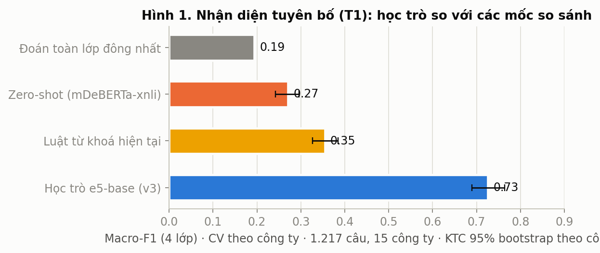
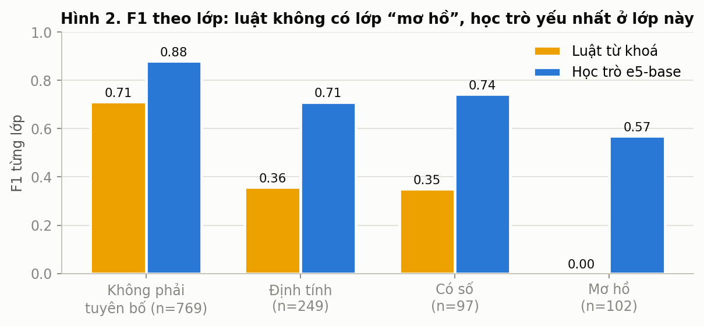
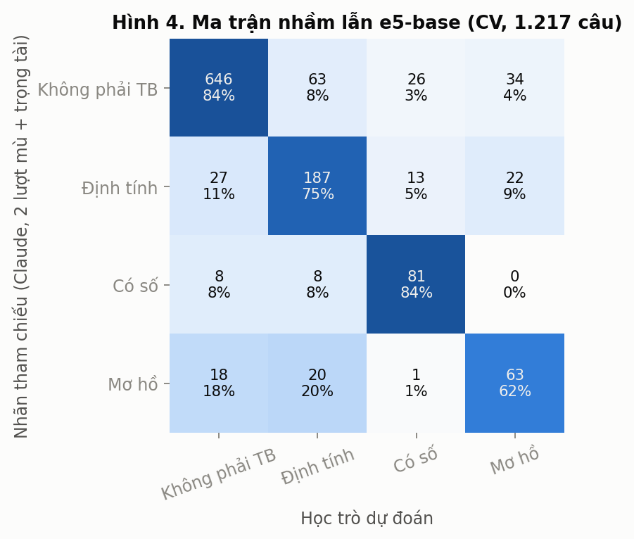
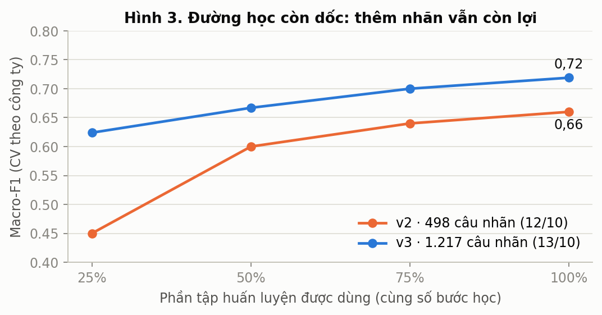
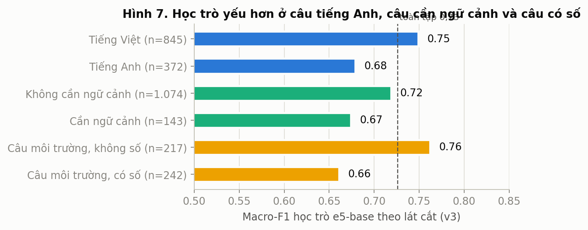
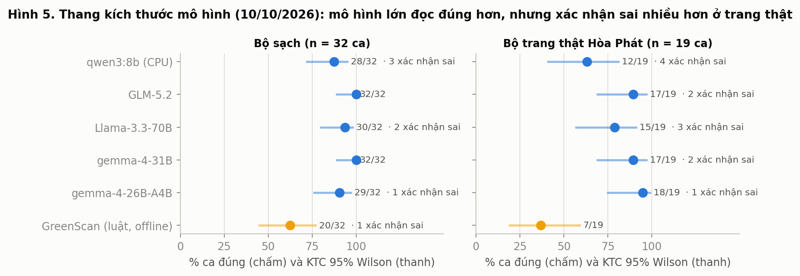
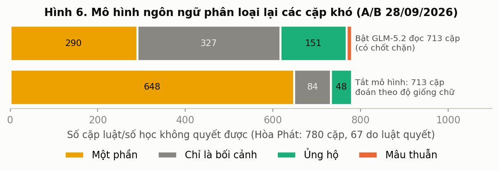
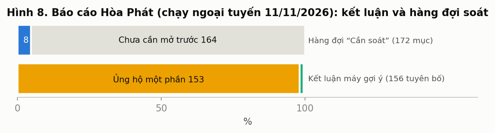

# GreenScan AI: kiểm chứng tuyên bố môi trường trong công bố của doanh nghiệp Việt Nam theo hướng bằng chứng trước

**Bản cập nhật 11/11/2026 cho vòng Chung kết · Cuộc thi Trí tuệ nhân tạo và Lượng tử trong Kinh tế – Tài chính – Kế toán lần thứ I, mã AQ2026-119**

Nhóm tác giả: nhóm GreenScan (Nhân, Quỳnh, Thảo).

> **Kết quả này là tín hiệu rủi ro dựa trên thông tin công khai, hỗ trợ người hành nghề đảm bảo khoanh vùng kiểm tra — không thay thế thủ tục thu thập bằng chứng theo ISSA 5000.**

---

## Tóm tắt

Doanh nghiệp niêm yết Việt Nam công bố ngày càng nhiều tuyên bố môi trường, nhưng hơn một nửa quan sát về phát thải khí nhà kính (KNK) theo Thông tư 96/2020 là trống, chỉ 2/22 báo cáo bền vững độc lập năm 2024 có đảm bảo bên thứ ba, và pháp luật chưa có khái niệm "tẩy xanh". GreenScan là công cụ hỗ trợ người hành nghề đảm bảo và người soát xét đọc báo cáo doanh nghiệp theo nguyên tắc **bằng chứng trước, mô hình sau, người quyết**. Hệ thống chia việc thành mười bước có vết: đọc tài liệu giữ nguồn trang, nhận diện tuyên bố, trích năm thuộc tính, truy xuất bằng chứng, kiểm chứng bằng số học và luật tất định, đối chiếu văn bản pháp luật đang hiệu lực, chấm rủi ro, xếp hàng đợi soát, cổng chất lượng và xuất giấy làm việc. Ở cấu hình mặc định, mọi bước chạy ngoại tuyến trên máy người dùng, không dùng mô hình ngôn ngữ lớn.

Bài trình bày năm nhóm kết quả đã đo: (1) bộ phân loại tuyên bố `multilingual-e5-base` huấn luyện trên 1.217 câu đạt macro-F1 0,73 [0,69; 0,76] so với nhãn do Claude gán, so với 0,36 của luật từ khoá; (2) thang kích thước mô hình trên 51 ca có đáp án cho thấy mô hình lớn đọc đúng hơn luật nhưng xác nhận sai nhiều hơn trên trang thật; (3) cho mô hình đọc 713 cặp khó của Hòa Phát làm lộ 327 cặp chỉ là bối cảnh, còn chốt chặn giữ 0 mâu thuẫn sai; (4) trên báo cáo Hòa Phát, hàng đợi "Cần soát" chọn 8 trong 172 mục để người soát mở trước; (5) bộ đánh giá GS-Eval v2 trên câu thật của 8 doanh nghiệp chỉ ra hai loại kết luận sai, và cả hai đã có cách sửa được đo trước và sau. Mọi số đo hiện có so với nhãn máy (đáp án dựng sẵn hoặc nhãn do Claude gán); số đo trên nhãn người là bước tiếp theo.

---

## 1. Giới thiệu

### 1.1 Vấn đề

Tài chính xanh ở Việt Nam tăng nhanh: tín dụng xanh khoảng 750 nghìn tỷ đồng (30/11/2025), chiếm khoảng 5% dư nợ. Khi dòng vốn "xanh" tăng, rủi ro doanh nghiệp dùng ngôn ngữ bền vững để tạo hình ảnh tốt hơn thực chất cũng tăng. Các cơ quan giám sát châu Âu (ESMA/EBA/EIOPA, 2024) định nghĩa tẩy xanh là khi tuyên bố, hành động hoặc truyền thông về bền vững "không phản ánh rõ ràng và công bằng hồ sơ bền vững thực chất" của tổ chức hay sản phẩm tài chính, cố ý hoặc vô ý.

Thực trạng công bố tại Việt Nam có ba đặc điểm quyết định cách thiết kế hệ thống:

| Phát hiện | Số liệu | Nguồn |
| --- | --- | --- |
| Tỷ lệ công ty HOSE có báo cáo phát triển bền vững | 1,06% (2015) → 28,38% (2024) | Hąbek & Bui 2025, 673 công ty |
| Báo cáo định tính (không số) | 72,5% (2024) | như trên |
| Báo cáo độc lập có đảm bảo bên thứ ba | 2/22 (2024) | như trên |
| Quan sát công bố KNK theo TT 96 đạt 0% | 50,6%; chỉ 21,3% đầy đủ | Lâm Thị Trúc Linh và cs. 2025, 399 quan sát |
| Tuân thủ công bố môi trường bắt buộc | 40,75%, thấp nhất trong các mục | Phạm Đức Hiếu và cs. 2019, 160 công ty |

Hệ quả: khi kiểm chứng một báo cáo thật, kết luận phổ biến nhất là "chưa đủ bằng chứng" hoặc "ủng hộ một phần", không phải "mâu thuẫn". Vì vậy giá trị của công cụ nằm ở việc chỉ ra **tuyên bố nào nên mở trước, vì sao, và còn thiếu thông tin gì**.

### 1.2 Vì sao không hỏi "AI có phát hiện tẩy xanh không"

Seele & Gatti (2017) chỉ ra tẩy xanh là một **cáo buộc từ bên ngoài**, không phải thuộc tính tự thân của văn bản. Khảo sát mới nhất về phát hiện tẩy xanh bằng NLP (Calamai và cs., 2025; v2 01/2026) kết luận chưa tồn tại bộ dữ liệu tẩy xanh đã được xác minh, và khuyến nghị kiến trúc phân rã có người giám sát, dùng nguồn bên thứ ba để giảm chủ quan. GreenScan chọn kiến trúc đó. Câu hỏi trục của hệ thống là:

> Với tuyên bố này, hệ thống đã tìm bằng chứng nào, chúng có so sánh được không, phép tính nào đã chạy, văn bản pháp luật nào liên quan, và phần nào vẫn chưa biết.

### 1.3 Đóng góp

1. Một quy trình mười bước, mỗi bước có vết, chạy trên báo cáo thật 264 trang trong 107–121 giây trên laptop không GPU (i7-1355U, 16 GB; đo 06/10/2026), không gửi dữ liệu ra ngoài ở chế độ ngoại tuyến (kiểm 09/10/2026: 0 kết nối).
2. Mười bất biến kiến trúc được thi hành bằng bài kiểm tự động, trong đó quan trọng nhất là: số học do mã tất định, mô hình không ghi đè; "chưa đủ bằng chứng" là kết luận hợp lệ; truy xuất và kiểm chứng được đo tách nhau.
3. Quy trình đo đăng ký trước ngưỡng và dự đoán, khoảng tin cậy bootstrap theo công ty, báo cả kết quả không như mong đợi.
4. Bộ phân loại tuyên bố tiếng Việt–Anh nhỏ (278 triệu tham số, khoảng 119 ms/câu trên CPU) kèm chuỗi tái lập trên Kaggle.
5. Kho văn bản pháp luật Việt Nam đã đối chiếu bản ký, ghi ngày hiệu lực và chuỗi sửa đổi theo từng vấn đề.
6. Đối chiếu với ISSA 5000: 16 yếu tố bắt buộc của báo cáo đảm bảo (đoạn 190 (a)–(l) và 191) và 6 mẫu câu kết luận lấy nguyên văn từ 12 báo cáo minh hoạ của IAASB.

---

## 2. Nghiên cứu liên quan

### 2.1 Phát hiện tuyên bố môi trường và tẩy xanh bằng NLP

Nhóm Leippold (Zurich) đặt nền cho hướng này: ClimateBERT (Webersinke và cs., 2022) tiền huấn luyện trên văn bản khí hậu; Bingler và cs. (2022) dùng nó để đo "nói suông" và chọn lọc thông tin trong công bố khí hậu; **Environmental Claim Detection** (Stammbach và cs., ACL 2023) định nghĩa tác vụ phân loại câu có phải tuyên bố môi trường hay không, báo SVM n-gram F1 khoảng 69–71 so với transformer khoảng 84–85, vì "không phải tuyên bố nào cũng chứa từ khoá". ClimateBERT-NetZero (Schimanski và cs., EMNLP 2023) nhận diện mục tiêu net-zero. ClimRetrieve (Schimanski và cs., EMNLP 2024) là bộ chuẩn truy xuất trên báo cáo khí hậu doanh nghiệp. A3CG (Ong và cs., ACL 2025) phân tích cặp khía cạnh–hành động; Braun và cs. (2026) nối tiếp bằng học tương phản. Climate-ModernBERT (Yu và cs., 09/2026) đạt 76,3 F1 trung bình trên 9 benchmark khí hậu. EmeraldMind (Kaoukis và cs., 2026) dùng đồ thị tri thức; DeepGreen (Xu và cs., 2026) giám sát dựa trên mô hình ngôn ngữ lớn với dữ liệu Trung Quốc.

Điều GreenScan rút ra: bộ trích tuyên bố bằng từ khoá sẽ bỏ sót, nên cần một bộ phân loại nơ-ron (mục 6.1) và cần đo độ phủ trên các câu không được trích.

### 2.2 Kiểm chứng tuyên bố và lớp "không đủ bằng chứng"

FEVER (Thorne và cs., 2018), SciFact (Wadden và cs., 2020), AVeriTeC (Schlichtkrull và cs., NeurIPS 2023) và Climate-FEVER (Diggelmann và cs., 2020; 1.535 tuyên bố) đều có lớp *không đủ thông tin*. Joren và cs. (ICLR 2025) cho thấy mô hình ngôn ngữ lớn thường trả lời thay vì từ chối khi ngữ cảnh không đủ. GreenScan vì vậy để **luật** quyết kết luận "chưa đủ bằng chứng", và có lớp "ủng hộ một phần" với quy tắc gộp tất định.

### 2.3 Số học trong văn bản tài chính

Mô hình ngôn ngữ lớn giảm tới 62% độ chính xác khi số bị nhiễu (NumPert, Aarnes & Setty 2025); FinQA (Chen và cs., 2021) với suy luận từ 3 bước trở lên chỉ đạt 22,78%; FinDVer (Zhao và cs., EMNLP 2024): mô hình tốt nhất 77,2% so với chuyên gia 93,3%. Đây là lý do bất biến "số học do mã": dung sai làm tròn, cộng lại bảng, so cùng chỉ số–kỳ–phạm vi đều là phép tính tất định.

### 2.4 Thiết kế truy xuất và đo lường

Zhao và cs. (ACM TOSEM 2026) cho thấy tài liệu gây nhiễu làm hỏng hệ thống hỏi đáp có truy xuất, và độ phủ truy xuất cao không bảo đảm kết luận đúng. Barnett và cs. (2024) liệt kê bảy điểm hỏng của kiến trúc này. GreenScan tách chỉ số truy xuất (Recall@k, MRR, nDCG) khỏi chỉ số kiểm chứng (độ chính xác, macro-F1, số mâu thuẫn sai, tỷ lệ từ chối kết luận) và bắt đầu từ mốc tất định.

### 2.5 Người và máy

Bansal và cs. (CHI 2021): lời giải thích của AI có thể làm người tin cả khi AI sai. Warren và cs. (CHI 2025): kiểm chứng viên chuyên nghiệp đòi giải thích dựa trên bằng chứng. Wang và cs. (ACL 2024) và Zheng và cs. (2023): mô hình dùng làm giám khảo thiên lệch vị trí và tự ưu tiên. Vì vậy GreenScan hiện bằng chứng gốc (ảnh trang có tô sáng), người soát chốt kết luận, và mọi số đo đều ghi rõ loại nhãn.

### 2.6 Tài nguyên tiếng Việt

VN-MTEB (Findings of EACL 2026): `multilingual-e5-large-instruct` (560M, MIT) cao nhất nhóm dưới 600M tham số; `multilingual-e5-small` (118M) hợp máy 8 GB. mDeBERTa-v3-base-xnli đạt XNLI-vi 0,793. ViFactCheck (7.232 cặp, MIT) là bộ kiểm chứng tiếng Việt có giấy phép thoáng nhất. Một số bộ phổ biến (environmental_claims, AVeriTeC, XNLI, ViANLI) chỉ dùng phi thương mại. Multilingual E5 (Wang và cs., 2024) được chọn vì giấy phép MIT và có ba cỡ.

### 2.7 Khung pháp lý và chuẩn mực

EU Directive 2024/825 áp dụng từ 27/09/2026, cấm tuyên bố môi trường chung chung không chứng minh được và tuyên bố trung hoà dựa trên bù trừ. UK CMA Green Claims Code, US FTC Green Guides, ASIC INFO 271 cung cấp bộ câu tự kiểm. Việt Nam: Luật BVMT 72/2020 (sửa bởi 146/2025), NĐ 06/2022 (sửa bởi 119/2025, 83/2026), QĐ 13/2024 và QĐ 21/2025 về danh mục cơ sở kiểm kê KNK, TT 96/2020/TT-BTC về công bố thông tin trên thị trường chứng khoán, TT 17/2022/TT-NHNN về quản lý rủi ro môi trường trong cấp tín dụng. Chưa văn bản nào định nghĩa tẩy xanh. Với công việc đảm bảo, chuẩn mực tham chiếu là ISSA 5000 của IAASB.

---

## 3. Định nghĩa bài toán

**Đầu vào.** Tài liệu công bố của một doanh nghiệp (báo cáo thường niên, báo cáo phát triển bền vững, bản cáo bạch; PDF có lớp chữ hoặc PDF quét, DOCX, HTML) với vai trò **tài liệu cần kiểm**, và **tài liệu đối chiếu** gồm tài liệu khác của chính doanh nghiệp, văn bản pháp luật, nguồn bên ngoài doanh nghiệp và chuẩn mực.

**Đầu ra.** Với mỗi tuyên bố môi trường: năm thuộc tính (chỉ số, giá trị và đơn vị, kỳ báo cáo, năm gốc, phạm vi), danh sách bằng chứng có trang, kết luận máy gợi ý thuộc một trong năm loại — **Được ủng hộ · Ủng hộ một phần · Chưa được chứng minh · Mâu thuẫn với nguồn · Chưa đủ bằng chứng** — văn bản pháp luật liên quan, điểm rủi ro 0–100 có phân rã, và vị trí trong hàng đợi soát kèm lý do. Ở cấp lượt chạy: giấy làm việc, bảng hàng đợi CSV và gói bằng chứng.

**Ba lớp định nghĩa.** Tẩy xanh nói chung; tẩy xanh trong tài chính; và **rủi ro tẩy xanh** cho một hệ thống AI, tức mức không nhất quán giữa tuyên bố, bằng chứng định lượng (phát thải, năng lượng, nước, chất thải, chi tiêu và doanh thu xanh), bằng chứng pháp lý và nguồn bên ngoài. Hệ thống ước lượng rủi ro; không kết luận pháp lý, không thay người hành nghề đảm bảo.

**Phân loại tuyên bố (T1).** Bốn lớp: không phải tuyên bố; tuyên bố định tính (cam kết, mô tả không số); tuyên bố có số (có giá trị và đơn vị); ngôn ngữ xanh mơ hồ (không kiểm được). Quy ước gán nhãn đi kèm gói dữ liệu.

---

## 4. Nguyên lý hoạt động

### 4.1 Kiến trúc tổng thể

Một bộ điều phối gọi các mô-đun chuyên biệt theo thứ tự cố định. Sơ đồ quy trình nằm trong thư mục sơ đồ đi kèm.

| # | Bước | Làm gì |
| --- | --- | --- |
| 1 | Kiểm đầu vào | Kiểm danh sách tài liệu, gán mã lượt chạy, ghi mã băm từng tệp |
| 2 | Đọc tài liệu | Đọc theo khối; trang quét được đọc bằng OCR tại máy và báo độ tin cậy; giữ bảng nguyên khối; cắt đoạn ngắn |
| 3 | Nhận diện tuyên bố | Bộ trích bằng luật (từ điển chủ đề môi trường, loại tiêu đề, mục lục, dòng bảng, câu cụt, có ghi lý do); gán năm thuộc tính |
| 4 | Dựng chỉ mục | Dựng bộ truy xuất, bộ kiểm chứng, bộ pháp lý, bộ chấm điểm |
| 5 | Truy xuất bằng chứng | Kết hợp BM25 và n-gram ký tự, hợp nhất thứ hạng; 30 ứng viên giữ 5; gắn cờ đoạn có dấu hiệu nhắn lệnh tới máy |
| 6 | Đọc cặp khó (tuỳ chọn) | Chỉ khi bật mô hình: đọc các cặp luật không quyết được |
| 7 | Kiểm chứng và pháp lý | Số học → cụm từ xác nhận → chiều thay đổi → độ giống; văn bản đang hiệu lực theo ngày, sửa đổi theo vấn đề |
| 8 | Chấm rủi ro và xếp hàng | Đọc số liệu công bố, cộng lại bảng, đối chiếu chéo, xếp hàng đợi soát |
| 9 | Cổng chất lượng | G0–G9, gồm G8 toàn vẹn tài liệu và G9 chất lượng đọc tài liệu |
| 10 | Xuất kết quả | Giấy làm việc, gói bằng chứng, bảng hàng đợi CSV |

### 4.2 Quy tắc kết luận

- Mâu thuẫn do luật hoặc số học → "Mâu thuẫn với nguồn". Một đoạn thuộc chính tài liệu chứa tuyên bố không được dùng để bác bỏ tuyên bố đó; hai con số vẫn hiện cho người soát.
- "Được ủng hộ" cần đoạn từ một tài liệu khác, đủ độ liên quan, và khớp số hoặc cụm từ xác nhận cùng chỉ số, kỳ và phạm vi. Một chốt chặn bổ sung (mục 6.5) đòi thêm nguồn độc lập: văn bản pháp luật, nguồn bên ngoài doanh nghiệp hoặc chuẩn mực.
- "Chưa được chứng minh" chỉ khi kho tài liệu đủ rộng để suy ra vắng bằng chứng; còn lại "Chưa đủ bằng chứng".
- Số học: dung sai bằng nửa chữ số cuối đã công bố (trần 10%). Ví dụ cộng lại bảng KNK: 22.540.603 + 933.876 = 23.474.479 so với công bố 23.474.480 → khớp (do làm tròn).
- Số đọc bằng OCR với độ tin cậy thấp không được dùng để kết luận "khớp" hay "mâu thuẫn" (cổng G9).
- 17 ca bẫy (gộp dấu, số thứ tự nhãn, chéo chỉ số, tuyên bố nằm ở tiêu đề…) là cổng hồi quy: mọi thay đổi ở bước trích, kiểm chứng phải giữ 17/17.

### 4.3 Chấm rủi ro và hàng đợi

Điểm cấp tuyên bố theo 7 tiêu chí (thiếu cụ thể; thiếu định lượng; thiếu năm gốc, kỳ hoặc phạm vi; bằng chứng yếu; không có đảm bảo độc lập; bằng chứng mâu thuẫn; ngôn ngữ phóng đại), có điều chỉnh theo trọng yếu, tài chính xanh và cam kết net-zero. Hàng đợi soát xếp theo trọng yếu (40), nghĩa vụ pháp lý (25), khoảng trống bằng chứng (25), bất thường (10), giữ những mục vượt ngưỡng điểm, trong khoảng 5 đến 25 mục. Mỗi mục kèm lý do tiếng Việt, ví dụ: "nhóm phát thải khí nhà kính; kết luận ‘ủng hộ một phần’, thiếu 4/5 thuộc tính". Điểm ưu tiên là thứ tự mở, không phải mức vi phạm.

### 4.4 Pháp lý

Kho văn bản pháp luật đã đối chiếu bản ký trên datafiles.chinhphu.vn; mỗi văn bản có ba ngày (ký, hiệu lực, bị sửa đổi bởi) và sửa đổi chỉ gắn với vấn đề nó sửa. Ví dụ: NĐ 83/2026 chỉ sửa thủ tục chất kiểm soát ô-dôn và HFC, nên không được trích kèm các tuyên bố phát thải chung. Hệ thống tìm đúng văn bản đang hiệu lực cùng chủ đề; quy tắc xác định nghĩa vụ cụ thể của từng doanh nghiệp là phần phát triển tiếp theo.

### 4.5 Mô hình ngôn ngữ và dữ liệu rời máy

Ba chế độ: **ngoại tuyến** (mặc định; luật, số học và truy xuất; 0 kết nối ra ngoài), **đám mây** (chỉ các cặp khó, chỉ cho tài liệu công khai) và **GPU tại máy**. Khi bật, mô hình chỉ nhận lời dặn cố định cùng nguyên văn câu tuyên bố và đoạn bằng chứng, và không bao giờ một mình đưa ra kết luận "Mâu thuẫn với nguồn": khi mô hình cho rằng có mâu thuẫn, kết luận chỉ là "Ủng hộ một phần" kèm cờ chuyển người soát.

### 4.6 Mười bất biến kỹ thuật

Các bất biến quan trọng: số học do mã; "chưa đủ bằng chứng" là kết luận hợp lệ; mô hình không tự quyết "Được ủng hộ" hay "Mâu thuẫn với nguồn"; đánh giá tách đôi truy xuất và kiểm chứng; ngưỡng đăng ký trước khi đo; mỗi lỗi đã gặp trở thành một bài kiểm hồi quy.

### 4.7 Giao diện

Ba bước trên một màn hình: Tải tài liệu → Soát theo hàng đợi → Giấy làm việc. Mọi màn hình và mọi tệp xuất ra đều mở đầu bằng câu lưu ý ISSA 5000. Người soát ghi quyết định (Xác nhận, Ghi đè, Yêu cầu thêm bằng chứng, Chưa kết luận) kèm lý do, tên và thời điểm; quyết định chỉ ghi thêm, không xoá được. GreenScan Studio biến danh sách thuộc tính còn thiếu thành đề xuất sửa cụ thể, không thêm con số mới, và xuất báo cáo chỉnh sửa (HTML, PDF, DOCX) kèm lý do từng đoạn.

---

## 5. Dữ liệu

Thẻ dữ liệu đầy đủ (nguồn, cỡ, phân bố nhãn, độ cân bằng, giấy phép, hạn chế) nằm trong thư mục dữ liệu đi kèm.

### 5.1 Kho văn bản

Thu thập có mục tiêu: doanh nghiệp phát thải cao và các văn bản neo pháp lý (QĐ 13/2024, TT 96/2020). Tổng 66.539 câu ứng viên; 15 công ty vào tập huấn luyện T1. Phụ lục QĐ 13 tính theo TOE, không phải tCO₂e; quy ước này được ghi vào hướng dẫn gán nhãn.

### 5.2 Các bộ đánh giá

| Bộ | Dùng để đo | Cỡ | Loại nhãn |
| --- | --- | --- | --- |
| T1 | phân loại câu thành 4 lớp | 1.217 câu | Claude, 2 lượt độc lập, κ 0,92 (đo độ nhất quán của nhãn, không phải độ đúng) |
| GS-Bench v1 | kết luận khớp / mâu thuẫn / chưa đủ | 453 ca (+162 ca ngoài mẫu) | đáp án dựng sẵn và Claude |
| GS-Eval v2 | kết luận, lời giải thích và điểm rủi ro trên câu thật | 146 câu, 8 doanh nghiệp | Claude |
| GS-Issue lớp A | tìm lỗ hổng và đề xuất sửa | 740 ca | đáp án có sẵn (lỗi do nhóm cấy vào) |
| Báo cáo minh hoạ ISSA 5000 | mẫu câu kết luận đảm bảo | 12 báo cáo IAASB | lấy từ tiêu đề IAASB đặt |

Tập kiểm tra trên người (câu T1 của Hòa Phát và cặp tuyên bố–bằng chứng) đã dựng xong ứng viên, đang chờ gán nhãn. Ngưỡng để báo số trên nhãn người đã đăng ký trước: ít nhất 60 cặp và κ giữa hai người từ 0,70.

### 5.3 Ca thật và đối chứng

Bốn ca đã có phán quyết của cơ quan có thẩm quyền: Keurig Dr Pepper 2024, BNY Mellon 2022, DWS 2023, KLM 2024 (nguồn chính thức, có mã băm). Hai đối chứng Việt Nam không có nhãn tẩy xanh: Hòa Phát, Bảo Việt. Nguyên tắc: đối chứng không bao giờ bị gán nhãn tẩy xanh chỉ vì thiếu dữ liệu. Cổng hồi quy 4/4 ca thật khớp, dù bật hay tắt mô hình.

---

## 6. Thí nghiệm và kết quả

Mọi so sánh kèm khoảng tin cậy 95% bootstrap theo **công ty**. Chỉ nói "hơn" khi cận dưới của hiệu số lớn hơn 0. Mọi bảng đều ghi loại nhãn.

### 6.1 Bộ phân loại tuyên bố T1

Cấu hình: `multilingual-e5-base` (278M tham số), GPU Tesla T4 trên Kaggle, kiểm định chéo theo công ty, 3 seed; so với đoán lớp đông nhất, zero-shot mDeBERTa-xnli và luật từ khoá.

| Hệ thống (so với nhãn Claude) | Độ chính xác | Macro-F1 [KTC 95%] | κ | F1 "là tuyên bố" |
| --- | --- | --- | --- | --- |
| Đoán toàn "không phải tuyên bố" | — | 0,19 | — | 0,00 |
| Zero-shot mDeBERTa-xnli | 0,45 | 0,27 [0,24; 0,30] | 0,11 | 0,49 |
| Luật từ khoá | 0,55 | 0,36 [0,33; 0,38] | 0,25 | 0,61 |
| **e5-base** | **0,80** | **0,73 [0,69; 0,76]** | **0,66** | **0,82 [0,79; 0,85]** |

Hiệu số theo cặp: e5 hơn luật +0,37 [0,33; 0,41], hơn zero-shot +0,45 [0,41; 0,50]. Từ v2 lên v3 trên cùng 498 câu: 0,665 → 0,726, Δ +0,061 [+0,021; +0,098].

Theo lớp (Hình 2): có số 0,74, định tính 0,71, mơ hồ 0,57; luật từ khoá không có lớp "mơ hồ". Nhầm lẫn chính (Hình 4) là giữa "định tính" và "không phải tuyên bố" (63 + 27 câu) và "mơ hồ" sang "định tính" (20).

**Đường học** (Hình 3): 0,62 / 0,67 / 0,70 / 0,72 tại 25/50/75/100% dữ liệu, vẫn còn dốc, nên thêm nhãn còn có lợi.

**Lát cắt** (Hình 7): tiếng Việt 0,75 (n = 845), tiếng Anh 0,68 (372); câu cần ngữ cảnh 0,67 (143); câu môi trường có số 0,66 (242), không số 0,76 (217).

**Ablation.** Che số so với giữ số: Δ +0,014 [−0,02; +0,04]; thêm câu kề: Δ −0,012 [−0,06; +0,02]; cả hai không có khác biệt có ý nghĩa. mDeBERTa-xnli tinh chỉnh hội tụ về một lớp sau 18 lần thử (lr 5e-5, 20 epoch), nên không dùng làm mốc chính. Dao động theo seed: 0,66–0,71.

**Chi phí suy luận.** 118,7 ms/câu trên CPU (batch 1, 4 luồng).

### 6.2 Thang kích thước mô hình

32 ca sạch (13 nhóm lỗi: làm tròn, lệch một con số, khác Scope, khác kỳ, mục tiêu so với thực hiện, khác ranh giới, đơn vị, cộng bảng, phủ định…) và 19 ca trang thật của Hòa Phát. Nhãn suy từ GHG Protocol, không từ luật GreenScan; cùng một lời dặn tiếng Việt, nhiệt độ 0.

| | Bộ sạch (32) | Trang thật (19) | Xác nhận sai (trang thật) | Thời gian/ca |
| --- | --- | --- | --- | --- |
| GreenScan luật, ngoại tuyến | 20 | 7 | 0 | ~0 |
| gemma-4-26B-A4B | 29 | 18 | 1 | 1,2 s |
| gemma-4-31B | 32 | 17 | 2 | 1,5 s |
| Llama-3.3-70B | 30 | 15 | 3 | 2,8 s |
| GLM-5.2 | 32 | 17 | 2 | 13,7 s |
| qwen3:8b trên CPU | 28 | 12 | 4 | 66–257 s |

Mô hình lớn đọc đúng hơn luật (McNemar p ≤ 0,02 trên bộ sạch), nhưng trên trang thật mọi mô hình đều có xác nhận sai, chủ yếu vì bảng PDF bị dàn phẳng, còn luật thì không. Thiết kế rút ra: mô hình làm **bộ đọc gợi ý**, luật và số học làm **bộ quyết định**.

### 6.3 Mô hình đọc cặp khó trên Hòa Phát (A/B 28/09/2026)

Hai tài liệu (báo cáo phát triển bền vững 2025 và báo cáo thường niên 2024, 264 trang), 780 cặp tuyên bố–bằng chứng, 67 cặp do luật quyết, 713 cặp còn lại.

| | Tắt mô hình | Bật, mô hình tự quyết | **Bật, có chốt chặn** |
| --- | --- | --- | --- |
| Kết luận: ủng hộ một phần / được ủng hộ / mâu thuẫn / chưa đủ | 153/2/0/1 | 136/6/10/4 | 150/2/0/4 |
| Rủi ro cao và rất cao trên đối chứng | 0 | 8 + 2 | 0 |
| Thời gian | 144 s | 632 s (710 lần gọi, 0 lỗi) | 188 s (có bộ nhớ đệm) |

Mô hình nhận ra 327 cặp chỉ là bối cảnh và chuyển đúng 3 tuyên bố sang "chưa đủ bằng chứng". Khi để mô hình tự quyết, 10 kết luận "mâu thuẫn" phần lớn sai khi soát tay (câu dính cột, dòng bảng "GIỚI TÍNH: 100 %" bị đọc thành "100 % nam"). Chốt chặn giữ 0 mâu thuẫn sai trên đối chứng.

### 6.4 Hàng đợi soát trên báo cáo Hòa Phát (11/11/2026)

Chạy ngoại tuyến trên báo cáo phát triển bền vững và báo cáo thường niên của Hòa Phát: 156 tuyên bố và 16 số liệu công bố, tổng 172 mục. Kết luận máy gợi ý: 153 "Ủng hộ một phần", 2 "Được ủng hộ", 1 "Chưa đủ bằng chứng". Hàng đợi "Cần soát" chọn 8 mục để mở trước, mỗi mục kèm lý do và trang. Bộ lọc chất lượng câu đánh dấu 3/156 câu dính tiêu đề do bố cục trang; các câu này vẫn nằm trong danh sách nhưng không vào hàng đợi và không tính vào điểm rủi ro.

Phân bố kết luận tập trung ở "Ủng hộ một phần" vì bằng chứng đối chiếu đều là tài liệu của chính doanh nghiệp; khi có thêm nguồn độc lập (dữ liệu phát thải bên ngoài, hồ sơ cơ quan quản lý) kết luận sẽ phân hoá hơn. Với người soát, đầu ra hữu ích nhất trên mẫu này là thứ tự mở và danh sách thuộc tính còn thiếu.

### 6.5 GS-Eval v2: hai loại kết luận sai và cách sửa

GS-Eval v2 chạy hệ thống trên 146 câu thật do bộ trích lấy ra từ báo cáo của 8 doanh nghiệp, nhãn do Claude gán theo hướng dẫn gán nhãn đi kèm.

**Câu không phải tuyên bố.** 44/146 câu (30%, Wilson [0,23; 0,38]) không phải tuyên bố: dòng bảng, mục lục, chỉ mục GRI, chân trang. Người soát vẫn cần lọc; bộ lọc chất lượng câu (mục 6.4) đánh dấu loại này thay vì xoá.

**Kết luận "mâu thuẫn" sai.** Trước sửa, 24 kết luận "Mâu thuẫn với nguồn" trên tuyên bố thật là sai. Chốt chặn 05/11/2026 (một đoạn của chính tài liệu không được bác bỏ tuyên bố; từ phủ định trong tài liệu doanh nghiệp chỉ tính khi nằm trong một phán quyết) đưa số này về 0, đồng thời giữ nguyên 453/453 ca GS-Bench và 4/4 ca thật.

| GS-Eval v2, 102 tuyên bố thật | Trước sửa | Sau sửa 05/11 |
| --- | --- | --- |
| "Mâu thuẫn" sai trên tuyên bố thật | 24 | **0** |
| Kết luận trùng nhãn | 0,40 | 0,51 |
| κ / macro-F1 | 0,15 / 0,29 | 0,18 / 0,52 |

**Kết luận "được ủng hộ" chỉ dựa trên lời doanh nghiệp.** Cả 5 kết luận "Được ủng hộ" trong mẫu đều không đúng nhãn: câu tuyên bố được chính doanh nghiệp nhắc lại ở một tài liệu khác và bị coi là xác nhận. Chốt chặn nguồn độc lập (mục 4.2) đã có sẵn: khi bật, những ca này thành "Ủng hộ một phần" với lý do "chỉ tài liệu khác của chính doanh nghiệp xác nhận; chưa có nguồn độc lập". Kiểm trên GS-Bench: 453/453 ca giữ nguyên. Chốt chặn hiện để tắt theo mặc định cho đến khi chạy lại đầu–cuối GS-Eval v2 theo dự đoán đã đăng ký.

### 6.6 Đối chiếu với ISSA 5000

Từ bản ISSA 5000 chính thức và bộ báo cáo minh hoạ của IAASB (11/2025, 8 báo cáo A–H) cùng 4 báo cáo ở Phụ lục 3 của chuẩn mực, nhóm lập: (a) danh mục 16 yếu tố bắt buộc của báo cáo đảm bảo theo đoạn 190 (a)–(l) và 191, mỗi yếu tố có điều kiện áp dụng và cách kiểm; (b) 6 mẫu câu kết luận tiếng Anh (không sửa đổi có giới hạn và hợp lý, ngoại trừ có giới hạn và hợp lý, từ chối đưa ra kết luận, trái ngược), lấy nguyên văn và chịu được chân trang chen giữa câu khi ngắt trang. Bộ mẫu câu nhận đúng loại kết luận và mức đảm bảo của 12/12 báo cáo. Đây là kết quả trên chính các báo cáo đã dùng để soạn mẫu câu, nên mới là điều kiện cần.

### 6.7 Kiểm thử và tái lập

626 bài kiểm tự động, gồm bất biến kiến trúc, 17 ca bẫy, lớp pháp lý, hàng đợi, câu lưu ý ISSA 5000 trên mọi đầu ra; 4/4 ca thật khớp. Mỗi lượt chạy ghi phiên bản quy trình và cấu hình; mỗi số huấn luyện ghi phiên bản dữ liệu, seed và lời dặn.

---

## 7. Thảo luận và giới hạn

1. **Loại nhãn.** Mọi số đo hiện có so với đáp án dựng sẵn hoặc nhãn do Claude gán; κ 0,92 giữa hai lượt Claude cho biết nhãn nhất quán, chưa cho biết nhãn đúng. Tập kiểm tra trên nhãn người đã dựng ứng viên và có ngưỡng đăng ký trước.
2. **Nguồn độc lập.** Trên mẫu Hòa Phát, toàn bộ bằng chứng đối chiếu là tài liệu của chính doanh nghiệp, nên kết luận tập trung ở "Ủng hộ một phần". Bổ sung nguồn bên ngoài (Climate TRACE, Global Energy Monitor, hồ sơ xử phạt của cơ quan quản lý) là hướng tiếp theo.
3. **Pháp lý.** Hệ thống tìm đúng văn bản đang hiệu lực cùng chủ đề; quy tắc xác định nghĩa vụ cụ thể của doanh nghiệp chưa có.
4. **Thuộc tính thiếu.** Nhiều tuyên bố thiếu kỳ báo cáo hoặc năm gốc; cần tách phần do công bố thiếu và phần do bước trích bỏ sót.
5. **Cỡ mẫu.** Với 60–100 cặp, κ = 0,70 có khoảng tin cậy khoảng [0,52; 0,88]; các ablation nhỏ chỉ có thể kết luận "không phát hiện khác biệt".
6. **Giấy phép.** Một số bộ dữ liệu phụ chỉ dùng phi thương mại và không nằm trong gói nộp.
7. **Phạm vi sản phẩm.** GreenScan không kết luận vi phạm hay tẩy xanh, chưa đối chiếu hoá đơn, chứng từ, chưa so giữa các năm hay với doanh nghiệp cùng ngành.

---

## 8. Hướng phát triển

| Luận điểm | Câu hỏi | Thí nghiệm |
| --- | --- | --- |
| Thước đo đáng tin | "Tự gán rồi tự chấm?" | κ giữa hai người trên tập kiểm tra; so nhãn Claude và bộ phân loại với nhãn người |
| Tốt hơn cách đang có | "Mô hình chat có làm được không?" | T1 trên câu Hòa Phát gán bởi người; truy xuất (BM25 · BGE-M3 · có sắp xếp lại); kiểm chứng (luật · mô hình có chốt · mô hình tự quyết) |
| Không vu oan | "Có quy kết sai không?" | 4 ca phán quyết và 2 đối chứng; nguồn bên ngoài cho Hòa Phát; chốt chặn nguồn độc lập |
| Dùng được thật | "Người soát có tiết kiệm thời gian không?" | Thử nghiệm người dùng: thời gian ra quyết định, thang SUS, trước và sau Studio |

Ngưỡng đã đăng ký: không báo số nếu tập nhãn người dưới 60 cặp hoặc κ dưới 0,70; chỉ bật mô hình nhúng BGE-M3 mặc định khi Recall@5 tăng từ 10 điểm và thời gian không quá 2 lần.

Nguyên tắc giữ trong mọi thí nghiệm: tách ba câu hỏi (nhãn có tin được không, mô hình thầy có đúng không, mô hình trò có đúng không); đơn vị độc lập là công ty; đăng ký trước; tập kiểm tra chỉ dùng một lần; so sánh theo cặp kèm khoảng tin cậy, hiệu chỉnh Holm khi so nhiều lần; báo cả kết quả không như mong đợi; nhãn AI không làm tập kiểm tra cuối; dữ liệu nước ngoài không thay tập kiểm tra Việt Nam.

---

## Tài liệu tham khảo

**Tẩy xanh và NLP khí hậu**

- Calamai, T., Balalau, O., Le Guenedal, T., Suchanek, F. M. (2025; v2 29/01/2026). Detecting Greenwashing: A Natural Language Processing Literature Survey. arXiv:2502.07541.
- Moodaley, W., Telukdarie, A. (2023). Greenwashing, Sustainability Reporting, and AI: A Systematic Literature Review. Sustainability 15(2), 1481.
- Webersinke, N., Kraus, M., Bingler, J. A., Leippold, M. (2022). ClimateBERT. arXiv:2110.12010.
- Bingler, J. A., Kraus, M., Leippold, M., Webersinke, N. (2022). Cheap talk and cherry-picking. Finance Research Letters 47, 102776.
- Stammbach, D., Webersinke, N., Bingler, J. A., Kraus, M., Leippold, M. (2023). Environmental Claim Detection. ACL 2023 Short, 1051–1066.
- Schimanski, T. và cs. (2023). ClimateBERT-NetZero. EMNLP 2023. · (2024). ClimRetrieve. EMNLP 2024, 17509–17524.
- Ong, K., Mao, R., Varshney, D., Cambria, E., Mengaldo, G. (2025). Towards Robust ESG Analysis Against Greenwashing Risks (A3CG). ACL 2025 Long.
- Braun và cs. (2026). Enhancing Language Models for Robust Greenwashing Detection. arXiv:2601.21722.
- Yu, T. và cs. (2026). Climate-ModernBERT. arXiv:2609.07798.
- Kaoukis, G. và cs. (2026). EmeraldMind. · Xu, C. và cs. (2026). DeepGreen. Computational Economics.
- Seele, P., Gatti, L. (2017). Greenwashing revisited. Business Strategy and the Environment. · Lyon, T., Montgomery, A. W. (2015). The means and end of greenwash. Organization & Environment.

**Kiểm chứng, số học, truy xuất**

- Thorne, J. và cs. (2018). FEVER. NAACL 2018. · Wadden, D. và cs. (2020). SciFact. EMNLP 2020. · Schlichtkrull, M., Guo, Z., Vlachos, A. (2023). AVeriTeC. NeurIPS 2023.
- Diggelmann, T. và cs. (2020). CLIMATE-FEVER. arXiv:2012.00614.
- Joren, H. và cs. (2025). Sufficient Context. ICLR 2025.
- Zhao, S. và cs. (2026). Understanding the Fundamental Design Decisions of RAG Systems. ACM TOSEM. · Barnett, S. và cs. (2024). Seven Failure Points When Engineering a RAG System.
- Aarnes, P. R., Setty, V. (2025). NumPert. arXiv:2511.09971.
- Chen, Z. và cs. (2021). FinQA. EMNLP 2021. · Zhao, Y. và cs. (2024). FinDVer. EMNLP 2024.
- Bansal, G. và cs. (2021). CHI 2021. · Warren và cs. (2025). CHI 2025. · Wang, P. và cs. (2024). ACL 2024. · Zheng, L. và cs. (2023). NeurIPS 2023.

**Mô hình và tài nguyên tiếng Việt**

- Wang, L. và cs. (2024). Multilingual E5 Text Embeddings. arXiv:2402.05672.
- He, P., Gao, J., Chen, W. (2021). DeBERTaV3. arXiv:2111.09543.
- VN-MTEB (Findings of EACL 2026). · ViFactCheck (2024).

**Pháp lý, chuẩn mực và thực trạng Việt Nam**

- IAASB (2024). International Standard on Sustainability Assurance 5000 (ISSA 5000). · IAASB (11/2025). ISSA 5000 Sustainability Assurance Illustrative Reports.
- ESAs (2024). Final Report on Greenwashing. · EU Directive 2024/825. · UK CMA Green Claims Code. · US FTC Green Guides. · ASIC INFO 271.
- Luật BVMT 72/2020/QH14 và 146/2025; NĐ 06/2022, 119/2025, 83/2026; QĐ 13/2024/QĐ-TTg, 21/2025; TT 96/2020/TT-BTC; TT 17/2022/TT-NHNN.
- Hąbek, P., Bui, T. T. (2025). Sustainability reporting by Vietnamese listed companies. · Lâm Thị Trúc Linh và cs. (2025). Công bố KNK theo TT 96/GRI 305. · Phạm Đức Hiếu và cs. (2019). Tuân thủ công bố TT 155/2015.
