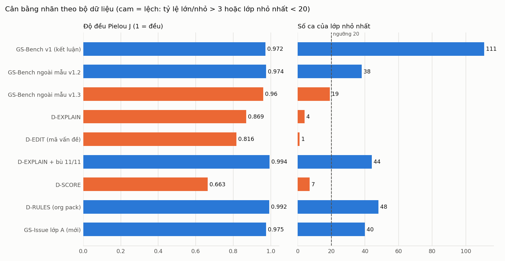
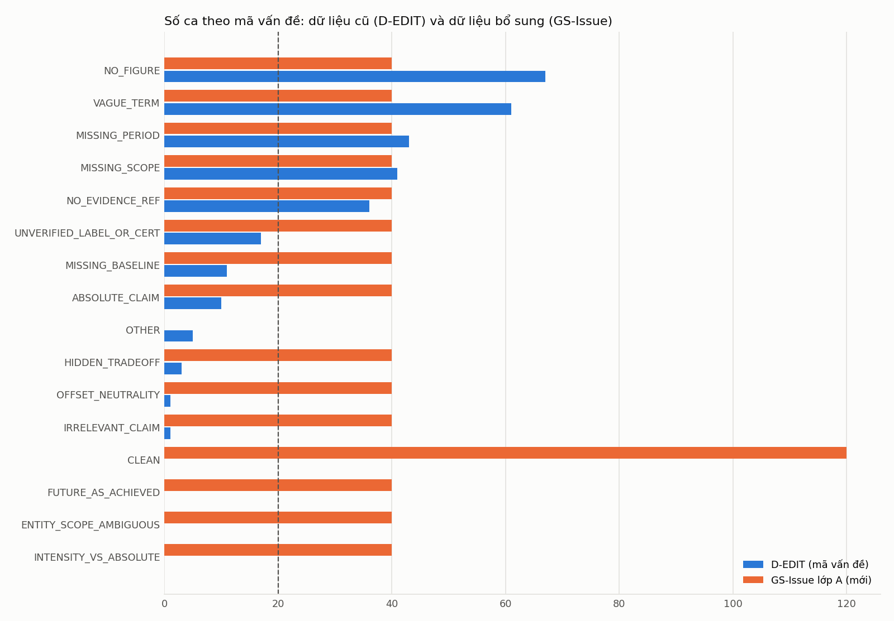

# Thẻ dữ liệu GreenScan (11/11/2026)

> **Kết quả này là tín hiệu rủi ro dựa trên thông tin công khai, hỗ trợ người hành nghề đảm bảo khoanh vùng kiểm tra — không thay thế thủ tục thu thập bằng chứng theo ISSA 5000.**

Thư mục này chứa toàn bộ dữ liệu đánh giá mà GreenScan dùng để đo, cùng các chuẩn mực tham chiếu. Mỗi bộ ghi rõ loại nhãn: **đáp án dựng sẵn** (lỗi do nhóm cấy vào nên biết chắc), **nhãn Claude** (do mô hình Claude gán theo hướng dẫn gán nhãn), **nhãn bạc** (hai mô hình cùng gán) hoặc **nhãn người**.

## 1. Nội dung thư mục

| Thư mục | Nội dung |
|---|---|
| `bo-du-lieu/gs_bench_v1/` | GS-Bench: 453 ca kết luận khớp / mâu thuẫn / chưa đủ, 162 ca ngoài mẫu (v1.2) và 87 ca ngoài mẫu đã làm sạch (v1.3); `stats.json` |
| `bo-du-lieu/gs_eval_v2/` | GS-Eval v2: câu thật của 8 doanh nghiệp, nhãn cho kết luận và lời giải thích (`explain/`), điểm rủi ro (`score/`), đề xuất sửa (`edit/`); `LABELING_GUIDE.md` là hướng dẫn gán nhãn |
| `bo-du-lieu/gs_issue/` | GS-Issue: lớp A (740 ca đột biến có đáp án), lớp B (1 437 câu thật), phần bù cho lời giải thích và cặp câu song sinh |
| `bo-du-lieu/gold_nguoi/` | Bộ phiếu gán nhãn cho người (ứng viên đã dựng, đang chờ gán) và quy ước gán nhãn |
| `chuan-muc-iaasb/` | ISSA 5000 chính thức, Cơ sở kết luận, bộ báo cáo minh hoạ (11/2025), FAQ về trọng yếu, Hướng dẫn thực hiện (PDF của IAASB, kèm mã băm SHA-256 trong `README.md`); nhãn 12 báo cáo minh hoạ; danh mục 16 yếu tố báo cáo đảm bảo; 6 mẫu câu kết luận |
| `hinh/` | Biểu đồ cân bằng nhãn và phân bố mã vấn đề |

## 2. Các bộ dữ liệu và độ cân bằng

"Lệch" nghĩa là tỷ lệ giữa lớp lớn nhất và lớp nhỏ nhất (IR) vượt 3, hoặc lớp nhỏ nhất dưới 20 ca. Bộ nào lệch đều đã được bù và ghi rõ cách bù.

| Bộ | Dùng để đo | n | Phân bố nhãn | IR | Loại nhãn | Tình trạng |
|---|---|---|---|---|---|---|
| GS-Bench v1 | kết luận | 453 | chưa đủ 200, mâu thuẫn 138, khớp 111 | 1,8 | đáp án dựng + Claude | cân bằng |
| GS-Bench ngoài mẫu v1.2 | như trên, doanh nghiệp mới | 162 | chưa đủ 69, mâu thuẫn 55, khớp 38 | 1,8 | Claude + mô hình 32B | cân bằng; tập ngoài mẫu chính |
| GS-Bench ngoài mẫu v1.3 | bản đã làm sạch của v1.2 | 87 | chưa đủ 40, mâu thuẫn 28, khớp 19 | 2,1 | như trên | dùng làm phụ |
| Lời giải thích (D-EXPLAIN) + phần bù | lời giải thích | 285 | khớp 60, mâu thuẫn 54, … | 1,5 | Claude + nhãn GS-Bench | cân bằng sau bù |
| Đề xuất sửa (D-EDIT) | mã vấn đề và gợi ý sửa | 200 | 12 mã | — | Claude | bù bằng GS-Issue |
| GS-Issue lớp A | tìm lỗ hổng và đề xuất sửa | 740 | 14 mã × 40, 120 câu sạch, 60 ca hai lỗi | 3,0 | đáp án dựng sẵn | cân bằng |
| GS-Issue lớp B | như trên, câu thật | 1 437 | — | — | nhãn bạc | dùng để đối chiếu |
| Điểm rủi ro (D-SCORE) + 80 cặp song sinh | chấm rủi ro | 200 + 80 | thấp 138, trung bình 55, cao 7 | — | hai lượt Claude + phân xử | đã bù bằng cặp song sinh |
| Quy tắc nội bộ (D-RULES) | quy tắc của tổ chức | 237 | vi phạm 72, tuân thủ 60, cần soát 57, không áp dụng 48 | 1,5 | ca dựng | cân bằng |
| Báo cáo minh hoạ ISSA 5000 | mẫu câu kết luận đảm bảo | 12 | không sửa đổi 8, ngoại trừ 2, từ chối 1, trái ngược 1 | — | lấy từ tiêu đề IAASB đặt | chờ hai người soát |

## 3. Nguồn gốc, quyền và riêng tư

- Câu thật lấy từ báo cáo phát triển bền vững và báo cáo thường niên đã công bố của doanh nghiệp niêm yết (HPG, PAN, CTD, SAB, DHG, TRA, PNJ, …) và từ hồ sơ vụ việc công khai (KLM, BNY Mellon, DWS, Keurig Dr Pepper). Không có dữ liệu cá nhân.
- GS-Issue lớp A và các cặp song sinh dùng tên doanh nghiệp, nhà máy, đơn vị đảm bảo và tổ chức chứng nhận **hư cấu**; không câu nào gán thành tích hay lỗi cho một doanh nghiệp có thật.
- Tài liệu IAASB thuộc bản quyền IAASB/IFAC, tải từ iaasb.org, chỉ dùng để tham chiếu.

## 4. Dữ liệu gốc không nằm trong thư mục này

Các kho lớn được dùng để dựng các bộ trên được giữ ở máy của nhóm và có thể cung cấp khi được yêu cầu:

| Kho | Cỡ | Nội dung |
|---|---|---|
| Kho báo cáo doanh nghiệp đã thu thập | khoảng 4,1 GB | báo cáo thường niên, báo cáo phát triển bền vững tải từ trang công bố thông tin |
| Văn bản pháp luật | khoảng 188 MB | bản ký từ datafiles.chinhphu.vn, danh mục và trích điều khoản |
| Hồ sơ vụ việc | khoảng 1,4 GB | hồ sơ công khai của các vụ việc đã có phán quyết |
| Ca thật | khoảng 46 MB | gói bốn ca đã có phán quyết và hai đối chứng Việt Nam |

## 5. Giới hạn đã biết

1. **Nhãn chưa qua người.** Số trên các bộ nhãn Claude và nhãn bạc là nhãn máy. Chỉ GS-Issue lớp A có đáp án chắc chắn. Bộ phiếu gán nhãn người đã dựng xong.
2. **Lớp A là ca kiểm soát.** Câu theo mẫu dễ hơn câu thật; điểm cao trên lớp A là điều kiện cần.
3. **Lớp B dùng nhãn bạc từ Qwen3-14B và Qwen3-32B**, nên không chấm hai mô hình này trên lớp B.
4. **Kho câu thật nghiêng về HPG** (40%). Lớp B đặt trần theo doanh nghiệp, và mọi khoảng tin cậy bootstrap đều tính theo doanh nghiệp.
5. **Bộ trích bỏ sót một số câu đứng một mình**, tập trung ở chỉ số nhiên liệu hoá thạch và lượng nước tiêu thụ; các số liên quan chỉ tính trên câu đã được trích và phần bị bỏ được báo riêng.
